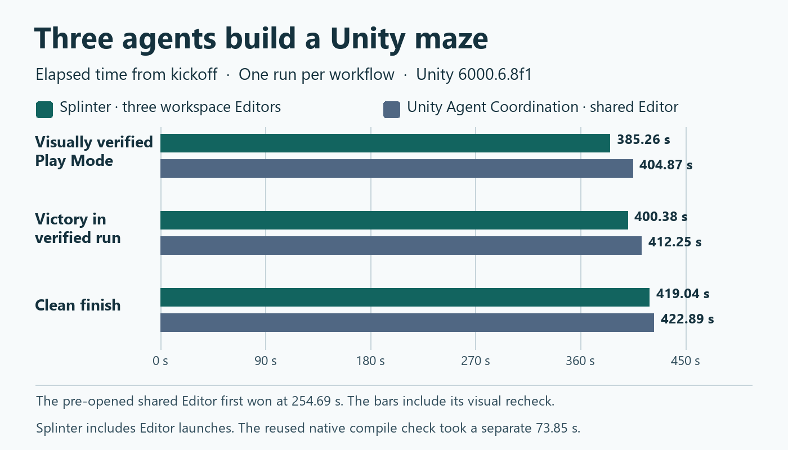

# Splinter

**프로젝트 복사 없이 Windows에서 병렬 개발과 다중 Unity Editor를 실행하는 독립 작업공간**

[English](README.md) · [문서 목차](docs/README.md) · [빠른 시작](#빠른-시작) · [벤치마크](#unity-미로-벤치마크)

여러 AI 코딩 에이전트나 병렬 작업을 동시에 돌리는 방식은 가벼운 코드베이스에서는 잘 작동하지만, 규모가 큰 로컬 프로젝트—특히 **Unity**—에서는 금세 한계에 부딪힙니다. 하나의 Unity Editor를 공유하면 스크립트 컴파일, 도메인 리로드, Play Mode 실행마다 모든 작업이 차례를 기다려야 합니다. 그렇다고 작업마다 수 GB짜리 프로젝트와 `Library` 캐시를 통째로 복사하면 디스크 공간이 빠르게 소모되고 매번 느린 리임포트 비용을 치르게 됩니다. Unity Version Control(Plastic SCM)을 쓰거나 버전 관리가 없는 일반 폴더 프로젝트라면 `git worktree`조차 선택할 수 없습니다.

**Splinter**는 프로젝트 전체를 복제하지 않고도 Windows(NTFS) 위에서 작업마다 쓰기 가능한 독립 경로를—Unity 프로젝트라면 각자 실행할 수 있는 전용 Editor까지—제공합니다. WinFsp 오버레이 파일 시스템을 기반으로, 변경되지 않은 파일은 공유되는 불변 기준본(basis)에서 읽고 수정된 바이트 범위만 작업별로 따로 저장합니다. 한 에이전트가 Play Mode에서 씬을 검증하는 동안 다른 에이전트는 프리팹을 편집하거나 스크립트를 다시 컴파일할 수 있으며, 원본 프로젝트는 제자리에 유지된 채 언제든 직접 편집할 수 있습니다. 모든 결과는 검토를 거친 뒤 명시적으로 반영하거나 폐기합니다.

## 주요 특징

- **전체 복사 없는 즉시 작업공간 생성:** WinFsp를 통해 고정된 프로젝트 기준본과 작업별 바이트 범위 변경분을 하나의 트리로 마운트합니다. 초기 전체 복사, 읽기 파일의 로컬 캐싱, 부분 수정 시 파일 전체 복사(copy-up)를 수행하지 않습니다.
- **공유 `Library` 기반 병렬 Unity Editor:** 작업공간마다 독립된 Unity Editor를 실행해 임포트·컴파일·Play Mode 경합 없이 작업할 수 있습니다. 같은 NTFS 볼륨에서 미리 준비한 `Library` 기준본을 공유해 변경되지 않은 임포트 데이터를 재사용하고, 작업이 끝나면 깔끔하게 원래 상태로 복원합니다.
- **Git, Plastic SCM, 일반 폴더 모두 지원:** 깨끗한 Git 커밋(`git-snapshot`), 기록된 Unity Version Control / Plastic SCM 변경 집합(`plastic-snapshot`), 버전 관리가 없는 폴더(`project-snapshot`)를 모두 지원합니다. VSS를 요구하거나 원본 체크아웃을 임의로 변경하지 않습니다.
- **작업 재개와 작업공간 간 선택적 가져오기:** 고정된 작업 키(`--key`)로 대화가 바뀌어도 같은 작업공간을 그대로 이어서 사용할 수 있습니다. 작업 도중 언제든 체크포인트를 남기고 계속 편집할 수 있으며, Git 커밋이나 Plastic 체크인 없이도 다른 작업공간에서 [전체 변경 또는 선택한 경로만 직접 가져올 수 있습니다](docs/workspace-import.md).
- **명시적이고 안전한 수명주기:** 대화가 끝나거나 Editor가 닫히거나 타임아웃이 발생해도 결과를 자동으로 병합하거나 삭제하지 않습니다. 충돌 검증이 포함된 반영 계획을 확인한 뒤 원본에 적용하거나, 결과를 보존한 채 작업공간만 회수하거나, 실패한 실험을 명시적으로 폐기할 수 있습니다.
- **에이전트 친화적 CLI와 도구 독립성:** 탐색 가능한 JSON Schema(`capabilities`, `schema <command>`)와 구조화된 JSON 응답을 제공하는 비대화형 CLI입니다. 기존 파일 편집 도구, Git 워크플로, Unity CLI, MCP 도구를 그대로 함께 사용할 수 있습니다.

## Unity 미로 벤치마크

독립 작업공간 방식과 단일 공유 Editor 대기 방식을 비교하기 위해, 세 에이전트가 웜 상태의 Unity `6000.6.8f1` 프로젝트(`Library` 파일 24,246개, `1.22 GB`)에서 플레이 가능한 100×100 미로 게임(World 생성 및 A* 경로 탐색, Actors 이동·전투, Presentation/UI 구현 후 씬 통합)을 제작하고 검증했습니다.

- **Unity Agent Coordination**은 이미 열려 있는 단일 Editor 한 대를 세 에이전트가 FIFO 순서로 번갈아 사용했습니다.
- **Splinter**는 Editor가 꺼진 상태에서 시작해 공유 `Library`를 준비하고, 독립 Editor 세 대를 병렬로 기동한 뒤 검토한 결과를 원본에 반영하고, `Library`를 복원해 원본 Editor에서 통합 게임을 검증했습니다. 작업공간 생성 시 초기 페이로드 복사는 **0바이트**였습니다.



| 기준 시점 (시작 기준) | Splinter (독립 Editor 3대) | Unity Agent Coordination (공유 Editor 1대) |
| --- | ---: | ---: |
| 시각 검증된 Play Mode 도달 | **6분 25.26초** (`385.26 s`) | 6분 44.87초 (`404.87 s`) |
| 검증 실행 승리 완료 | **6분 40.38초** (`400.38 s`) | 6분 52.25초 (`412.25 s`) |
| 전체 정리 완료 (모든 Editor 종료 및 회수) | **6분 59.04초** (`419.04 s`) | 7분 02.89초 (`422.89 s`) |

작업공간 준비, Editor 3대 기동, `Library` 복원, 최종 통합 검증까지 모두 측정 시간에 포함했는데도, Splinter는 미리 켜 둔 공유 Editor와 비슷한 전체 시간 안에 작업을 마쳤습니다. 그러면서도 각 에이전트가 작업 내내 독립적으로 컴파일하고 Play Mode를 실행할 수 있었습니다.

> **측정 조건 및 참고 사항:** 단일 머신·방식당 1회 측정 결과이므로 3.85초의 차이를 일반적인 속도 우위로 해석해서는 안 됩니다. 공유 Editor는 두 번째 통합 및 시각 재검증 이전에 이미 4분 14.69초 시점에 첫 승리를 기록했습니다. Splinter는 공통 입력에 대한 일회성 네이티브 컴파일 검증을 재사용했으며, 이 73.85초를 포함하면 전체 정리 시간은 **8분 12.89초**입니다(벤치마크 픽스처 복사·준비 시간은 양쪽 모두 제외). 자세한 내용은 [측정 방법, 시작 조건 및 원시 수치](docs/verification/parallel-workspace-performance.md)를 참고하세요.

## 동작 방식

Splinter는 불변 **프로젝트 기준본(basis)** 과 **작업별 변경 저장소(delta store)** 를 결합해 **WinFsp** 기반의 단일 쓰기 가능 디렉터리 트리로 제공합니다. Git/Plastic 기반 Unity 작업공간에서는 소스 경로(`Assets`, `Packages`, `ProjectSettings` 등)에 내구성 있는 범위 저널을 사용하고, 스냅샷에 추적되지 않는 생성 경로(`Library`, `Temp`, `Logs` 등)에는 경량 임시 오버레이를 적용해 격리를 유지하면서도 일회성 빌드 산출물의 불필요한 쓰기 부하를 줄입니다.

1. **생성 또는 재개** — 고정된 `--key`로 작업공간을 만들고 반환된 `data.workspace.path`에서 편집과 명령을 실행합니다. Unity 프로젝트는 필요할 때만 해당 작업공간 전용 Editor를 기동합니다.
2. **체크포인트와 공유** — 작업이나 Editor를 멈추지 않고 언제든 불변 체크포인트를 남길 수 있습니다. 다른 작업공간에서 해당 체크포인트의 [전체 변경 또는 선택한 경로를 가져올 수 있으며](docs/workspace-import.md), 컴파일·Play Mode·테스트·빌드는 기존 도구를 그대로 사용합니다.
3. **명시적 마무리** — 충돌 검사를 거친 계획으로 검토된 결과를 원본에 반영하거나, 독립 결과를 보존한 채 작업공간 자원만 회수하거나, 작업을 명시적으로 폐기합니다.

## 지원 프로젝트 소스

| 프로젝트 소스 | 저장 모드 | 기준본 |
| --- | --- | --- |
| [Git](docs/git-project-basis.md) | `git-snapshot` | 지원 조건을 충족하는 깨끗한 저장소의 고정 로컬 커밋 |
| [Unity Version Control / Plastic SCM](docs/plastic-project-basis.md) | `plastic-snapshot` | 지원되는 설치 클라이언트로 읽는 기록된 변경 집합 |
| [일반 폴더 (VCS 없음)](docs/plain-project-basis.md) | `project-snapshot` | 원본 NTFS 볼륨에서 제자리 준비한 관리형 기준본 |

Git과 Plastic 작업공간에는 별도로 [준비한 Unity `Library` 기준본](docs/git-library-reference.md)을 연결할 수 있습니다. 관리형 프로젝트와 `Library` 준비 과정은 같은 NTFS 볼륨 안에서 기존 데이터를 복사 없이 이동하고 원래 경로에 쓰기 가능한 뷰를 마운트하므로, 원본은 계속 편집할 수 있고 모든 의존 작업이 끝나면 깔끔하게 원래 폴더로 복원됩니다. Unity 프로젝트의 최초 준비와 최종 복원 시에는 원본 Editor에서 저장한 뒤 정상 종료해야 합니다.

## 빠른 시작

### 사전 요구사항

- **NTFS** 볼륨을 사용하는 Windows
- [WinFsp](https://github.com/winfsp/winfsp)
- **PowerShell 7.2 이상** (`pwsh`)
- [`global.json`에 지정된 .NET SDK](global.json)
- 대상 프로젝트에 필요한 Git, Plastic SCM 또는 Unity

### 1. CLI 빌드 및 스키마 확인

Splinter 소스 체크아웃 루트에서 실행합니다.

```powershell
pwsh ./scripts/build.ps1
pwsh ./scripts/splinter.ps1 capabilities
pwsh ./scripts/splinter.ps1 schema workspace.ensure
```

### 2. 작업공간 생성 또는 재개

깨끗한 Git 저장소에 있는 Unity 프로젝트로 독립 작업공간을 만드는 예시입니다. `$workspaceHome`은 원본 프로젝트 바깥의 짧은 NTFS 경로로 지정하세요.

```powershell
$project = 'C:/projects/MyGame'
$workspaceHome = 'C:/sp/mygame'
$base = git -C $project rev-parse HEAD

pwsh ./scripts/splinter.ps1 workspace ensure --project $project --home $workspaceHome `
    --key lighting-pass --source git --application unity --storage git-snapshot --base $base
```

### 3. 반환된 경로에서 작업하기

`workspace ensure`가 성공하면 파일 편집과 도구 실행 대상에 원본 경로 대신 반환된 `data.workspace.path`를 사용합니다. 나중에 작업을 재개할 때는 동일한 `--project`, `--home`, `--key`, `--base`를 그대로 전달하면 됩니다.

다음 단계: [시작 및 종료 안내](docs/agent-start.md) · [Unity Editor 워크플로](docs/alpha-workspaces.md) · [작업공간 간 가져오기](docs/workspace-import.md) · [에이전트 CLI 스킬](skills/splinter/SKILL.md)

## 현재 상태와 범위

Splinter는 **Windows/NTFS용 연구 알파** 단계입니다. 현재 검증은 특정 소규모 워크로드를 중심으로 수행되었으며, 대규모 프로젝트 전체 수명주기, 일반적인 메모리·처리량 개선 보장, OS 및 전원 장애 시 내구성은 아직 검증 범위 밖입니다.

- 실행 중인 각 Unity Editor의 메모리 사용량과 작업공간별 임포트 비용은 여전히 별도로 발생합니다.
- 작업공간 격리는 프로젝트 저장소와 소유 프로세스·자원 수명주기에 한정되며, OS 수준의 보안 샌드박스가 아닙니다.

기본 회귀 테스트, 측정 조건, 남아 있는 검증 항목은 [검증 범위](docs/verification/README.md)에서 확인할 수 있습니다.

## 문서

| 문서 | 내용 |
| --- | --- |
| [문서 목차](docs/README.md) | 저장소, 원본 반영, 복구, 개발 도구 전체 안내 |
| [에이전트 시작 안내](docs/agent-start.md) | 사전 요구사항, 소스별 진입 경로, 전체 작업 흐름 |
| [에이전트 CLI 스킬](skills/splinter/SKILL.md) | AI 에이전트용 명령 탐색, 작업 스케줄링 및 인계 규칙 |
| [기술 구조](docs/ko/foundation.md) | 구성요소, 저장 형식, 소유권 경계 설명 |
| [제품 요구사항](plan.html) | 제품 범위, 수명주기 계약, 수용 기준, 검증 정책 |
| [검증 범위](docs/verification/README.md) | 자동화 검증, 벤치마크 경계, 미완료 자격 검증 항목 |

## 라이선스 및 고지

Splinter의 코드와 문서는 [MIT 라이선스](LICENSE)를 따릅니다. 의존성 버전과 외부 구성요소의 라이선스 조건은 [THIRD_PARTY_NOTICES.md](THIRD_PARTY_NOTICES.md)에 정리되어 있습니다.

**WinFsp - Windows File System Proxy, Copyright (C) Bill Zissimopoulos.** ([WinFsp 소스](https://github.com/winfsp/winfsp))
