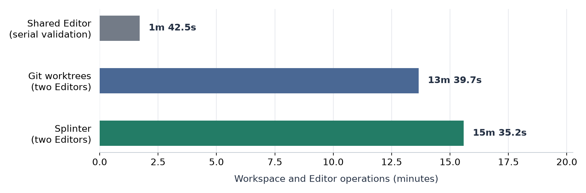
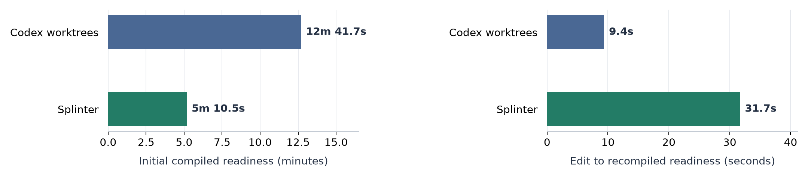
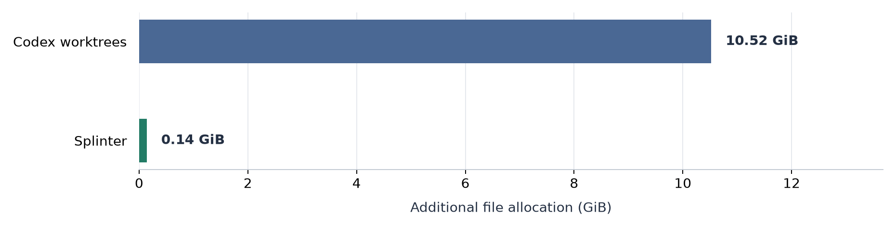

# Splinter

**AI 에이전트의 병렬 개발을 위한 효율적인 독립 작업공간.**

[English](README.md)

Splinter는 AI 에이전트가 Unity 프로젝트나 일반 프로젝트 폴더에서 독립적으로 작업할 수 있도록 돕는 로컬 작업공간·저장 도구입니다. 각 작업에는 별도의 쓰기 가능한 프로젝트 경로를 제공합니다. 변경하지 않은 파일은 고정한 프로젝트 기준본에서 읽고, 편집한 내용은 작업별 비공개 바이트 범위로 저장합니다. 여러 작업을 동시에 진행하면서 원본도 계속 수정할 수 있고, 결과의 보존과 반영은 명시적으로 수행합니다.

**현재 상태:** Windows와 NTFS를 대상으로 하는 내부 알파입니다. 작은 Git·Unity Version Control / Plastic SCM·VCS 없는 프로젝트에서 범위를 정해 검증했습니다. 실제 입력과 지원 한계는 [검증 안내](docs/ko/verification/README.md)를 참고하세요.

## Splinter가 필요한 이유

병렬 개발에서 작업마다 프로젝트 전체와 생성 데이터를 복제하고 독립 애플리케이션을 실행하면 비용이 커집니다. Unity에서는 소스만 분리해도 에셋과 `Library`, 여러 Editor의 부담이 남습니다.

Splinter는 작업이 재사용할 데이터와 변경할 데이터를 분리합니다. 범위 저널을 사용하므로 최초 프로젝트 전체 복제, 읽은 파일을 디스크에 복제하는 캐시, 일부 수정 때문에 기준 파일 전체를 복사하는 처리를 피합니다. 명시적으로 준비한 Library 기준본을 연결하면 변경하지 않은 생성 데이터도 참조하고, 각 작업의 쓰기는 별도로 저장할 수 있습니다.

기본 사용 흐름은 간단합니다. 독립 실행이 필요할 때 작업공간을 만들고, 여러 대화에 걸쳐 같은 작업을 이어간 뒤, 명시적으로 보존·반영·폐기합니다. 에이전트는 Splinter가 반환한 경로에서 기존 파일 도구·Git 도구·애플리케이션 도구로 작업합니다.

<a id="실제-측정한-저장-공간과-시간의-트레이드-오프"></a>
## 실제 측정한 저장 공간과 시간

독립 Unity Editor 두 개가 **추적 파일 1,602개·소스 2.80 GB·기존 Library 3.14 GB**인 프로젝트에서 각각 격리된 C# 한 줄을 수정하고 컴파일했습니다(Windows/NTFS, Unity 6000.3.22f1). **양쪽 모두 A/B를 병렬 실행**했습니다. Codex 작업 경로의 일반 Git 워크트리는 새 Library를 생성하고, Splinter 작업공간은 원본 Library를 참조합니다.

### 전체 작업 시간 비교

같은 작업의 준비·편집·컴파일·결과 보존·소스 결과 합치기·정리까지 **Codex 워크트리 13분 39.7초, Splinter 15분 35.2초**가 걸렸습니다. 이 실행에서 Splinter의 전체 시간은 **14.1% 길었습니다**.

별도로 작성한 A/B 변경을 기존 Editor 하나에서 순차 검증하는 방식은 **1분 42.5초**가 걸렸습니다. 이 [공유 Editor 비교](#병렬-코드-작성과-공유-editor-하나)는 같은 기존 Library와 소스 변경을 사용한 별도 작업 방식입니다.



| A/B 단계 | Codex 워크트리 | Splinter |
| --- | ---: | ---: |
| Library 기준본 준비 | 해당 없음 | 1분 0.2초 |
| A + B 작업공간 생성 | 13.4초 | 2분 48.8초 |
| 두 Editor 시작 → 초기 컴파일 준비 | 12분 41.7초 | 5분 10.5초 |
| 한 줄 수정 → 재컴파일 | 9.4초 | 31.7초 |
| 선택 에셋 확인 | 7.6초 | 1.2초 |
| 두 Editor 정상 종료 | 3.6초 | 1분 56.8초 |
| 결과 보존 + 작업공간 파일 회수 | 23.3초 | 3분 19.5초 |
| A/B 소스 결과 합치기 | 0.7초 | 0.7초 |
| 원본 Library 복원 | 해당 없음 | 45.5초 |
| **전체 과정** | 13분 39.7초 | 15분 35.2초 |

Codex 시간은 앱의 작업 경로에서 병렬 `git worktree add`로 생성한 시간과 Editor 작업부터 결과 보존·`git worktree remove`까지를 포함합니다. Splinter는 Library 준비부터 복원까지입니다. 대화 생성·앱 아카이브·읽기 전용 입력 확인·저장 공간 조사 시간은 제외했습니다. 빈 Codex 작업 폴더 두 개는 삭제하지 못했으며, 작업 파일과 Git 등록은 회수됐습니다. A/B가 겹치는 시간은 한 번만 계산하고 짧은 명령 전달 간격은 포함했습니다. 자세한 범위는 [측정 보고서](docs/ko/verification/unity-current-comparison.md)에 기록했습니다.

두 방식 모두 충돌 없이 A/B를 합친 동일한 Git 결과를 별도로 보존했고 원본 소스는 변경하지 않았습니다. 각 A/B의 컴파일·에셋 확인, 정상 Editor 종료, 소유 작업공간 회수와 원본 Library 복원을 확인했습니다. 합친 결과를 Editor에서 다시 컴파일하거나 Play Mode·Unity 테스트·게임 빌드를 실행하지는 않았습니다.

### 초기 준비와 반복 편집



| 작업공간 생성 이후 A/B 구간 | Codex 워크트리 | Splinter |
| --- | ---: | ---: |
| 초기 컴파일 준비 | 12분 41.7초 | 5분 10.5초 |
| 한 줄 수정 후 재컴파일 | 9.4초 | 31.7초 |

기존 Library를 참조하면 새 작업공간의 임포트 부담을 줄일 수 있지만, 반복 편집의 비용도 함께 고려해야 합니다. 이미 준비된 작업공간을 계속 사용하는 경우와 새 작업공간을 만드는 경우의 비용은 다릅니다. 같은 작업을 이어갈 때는 작업공간을 재사용해 최초 준비·최종 정리 비용을 여러 편집에 나눠 부담할 수 있습니다.

### 저장 공간



**2026-10-14 현재 버전 실측:** 두 수정의 컴파일 완료 시점에 추가 파일 할당은 **Codex 10.52 GiB, Splinter 0.14 GiB로 98.64% 적었습니다**. 작업·제어 파일, 소유 Git 등록, 공유 runner/Library 메타데이터는 한 번만 합산합니다. 원본 소스·원본 Library 본문·공유 Git 객체·파일시스템 디렉터리 메타데이터는 제외하며, 최대 디스크 사용량은 아닙니다.

### 병렬 코드 작성과 공유 Editor 하나

독립 Codex 에이전트 두 개가 별도 코드 워크트리에서 A/B를 준비합니다. Editor 하나가 A를 검증한 뒤 A의 소스를 되돌리면서 B를 적용해 한 번만 새로고침하고, B 검증 후 원본 소스를 복구·재컴파일합니다.

| 측정 구간 | 공유 Editor 하나 | Splinter: Editor 두 개 |
| --- | ---: | ---: |
| 보존·정리를 포함한 작업공간·Editor 작업 합계 | **1분 42.5초** | **15분 35.2초** |
| 작업공간 생성 후 Editor 실행 → 초기 컴파일 준비 | 40.6초 | 5분 10.5초 |
| 두 후보 준비 → 양쪽 컴파일·에셋 확인 완료 | 29.7초 | 32.9초 |

B는 A가 공유 Editor를 반환할 때까지 **16.0초** 기다린 뒤 **13.8초** 동안 검증합니다. Splinter는 이 공유 Editor 대기열을 없애지만, 이번 작은 작업에서는 병렬 검증 자체도 더 오래 걸렸고 준비·정리 비용도 추가됩니다. 이 작업에는 Editor 하나를 재사용하는 편이 빠릅니다.

공유 Editor는 새로 측정했으며, Splinter는 소스·Library 내용과 제품 소스·실행 파일 hash가 같음을 확인한 뒤 RC-01 실측을 재사용했습니다. 합계는 작업공간·Editor 연산 시간이며 AI 추론·에이전트 전달 대기·읽기 전용 입력 확인은 제외합니다. 방식별 한 번의 관측이며 긴 테스트·빌드 실측은 아닙니다. 단계별 시간과 근거는 [SE-01](docs/ko/verification/unity-shared-editor.md)을 참고하세요.

### 짧은 작업과 긴 작업에서의 선택

이미 준비된 Editor에서 끝낼 수 있는 작은 수정이라면 병렬 작업공간의 생성·보존·병합·정리 비용이 더 클 수 있습니다. 독립 실행이 필요하지 않다면 원본에서 바로 작업하는 편이 간단하고 빠를 수 있습니다.

검증에 공유 Editor 하나를 쓰더라도 코드 작성은 병렬로 진행할 수 있습니다. 독립 Editor의 시간 이득은 하나의 Editor를 기다려야 했던 **Editor 작업**—임포트·컴파일·테스트·빌드—을 겹쳐 실행하는 데서 나옵니다. AI 추론이나 코드 작성 시간이 길어지는 것만으로는 이 이득이 생기지 않습니다.

두 후보가 모두 준비된 시점부터, 각각 `E_A`, `E_B`가 걸리는 Editor 작업은 개별 실행 속도가 같다는 가정에서 Editor 하나로 약 `E_A + E_B`, 두 개로 약 `max(E_A, E_B)`가 필요합니다. 겹쳐 실행해 아끼는 `min(E_A, E_B)`가 추가 준비·보존·병합·정리·자원 경쟁 비용보다 커야 합니다. 예를 들어 Editor 작업 두 개가 각각 30분이고 병렬 실행의 추가 비용이 10분이라면 60분 대신 40분이 걸립니다. 이는 실측 손익분기가 아닌 모델이며, 동시 임포트·빌드는 서로 느려질 수 있습니다.

일반 워크트리도 프로젝트 경로와 Library를 분리하면 독립 Unity Editor를 사용할 수 있습니다. Splinter는 소스·Library 중복 저장을 줄이는 도구이며, Editor 두 개를 실행하기 위한 필수 조건은 아닙니다. 프로그램 전체의 단일 인스턴스 제약, 외부 도구의 공유 세션, 독점 GPU·장치 등은 여전히 작업을 직렬화할 수 있습니다. 이번 컴파일·에셋 확인 실측으로 Play Mode·테스트·빌드 병렬 성능을 확정할 수는 없습니다.

자동화한 동일 한 줄 수정으로 작업공간·Unity 비용을 비교했으며 AI 추론·실제 기능 개발 시간은 포함하지 않았습니다. 같은 원본 입력에서 각 방식을 한 번씩 측정했으며 OS 캐시를 비우거나 순서를 무작위화하지 않았습니다. 자세한 조건·원시 근거는 [측정 보고서](docs/ko/verification/unity-current-comparison.md)와 [정확한 데이터](reports/benchmarks/unity-current-comparison-20261014.json)를 참고하세요.

## 동작 원리

**기준본**은 작업을 시작할 때 고정한 데이터입니다. **비공개 저널**은 해당 작업이 바꾼 바이트 범위와 파일 메타데이터를 기록합니다. 두 데이터를 조합한 프로젝트 트리를 쓰기 가능한 WinFsp 파일시스템으로 제공합니다.

```text
고정한 프로젝트 기준본
  + 작업 A의 비공개 변경분  ->  작업공간 A
  + 작업 B의 비공개 변경분  ->  작업공간 B
```

A의 편집은 B의 파일이나 원본을 자동으로 변경하지 않습니다. checkpoint는 안정된 소스를 독립 결과로 보존하고, integrate는 선택한 소스 어댑터의 보호 조건에 따라 그 결과를 반영합니다. release는 결과를 유지하며 해당 작업이 소유한 자원을 회수합니다. discard는 별도의 명시적 폐기입니다.

작업 중에도 원본을 사용할 수 있습니다. 선택적인 관리형 Library 또는 VCS 없는 프로젝트 기준본은 기존 데이터를 같은 NTFS 볼륨에서 복사 없이 이동하고, 원래 경로에 쓰기 가능한 view를 제공합니다. 최초 전환과 최종 복원에는 원본 Editor의 저장과 정상 종료가 필요합니다. 복원은 원본의 현재 내용을 일반 NTFS 디렉터리로 되돌립니다.

## 주요 기능

- **작업별 독립 공간.** 쓰기 가능한 경로·변경분·작업 상태·소유 애플리케이션 프로세스를 분리하고, 원본과 다른 작업을 보호합니다.
- **변경량에 따른 저장.** 불변 데이터 참조, 제한된 크기의 raw/Brotli payload, 저널 정리를 제공합니다. 새 작업은 현재 변경분만 유지하는 저널 최적화를 기본 사용하며, 명시적 정리로 기준본과 다시 같아진 범위도 제거할 수 있습니다.
- **대화 이후에도 이어지는 작업.** 고정한 작업 식별자·원자적 JSON 상태·같은 요청의 복구를 통해 중단이나 응답 유실 뒤 작업을 이어갑니다.
- **독립 결과와 보호 조건을 갖춘 반영.** 소스 checkpoint, Git 결과 통합, 지원하는 일반 폴더·기록된 Plastic 경로의 전체/선택 파일 반영을 제공합니다. 대상 변경이나 충돌은 거부하고 명시적으로 해결하도록 합니다.
- **명시적 자원 소유권.** Unity Editor 시작/종료, provider·mount 추적, 의존성 보호, 자기 자원의 회수·폐기를 관리합니다.
- **에이전트를 위한 인터페이스.** stdout의 단일 JSON 응답, capabilities·명령 schema·구조화된 오류와 저장소에 포함한 [에이전트 스킬](skills/splinter/SKILL.md)을 제공합니다.

Splinter는 작업공간 저장과 자원 수명을 담당합니다. 편집·refresh·컴파일·Play Mode·테스트·빌드·결과 판정은 에이전트와 선택한 도구가 수행합니다. checkpoint는 소스의 안정성을 확인하며, 컴파일·테스트 결과는 외부 도구에서 확인합니다. MCP와 Unity CLI는 에이전트가 필요에 따라 선택하는 외부 연결입니다.

## 저장 방식

소스 종류는 `git`, `plastic`, `none`으로 명시합니다. 실제 프로젝트에 맞는 저장 방식을 선택하고 생성 전에 해당 경로의 전제를 확인하세요.

| 저장 방식 | 프로젝트 기준본 | 준비 조건 |
| --- | --- | --- |
| [`git-snapshot`](docs/ko/git-project-basis.md) | 고정한 로컬 Git commit·tree·blob | 요청 commit과 일치하는 지원 가능한 clean 저장소, WinFsp. VSS 서비스는 필요하지 않습니다. |
| [`plastic-snapshot`](docs/ko/plastic-project-basis.md) | 기록된 고정 Plastic changeset·파일 revision | 검증한 설치 버전의 Plastic client를 통한 읽기 접근, WinFsp. 새 Plastic 작업공간 등록이나 VSS 서비스는 필요하지 않습니다. |
| [`project-snapshot`](docs/ko/plain-project-basis.md) | 생성 데이터를 포함한 VCS 없는 프로젝트의 관리형 기준본 | 명시적 `project prepare`, 같은 NTFS 볼륨 내 이동, 원본 경로의 쓰기 가능한 view. VSS 서비스는 필요하지 않습니다. |
| [`ntfs-snapshot`](docs/ko/ntfs-workspaces.md) | Git·Plastic·VCS 없는 프로젝트의 VSS snapshot | WinFsp, 정확한 project/home identity가 등록된 제한 권한 서비스. |

Git·Plastic 작업에는 명시적으로 준비한 [Library 기준본](docs/ko/git-library-reference.md)을 연결할 수 있습니다. Git commit 기준본은 커밋한 원시 바이트만 포함하고 ignored 파일은 제외합니다. checkout filter·LFS·특수 파일은 해당 경로의 입력 제한을 확인해야 합니다. 기록된 Plastic reader는 현재 client `11.0.16.9915`가 필요합니다.

## 시작하기

현재 Splinter는 소스 checkout에 포함된 PowerShell CLI로 사용합니다. 독립 작업공간을 만들고, 반환된 프로젝트 경로에서 기존 편집·Git·Unity 도구로 작업한 뒤, 결과를 명시적으로 보존·반영·폐기하는 흐름입니다. 같은 작업은 기존 작업공간에서 이어갈 수 있습니다.

필요한 환경은 Windows/NTFS, PowerShell 7.2 이상, [global.json](global.json)에 명시한 .NET SDK, [WinFsp](https://github.com/winfsp/winfsp)입니다. Git·Plastic·Unity는 해당 프로젝트에서 사용할 때 필요하며, `ntfs-snapshot`에는 별도의 [제한 권한 서비스](docs/ko/storage-privilege-service.md)가 필요합니다.

설정과 첫 작업공간 생성은 [시작 안내](docs/ko/agent-start.md)를, Unity 프로젝트의 Editor 사용은 [Unity 사용 안내](docs/ko/alpha-workspaces.md)를 참고하세요. AI 에이전트가 따를 상세 절차는 [에이전트 스킬](skills/splinter/SKILL.md)에 정리되어 있습니다.

## 지원 범위와 한계

현재 구현과 실제 검증은 작은 프로젝트의 Windows/NTFS 알파 사용을 대상으로 합니다. 대형 프로젝트·macOS/Linux 어댑터·포괄적인 ARM 지원·재부팅/전원 손실/일반 OS 장애 보장은 이 자격에 포함되지 않습니다. [검증 안내](docs/ko/verification/README.md)는 자동 계약 시험과 실제 파일시스템·Unity 실행을 구분합니다.

변경하지 않은 데이터를 공유해 저장 구조의 중복을 줄입니다. 각 Unity Editor의 메모리와 import 비용은 여전히 존재하며, 현재 근거로 전체 시스템 RAM이나 디스크 순간 최대 사용량의 일반적인 절감을 주장하지 않습니다. 지원하지 않는 파일 유형과 메타데이터는 저장 경로별 문서에 명시합니다.

Splinter는 CLI와 에이전트 지침을 제공합니다. 전용 설치·대화 자동 연결·작업 스케줄링·자동 모드 선택·원본 Editor 공유·AI 실행 플랫폼은 현재 구현 범위 밖입니다. 작업공간 격리는 저장과 자원 소유권을 보호하며, 신뢰할 수 없는 코드를 실행하는 OS 보안 sandbox는 아닙니다. 지원하지 않거나 손상된 상태는 보존하고 명시적으로 거부하며 자동 이관하지 않습니다.

## 문서

[한국어 문서 지도](docs/ko/README.md)에서 기능별 상세 문서를 찾아볼 수 있습니다. 기본 문서는 영어이며, [영문 문서 지도](docs/README.md)와 각 문서의 언어 링크로 전환할 수 있습니다.

| 문서 | 내용 |
| --- | --- |
| [시작 안내](docs/ko/agent-start.md) | 설정, 첫 작업공간 생성, 작업 이어가기와 마무리 |
| [Unity 사용 안내](docs/ko/alpha-workspaces.md) | 독립 Editor에서 Unity 프로젝트 작업 |
| [용어집](docs/ko/glossary.md) | 기준본, 비공개 변경 범위, 결과 보존과 자원 회수 |
| [구조와 동작](docs/ko/foundation.md) | Splinter를 구성하는 요소와 상호 작용 |
| [검증 범위](docs/ko/verification/README.md) | 검증한 환경, 측정 근거와 지원 한계 |
| [서드파티 고지](THIRD_PARTY_NOTICES.md) | 의존성 출처, 버전과 라이선스 조건 |

## 크레딧

Splinter는 다음 프로젝트와 기여자들의 작업을 사용합니다.

- **[WinFsp](https://github.com/winfsp/winfsp)**: 쓰기 가능한 파일시스템 view와 .NET binding. **WinFsp - Windows File System Proxy, Copyright (C) Bill Zissimopoulos.** GPLv3와 자유·오픈소스 소프트웨어의 linking에 대한 조건부 예외를 적용합니다.
- **[.NET](https://github.com/dotnet/runtime)**·**[System.CommandLine](https://github.com/dotnet/command-line-api)**: 런타임과 CLI 기반. Brotli 압축은 .NET의 `System.IO.Compression` API를 통해 사용합니다.
- **[json-everything](https://github.com/json-everything/json-everything)**: schema 검증과 JSON 처리를 위한 JsonSchema.Net·JsonPointer.Net·Json.More.Net. 소스는 MIT이며, 고정한 NuGet 바이너리에는 별도의 Open Source Maintenance Fee 약정이 포함되어 있습니다.
- **[Humanizer](https://github.com/Humanizr/Humanizer)**: JSON 패키지가 간접 참조하는 MIT 런타임 의존성.
- **[xUnit.net](https://github.com/xunit/xunit)**·**[Microsoft.Testing.Platform](https://github.com/microsoft/testfx)**: 자동 시험과 TRX 보고. 각각 Apache 2.0·MIT를 적용합니다.
- **[Matplotlib](https://matplotlib.org/)**: 선택적인 문서용 스크립트로 기록된 비교 그래프를 렌더링합니다.

설치된 Git·PowerShell·Unity·Plastic 도구에는 각 도구의 라이선스가 적용됩니다. 직접·간접 패키지의 정확한 버전, 원본 라이선스 링크, 표기 조건과 재배포 시 고려사항은 [서드파티 고지](THIRD_PARTY_NOTICES.md)에 정리했습니다.
