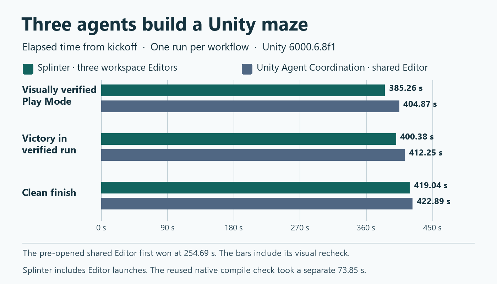

# Splinter

**Isolated workspaces for parallel development and Unity Editors on Windows—without copying your project.**

[한국어](README.ko.md) · [Documentation](docs/README.md) · [Quick start](#quick-start) · [Benchmark](#unity-maze-benchmark)

Running multiple AI coding agents or parallel tasks works well on lightweight codebases, but breaks down quickly on large local projects—especially **Unity**. Sharing a single Unity Editor forces every task to queue behind another task's script compiles, domain reloads, and Play Mode sessions. Duplicating a multi-gigabyte project and its `Library` cache for every task burns disk space and triggers slow re-imports—and if you use Unity Version Control (Plastic SCM) or a plain folder without Git, `git worktree` isn't an option at all.

**Splinter** gives each task its own writable workspace path on Windows/NTFS—and, for Unity projects, its own independent Editor—without copying the project upfront. Backed by a WinFsp overlay filesystem, workspaces read unchanged files from a shared immutable basis and store only their private changed byte ranges. One agent can test a scene in Play Mode while another edits prefabs or recompiles scripts, your original project stays untouched and editable in place, and every result is explicitly reviewed before anything is applied or discarded.

## Why Splinter?

- **Instant workspaces without full copies:** Mounts a fixed project basis with task-private byte-range deltas through WinFsp—no full project clone, no disk cache of read-only files, and no whole-file copy-up when editing part of a file.
- **Parallel Unity Editors with shared `Library`:** Launch an isolated Unity Editor per workspace so tasks never block each other on imports, compiles, or Play Mode. Optionally prepare a warm `Library` basis once on the same NTFS volume so tasks reuse unchanged import data and restore cleanly afterward.
- **Works with Git, Plastic SCM, or plain folders:** Supports clean Git commits (`git-snapshot`), recorded Unity Version Control / Plastic SCM changesets (`plastic-snapshot`), and VCS-free folders (`project-snapshot`) without requiring VSS or mutating your original checkout.
- **Resumable tasks and peer imports:** Resume the exact same workspace across conversations or agent sessions using a stable task key. Checkpoint your work at any point, keep editing, and [import whole changes or selected paths](docs/workspace-import.md) directly into another workspace without committing or checking in.
- **Guarded, explicit lifecycle:** Nothing is silently merged or deleted when an Editor closes, a session ends, or a timer expires. Apply changes back to the original through conflict-checked plans, release workspaces while preserving their results, or explicitly discard failed experiments.
- **Agent-ready CLI, bring your own tools:** Non-interactive CLI with discoverable JSON Schemas (`capabilities`, `schema <command>`) and structured JSON responses. Keep using your existing file tools, Git workflow, Unity CLI, or MCP integrations.

## Unity maze benchmark

To compare isolated workspaces against queuing on a single shared Editor, three agents built and verified a playable 100×100 Unity maze (World generation and A* pathfinding, Actors and combat, and Presentation/UI, followed by scene integration) on a warm Unity `6000.6.8f1` project (`24,246` Library files, `1.22 GB`).

- **Unity Agent Coordination** gave all three agents FIFO turns inside a single pre-opened Editor.
- **Splinter** started from a stopped project, prepared the shared `Library`, launched three isolated Editors in parallel, applied reviewed changes back to the original, restored the `Library`, and verified the integrated game in the original Editor—copying **0 initial payload bytes** per task.



| Milestone (from kickoff) | Splinter (3 isolated Editors) | Unity Agent Coordination (1 shared Editor) |
| --- | ---: | ---: |
| Visually verified Play Mode | **6m 25.26s** (`385.26 s`) | 6m 44.87s (`404.87 s`) |
| Verified victory | **6m 40.38s** (`400.38 s`) | 6m 52.25s (`412.25 s`) |
| Clean finish (all Editors closed & cleaned up) | **6m 59.04s** (`419.04 s`) | 7m 02.89s (`422.89 s`) |

Even with workspace setup, three Editor launches, Library restoration, and final verification included in the clock, Splinter finished alongside the pre-opened shared Editor while giving every agent independent compile and Play Mode access throughout its task.

> **Measurement notes:** Single-machine, single-run measurements—the 3.85 s finish gap is not a general speed claim. The shared Editor had already recorded an earlier victory at 4m 14.69s before its second integration and visual recheck. Splinter reused a one-time native compile check for the common input; charging that 73.85 s check brings clean finish to **8m 12.89s** (fixture copy/setup is outside both clocks). See the [full methodology, starting conditions, and raw data](docs/verification/parallel-workspace-performance.md).

## How it works

Splinter pairs an immutable **project basis** with a **task-private delta store** and exposes both as one writable directory tree over **WinFsp**. For Git and Plastic Unity workspaces, source paths (`Assets`, `Packages`, `ProjectSettings`, etc.) use a durable range journal while untracked generated paths (`Library`, `Temp`, `Logs`, etc.) use a lightweight ephemeral overlay—keeping isolation intact without redundant durability overhead on disposable build artifacts.

1. **Create or resume** — Create a workspace with a stable `--key` and perform all edits and commands inside the returned `data.workspace.path`. Start a dedicated Unity Editor for that workspace only when needed.
2. **Checkpoint and share** — Capture immutable checkpoints at any point without stopping your work or Editor. Another workspace can [import all changes or selected paths](docs/workspace-import.md) from a checkpoint, while each task compiles, runs Play Mode, tests, and builds with its existing tools.
3. **Finish explicitly** — Apply a reviewed, conflict-checked result to the original project, release the workspace while keeping its independent results, or explicitly discard the task.

## Supported project sources

| Project source | Storage mode | Basis |
| --- | --- | --- |
| [Git](docs/git-project-basis.md) | `git-snapshot` | Fixed local commit from a clean, supported repository |
| [Unity Version Control / Plastic SCM](docs/plastic-project-basis.md) | `plastic-snapshot` | Recorded changeset read through a supported installed client |
| [Plain folder (no VCS)](docs/plain-project-basis.md) | `project-snapshot` | Managed basis prepared in place on the original NTFS volume |

Git and Plastic workspaces can also attach a separately [prepared Unity `Library` basis](docs/git-library-reference.md). Managed project and `Library` preparation relocate existing data within the same NTFS volume without copying and expose a writable view at the original path, so the original stays editable and restores cleanly once all dependent tasks finish. For Unity projects, initial preparation and final restoration require saving and closing the original Editor normally.

## Quick start

### Prerequisites

- Windows on an **NTFS** volume
- [WinFsp](https://github.com/winfsp/winfsp)
- **PowerShell 7.2+** (`pwsh`)
- The [.NET SDK pinned in `global.json`](global.json)
- Git, Plastic SCM, or Unity as required by your project

### 1. Build the CLI and inspect schemas

From a source checkout of Splinter:

```powershell
pwsh ./scripts/build.ps1
pwsh ./scripts/splinter.ps1 capabilities
pwsh ./scripts/splinter.ps1 schema workspace.ensure
```

### 2. Create or resume a workspace

This example creates an isolated Unity workspace from a clean Git repository. Place `$workspaceHome` on a short NTFS path outside the original project.

```powershell
$project = 'C:/projects/MyGame'
$workspaceHome = 'C:/sp/mygame'
$base = git -C $project rev-parse HEAD

pwsh ./scripts/splinter.ps1 workspace ensure --project $project --home $workspaceHome `
    --key lighting-pass --source git --application unity --storage git-snapshot --base $base
```

### 3. Work in the returned path

When `workspace ensure` succeeds, use `data.workspace.path` for file edits and tool commands—never substitute the original path. Pass the same `--project`, `--home`, `--key`, and `--base` to resume the workspace later.

Next steps: [Setup & completion guide](docs/agent-start.md) · [Unity Editor workflow](docs/alpha-workspaces.md) · [Cross-workspace imports](docs/workspace-import.md) · [Agent CLI skill](skills/splinter/SKILL.md)

## Status and scope

Splinter is a **Windows/NTFS beta** (research pre-release). Current validation covers specific small workloads; full large-project lifecycles, general memory and throughput gains, and OS/power-loss durability remain outside current qualification.

- Each running Unity Editor still carries its own memory footprint and per-workspace import cost.
- Workspace isolation covers project storage and owned process/resource lifetimes—it is not an OS security sandbox.

See [Validation scope](docs/verification/README.md) for the default regression suite, measured runs, and open qualification items.

## Documentation

| Guide | Contents |
| --- | --- |
| [Documentation map](docs/README.md) | Full index for storage, publication, recovery, and dev tooling |
| [Agent start guide](docs/agent-start.md) | Prerequisites, source paths, and end-to-end workspace workflows |
| [Agent CLI skill](skills/splinter/SKILL.md) | Command discovery, scheduling, and handoff rules for AI agents |
| [Technical architecture](docs/foundation.md) | Component structure, storage formats, and ownership boundaries |
| [Product requirements](plan.html) | Product scope, lifecycle contracts, acceptance criteria, and verification policy |
| [Validation scope](docs/verification/README.md) | Automated checks, benchmark boundaries, and remaining qualification |

## License and attributions

Splinter's code and documentation are licensed under the [MIT License](LICENSE). Dependency versions and upstream license terms are listed in [THIRD_PARTY_NOTICES.md](THIRD_PARTY_NOTICES.md).

**WinFsp - Windows File System Proxy, Copyright (C) Bill Zissimopoulos.** ([WinFsp source](https://github.com/winfsp/winfsp))
