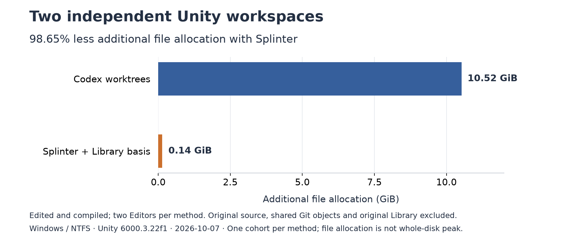
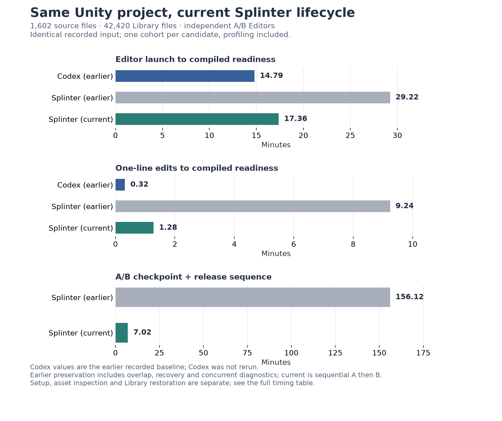
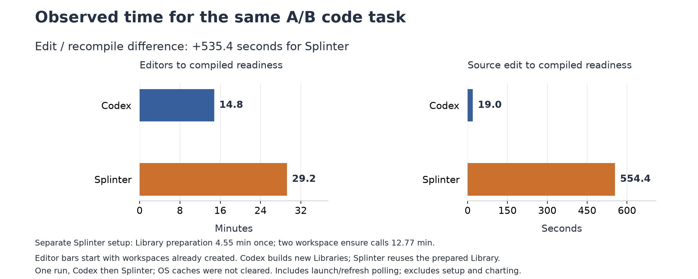
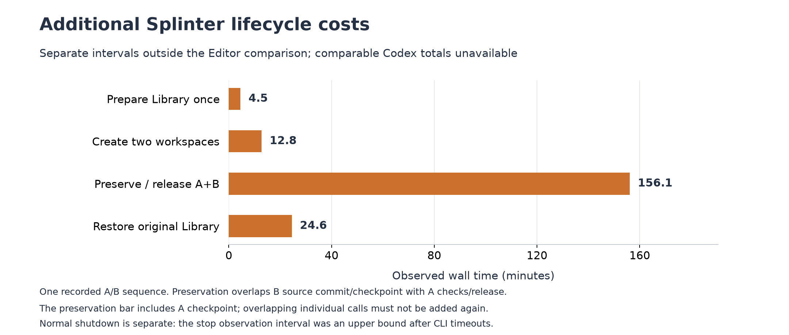

# Splinter

**Efficient, isolated workspaces for parallel AI development.**

[한국어](README.ko.md)

Splinter is a local workspace and storage tool for AI agents working on Unity projects and ordinary project folders. Each task gets its own writable project path, while unchanged files are read from a fixed project basis and edits are stored as private byte ranges. Multiple tasks can work independently, the original project stays editable, and results are preserved or integrated explicitly.

**Current status:** an internal alpha for Windows and NTFS, with bounded validation on small Git, Unity Version Control / Plastic SCM, and VCS-free projects. See the [validation guide](docs/verification/README.md) for the tested inputs and remaining limits.

## Why Splinter

Parallel development becomes expensive when every task needs a complete project copy, its own generated data, and an independent application instance. Unity makes this especially visible: source isolation alone does not address the cost of assets, the `Library` directory, and multiple Editors.

Splinter separates the data a task can reuse from the data it changes. Its range journals avoid an initial full project copy, a disk cache of files merely read, and copying an entire base file just to modify part of it. An explicitly prepared Library basis can also share unchanged generated data while keeping each task's writes private.

The intended workflow is simple: use a workspace when a task needs independent execution, continue that same task across conversations, then explicitly preserve, integrate, or discard it. Each agent works in the path returned by Splinter and can use its existing file tools, Git tools, and application tooling there.

## Measured storage and time tradeoff

We compared two actual Codex app worktrees with two Splinter workspaces on the same Unity project: **1,602 tracked files, about 2.8 GB of source, Unity 6000.3.22f1**. Each method ran two independent Editors and the same isolated A/B code changes. Codex created a new Library per worktree; Splinter used `git-snapshot`, the existing original Library basis, and the default SJL4 journal optimization.

The source work was deliberately minimal: A changed `value + 1` to `value + 2` in one C# file, and B changed `value + value` to `value + value + value` in another. Each result contained one changed line. The preservation/release interval below begins after editing, compilation and Editor shutdown; it is overhead for preserving these small results and reclaiming resources. **The measured delays are performance blockers for interactive development on this input.**



After both edits compiled, additional file allocation was **10.52 GiB for Codex and 0.14 GiB for Splinter: a 98.65% reduction**. This counts task files, owned Git registration, and shared Splinter runner/Library metadata once. Existing original source, Library payload, and shared Git objects are excluded; this is a measured stage, not peak disk usage.

**The same Unity project was remeasured after optimization.** Initial Editor readiness changed from **29m 13s → 17m 22s**, one-line edits to compiled readiness from **9m 14s → 1m 17s**, and A/B checkpoint/release from **2h 36m 7s → 7m 01s**. Current A/B checkpoints take 83.5s / 81.6s; releases take 130.6s / 125.6s.



The complete observed run, including Library preparation and restoration, takes **68m 28s**; final Library restoration alone takes **23m 25s**. Both stop commands exceed their two-minute limit; the same Editors subsequently exit normally and preservation continues. Earlier preservation includes overlap, recovery and concurrent diagnostics; current preservation runs sequentially A then B, so this is not an isolated causal speedup ratio. This is one profiled run. Codex and the allocation numbers above remain historical baselines. See [exact costs, profiling, failures and restoration qualification](docs/verification/unity-lifecycle-remeasurement.md) and the [dataset](reports/benchmarks/unity-lifecycle-remeasurement-20261007.json).

[Subsequent read/restoration optimization](docs/verification/lifecycle-read-optimization.md) adds bounded Git proof reuse, fused seal reads and unchanged Library file restoration with batched progress records. A small NTFS restore comparison averages **8.17s → 4.24s**; the full Unity timings above precede these additional changes.

<details>
<summary>Earlier timings and optimization history</summary>



| Observed A/B cohort time | Codex worktrees | Splinter + Library basis | Splinter difference |
| --- | ---: | ---: | ---: |
| Editor launch to compiled readiness, after workspace creation | 14m 47s | 29m 13s | +14m 26s |
| Code change / refresh to compiled readiness | 19s | 9m 14s | +8m 55s |

**Storage savings came with a substantial time cost in this run.** Splinter also took 4m 33s to prepare the Library basis once and 12m 46s for the two sequential workspace creation calls; these setup costs are separate from the Editor bars. End-to-end Codex task creation time was unavailable and is excluded.

**Result preservation was also slow: A's checkpoint alone took 95m 23s after Editor shutdown**, outside the Editor bars. It exposed repeated full Git attribute checks and journal-inventory observations under the store lock. A later read-only probe of the same 50 paths took 0.23s on ordinary NTFS and 12.83s on Splinter. The [delay diagnosis and lifecycle costs](docs/verification/readme-unity-comparison.md#preservation-delay-diagnosis) separate these findings from the earlier Unity timings; a comparable end-to-end Codex preservation time was not obtained.

[Follow-up profiling](docs/verification/checkpoint-release-profiling.md) reused those records and tiny Editor-free tasks: checkpoint repeated source inspection seven times, release recollected the preserved result, and journal reclamation contained quadratic file-fence lookup. The original product was not optimized in that diagnosis.

[Subsequent lifecycle optimization](docs/verification/checkpoint-release-optimization.md) batches Git attribute queries, removes response-only source scans, reuses unchanged sealed results and indexes reclamation fences. On the same tiny Editor-free workload, checkpoint improved **42.30s → 31.88s (24.65%)** and release **20.66s → 14.54s (29.59%)**. These are small-fixture measurements; the later real Unity rerun is qualified separately as UR-01–04.

[Further optimization CO-05–08](docs/verification/checkpoint-release-optimization.md#final-product-measurement-co-07) combines checkpoint/preservation verification and removes repeated inventory work and fixed request delays. A fresh comparison on the same tiny workload, against the already optimized distribution, measured checkpoint **28.66s → 14.09s (50.84% less)** and release **13.68s → 9.66s (29.39% less)**. The large Unity chart below retains the historical measurement.



The recorded preservation/release sequence took **2h 36m 7s**, including overlapping B work, the retained `WorkspaceBusy` orchestration refusal and recovery, and concurrent diagnostic probes. This includes A's checkpoint above; the intervals must not be added twice. Final Library restoration took **24m 33s**. Both Splinter results were preserved, owned resources reclaimed, the original Library restored, and all 1,602 original source files verified unchanged. These lifecycle bars show the recorded Splinter sequence; comparable Codex totals were unavailable.

This is one cohort per method on Windows/NTFS, run Codex then Splinter without clearing OS caches. It verifies selected compilation, asset loading, and rendering, with no Play Mode, tests, or game build. It does not establish general speed, RAM, or peak storage savings. See the [methodology, exact values, failures, and cleanup qualification](docs/verification/readme-unity-comparison.md), [recorded dataset](reports/benchmarks/unity-workspace-comparison-20261007.json), and [chart renderer](scripts/plot-unity-workspace-comparison.py).

</details>

## How it works

A **basis** is the fixed data from which a workspace starts. A **private journal** records that workspace's changed byte ranges and file metadata. Together, they form the project tree exposed through a writable WinFsp filesystem.

```text
Fixed project basis
  + task A's private changes  ->  workspace A
  + task B's private changes  ->  workspace B
```

Edits in A do not change B's files or silently update the original. A checkpoint preserves a stable, independent source result; integration applies that result through the selected source adapter's guards. Releasing a workspace preserves its result while reclaiming resources owned by that task. Discarding is a separate, explicit operation.

The original remains usable during task work. For the optional managed Library or VCS-free project basis, preparation moves existing data within the same NTFS volume without copying it and exposes a writable view at the original path. Preparation and final restoration require the original Editor to save and stop normally; restoration returns the original's current contents to an ordinary NTFS directory.

## Main capabilities

- **Independent task workspaces.** Separate writable paths, private changes, task state, and owned application processes, with protection for the original and other tasks.
- **Storage that follows changes.** Shared immutable data, bounded raw or Brotli payloads, and journal compaction. New workspaces use the current-state journal optimization by default; explicit compaction can also remove ranges that match the basis again.
- **Work that survives a conversation.** Stable task identities, atomic JSON state, and recovery using the same request after interruption or a lost response.
- **Independent results and guarded integration.** Source checkpoints, Git result integration, and planned full or selected file application for supported plain-folder and recorded Plastic paths. Changed targets and conflicting inputs are rejected for explicit resolution.
- **Explicit resource ownership.** Unity Editor start/stop, provider and mount tracking, dependency guards, and release or discard of the task's own resources.
- **An interface for agents.** One JSON response on stdout, discoverable capabilities, command schemas, structured errors, and a repository-provided [agent skill](skills/splinter/SKILL.md).

Splinter manages workspace storage and resource lifetimes. Agents and their chosen tools perform editing, refresh, compilation, Play Mode, tests, builds, and assessment of the result. A checkpoint establishes source stability; compilation and test results come from those external tools. MCP and Unity CLI are optional integrations selected by the agent.

## Storage options

The source kind is explicit: `git`, `plastic`, or `none`. Choose a storage path for the actual project and read its prerequisites before creating a workspace.

| Storage | Project basis | Preparation |
| --- | --- | --- |
| [`git-snapshot`](docs/git-project-basis.md) | A fixed local Git commit, tree, and blobs | A supported clean repository at the requested commit; WinFsp. No VSS service is required. |
| [`plastic-snapshot`](docs/plastic-project-basis.md) | A fixed recorded Plastic changeset and file revisions | Read access through the qualified installed Plastic client; WinFsp. No new Plastic workspace registration or VSS service is required. |
| [`project-snapshot`](docs/plain-project-basis.md) | A managed basis for a VCS-free project, including its generated data | Explicit `project prepare`, a move within the same NTFS volume, and a writable view at the original path. No VSS service is required. |
| [`ntfs-snapshot`](docs/ntfs-workspaces.md) | A VSS snapshot of a Git, Plastic, or VCS-free project | WinFsp and the restricted storage service with the exact project/home identities registered. |

Git and Plastic tasks can attach an explicitly prepared [Library basis](docs/git-library-reference.md). Git commit bases contain committed raw bytes and exclude ignored files; checkout filters, LFS, and unsupported special files require attention to the route's input restrictions. The recorded Plastic reader currently requires client version `11.0.16.9915`.

## Getting started

The current entry point is a source checkout and the PowerShell CLI wrapper.

### Requirements

- Windows with NTFS for the workspace storage paths above.
- PowerShell 7.2 or later.
- .NET SDK `10.0.112`, or a compatible patch allowed by [global.json](global.json).
- [WinFsp](https://github.com/winfsp/winfsp) for mounted workspaces; the .NET binding is pinned to `2.2.26215`.
- Git for Git sources, or the qualified installed Plastic client for Plastic sources. Unity is needed only when using Unity projects and Editors.
- The [restricted storage service](docs/storage-privilege-service.md) and registered access scope for `ntfs-snapshot` only.

Run from the Splinter repository root:

```powershell
# Locked dependency restore, Release build, and automated tests.
pwsh ./scripts/build.ps1

# Discover the interface before issuing a new command.
pwsh ./scripts/splinter.ps1 capabilities
pwsh ./scripts/splinter.ps1 schema workspace.ensure
```

For a first Git workspace without an Editor, use a supported clean repository whose current HEAD matches the chosen base. Replace these example values with your actual project, existing base branch, and an NTFS home outside the original project and any VCS-managed tree:

```powershell
$project = 'C:/Projects/MyProject'
$workspaceHome = 'C:/Splinter/MyProject'
$taskKey = 'feature-a'
$base = 'development'

pwsh ./scripts/splinter.ps1 doctor --project $project

$reply = (& pwsh ./scripts/splinter.ps1 workspace ensure `
    --project $project --key $taskKey --base $base `
    --source git --application none --storage git-snapshot `
    --home $workspaceHome) | ConvertFrom-Json
$reply
```

Inspect `status`, `error`, and any `nextActions`. Only after the request succeeds and the workspace is ready, use **`data.workspace.path`** as your editing directory and the target for file and application tools. `doctor` is a metadata diagnostic; it does not certify an actual workspace run.

For Unity, choose `--application unity` in the initial request and follow the [agent start guide](docs/agent-start.md) and [Unity workflow](docs/alpha-workspaces.md). Keep ordinary CLI, Git, and Unity processes under normal user permissions. Service installation and basis preparation have their own explicit setup procedures.

### Continuing and finishing a task

Keep the same project, home, key, workspace ID, storage choice, base, and request digest in the conversation or handoff. Resume with the same `workspace ensure` inputs; use one writer per workspace path. Read `schema <command>` before each new command and retain the saved ID and home.

| Intent | Command and behavior |
| --- | --- |
| Continue later | Keep the workspace; use `unity stop` if only the owned Editor should stop. |
| Preserve a result | `workspace checkpoint` collects stable source into an independent result. |
| Apply a result | `workspace integrate` uses the source adapter's target, conflict, and ownership guards. Plain-folder and recorded Plastic application require an explicit plan and fixed intent. |
| Preserve the result and free task resources | `workspace release` requires the independent result and reclaims only owned resources. |
| Abandon a task | `workspace discard` requires the exact task and a fixed discard intent. |

Closing a conversation or Editor does not approve integration, release, or discard. See the [agent guide](docs/agent-start.md), [discard contract](docs/workspace-discard.md), and [glossary](docs/glossary.md) for exact lifecycle and recovery rules.

## Scope and limits

The implementation and recorded validation target Windows/NTFS alpha use with small projects. Large projects, macOS/Linux adapters, comprehensive ARM coverage, and reboot, power-loss, or general OS-failure guarantees remain outside that qualification. The [validation guide](docs/verification/README.md) distinguishes automated contract tests from actual filesystem and Unity runs.

Sharing unchanged data reduces duplication in the storage model. Each Unity Editor still has its own memory and import costs; the current evidence does not establish general reductions in total system RAM or peak disk usage. Unsupported file types and metadata are documented per storage route.

Splinter provides a CLI and agent guidance. Dedicated installation, automatic conversation binding, task scheduling, automatic mode selection, shared-original-Editor orchestration, and an AI execution platform are outside the current implementation. Workspace isolation protects storage and resource ownership; it is not an OS security sandbox for untrusted code. Unsupported or damaged state is preserved and explicitly rejected, without automatic migration.

## Documentation and development

Start with the [documentation map](docs/README.md). English is the default for feature, architecture, plan, and verification documents; [Korean documentation](docs/ko/README.md) is available separately, with a language link on each page.

| Read this | For |
| --- | --- |
| [Agent start guide](docs/agent-start.md) and [agent skill](skills/splinter/SKILL.md) | Prerequisites, returned paths, task resumption, and explicit completion |
| [Glossary](docs/glossary.md) | Basis, private ranges, seals, intents, and lifecycle terms |
| [Current foundation](docs/foundation.md) | Modules, contracts, and the implemented architecture |
| [Product requirements](plan.html) and [implementation plan](docs/plans/implementation-plan.md) | Product goals, ownership boundaries, and remaining work |
| [Validation guide](docs/verification/README.md) | Evidence, tested environments, and support limits |
| [Development CLI](docs/development-cli.md) | Diagnostic checkouts, views, and probes |
| [Third party notices](THIRD_PARTY_NOTICES.md) | Dependency versions, upstream projects, and license conditions |

The code separates common contracts and lifecycle logic (`Core`, `Runtime`, `Protocol`) from source adapters, the Unity application policy, and Windows storage/process implementations. `src/` contains the product, `tests/` its automated tests, `scripts/` the command wrappers and validation tools, and `tools/` development-only utilities.

Use `development` for ordinary development and integration; `main` is the release branch. Run `pwsh ./scripts/build.ps1` for the required checks. Dependency changes must update central versions and the corresponding lockfiles together. The optional sibling `../splinter-unity` is a separate Git/Unity test project, not a submodule or a requirement for CLI discovery.

## Credits

Splinter builds on the work of these projects and their contributors:

- **[WinFsp](https://github.com/winfsp/winfsp)** supplies the writable filesystem views and .NET binding. **WinFsp - Windows File System Proxy, Copyright (C) Bill Zissimopoulos.** Its license is GPLv3 with a conditional exception for linking from free and open source software.
- **[.NET](https://github.com/dotnet/runtime)** and **[System.CommandLine](https://github.com/dotnet/command-line-api)** provide the runtime and CLI infrastructure. Brotli compression is used through .NET's `System.IO.Compression` APIs.
- **[json-everything](https://github.com/json-everything/json-everything)** provides JsonSchema.Net, JsonPointer.Net, and Json.More.Net for schema validation and JSON handling. Its source is MIT-licensed; the pinned NuGet binaries also include an Open Source Maintenance Fee agreement.
- **[Humanizer](https://github.com/Humanizr/Humanizer)** is an indirect runtime dependency of the JSON packages, under the MIT license.
- **[xUnit.net](https://github.com/xunit/xunit)** and **[Microsoft.Testing.Platform](https://github.com/microsoft/testfx)** provide automated testing and TRX reports, under Apache 2.0 and MIT respectively.
- **[Matplotlib](https://matplotlib.org/)** renders the recorded comparison charts through an optional documentation script.

Installed Git, PowerShell, Unity, and Plastic tools retain their own licenses. Exact direct and indirect package versions, upstream license links, attribution conditions, and redistribution considerations are recorded in [Third party notices](THIRD_PARTY_NOTICES.md).
