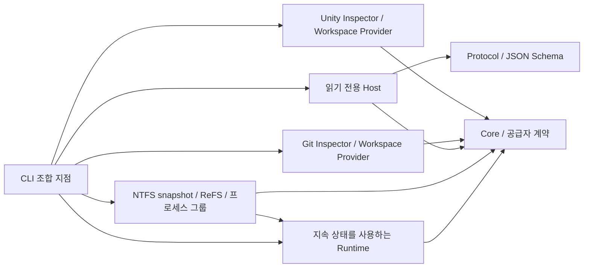

# 현재 기반

> 제품 workspace에 [NTFS snapshot 모드](ntfs-workspaces.md)를 연결했다. 자동 계약/Git/NTFS 메타데이터 시험과 실제 VSS/Unity 통합 자격은 구분하며 [NI 기록](verification/ntfs-workspace-integration.md)을 따른다. SO 독립 실험과 기존 ReFS 성공을 NI 통과로 합산하지 않는다.

Splinter의 현재 실행 범위는 내부 알파의 **기준본 준비/봉인 → 작업공간 생성/재개 → Unity start/refresh/stop → 상태·validation 관찰 → checkpoint/integrate/release**와 계약·진단·계획 검증이다. ReFS CoW와 무-checkout index를 연결하고, Windows 프로세스 그룹의 종료 증거를 회수 조건으로 사용한다. 실제 실행한 조합은 [자원 검증](verification/storage-and-resources.md), 기존 두 Luna low 작업자의 일반 checkout 증거는 [알파 검증](verification/internal-alpha.md)을 따른다. daemon/SQLite Host와 외부 `agent.start`는 미구현이다.

## 구조와 의존성

개발용 `Splinter.ReplayProbe`는 고정 synthetic identity의 작은 저널 생성과 read-only Runtime replay를 제공한다. `OverlayIoMetrics.replayIndexOperations`로 연산별 비용을 구분하고 내용·state/input hash와 관리 메모리 할당을 확인한다. 제품 workspace나 Unity 검증이 아니며 사용법은 [offline replay 계측](replay-profiling.md), 실제 결과는 [RI 기록](verification/replay-index-cost.md)을 따른다.

[불변 검증 후보·고정 view](validation-view.md)는 개발용 `snapshot-spike` 확장이다. Core의 `ValidationCandidate`/`ValidationViewSelection`, Runtime의 읽기 전용 봉인 후보와 분리된 source/cache 저널, Windows의 WinFsp 조합을 사용한다. 제품 workspace coordinator나 기본 실행 모드에는 연결되지 않았다. 후보는 최종 checkpoint와 구별되며 별도 독립 결과 수집이 필요하다. Host의 capability는 `validationViewExperiment.integratedWorkspaceMode=false`로 경계를 표시한다.

공통 Runtime의 `JournalReplayReader`는 저널 replay 읽기를 64KiB 버퍼로 묶고 `OverlayIoMetrics`에 읽기·검증·index 적용 비용을 나눈다. 모든 frame 검증과 acknowledged write flush는 유지한다. Windows client는 같은 launch의 실제 mount와 최신 mounted 상태를 기다리고 provider의 replay 단계만으로 준비 완료를 반환하지 않는다. 범위와 시간의 실제 판단은 [VR 실행](verification/validation-view-readiness-and-replay.md)과 [RI 후보의 작은 Unity 비교](verification/unity-replay-comparison.md)를 따른다. 동일 저널 mount 비교와 Editor 쓰기로 입력이 누적되는 실제 재시작 비교를 구분한다.

NTFS 회수는 Core의 `SnapshotReclamation`으로 실제 해제와 지연을 구분한다. 독립 결과와 자원 정리 후 더 오래된 snapshot 때문에 삭제가 차단되면 Runtime이 `reclaim-pending`을 저장하고 같은 workspace의 명시적 release 재시도로 이어간다. Windows의 `VssSnapshotReclamation`은 boot·owner·요청 ID에 묶인 helper 증거를 검증한다. `SnapshotSharedStorage`는 시각이 있는 source volume 전체 관측이며 workspace별 귀속은 unknown이다. 계약과 자동 회수의 경계는 [NTFS 지연 회수](ntfs-workspaces.md#지연-회수와-명시적-재시도)를 따른다.

[NTFS snapshot 모드](ntfs-workspaces.md)는 Core의 `ISnapshotWorkspaceBackend`/`ISnapshotSourceWorkspaceProvider`를 통해 기존 coordinator에 연결한다. Runtime은 단계·의존성·결과 manifest를 조정하고 Windows 어댑터가 VSS helper·메타데이터 지원 검사·WinFsp·범위 저널을 관리한다. Windows 모듈은 Runtime과 WinFsp.Net을 참조한다. 같은 저널/mount 구현을 사용하는 [독립 실험 명령](snapshot-overlay.md)은 별도 진입점이다.

NTFS 연결은 `VerifyConnectionAsync`에서 현재 부팅·연결 세대의 정확한 live VSS identity를 확인한다. Core의 `SnapshotReadAccess`는 공급자 중립적인 snapshot ID·읽기 root·검증 ID만 전달하며 VSS provider/volume/CIM 정보는 Windows에 남긴다. 불변 SnapshotReference와 delta identity를 변경하지 않고 검증된 현재 읽기 위치로 재개한다. capability의 `snapshotVerification`/`snapshotReadAccess`와 입력·응답 schema가 이 계약을 노출한다. 세부 계약과 미검증 경계는 [NTFS 작업공간](ntfs-workspaces.md#살아-있는-vss-식별과-읽기-위치), 후보별 시험은 [LV 기록](verification/ntfs-live-vss-identity.md)을 따른다.

| 프로젝트 | 현재 책임 | 참조 |
| --- | --- | --- |
| `Splinter.Core` | 탐지·작업공간 VCS/application/storage/process ports, 기준본·자원·검증 기록, DAG 검사, `WorkspaceMountAccess`의 공급자 중립 mount identity 규칙 | .NET 기본 라이브러리 |
| `Splinter.Protocol` | 응답 DTO, 명령 descriptor, 내장 JSON Schema와 검증 | JsonSchema.Net |
| `Splinter.Host` | 읽기 전용 명령 조합과 결과 작성 | Core, Protocol |
| `Splinter.Runtime` | 작업공간 생성·재개·검증·회수 조정, atomic JSON 저장과 작업/저장소 잠금 | Core |
| `Splinter.SourceControl.Git` | 저장소 조회, 실제 worktree 생성·fingerprint·커밋·통합·회수 | Core |
| `Splinter.Application.Unity` | 메타데이터 탐지, 정확한 버전 Editor 실행·활성화·검증 요청·종료 | Core |
| `Splinter.Platform.Windows` | NTFS VSS helper·입력 지원 검사·범위 저널 backend/회수, ReFS 블록 복제, Job Object·WinFsp 제공자 | Core, Runtime, WinFsp.Net; Win32 |
| `Splinter.Cli` | 파싱, 어댑터 조립, Runtime/Host 호출, JSON 응답과 종료 코드 | Runtime, Host, Git/Unity/Windows 어댑터, System.CommandLine |
| `unity/Splinter.Editor` | 작업별 Editor 안에서 refresh·컴파일·domain reload 관측과 종료 요청 처리 | Unity Editor API; 독립 소스 |
| `Splinter.Tests` | 계약, CLI, DAG, fake 공급자, 실제 Git·Windows 자식 회수·선택적 ReFS 시험 | CLI, xUnit v3, MTP |
| `tools/Splinter.ReplayProbe` | 제한된 합성 저널 생성·읽기 전용 replay·출력/hash 검증과 비용 계측 | Runtime; 개발용 console |



Host는 CLI 프로세스의 읽기 전용 라이브러리다. 변경 작업은 별도 Runtime이 Core ports를 통해 어댑터에 위임한다. daemon·SQLite는 없다. Runtime은 CLI가 종료되어도 남는 `workspace.json`, intent/event 기록과 프로세스 간 파일 잠금을 사용하며, Unity 어댑터는 작업별 파일 IPC를 사용한다. 어댑터 객체는 CLI에서 조립한다. 선택적 persistent Host/DB 전환과 현재 구현을 구별한다.

Runtime의 `AtomicFilePublication`은 같은 디렉터리에서 flush한 임시 파일을 기존 상태에는 `File.Replace`, 최초 게시에는 덮어쓰기 없는 `File.Move`로 발행한다. workspace/baseline 저장과 Windows provider 제어 IPC가 사용하며 polling reader는 `FileShare.Delete`를 허용한다. VSS helper의 영수증도 같은 방식을 쓴다. 접근 거부/공유 위반을 목적 파일 선삭제나 속성 변경으로 우회하지 않고 남은 파일을 복구 증거로 보존한다. 이는 제어 파일 게시 방식이며 저널 flush 정책을 변경하지 않는다.

제품 .NET 어셈블리를 Unity 프로젝트에 넣지 않는다. 작은 Editor 브리지 소스를 소유 작업공간의 `Assets/__Splinter__`에 넣으며 원본이나 결과 커밋에는 포함하지 않는다. 비Git·비Unity fake로 Runtime의 기준본·수명주기·검증·프로세스 회수 경계를 시험한다. 각 대화가 workspace CLI를 직접 사용하는 데 별도 조정 AI는 필요하지 않다. 프로젝트용/전역용 설치, 필요성 자동 판단, Codex 대화/파일 경로의 자동 binding, 반영 없는 명시적 discard는 미구현이며 [대화별 계획](plans/session-workflow-and-installation.md)에 있다. 전체 DAG 실행과 agent runner는 선택적 후속이다. 범용 저장소 지원표·장애 복구 적합성도 아직 미완료다.

## 에이전트용 명령 계약

개발 빌드의 실행 접두사는 `pwsh ./scripts/splinter.ps1`이다. 아래 표의 `splinter` 대신 사용한다. 스크립트는 빌드된 CLI를 호출하며 자동 빌드를 하지 않는다.

| 명령 | 입력 | 결과 |
| --- | --- | --- |
| `splinter capabilities` | 없음 | 구현된 명령, 정확한 CLI 사용법, 입력 전달 방식, schema ID, 부작용·재시도 계약, 미구현 기능 |
| `splinter schema <command>` | 예: `plan.validate` | descriptor, 입력 schema, 출력 schema |
| `splinter doctor --project <directory>` | 존재하는 로컬 디렉터리 | Git/Unity 메타데이터, commit 유무, 누락 조건, 미실행 검사 |
| `splinter plan validate --input <plan.json>` | 최대 1 MiB JSON 파일 | 스키마·의존성 오류 또는 실행 가능 계층 |
| `splinter snapshot-spike --input <request.json>` | 명시적으로 준비한 overlay 요청과 action | 독립 실험의 mount/status/Git/Unity/보존/회수; [전용 절차](snapshot-overlay.md) |
| `splinter workspace ensure/list/status` | 프로젝트·작업 key/storage 또는 workspace ID; NTFS journal budget; status의 선택적 `--verify-source`/`--audit-source` | 지속 작업공간 생성/재접속과 snapshot/delta/앱 상태. 일반 poll은 소스 전체 읽기 생략 |
| `splinter workspace compact` | 결과 수집 전 NTFS workspace ID와 선택적 home | 소유 Editor/핸들 0을 확인한 뒤 죽은 범위·연속 기록을 정리, 새 저널 세대를 검증·재연결; 이전 세대는 확인 전까지 보존 |
| `splinter unity start/refresh/stop` | workspace ID | 소유 Editor의 실행·검증 요청·종료 |
| `splinter workspace checkpoint/integrate/release` | ID, 커밋 설명/통합 대상 | 검증한 소스 커밋·원본 적용·안전한 회수 |
| `splinter storage probe` | 후보 home 경로 | ReFS 볼륨·클러스터 geometry, 전체 복사 fallback 없음 |
| `splinter baseline prepare/seal/release` | 프로젝트·기준 ref 또는 준비 ID | 호환 기준본을 우선 재사용해 새 커밋 검증·봉인, 소비 작업 종료 후 명시적 캐시 회수 |

필수 인자와 재개·복구 절차는 [알파 작업공간](alpha-workspaces.md)을 따른다. 입력 schema와 `capabilities`가 기계용 계약이다.

`JournalDeltaStore`의 명시적 오프라인 압축은 Core의 snapshot backend port와 Runtime coordinator를 통해 Windows backend에 연결한다. 후보 저널은 원본 저널을 재생한 살아 있는 범위에서 작성하며 `compaction-intent.json`, checksum, 상태 hash, 전후 seal을 대조한다. coordinator는 `compact-unmount` → `compact-write` → `compact-connect`를 저장하고 같은 작업의 재시도를 허용한다. 선택적 `maxEstimatedJournalOverlapBytes`는 기존/후보 저널 길이 합계를 후보 작성 전에 검사하며, pending 예산을 같은 작업의 재시도까지 저장한다. 새 정리 시도의 stage 비용은 Core `SnapshotCompactionCost`로 응답에 보존하며 scan·후보 쓰기·flush·재생·seal과 재연결·이전 세대 정리를 분리한다. 재연결 뒤 이전 세대를 제거하며 validation은 새로 받아야 한다. [현재 NTFS 계약](ntfs-workspaces.md#일반-cli-흐름), [정리 1차](verification/journal-compaction.md), [Unity 재개·공간 비용](verification/journal-compaction-qualification-and-cost.md), [중첩량 예산](plans/journal-compaction-peak-admission.md)을 따른다.

workspace 응답의 `sourceVerification`은 `not-checked` 또는 `verified`다. 일반 status는 새 pending 검증 응답을 한 번 조정하거나 `--verify-source`를 지정한 경우에만 source를 읽는다. 확인한 응답에는 `source`와 검증 fingerprint 일치 여부인 `validationCurrent`가 있다. 성공 판정은 `workspace.validation.success`도 함께 확인한다. NTFS 결과의 `collectionProtocol=stable-journal-v1`은 수집 전후 저널 동일성을 뜻하며 이전 기록의 재검증·보존 절차는 [NTFS 작업공간](ntfs-workspaces.md#회수와-관측)을 따른다. capabilities의 `workspaceStatus`·`sourceVerification`·`snapshotOverlay.resultCollection`이 계약을 표시한다. NTFS는 정확한 snapshot/provider epoch/소스 변경 경로에 묶인 파일 hash를 재사용하며 같은 크기/mtime을 근거로 성공을 재사용하지 않는다. 감사·손상 manifest 복구는 `--audit-source`다. [소스 검증과 계측](source-verification.md)이 새 Core port·Windows 요청 장벽·Git manifest·개발 할당 계측의 현재 경계를 설명한다.

인자 없는 실행과 `--help`는 capabilities를 반환한다. `plan`만 호출하면 `plan.validate` schema를 반환한다. 기본 출력은 stdout의 JSON 한 줄이다. `--json`과 `--non-interactive`는 기본 동작을 명시한다. `--human`은 동일 응답에 들여쓰기만 추가하며 `--json`과 함께 사용할 수 없다. 현재 명령은 입력 프롬프트를 띄우지 않는다.

공통 envelope는 `schemaVersion`, `requestId`, `command`, `status`, `terminal`, `retryDisposition`, `data` 또는 `error`, `nextActions`다. 비동기 실행·컴파일 접수는 `Accepted`, `terminal=false`이며 완료 증거는 status로 조회한다. `Succeeded`는 해당 명령의 처리가 완료됐다는 뜻이다. 실제 컴파일 성공은 현재 fingerprint와 일치하는 `workspace.validation.success`로 판단한다. `requestId`는 응답 상관관계 ID이며 중복 방지 키가 아니다. ensure의 프로젝트+key가 지속 작업공간을 식별한다.

실패에는 안정된 `error.code`와 설명이 있다. 입력 수정은 `correct-request`, 중지된 조회·Git 조회 타임아웃은 `safe-to-retry`, 권한·Git 설치 문제는 `requires-user-action`으로 분류한다. 가능한 경우 `nextActions`에 다음 명령과 인자를 넣는다. 에이전트는 메시지 문자열보다 코드와 schema를 기준으로 처리한다.

| 종료 코드 | 현재 의미 |
| --- | --- |
| 0 | 명령 처리 성공 |
| 2 | 잘못된 인자·JSON·계획·경로·프로젝트 메타데이터 |
| 3 | 파일 접근 권한 부족 |
| 5 | 내부 오류 또는 Git 조회 실패 |
| 6 | Git 조회 제한 시간 초과 |
| 7 | 사용자/호출자의 조회 취소 |
| 9 | Git 실행 불가 또는 미구현 명령의 schema 요청 |

파싱 오류도 JSON 한 개로 반환한다. `schema`는 구현된 API를 나열한다. `capabilities.unavailable`의 `plan.submit`, `unity.execute`, `unity.play`, `unity.tests`, `agent.start`는 실행할 수 없다. CoW와 자원 회수 계약은 [저장소·자원 관리](storage-and-resources.md)를 따른다. 감시 프로세스는 Editor 작업별로만 존재하며 마지막 소유 프로세스와 함께 종료한다.

### 진단의 의미

실제 workspace의 Git 작업은 대형 에셋 확인·객체 저장을 포함하므로 명령별 10분 제한과 호출자 취소를 사용한다. 제한 초과 시 소유 명령 프로세스를 종료하고 상태·남은 잠금을 보존한다. snapshot attach 재시도는 index 존재만으로 초기 확인을 완료했다고 판단하지 않으며 stat cache를 다시 refresh한다. 아래 진단용 inspector의 제한과 구별한다.

Git 어댑터는 인자 배열과 기계용 출력으로 Git을 호출하고, 상속된 `GIT_*` 환경변수의 다른 저장소 지정을 제거한다. 조회별 제한 시간은 10초다. 최초 커밋이 없는 저장소와 linked worktree를 구분하며 index를 변경하지 않는 조회만 수행한다.

현재 `repositoryId`는 정규화한 Git common directory 경로다. 이동에도 유지되는 영속 제품 ID는 아니다. Unity 탐지는 상위 경로의 Assets, ProjectSettings/ProjectVersion.txt, Packages/manifest.json을 검사한다. Unity 버전이나 패키지를 읽었다는 사실은 해당 Editor가 설치되었거나 실행 가능하다는 보장이 아니다.

`doctor` 성공은 진단 명령이 끝났다는 뜻이다. `readyForExecution`은 항상 false이고, ReFS·Editor·에이전트 인증·Host 복구는 `checksNotRun`에 표시한다. missingPrerequisites가 비어 있어도 실행 준비 완료로 해석하지 않는다.

### 계획 검증의 의미

`contracts/v1/plan-request.schema.json`은 버전, 프로젝트·snapshot·정책 참조, 목표·의존성·예상 경로·검증 조건, 자원 한도와 완료 정책의 형식을 검사한다. `contracts/examples/parallel-plan.json`은 문법 예제이며 그 안의 snapshot·정책·게임 경로는 실제 등록된 항목이 아니다.

Core는 중복 ID, 없는 의존성, 중복 의존성, 순환을 거부한다. 독립 작업은 선언 순서와 관계없이 같은 계층에 놓인다. 계층은 의존성만 계산하며 실행기나 자원 스케줄러가 아니다. 실패한 그래프의 부분 실행 계층은 반환하지 않는다.

성공의 범위는 `schema-and-dependency-graph`다. 정책 승인, snapshot 존재, 실행 capability, 실제 자원 예산은 확인하지 않는다. 입력 경로의 접근 권한·탈출 검사도 실행을 구현할 단계의 별도 책임이다. `readyForExecution`은 항상 false이며 계획 제출이나 실행을 대체하지 않는다.

## 저장소와 브랜치 운영

- 제품 저장소의 `main`은 출시용, `development`는 개발용이다. 일반 개발과 통합은 `development`를 기준으로 하며, 필요한 작업 브랜치도 여기에서 분기한다. 출시할 개발 결과를 `main`에 반영한다.
- 형제 `../splinter-unity`는 Splinter 검증을 위한 독립 fixture다. 이 저장소의 `development`에는 MCP와 재사용할 테스트 기본 설정을 유지한다.
- 에이전트가 시험 목적에 맞춰 Unity fixture의 브랜치·워크트리·시험용 커밋과 미커밋 변경·충돌 등의 상태를 자율적으로 구성하고 관리한다. 재현과 회수를 위해 기준 커밋과 만든 시험 상태를 기록한다.
- Unity 파일이 달라지는 checkout이나 시험 변경 후에는 해당 Editor에 포커스를 맞추고 컴파일·새로고침 완료를 확인한다. Editor 연결과 검증 절차는 Unity 저장소의 `Docs/AI/UnityMcp.md`를 따른다.

## 빌드와 시험

저장소 루트에서 `pwsh ./scripts/build.ps1`을 실행한다. SDK는 global.json, 패키지는 Directory.Packages.props와 프로젝트별 packages.lock.json에 고정한다. 스크립트는 locked restore → 경고를 오류로 처리한 Release 빌드 → 시험 순서로 실행하고, 실패 시 중단한다. 첫 restore에는 nuget.org 접근이 필요하다. 다운로드와 도구 상태는 무시된 `.local/`에 둔다.

.NET 10의 Microsoft.Testing.Platform 모드와 xUnit v3를 사용한다. TRX는 `artifacts/test-results/`에 쓴다. 실행기 선택은 [Microsoft 문서](https://learn.microsoft.com/en-us/dotnet/core/testing/unit-testing-with-dotnet-test), TRX 옵션은 [공식 패키지](https://www.nuget.org/packages/Microsoft.Testing.Extensions.TrxReport/2.4.0)를 따른다.

자동 시험은 JSON/schema·그래프·inspector와 fake 수명주기, 재접속, 검증 hash 불일치 거부, 실제 Git 격리·통합·충돌 보존·긴 경로·부분 삭제 복구, 무-checkout index와 실제 Windows 자식 회수를 다룬다. `SPLINTER_TEST_REFS_ROOT`를 지정하면 실제 대용량 ReFS 블록 복제·할당량·쓰기 격리도 시험하며, 생략하면 그 시험은 Skipped다. 현재 NTFS 후보의 자동/실제 실행 결과는 [NI 검증](verification/ntfs-workspace-integration.md), 기존 ReFS 실행은 [자원 검증](verification/storage-and-resources.md)에 구분해 기록한다. 원격 CI와 Ubuntu 실행 증거는 아직 없다. 실제 GUI Unity 시험은 자동 .NET 시험과 별도로 기록한다.

### 실제 저장소의 Git 수명주기 시험

```powershell
pwsh ./scripts/test-worktree-lifecycle.ps1 -Repository ../splinter-unity
pwsh ./scripts/test-worktree-lifecycle.ps1 -Repository .
```

두 저장소 모두 최초 커밋과 추적된 README.md가 필요하다. 이 스크립트는 제품 명령이 아니라 개발용 통합 시험이며, 지정 저장소의 Git 관리 영역에 임시 branch/worktree를 등록한다.

1. 원본 HEAD·status·staged/unstaged diff hash와 README hash를 기록한다.
2. 정확한 HEAD에서 일반 Git checkout으로 A/B worktree와 별도 index를 만들고 실제 CLI doctor로 확인한다.
3. A의 README를 수정하여 B와 원본이 그대로인지 확인한다.
4. 자기 수정만 복원하고 Git으로 worktree와 임시 branch를 회수한다. 원본 상태와 기존 worktree 등록을 다시 비교한다.

산출물은 `artifacts/worktree-smoke/<runId>/result.json`과 A/B doctor JSON이다. 소유 marker·정확한 경로·reparse·HEAD·dirty/ignored 상태를 검사하며 force remove/reset/clean/prune을 사용하지 않는다. 예상하지 못한 변경은 보존하고 실패를 기록한다. Git hook은 시험 호출에서만 비활성화한다. 외부 프로세스와의 경합·강제 종료 복구까지 보장하는 제품 cleanup 구현은 아니다.

`storageMode=git-checkout`, `unityStarted=false`가 시험 범위를 명시한다. Library를 복제하거나 Editor를 실행하지 않으므로 Git/CoW 결합·캐시·동시 Unity 실행 시험의 통과 근거로 사용할 수 없다. 형제 Unity 저장소는 제품 submodule이 아니며 버전·템플릿·운영 경계는 그 저장소의 Docs/AI/UnityProjectContext.md에서 확인한다.

## 다음 구현 경계

현재 내부 알파의 저장소·프로세스 계약은 [NTFS 작업공간](ntfs-workspaces.md)과 [선택적 ReFS/자원 관리](storage-and-resources.md)에 있다. [NI 검증](verification/ntfs-workspace-integration.md)에서 실제 NTFS 범위 저장·Unity A/B·재연결·결과 보호를 확인했다. 실제 dirty 원본에 대한 통합 거부와 원본/결과 보존, 소유 자원과 VSS 회수까지 확인해 NI-01~08의 1차 내부 알파 범위를 완료했다. 진행 중인 [NR-01~08 계획](plans/ntfs-recovery-and-support.md)은 공통 복구 분류·unknown 관측·상태/저널 손상 보존·파일 속성 거부·현재 부팅과 대조하는 VSS 해제 후 관측을 부분 구현했다. 이전 NR 후보의 로컬과 VIVOBOOK 자동 시험은 모두 139 통과·0 실패·1 ReFS skip이다. 이후 [LV 후보](verification/ntfs-live-vss-identity.md)와 [검토 후 수정 후보](verification/workspace-review-fixes.md)의 실행 증거를 따로 기록한다. VIVOBOOK에서는 실제 mount의 5개 API 거부와 ARM Windows/x64 Unity 단일 작업의 검증 2건·독립 결과 보존·workspace 회수를 확인했다. 상세 범위와 canonical 준비 세션 정리는 [NR 기록](verification/ntfs-recovery.md)을 따른다. 실제 재부팅·전원·공간 장애 및 긴 패키지 경로·파일 지원 경계는 남아 있다. [공개 구현 계획](plans/implementation-plan.md)의 범용 지원표·지속 Host·전력 장애 일반 지원·DAG 실행·agent runner·Play/테스트/저작 기능은 후속 범위다. [PV-01/02의 선택 범위](verification/parallel-workflow.md)는 마감했으며 PV-01은 대표 fixture·복구 포함 완료, PV-02는 제한을 유지한 범위 완료다. 현재 후보의 자동 시험은 [RI 검증](verification/replay-index-cost.md)의 300 통과·0 실패·1 ReFS skip이다. 기존 중첩량 예산의 실행 범위는 [별도 기록](verification/journal-compaction-peak-admission.md)을 유지한다. SF-01 소스 검증과 SF-02 계측을 구현했지만 비소유 VSS 5개 소실이 있던 실행은 FailedPreservation을 유지한다. 후속 제어 JSON 게시 충돌 수정과 격리 VSS의 삭제 연쇄 재현·실제 guard 차단·오래된 순서 회수를 확인했다. 명시적 정리의 작은 Unity 재개·결과 보존도 확인했으나 정리 중 두 세대 겹침으로 전체 추가 공간의 관측 최고치는 증가했다. 임의 순서의 즉시 회수와 일반 비소유 백업 공존 보장은 남아 있다. SF-02 전체·SF-03~06 및 NR/SW 지원 범위는 미완료다. 상태와 다음 명령은 CLI 프로세스 밖에 남으며 대화 종료 시 자동 회수하지 않는다.
