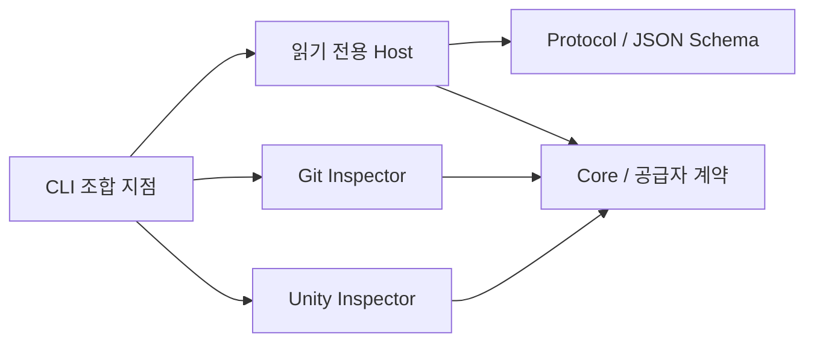

# 현재 기반

Splinter의 현재 실행 범위는 **명령 발견 → 계약 조회 → 저장소 진단 → 계획 검증**이다. 모든 제품 명령은 읽기 전용이며, 작업 실행·환경 생성·원본 적용을 수행하지 않는다. 실제 지원 상태는 `capabilities`가 반환한다.

## 구조와 의존성

| 프로젝트 | 현재 책임 | 참조 |
| --- | --- | --- |
| `Splinter.Core` | 앱/VCS 탐지 ports, DAG 오류 검증과 실행 가능 계층 계산 | .NET 기본 라이브러리 |
| `Splinter.Protocol` | 응답 DTO, 명령 descriptor, 내장 JSON Schema와 검증 | JsonSchema.Net |
| `Splinter.Host` | 읽기 전용 명령 조합과 결과 작성 | Core, Protocol |
| `Splinter.SourceControl.Git` | Git 루트·HEAD·common dir·linked worktree 조회 | Core |
| `Splinter.Application.Unity` | Unity 프로젝트·버전·패키지의 파일 기반 탐지 | Core |
| `Splinter.Cli` | 파싱, 어댑터 조립, 오류를 JSON으로 변환, 종료 코드 | Host, 두 어댑터, System.CommandLine |
| `Splinter.Tests` | 계약, CLI, DAG, fake 공급자와 실제 임시 Git 시험 | CLI, xUnit v3, MTP |



현재 Host는 CLI 프로세스에서 호출하는 라이브러리다. daemon·IPC·SQLite·복구 저널은 아직 없다. 어댑터 객체 조립은 CLI에 있지만 Git 명령과 Unity 파일 해석은 각각의 어댑터가 맡는다. 향후 persistent Host로 옮길 때 조합 지점을 이동하고 CLI에는 transport client만 남긴다.

제품 .NET 어셈블리를 Unity 프로젝트에 넣지 않는다. Unity Editor 브리지는 이후 별도 UPM 패키지로 만든다. 비Git·비Unity fake inspector를 사용하는 Host 시험으로 현재 경계의 공급자 독립성을 확인한다. 이것은 전체 fake 실행 수명주기 시험의 일부만 다룬다.

## 에이전트용 명령 계약

개발 빌드의 실행 접두사는 `dotnet ./src/Splinter.Cli/bin/Release/net10.0/splinter.dll`이다. 아래 표의 `splinter` 대신 사용한다.

| 명령 | 입력 | 결과 |
| --- | --- | --- |
| `splinter capabilities` | 없음 | 구현된 명령, 정확한 CLI 사용법, 입력 전달 방식, schema ID, 부작용·재시도 계약, 미구현 기능 |
| `splinter schema <command>` | 예: `plan.validate` | descriptor, 입력 schema, 출력 schema |
| `splinter doctor --project <directory>` | 존재하는 로컬 디렉터리 | Git/Unity 메타데이터, commit 유무, 누락 조건, 미실행 검사 |
| `splinter plan validate --input <plan.json>` | 최대 1 MiB JSON 파일 | 스키마·의존성 오류 또는 실행 가능 계층 |

인자 없는 실행과 `--help`는 capabilities를 반환한다. `plan`만 호출하면 `plan.validate` schema를 반환한다. 기본 출력은 stdout의 JSON 한 줄이다. `--json`과 `--non-interactive`는 기본 동작을 명시한다. `--human`은 동일 응답에 들여쓰기만 추가하며 `--json`과 함께 사용할 수 없다. 현재 명령은 입력 프롬프트를 띄우지 않는다.

공통 envelope는 `schemaVersion`, `requestId`, `command`, `status`, `terminal`, `retryDisposition`, `data` 또는 `error`, `nextActions`다. 현재 명령은 단기 조회이므로 `status`는 `Succeeded`/`Failed`, `terminal`은 항상 true다. `requestId`는 응답 상관관계 ID이며 중복 실행 방지 키가 아니다. 장기 operation·이벤트·requestKey 계약은 아직 노출하지 않는다.

실패에는 안정된 `error.code`와 설명이 있다. 입력 수정은 `correct-request`, 중지된 조회·Git 조회 타임아웃은 `safe-to-retry`, 권한·Git 설치 문제는 `requires-user-action`으로 분류한다. 가능한 경우 `nextActions`에 다음 명령과 인자를 넣는다. 에이전트는 메시지 문자열보다 코드와 schema를 기준으로 처리한다.

| 종료 코드 | 현재 의미 |
| --- | --- |
| 0 | 명령 처리 성공 |
| 2 | 잘못된 인자·JSON·계획·경로·프로젝트 메타데이터 |
| 3 | 파일 접근 권한 부족 |
| 5 | 내부 오류 또는 Git 조회 실패 |
| 6 | Git 조회 제한 시간 초과 |
| 7 | 사용자/호출자의 조회 취소 |
| 9 | Git 실행 불가 또는 미구현 명령의 schema 요청 |

파싱 오류도 JSON 한 개로 반환한다. 현재 `schema`는 미래 API를 나열하지 않는다. `capabilities.unavailable`에 있는 `plan.submit`, `workspace.create/release`, `storage.cow`, `unity.execute`, `agent.start`는 실행할 수 없다.

### 진단의 의미

Git 어댑터는 인자 배열과 기계용 출력으로 Git을 호출하고, 상속된 `GIT_*` 환경변수의 다른 저장소 지정을 제거한다. 조회별 제한 시간은 10초다. 최초 커밋이 없는 저장소와 linked worktree를 구분하며 index를 변경하지 않는 조회만 수행한다.

현재 `repositoryId`는 정규화한 Git common directory 경로다. 이동에도 유지되는 영속 제품 ID는 아니다. Unity 탐지는 상위 경로의 Assets, ProjectSettings/ProjectVersion.txt, Packages/manifest.json을 검사한다. Unity 버전이나 패키지를 읽었다는 사실은 해당 Editor가 설치되었거나 실행 가능하다는 보장이 아니다.

`doctor` 성공은 진단 명령이 끝났다는 뜻이다. `readyForExecution`은 항상 false이고, ReFS·Editor·에이전트 인증·Host 복구는 `checksNotRun`에 표시한다. missingPrerequisites가 비어 있어도 실행 준비 완료로 해석하지 않는다.

### 계획 검증의 의미

`contracts/v1/plan-request.schema.json`은 버전, 프로젝트·snapshot·정책 참조, 목표·의존성·예상 경로·검증 조건, 자원 한도와 완료 정책의 형식을 검사한다. `contracts/examples/parallel-plan.json`은 문법 예제이며 그 안의 snapshot·정책·게임 경로는 실제 등록된 항목이 아니다.

Core는 중복 ID, 없는 의존성, 중복 의존성, 순환을 거부한다. 독립 작업은 선언 순서와 관계없이 같은 계층에 놓인다. 계층은 의존성만 계산하며 실행기나 자원 스케줄러가 아니다. 실패한 그래프의 부분 실행 계층은 반환하지 않는다.

성공의 범위는 `schema-and-dependency-graph`다. 정책 승인, snapshot 존재, 실행 capability, 실제 자원 예산은 확인하지 않는다. 입력 경로의 접근 권한·탈출 검사도 실행을 구현할 단계의 별도 책임이다. `readyForExecution`은 항상 false이며 계획 제출이나 실행을 대체하지 않는다.

## 빌드와 시험

저장소 루트에서 `pwsh ./scripts/build.ps1`을 실행한다. SDK는 global.json, 패키지는 Directory.Packages.props와 프로젝트별 packages.lock.json에 고정한다. 스크립트는 locked restore → 경고를 오류로 처리한 Release 빌드 → 시험 순서로 실행하고, 실패 시 중단한다. 첫 restore에는 nuget.org 접근이 필요하다. 다운로드와 도구 상태는 무시된 `.local/`에 둔다.

.NET 10의 Microsoft.Testing.Platform 모드와 xUnit v3를 사용한다. TRX는 `artifacts/test-results/`에 쓴다. 실행기 선택은 [Microsoft 문서](https://learn.microsoft.com/en-us/dotnet/core/testing/unit-testing-with-dotnet-test), TRX 옵션은 [공식 패키지](https://www.nuget.org/packages/Microsoft.Testing.Extensions.TrxReport/2.4.0)를 따른다.

현재 시험은 JSON stdout·입출력 schema·허위 실행 준비 방지·그래프 실패·비Git 공급자·Unity 메타데이터·실제 임시 Git 저장소의 staged/unstaged 보존을 다룬다. Windows 로컬 실행이 검증 대상이다. `.github/workflows/ci.yml`에 Windows/Ubuntu 빌드 작업을 두었으며 원격 CI와 Ubuntu 실행 증거는 아직 없다.

### 실제 저장소의 Git 수명주기 시험

```powershell
pwsh ./scripts/test-worktree-lifecycle.ps1 -Repository ../splinter-unity
pwsh ./scripts/test-worktree-lifecycle.ps1 -Repository .
```

두 저장소 모두 최초 커밋과 추적된 README.md가 필요하다. 이 스크립트는 제품 명령이 아니라 개발용 통합 시험이며, 지정 저장소의 Git 관리 영역에 임시 branch/worktree를 등록한다.

1. 원본 HEAD·status·staged/unstaged diff hash와 README hash를 기록한다.
2. 정확한 HEAD에서 일반 Git checkout으로 A/B worktree와 별도 index를 만들고 실제 CLI doctor로 확인한다.
3. A의 README를 수정하여 B와 원본이 그대로인지 확인한다.
4. 자기 수정만 복원하고 Git으로 worktree와 임시 branch를 회수한다. 원본 상태와 기존 worktree 등록을 다시 비교한다.

산출물은 `artifacts/worktree-smoke/<runId>/result.json`과 A/B doctor JSON이다. 소유 marker·정확한 경로·reparse·HEAD·dirty/ignored 상태를 검사하며 force remove/reset/clean/prune을 사용하지 않는다. 예상하지 못한 변경은 보존하고 실패를 기록한다. Git hook은 시험 호출에서만 비활성화한다. 외부 프로세스와의 경합·강제 종료 복구까지 보장하는 제품 cleanup 구현은 아니다.

`storageMode=git-checkout`, `unityStarted=false`가 시험 범위를 명시한다. Library를 복제하거나 Editor를 실행하지 않으므로 Git/CoW 결합·캐시·동시 Unity 실행 시험의 통과 근거로 사용할 수 없다. 형제 Unity 저장소는 제품 submodule이 아니며 버전·템플릿·운영 경계는 그 저장소의 Docs/AI/UnityProjectContext.md에서 확인한다.

## 다음 구현 경계

현재 범위는 F01과 F02의 단기 계약, F03의 DAG 검사 부분이다. 다음 작업은 [계획](plans/implementation-plan.md)의 S1~S4 실제 실험 및 F03~F06의 상태 전이·저널·지속 Host·fake 수명주기다. 생성·실행 API는 소유권과 재시작 복구가 연결되기 전까지 지원 목록에 올리지 않는다.
