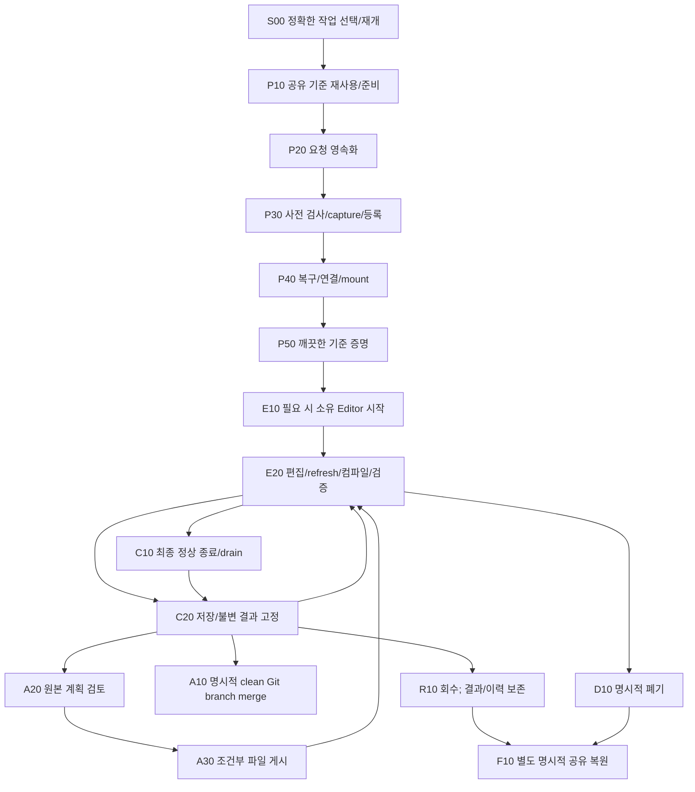
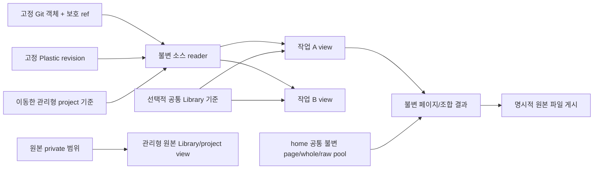
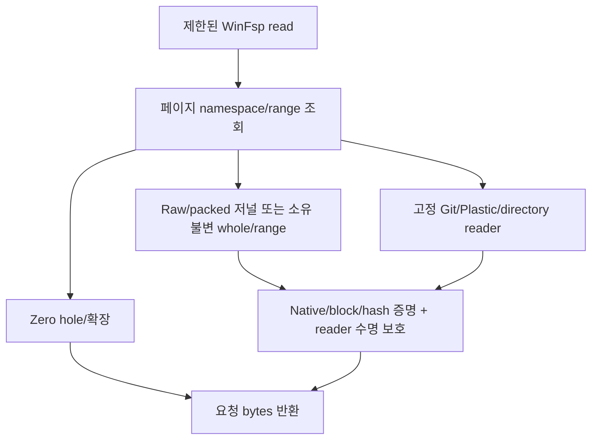
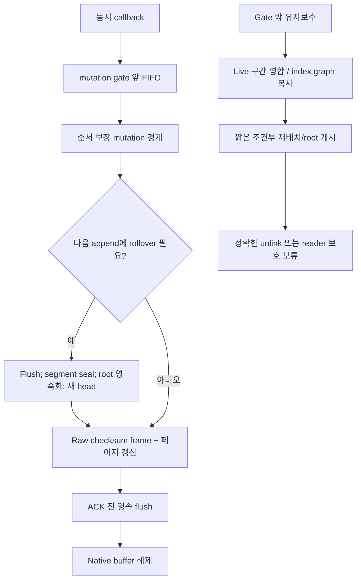
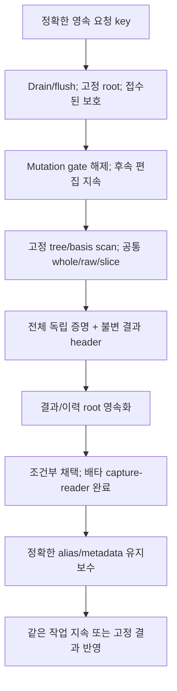
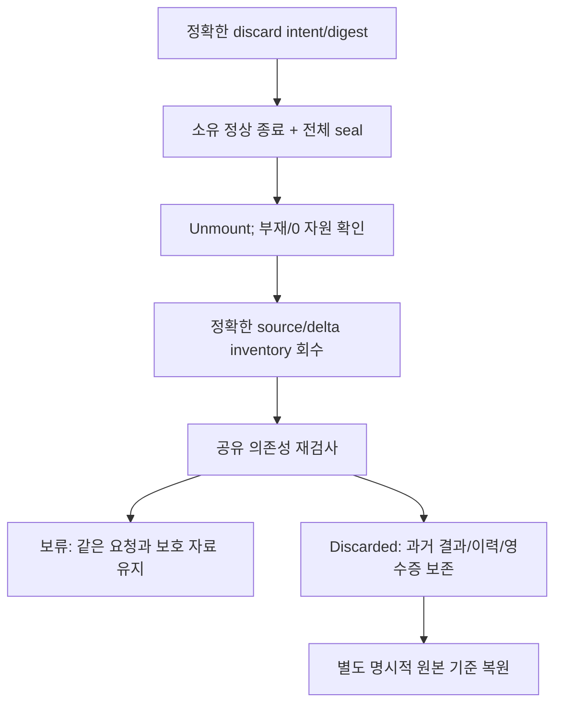

# 최적화 에이전트를 위한 Splinter 수명주기 지도

[ST-56–60](verification/scalable-storage-throughput-followup.md)은 참조 작업공간에 맞게 수집을 바꾼다. 파일 manifest v4는 변경 전후 의존성과 기존 보존 내용만 보관하며, 평탄한 작업 인덱스를 다시 만들지 않고 기존 디렉터리 root를 비교한다. 결과 descriptor는 최대 64개씩 게시하고 수집 중 별칭 정리는 release의 보존 결과 유지관리로 옮긴다. 고정 결과 읽기는 덮이지 않은 기준 범위만 읽고 목록은 검증한 하위 metadata를 재사용한다. 전체 수집/게시 검사와 영속 ACK는 유지한다. 이전 파일 manifest v3는 보존·거부하며 task/basis/overlay·SPM2·명령 필드는 유지한다. 작은 None 근거를 대형/Unity/Plastic 자격으로 승계하지 않는다.

[English](../lifecycle-optimization-map.md) · [기계 판독 색인](../lifecycle-optimization-map.json) · [문서 지도](README.md)

**코드 기준:** `b68eaaa9e7e78930ff7b4b0b368f137bc3e528c6` 위 SCAL working-tree 후보, `development`, 2026-11-01 확인. JSON은 실제 파일 hash와 현재 symbol 위치를 고정한다. 기준 커밋에 미커밋 변경이 포함된 것은 아니다. 소스 hash는 구현을 설명하며 실제 실행 바이너리는 별도의 보존 manifest가 식별한다.

현재 형식은 **task v4 / 관리형 basis v3 / 제품 overlay v3**다. [SCAL-01–08 검증](verification/scalable-storage.md)은 **진행 중**이다. 아래 RI/GCO/MX 등 과거 시간은 당시 후보/입력 범위를 유지한다. 이 지도는 탐색 자료이며 새 실험 실행 승인이나 자격 주장이 아니다.

[ST-01–23 후속](verification/scalable-storage-throughput-followup.md)은 기존 단계 내부 처리를 바꾼다. W10은 resize/metadata callback 최대 64개를 묶고 capture/flush 전에 두 queue를 drain하며 영속 완료 뒤 성공을 반환한다. B10/C20은 relocation/adoption frame과 raw 객체 게시를 묶되 pending intent·전체 native/content proof·reader fence를 유지한다. 인증된 Stop은 접수한 maintenance를 취소하고 drain한다. Canonical reader는 catalog 잠금 안에서 pin하고 밖에서 hash하며 제한된 1MiB 읽기마다 취소를 검사한다. A20은 정렬 계획을 병합하고 선택 집합을 일괄 생성한다. 단계 순서와 결과/회수 의존성은 유지하며 작은 시간 비교는 대형 입력 자격이 아니다.

ST-24–28은 `PagedMetadataBatch`로 W10의 기존 node 탐색 경로를 결합하고, 고정 작업 안의 제한된 C20 내용 증명과 Git catalog 병합 cursor를 공유하며, 동일한 A20 path import 재구축을 생략한다. Root 게시 전에 지연된 페이지를 flush하며 단계 순서와 증명 의존성은 유지한다. 별도 구조적 보고서의 작은 검사 45개와 metadata 비용 수치는 대형 경과 시간 자격이 아니다.

ST-29–35는 W10/C20/A20 내부에 `StorageResources`·`BoundedParallel`을 연결한다. 제한된 삽입/변경 색인 배치·수요 기반 정렬/캐시 예산 확대·목록 metadata 재사용으로 반복 작업을 줄이며, hash를 열거/소비와 겹치고 독립 원본 staging을 디스크 여유 아래 병렬 처리한다. 고정 Plastic revision 읽기는 직렬이다. 전체 대상 잠금·영속 진행 기록·취소/drain·단계 게시 순서는 유지한다. 자원 보고서의 작은 정확성/비용 검사는 실제 CPU/디스크 최대 활용·대형 경과 시간·프로세스 메모리 자격이 아니다.

ST-36–40은 W10의 이름/namespace·Create 배치, A20의 조밀한 이력/보존 부모 병합, A30의 영속 진행 ACK 묶음을 연결한다. B10/R10/F10의 metadata graph 복사는 제한된 정확한 방문/relocation 캐시와 디스크 fallback을 사용한다. Create는 같은 mutation gate 안에서 영속 완료 뒤 핸들을 보존하고 A30 호출자는 그룹의 페이지/제어 저장 성공 전 다음 단계로 가지 않는다. 전체 native/소유 증명과 단계 게시 순서를 유지한다. 새 helper와 작은 64개 검사는 남은 후보 보고서가 소유하며 대형 시간/RSS/전체 gate는 미자격이다.

ST-41–43은 P40의 최초 연결을 client.lock 아래에서 관측하고, workspace 작업 잠금 내부의 연결 요청 및 R10 회수 intent 부재 대기를 제거한다. 불명확한 시작·일반 관측의 게시 유예·최종 수집/전체 seal·정확한 회수 순서는 유지한다. 기존 선택적 결과 diagnostics에 R10 하위 구간 시간을 추가한다. 작은 None 동일 입력 ABBA와 검증 실행 초과 기록은 처리량 후속 문서가 소유하며 큰 입력/전체 gate 근거가 아니다.

ST-49–51은 완료된 SPM2 레코드 변경 뒤의 후속이다. A20은 한 계획 동안 정확한 root/managed lease를 유지하고 target을 다시 읽고 해제한 뒤 가용성/관리 경계를 재검증한다. A30은 여전히 모든 target을 재확보하고 기존 영속 보호 아래 게시한다. C20은 private 범위를 descriptor에 직접 전달하며 생략/기존 descriptor도 검증·adoption을 끝까지 drain한다. 단계 순서·결과·회수 의존성은 바꾸지 않는다. 별도의 작은 None ABBA는 대형 입력이나 과거 몇 시간 실행의 해결 자격이 아니다.

ST-53–55는 C20 내부에서 정확한 전체 flat-tree 피복을 증명한 뒤 adoption 재복사를 피하고, 별칭 정리 전 제한된 메모리/디스크 필수 참조 집합을 완전히 검증한다. 첫 100ms 응답 재조회만 세분화하며 최초/완료/주기적 provider 증명은 유지한다. R10도 같은 보존 결과 정리를 사용한다. 영속 ACK·게시·identity·reader·복구 경계는 완화하지 않는다. 작은 None 시간 근거는 capture-maintenance 보고서가 소유한다.

## 1. 흐름을 결정하는 규칙

- 반환 `data.workspace.path`와 project/key/id/home/base/request identity를 사용한다. 편집·수집·반복 반영 동안 같은 작업을 유지한다.
- 저장·고정 결과·소유 Editor 수명·정확한 회수는 Splinter 책임이다. 저장·refresh/reload·컴파일·동작 판단은 에이전트와 외부 MCP/Unity CLI 책임이다. ready/checkpoint는 컴파일 성공 증명이 아니다.
- 현재 Windows 제품은 SJS1 segment raw SJR2·페이지 metadata를 사용한다. 이전 overlay-v2 bounded/append/SJL4 fixture와 개발 view는 별도이며 구형 상태를 자동 이관·회수하지 않는다.
- 프로젝트 전체 entry/path/result/journal 총량 상한은 없다. 64KiB 논리 페이지·지연 할당하는 프로세스 공통 32MiB metadata cache·최대 8개 독립 파일 worker는 처리 단위다. 실제 파일시스템 제약과 고유한 불변 이력은 저장량·시간을 요구한다.
- 전체 입력/게시 대상 native fence와 핸들 결합 자료는 고정 대상 수에 비례할 수 있다. payload/native/VCS/Editor 메모리·전체 private bytes는 metadata cache와 별도다.
- 최초 전체 복제·읽기 hydration·파일 전체 copy-up은 금지한다. 명시적 독립 결과 보존·원본 게시의 payload 복사는 별도 비용이다. 수정 가능한 원본으로 불변 backing을 대체하지 않는다.
- B10 저장 rollover/유지보수·C20 결과 수집·R10 작업 회수·F10 공유 기준 복원은 출력이 다르다. 대화 종료·timeout·디스크 압박·Editor 종료는 이 작업의 묵시적 승인이 아니다.

## 2. 작업공간 하나의 제어 흐름

Editor 없는 작업은 E10을 생략한다. 중간 C20은 원본/A/B Editor를 유지하고 최종 처리는 C10·전체 seal을 사용한다. `checkpoint --release`는 같은 호출의 새 수집만 공유한다. 독립 release는 현재 소스를 재검사하며 peer가 기준을 사용하면 F10은 보류한다.

## 3. 데이터와 소유 관계

원본 Library/project view는 서로 다른 구성이다. 이후 원본 편집을 A/B로 자동 유입하지 않으며 작업 Library는 소스 결과에서 제외한다. Git 원본 파일 게시는 HEAD/index/branch를 유지하고 branch merge는 별도다. Plastic revision·등록·관리 정보·잠금을 보호하며 check-in/서버 변경을 하지 않는다.

`records/<id>/workspace.json`은 작은 수명/진행 제어와 이력 root를 둔다. `delta/`는 segment/packed backing·페이지 root, `captures/`는 고정 제어/reader/채택 보호, `files/generations/`는 결과 header, `journal-packing/`는 외부 계획·보호 gap, `maintenance/`는 완료 요청을 보존한다. 공통 `metadata-store`·`content-store`·`range-store`는 불변 데이터/참조 인덱스다. 설명용 경로로 삭제 대상을 직접 구성하지 않는다.

## 4. 단계별 계약

### S00 — 선택과 재개

[capabilities/schema·시작점](agent-start.md), [스킬](../../skills/splinter/SKILL.md), 고정 요청 identity를 읽는다 [K00, K24, K44]. 필요/요청 시 격리한다. list/status는 Editor 유휴·컴파일 증명이 아니며 미완료 작업의 정확한 복구 동작을 따른다.

### P10 — 공유 Library/project 기준 준비

정확한 원본 Editor를 외부 도구로 저장·정상 종료하고 기준/의존 보호·준비 intent를 고정한다 [K04, K22, K23]. 이름/metadata를 페이지 catalog로 순차 기록하며 전체 native identity/content fence·제한 hash worker를 유지한다 [K36, K43]. 같은 NTFS 볼륨에서 전체 payload 복제 없이 이동하고 원본 view를 게시한다. 불명확한 이동/소유권은 보존·거부한다. basis v3와 과거 근거를 구분한다.

### P20 — 요청 영속화

source/application/storage/base·home 분리·key를 정규화하고 id/digest를 만들어 작업 잠금 아래 task-v4 intent를 게시한다 [K00, K01]. 같은 키는 고정 필드를 대조한다. 종료한 작업을 새 작업으로 재사용하지 않는다. 미완료 capture/apply/discard/maintenance는 새 mutation을 막지만 정상 stop은 허용한다.

### P30 — 사전 검사, capture, 등록

효과 전후 source-checked/capture/registration 단계를 영속화한다 [K02, K05, K06, K19]. Git은 checkout 없이 보호 ref·관리 자료를 고정하고 Plastic은 고정 changeset 목록과 정확한 regular/static 등록을 검사한다. None은 관리형 project 참조에 결합한다. subprocess catalog·디스크 구성원 검사를 순차 처리하며 다른 소스/수정 가능한 원본으로 fallback하지 않는다 [K42].

### P40 — 복구, 연결, mount

정확한 owner/read access/graft·provider launch를 대조한다 [K05, K07]. SJS1/페이지 root를 열고 checksum active frame을 재생한다. 회수 전 미완료 capture 제어·pin을 복구하고 저장 유지보수는 같은 요청을 재개한다 [K37–K39]. provider PID/start/token·mount·기준 가용성을 관측한다. WinFsp dispatch는 8 thread이며 소유 client가 남으면 provider 부재만으로 재연결하지 않는다.

### P50 — attach, 기준 증명, ready

기준/현재의 깨끗한 일치와 admission을 증명한다 [K02, K06, K19, K42]. Git index refresh·객체·읽기 경계 검사를 유지하며 대형 chunk proof metadata는 디스크로 분할하고 subprocess 전체 출력을 배열로 합치지 않는다. None hash는 최대 8 worker, Plastic은 exact 작은 revision 64개/decoded 4MiB 선행 묶음 아래 직렬이다. ID/segment/길이/MD5·영속 SHA-256 증명을 유지하며 등록/잠금도 순차 처리한다. 최초 editorless 증명은 완전한 metadata/identity/change barrier에 결합한 1회용이고 호출/재시작을 넘겨 재사용하지 않는다. cache 예산은 process RAM 한도가 아니다.

### E10 — 소유 Editor 시작

재사용 가능한 mount와 미완료 guard를 검사하고 관측된 소유 Editor만 재사용한다 [K01, K08, K09, K20]. 고정 결과는 편집·재시작을 막지 않는다. launch 영수증은 project/executable/PID/start/token에 결합한다. 제품 bridge·적격 최초 Library graph 처리는 기존 범위다. refresh/import/로드된 코드 성공은 외부 도구로 검증하며 heartbeat는 별도다. [시작 증거](development-cli.md#bounded-unity-startup-evidence) [K28]는 선택적 제한 관측이다.

### E20 — 편집, refresh, 검증

반환 경로만 편집한다. 외부 응답마다 정확한 project/PID/start를 대조하고 필요한 refresh·로드된 코드/씬/에셋을 검증한다. 목록 누락을 부재로 보거나 불확실한 쓰기를 반복하지 않는다. 이름 없는 dirty 씬·Play/busy/저장 실패·원본/peer 무관 편집을 보존한다. 정상 stop/restart·C20/A20/A30 반복은 같은 task/basis/Library를 유지한다.

### I10 — private, 기준, hole 읽기

전체 객체/chunk/native 증명과 reader close/drain을 유지한다 [K06, K10, K40, K42]. cache hit로 수정 가능한 원본을 대체하거나 검증을 생략하지 않는다. 요청 bytes·decode bytes·실제 장치 읽기·cache 계상은 다르다.

디렉터리 callback은 native packet 사이에 핸들 소유 고정 cursor 하나를 유지한다 [K11, K37]. `ReadDirectory`는 packet 전체를 직렬화하고 `ReadDirectoryEntry`는 다음 marker로 overflow 한 항목을 재전달한다. 재시작/seek·명시적 pattern 변경은 구성원을 새로 고정하고 continuation의 pattern 생략은 유지한다. EOF·Cleanup·Close·오류에서 cursor와 index-reader 보호를 해제한다. 전체 디렉터리를 모으지 않고도 packet마다 전체 정렬·prefix stat을 반복하는 비용을 없앤다. 구성 요소 근거는 실제 256바이트 WinFsp.Net buffer와 생성 이름 10,000개이며 실제 100,000항목 provider 자격과는 구분한다.

### W10 — 순서 보장 쓰기와 flush

한 batch는 최대 64개 범위/16MiB, provider 전송은 최대 1MiB다 [K11–K13]. 큰 callback은 다음 batch로 넘어간다. 단일 쓰기는 성공 전 flush, batch는 외부 접근이 막힌 순서 상태·flush 후 ACK를 유지한다. 불확실한 append는 poison/replay로 복구한다. 같은 private bytes는 payload를 재사용할 수 있고 resize/metadata callback 최대 64개는 별도 순서 batch를 공유하며 SJL4 barrier를 유지한다. Capture/flush는 두 queue를 drain한다. 명시적 flush 재사용은 같은 변경 없는 영속 handle/길이 증명이 필요하다. background writer·조기 ACK를 추가하지 않으며 제한 진단 [K26]은 소스 증명과 별도다. Metadata callback마다 queue 대기와 공유 영속 batch 구간을 기록한다.

### B10 — rollover와 실행 중 저장 유지보수

16MiB/4,096-frame 처리 단위는 유지한 hash/native identity로 seal하고 고정 root·새 head를 영속 게시한다 [K37]. private 상태 전체 prefix를 다시 쓰지 않는다. 고정 제품 저널 예산·2GiB 여유값은 없으며 실제 게시/복구 공간은 검사한다.

고정 디렉터리 cursor가 있으면 비싼 복사/재생 전에 metadata 정리를 미루고 접수한 pending 요청·최종 게시 fence를 유지한다. 프로세스 공통 캐시는 정확한 scope/container 조각만 무효화하며 16개 container 핸들은 검증된 cache hit의 최근 사용까지 명시적 LRU로 관리한다. 조각 색인의 비용도 같은 32MiB 예산에 포함한다. 후보 R16 캐시/정리 50행은 통과했으며 실제 10만 항목 재개와 최종 전체 소스 자격은 별도다.

Live index 복사/tail 재생은 gate 밖에서 수행한 뒤 root를 전환한다 [K38]. 부분 생존 payload는 고정 디스크 계획·물리 구간 병합·최대 16MiB의 연속 target 단위로 재배치한다. 음수 data-only ID는 정상 frame 재생에서 제외한다. 같은 sequence의 조건부 재배치는 file/원래 block/offset을 대조하여 동시 write/truncate/rename을 보존한다. target native/hash fence 뒤만 이전 backing을 unlink한다. 미완료 capture/reader는 이전 backing을 보호하며 busy 삭제는 물리 계상을 남겨 보류한다. 생성 identity gap은 delta 밖에서 보존·페이지 조회한다. 긴 요청 동안 임시 metadata가 늘 수 있으며 bounded cache가 일정한 디스크 사용량을 뜻하지 않는다.

### C10 — 정상 소유 종료와 drain

경로 있는 dirty 씬/에셋은 외부 도구로 저장하고 unnamed/Play/실패는 보존한다. 제품 정상 stop [K08–K09, K20]은 소유 요청과 정확한 process group/자식의 종료를 대조한다. timeout은 강제 종료 승인이 아니다. 최종 처리에는 소유권이 검증된 active process/working/private memory 0과 전체 seal 전 소유 infrastructure 제거가 필요하다. A 최종화 중 원본·다른 작업 Editor를 유지한다.

### C20 — 같은 작업을 유지하는 불변 결과 수집

같은 키는 나중 편집을 다시 수집하지 않고 최초 고정 결과를 반환한다 [K32–K34, K39–K41]. checksum capture-freeze frame/분할 pending index가 외부 header와 pin보다 먼저 보호한다. 회수 전 정확한 잘린/누락 제어를 복구한다. payload/hash/alias 작업은 gate 밖의 제한 worker·실패 drain으로 처리한다. Git은 보호 기준과 조합 파일/범위 결과를 남기며 commit/tree/ref는 명시적 branch 반영까지 미룬다.

Whole/raw pool은 각각 exact 내용을 중복 제거한다. 기존 whole 객체를 새 private chunk에 재사용할 수 있고 최초 header 게시 전에는 전체가 일치하는 소유 raw chunk를 non-Git 기준에 사용할 수 있다. Descriptor codec v3는 raw 기준과 외부 Git 기준을 구분한다. 전체 SHA/길이/소유권/참조 보호를 요구하며 기존 불변 header 재지정·임의 부분 일치는 하지 않는다. 두 pool의 과거 복사본은 남을 수 있다 [K40].

최종 처리는 같은 엔진을 정상 종료 뒤 사용하고 종료 중 쓰기·전체 pre/post/unmount seal을 확인한다. 저장 채택/packing/GC는 논리 accepted-source seal을 유지하며 native backing/hash/page/inventory 증명과 구분한다. 수집은 컴파일 성공 주장이 아니다.

### A10 — 명시적 Git branch merge

선택한 불변 결과를 검증하고 필요한 소유 Git 객체/ref만 구체화한 뒤 clean-target merge를 수행한다 [K18, K34]. 원본 branch/index 청결·소유 abort 보호를 유지한다. Push나 원본 파일 게시의 자동 commit을 포함하지 않는다.

### A20 — 고정 원본 계획

마지막 반영 경로 상태/고정 결과/현재 원본을 대조한다 [K16, K19, K34–K35, K41]. 선택 경로만 상태를 갱신하며 삭제·최초 복귀·Unity metadata 동반 범위를 처리한다. 고정 plan ID/digest·제한 preview를 반환하고 전체 entry/선택/충돌은 페이지로 조회한다 [K44]. Git 관리·Plastic revision/등록/selector/잠금을 유지한다. 실행 중 원본은 외부 저장/소유 deferral/project/PID/start/result/plan 협력을 요구하며 dirty/refresh/reload/컴파일은 외부 책임이다.

### A30 — 조건부 파일 게시

Intent/digest/result/선택/permit을 고정하고 전체 대상·조상을 검사/잠근 뒤 최대 8개의 독립 파일 worker를 사용한다 [K17, K41]. Topology/동반 순서·직렬 영속 진행·실패/취소 drain을 유지한다. 동시 임시 payload 예약은 최대 단일 파일 준비량을 넘지 않는다. 복구 가능한 파일별 게시이며 전체 파일 원자 transaction은 아니다. 완료 요청은 영수증만 반환하고 unknown/replaced stage는 보존·거부한다.

### R10 — 결과를 남기는 작업 회수

모든 보존 결과를 검증하고 A만 정상 종료한 뒤 C20/전체 seal로 최종 소스를 수집한다 [K02, K32]. Unmount 후 정확한 provider/mount/handle 부재를 확인하고 소유 등록·저널 inventory를 회수한다. Delta 제거 뒤 보존 결과 유지보수·강제 동일 요청 metadata 회수를 마친 후 공유 snapshot/dependency를 회수한다 [K38, K40, K44]. 결과/이력/영수증은 남긴다. 보류는 성공이 아니며 원본/B의 별도 승인된 전환 전까지 유지한다.

### D10 — 명시적 폐기

새 독립 결과·컴파일 성공은 필요하지 않다 [K03, K21]. 과거 결과·이미 반영한 원본·peer/shared backing은 보호한다. 무관한 폐기 전에 미완료 mutation/maintenance를 복구하며 정상 stop/seal/소유 guard는 유지한다.

### F10 — 별도 공유 원본 복원

모든 dependent/reader 종료 뒤 정확한 원본 Editor를 외부 도구로 저장·정상 종료한다 [K04, K22–K23]. 소스 packing/회수를 재개하고 stopped seal·native fence를 고정한다. 대량 inventory는 페이지 directory/GUID/range·작은 영속 cursor로 복원하며 unchanged payload는 이동하고 private range를 재생한다 [K43]. 작은 unchanged/sparse/root-delta/topology/general 경로도 각 guard·기존 계획 우선 복구·전체 identity/content/membership/신규 파일 증명을 유지한다. Route 문턱은 처리 구현 선택이며 입력 거부가 아니다. Unknown/foreign·생성 identity gap은 보존한다. 원본 view의 현재 내용을 복원하며 작업 Library를 합치지 않는다. 상태/manifest/영수증/결과는 남는다.

## 5. 유지보수와 직렬화

`workspace maintain --id --request-key --scope workspace|shared|content|ranges|all` [K44]은 고정 7개 metadata 범위를 소유한다. 배타 회수 전 모든 보존 결과/검토/진행 root·공통 anchor·reader를 고정한다. 물리 이동은 논리 hash를 유지하고 checksum 제어·target native/hash 증명 뒤만 이전 container를 삭제한다. Capture/apply의 추가 metadata 4MiB 판단값은 quota가 아니며 release는 강제 실행한다. Pending은 정확한 요청으로 복구하고 새 mutation을 막지만 stop은 허용한다. 완료 재시도는 영수증만 반환하고 status는 회수하지 않는다.

이력/파일/계획/선택/충돌은 root-bound `workspace read`로 조회한다. `deferred-reclamation` 범위는 `content`, `ranges`, `content-references`, `journal-packing`이며 원본 게시 scratch는 `preserved-scratch`/`workspace-original`이다. `maintenance-residuals`는 request key·7개 store 범위 중 하나에 결합한다. Count/preview/잔여 할당은 삭제 승인이 아니다.

Task/project/basis/pool 잠금·mutation 순서·reader drain·전체 대상 게시 fence를 구분한다. 독립 파일만 겹친다. Metadata cache 계상·payload/native/Editor/private memory·실제 할당 파일 합집합·제어 근거·보호 이력·미해결 잔여를 별도로 기록한다.

## 6. 계측과 과거 근거

위 stage ID와 실제 binary/source identity·원시 시간/자원을 사용한다. 진단/복구·직접 편집과 CLI 비용을 구분하고 겹치는 counter를 합산하지 않는다. SCAL-08은 선언된 작은 입력 ABBA·coarse phase/전체 회귀 기준을 사용한다. Group 표본 최대는 하한이며 과거 cache 미지원은 null이다. Native 할당은 hardlink identity를 한 번 세고 directory/MFT/system cache는 제외한다. 보존 이력/보호 backing은 자동 leak이 아니다. 이 지도로 새 Unity 실험을 승인하지 않는다.

### 당시 후보의 계측 기록

아래 문구·수치의 현재/미구현 표시는 각 당시 후보 기준이다. 새 SCAL 구조의 자격으로 읽지 않는다.

| 질문 / 단계 | 기록된 후보에서 확인한 근거 | 다음 유용한 관측; 구현 약속 아님 |
| --- | --- | --- |
| 중복 명시적 flush, W10 | [WP](verification/write-path-throughput.md): 2,048 writes+명시적 flush 8.114789 → 4.374668초; 공급된 16-write batch 0.518767 → 0.299169초 | 실제 앱 explicit flush·쓰기 도착 분포; 일반 쓰기 내구성 유지 |
| CPU 준비 / flush, W10 | WP 최종 2,048 small write: 준비 0.033705초, 물리 flush 4.317677초 | thread·binary metadata 추가 전 실제 연산 구성 확인 |
| 상태 크기 / 전체 checkpoint, B10 | WP 크기 계산 0.277765 → 0.049482초; checkpoint workload 전체 1.030469 → 0.993840초; 변경 후 checkpoint 자체 0.707720초 | 전체 상태 쓰기·증명·replay·게시를 귀속; 증분 표현 미구현 |
| 큰 private overwrite 비교 | WP 후보 읽기는 감소했지만 평균 1.838353 → 1.882652초 | 후보 제거됨; 읽기 bytes만으로 복구하지 않음 |
| 생성, P10/P50 | [WC](verification/workspace-creation-throughput.md): Library 준비 후 같은 입력 editorless Git 생성 73.953 → 51.915초 | 새 승인 입력의 최초 proof/index/manifest; 일반 대형 이점 아님 |
| Unity 수명주기 하나 | [LU](verification/unity-single-lifecycle.md): 359.5 → 300.0초; 준비/생성/복원 일관된 50.6초 절감 | 과거 결합 후보; 소스 반영 미실행; WP/RW 이득을 이 합계에 귀속 불가 |
| 정상 Editor 종료, C10 | [SD](verification/unity-shutdown-diagnosis.md): 같은 method 수의 단일/64개 class 17.34초 / 1.60초 | 정확한 종료 workload/loaded 상태; 일반 method 수 증가 법칙 아님 |
| 파일 결과 보존, C20 | [RT-03](verification/result-collection-throughput.md): 실제 editorless None checkpoint **98.429 → 58.944초**, **39.485초 / 40.1%** 절감; 한 번 scan과 제한 병렬 payload 작업을 묶어 측정 | baseline/result 전체 구체화·반복 object 증명은 유지; 개별 인과 효과·Unity/실제 Plastic 시간은 미확인 |
| metadata mutation, W10 | ST-10은 resize/metadata callback 최대 64개를 묶고 영속 완료·queue drain 유지 | 실제 대형/동시 유입 분포는 미자격이며 create/rename/delete는 기존 commit 유지 |
| release / discard | discard는 C20 보존을 생략하지만 stop/seal/reclaim 필요 | 같은 상태에서 단계별 비교; 무료 폐기나 보편 절감 가정 없음 |

RT-03은 같은 **2.125GiB·2,112개 파일**의 소스 내용·수정 시각과 고정 편집으로 전 → 후 → 후 → 전 순서를 사용했다. P20–P50 ensure + E20 고정 편집 + C20 checkpoint + 별도 R10 release 합계는 **203.305 → 159.906초**, 관측 절감은 **43.399초 / 21.3%**다. checkpoint 명령 시간에는 명령 외곽 비용도 포함되며 내부 C20만의 타이머는 아니다. 공통 P10 준비 **9.031초**와 F10 복원 **12.018초**는 합계 밖에서 각각 한 번 수행했다. Editor·원본 반영·폐기 시간은 측정하지 않았다. 버전별 두 번·큰 절대 시간 편차·OS 캐시를 비우지 않은 조건의 한계를 유지하며 [개별 실행과 소스 hash](../../reports/benchmarks/result-collection-throughput-20261026.json)를 따른다.

PR-03은 새로운 동일 **2.125 GiB / 2,112파일** 입력의 ABBA 순서로 후속 준비/관측 변경을 별도 비교했다. Ensure **65.258 → 20.650초**, checkpoint **38.916 → 24.524초**, 별도 release **35.071 → 9.578초**, 같은 작업공간 단계 합계는 **139.304 → 54.790초**로 **84.515초 / 60.7%** 줄었다. 공통 prepare **8.598초**와 restore **11.965초**는 각각 한 번 실행해 합계에서 제외했다. 모든 소스/결과 identity와 소유 회수가 일치했다. 결합한 변경의 관측이며 개별 인과 시간이나 Unity/반영/폐기 측정이 아니다. 한계는 [PR 검증](verification/preparation-throughput.md)이 소유한다. 남은 명령 비용은 20.650초 / 24.524초 / 9.578초이며 전체 admission·독립 payload 구체화·이후 호출의 새 증명을 유지한다.

이 입력에서 남은 실측 비용은 **P20–P50 생성 65.599초**, **checkpoint 58.944초**, **별도 R10 release 35.326초**다. 후속 계측은 생성의 admission/baseline scan, 전체 결과 구체화/증명, release의 소스/seal/object 재검증 비용을 나누어야 한다. 이 수치는 조사 위치를 알려주며 증명 생략을 승인하거나 미구현 후보의 절감량을 입증하지 않는다.

폐기/무이득 후보는 유지하지 않는다: [DF](verification/durable-flush-throughput.md) RAM checkpoint·I/O 대안, [LT](verification/lifecycle-throughput.md) flush/read 겹침, native Bee, VSS, ReFS. 조기 ACK·필수 flush 생략은 다른 내구성 정책이지 동등 최적화가 아니다. 이 지도는 backend·worker pool·명령·정책 switch를 추가하지 않는다.

BO-01–05는 F10 sparse 복원 구현과 W10/P50 진단 구간 분리, E10 근거 수집을 연결한다. 진단 OFF/ON 비용·일반 NTFS 복원 비교·과거 RR-01 Unity 관측은 별도 근거다. 이전 표로 BO의 전체 Unity 절감이나 새 반영/폐기 시간을 추정하지 않으며 현재 자격은 [BO 계획](plans/lifecycle-bottlenecks.md)·[검증](verification/lifecycle-bottlenecks.md)을 따른다.

MX10 최종 비교는 반영 **338.51645460→326.31757210초**, 폐기 **281.90245510→286.53377360초**다. 단일 전체 stopwatch이며 각 경로 전후 **1회**라 큰 전체 이점·인과 효과를 확정하지 않는다. 모두 원본 Library sequence **0**의 `unchanged-root`여서 MX05 A/B2 변경 복원을 선택하지 않았다. 현재 큰 구간은 준비 약 **40초**, ensure **49–52초**, 초기 ready **98–101초**, 최종 반영 **90.57529460초**/폐기 **44.63291410초**, 복원 **22–24초**다. 최종 gate **1,966 통과 / 0 실패 / 34 조건부 skip**과 MX08A 채택 근거·제한은 [MX10](verification/remaining-lifecycle-optimization.md#mx-10-final-closeout)이 소유하며 새 시험을 승인하지 않는다.

## 7. 완료·복구 해석

| 관측 | 필요한 해석 |
| --- | --- |
| Ready / 고정 결과 존재 | 같은 작업을 재사용한다. 결과 버전과 workspace 수명은 별도다 |
| Capture/apply/maintenance 미완료 | 같은 key/result/intent/scope/root로 복구하며 새 작업/요청으로 우회하지 않는다 |
| Reader 보류 / 보존 backing | 소유/unknown 자료와 페이지 잔여를 유지하며 강제 삭제·할당 0을 주장하지 않는다 |
| Released/discarded | 정확한 task 자원은 없지만 결과/영수증이 남고 공통 복원은 미완료일 수 있다 |
| Dirty/Play/unnamed 씬·외부 응답 불명확 | 정확한 Editor/요청을 보존·관측한 뒤 후속 write/reload/stop을 판단한다 |
| 구형/손상/foreign 상태 | 보존·거부하며 자동 이관·수정 가능한 원본 fallback·수동 제어 삭제를 하지 않는다 |

## 8. 현재 코드 진입점

JSON의 hash/symbol 위치는 이 소스의 관측값이다. K00–K35는 탐색 ID를 유지하되 K14/K15는 과거 overlay-v2/개발 checkpoint다. 현재 B10은 K37/K38을 사용한다. 추가 모듈은 대규모 준비부터 회수까지 연결하며 기능 계약·검증 문서가 동작/자격을 소유한다.

| Ref | 파일 / symbol |
| --- | --- |
| K00 | [WorkspaceCommands](../../src/Splinter.Cli/WorkspaceCommands.cs): `Add`, Runtime 조합, 명령 분기; [GeneratedDirectoryCommands](../../src/Splinter.Cli/GeneratedDirectoryCommands.cs) |
| K01 | [WorkspaceCoordinator](../../src/Splinter.Runtime/WorkspaceCoordinator.cs): `EnsureAsync`, `StartCoreAsync`, `CheckpointAsync`, `IntegrateAsync`, `ReleaseAsync` |
| K02 | [SnapshotWorkspaces](../../src/Splinter.Runtime/SnapshotWorkspaces.cs): `EnsureSnapshotAsync`, `ConnectSnapshotAsync`, `CheckpointSnapshotResultAsync`, `ReleaseSnapshotWorkspaceAsync`, `ReuseSnapshotResultAsync` |
| K03 | [WorkspaceDiscard](../../src/Splinter.Runtime/WorkspaceDiscard.cs): `DiscardAsync`, seal/dependency/자원 0 guard |
| K04 | [ManagedDirectoryBasis](../../src/Splinter.Platform.Windows/ManagedDirectoryBasis.cs): `PrepareAsync`, `AttachAsync`, `DetachAsync`, `RestoreAsync`; [OwnedDirectorySnapshot](../../src/Splinter.Platform.Windows/OwnedDirectorySnapshot.cs): worker/proof |
| K05 | [NtfsSnapshotWorkspaceBackend](../../src/Splinter.Platform.Windows/NtfsSnapshotWorkspaceBackend.cs): capture/connect/seal/unmount/delta/기준 회수; [ProjectDirectorySnapshotProvider](../../src/Splinter.Platform.Windows/ProjectDirectorySnapshotProvider.cs): 공통 project 참조와 release 관측 |
| K06 | [GitSnapshotWorkspaces](../../src/Splinter.SourceControl.Git/GitSnapshotWorkspaces.cs), [GitOverlayRegistration](../../src/Splinter.SourceControl.Git/GitOverlayRegistration.cs), [GitObjectSnapshotTree](../../src/Splinter.SourceControl.Git/GitObjectSnapshotTree.cs): 고정 기준·attach/proof/선행 읽기·보존 |
| K07 | [WinFspOverlayMountProvider](../../src/Splinter.Platform.Windows/WinFspOverlayMountProvider.cs), [WinFspOverlayClient](../../src/Splinter.Platform.Windows/WinFspOverlayClient.cs), [WinFspOverlayServer](../../src/Splinter.Platform.Windows/WinFspOverlayServer.cs): 소유 provider/control/replay/mount |
| K08 | [UnityWorkspaceProvider](../../src/Splinter.Application.Unity/UnityWorkspaceProvider.cs): start/infrastructure/관측/정상 종료 |
| K09 | [WindowsProcessWorkspaceProvider](../../src/Splinter.Platform.Windows/WindowsProcessWorkspaceProvider.cs): 소유 launch/group/exit 증명 |
| K10 | [JournalDeltaStore](../../src/Splinter.Runtime/JournalDeltaStore.cs): `Read`, `Write`, `FindPrivateChanges`, `Commit`, `Flush`, replay/index; [JournalDeltaCandidates](../../src/Splinter.Runtime/JournalDeltaCandidates.cs): `Seal` |
| K11 | [WinFspOverlayFileSystem](../../src/Splinter.Platform.Windows/WinFspOverlayFileSystem.cs): read/write/flush/metadata/cleanup/close callback, packet 전체 `ReadDirectory`·핸들 소유 고정 cursor·overflow 재전달 |
| K12 | [WinFspWriteBatch](../../src/Splinter.Platform.Windows/WinFspWriteBatch.cs): `SubmitWrite`, `ExecuteWriteBatch`, `DrainAcceptedWrites` |
| K13 | [JournalWriteBatch](../../src/Splinter.Runtime/JournalWriteBatch.cs): `WriteBatch`, `FlushPendingWrites`; [WorkspaceWriteBatch](../../src/Splinter.Core/WorkspaceWriteBatch.cs): 제한 |
| K14 | [JournalDeltaBounded](../../src/Splinter.Runtime/JournalDeltaBounded.cs): 용량/checkpoint/generation 복구 |
| K15 | [JournalStateFrames](../../src/Splinter.Runtime/JournalStateFrames.cs): raw 크기 계산/출력/replay |
| K16 | [WorkspaceOriginalApply](../../src/Splinter.Runtime/WorkspaceOriginalApply.cs): plan/apply 진입 guard |
| K17 | [WindowsOriginalFilePublisher](../../src/Splinter.Platform.Windows/WindowsOriginalFilePublisher.cs): NTFS 조건부 게시·receipt, `MoveOwnedEntry`, `CreateOwnedFile`, `CreateOwnedDirectory` |
| K18 | [GitWorkspaceProvider](../../src/Splinter.SourceControl.Git/GitWorkspaceProvider.cs): 소스 checkpoint·target/dirty guard·merge |
| K19 | [FileWorkspaceProvider](../../src/Splinter.SourceControl.Files/FileWorkspaceProvider.cs), [FileRecordedBasis](../../src/Splinter.SourceControl.Files/FileRecordedBasis.cs), [FileOriginalApply](../../src/Splinter.SourceControl.Files/FileOriginalApply.cs), [PlasticWorkspaceProvider](../../src/Splinter.SourceControl.Files/PlasticWorkspaceProvider.cs): manifest/전체 결과 payload/원본 plan·intent; [FileInspectionProof](../../src/Splinter.SourceControl.Files/FileInspectionProof.cs): 세대에 결속된 1회성 응답 증명 |
| K20 | [WorkspaceBridge](../../unity/Splinter.Editor/Editor/WorkspaceBridge.cs): heartbeat/busy/dirty scene/Play/정상 exit |
| K21 | [WindowsWorkspaceDiscardProvider](../../src/Splinter.Workflows.Windows/WindowsWorkspaceDiscardProvider.cs): 정확한 소유 delta/기준/소스 폐기 |
| K22 | [ManagedDirectoryRestore](../../src/Splinter.Platform.Windows/ManagedDirectoryRestore.cs): `ExecuteAsync`, 공유 `CursorBatchSize=128`, 신규 route 선택·기존 intent 재개·일반 v2 file/range/cursor/final proof |
| K23 | [ManagedUnchangedDirectoryRestore](../../src/Splinter.Platform.Windows/ManagedUnchangedDirectoryRestore.cs): 변경 없는 적격 Library rename/proof/회수 |
| K24 | [WorkspaceStore](../../src/Splinter.Runtime/WorkspaceStore.cs), [ProductState](../../src/Splinter.Workflows.Windows/ViewLifecycleState.cs): identity/경로/잠금/영속 record 게시 |
| K25 | [ManagedSparseDirectoryRestore](../../src/Splinter.Platform.Windows/ManagedSparseDirectoryRestore.cs): `Eligible`, `CreateAsync`, `ResumeAsync`, `OpenJournalEffects`, staged leaf 회수; [ManagedRestoreJournalProof](../../src/Splinter.Platform.Windows/ManagedRestoreJournalProof.cs): 고정 manifest metadata replay; [ManagedRestoreFileAccess](../../src/Splinter.Platform.Windows/ManagedRestoreFileAccess.cs): exact handle 이동/삭제, `MoveRelative`, `CreateFile`, `CreateDirectory`, `PinDirectoryAgainstDataWrites` |
| K26 | [WinFspWriteTelemetry](../../src/Splinter.Platform.Windows/WinFspWriteTelemetry.cs): `WriteTelemetry`, `ObserveWriteAdmission`, 제한 구간 관측; [JournalWriteAccounting](../../src/Splinter.Runtime/JournalWriteAccounting.cs), [SourceViewDeltaStore](../../src/Splinter.Runtime/SourceViewDeltaStore.cs): 저비용 Runtime 구간 counter |
| K27 | [GitReadObservation](../../src/Splinter.SourceControl.Git/GitReadObservation.cs): `ObserveReads`; [GitPreparationObservation](../../src/Splinter.SourceControl.Git/GitPreparationObservation.cs): `Run`, `Measure`, `Observe`; [WorkspaceSnapshotBasis](../../src/Splinter.Platform.Windows/WorkspaceSnapshotBasis.cs): `ObserveGitReads` |
| K28 | [capture-unity-startup.ps1](../../scripts/capture-unity-startup.ps1), [UnityStartupCapture](../../scripts/internal/UnityStartupCapture.cs): 제한 개발 근거, 소유권 확인, before/live 연결, 로그 순서 분석 |
| K29 | [ManagedRootDeltaDirectoryRestore](../../src/Splinter.Platform.Windows/ManagedRootDeltaDirectoryRestore.cs): `Eligible`, `CreateAsync`, `ResumeAsync` — 고정 구조 root-delta v1 |
| K30 | [ManagedTopologyDirectoryRestore](../../src/Splinter.Platform.Windows/ManagedTopologyDirectoryRestore.cs): `Eligible`, `PreferFresh`, `CreateAsync`, `ResumeAsync`; [ManagedRestoreTopology](../../src/Splinter.Platform.Windows/ManagedRestoreTopology.cs): `Build`, `Inventory`, `ForestPins` |
| K31 | [ManagedRestoreControlFiles](../../src/Splinter.Platform.Windows/ManagedRestoreControlFiles.cs): `IsPublicationTemporary`; [WindowsDirectoryTreeProof](../../src/Splinter.Platform.Windows/WindowsDirectoryTreeProof.cs): `PinDirectory`; [WindowsOwnedDirectoryLease](../../src/Splinter.Platform.Windows/WindowsOwnedDirectoryLease.cs): `TransferToRestore` |
| K32 | [WorkspaceGenerations](../../src/Splinter.Core/WorkspaceGenerations.cs): `WorkspaceResultGeneration`; [WorkspaceGenerations](../../src/Splinter.Runtime/WorkspaceGenerations.cs): `CaptureGenerationCoreAsync`; [JournalSourceCapture](../../src/Splinter.Runtime/JournalSourceCapture.cs): `CaptureSource` |
| K33 | [NtfsSourceGenerations](../../src/Splinter.Platform.Windows/NtfsSourceGenerations.cs): `CaptureSourceAsync`; [WinFspSourceCapture](../../src/Splinter.Platform.Windows/WinFspSourceCapture.cs): `CaptureSource`; [WindowsJournalFilePins](../../src/Splinter.Platform.Windows/WindowsJournalFilePins.cs): `RecoverCopies`, `CreateDirectory`; [GitSnapshotReadScope](../../src/Splinter.SourceControl.Git/GitSnapshotReadScope.cs): `OpenReadScope`, `VerifyReadBoundary`; [WorkspaceSnapshotBasis](../../src/Splinter.Platform.Windows/WorkspaceSnapshotBasis.cs): `OpenCaptureTree`; [CapturedResultReaders](../../src/Splinter.Platform.Windows/CapturedResultReaders.cs): `Open` |
| K34 | [FileSourceGenerations](../../src/Splinter.SourceControl.Files/FileSourceGenerations.cs): `PreserveGenerationAsync`; [GitGenerationIntegration](../../src/Splinter.SourceControl.Git/GitGenerationIntegration.cs): `IntegrateGenerationAsync`; [GitOriginalPublicationGuard](../../src/Splinter.SourceControl.Git/GitOriginalPublicationGuard.cs): `GitOriginalPublicationGuard`; [ResultGenerationDiagnostics](../../src/Splinter.Runtime/ResultGenerationDiagnostics.cs): `Open`, `Measure` |
| K35 | [UnityProjectPolicy](../../src/Splinter.Application.Unity/UnityProjectPolicy.cs): `AcquireOriginal`; [WindowsOriginalEditorIdentityVerifier](../../src/Splinter.Platform.Windows/WindowsOriginalEditorIdentityVerifier.cs): `Acquire` |

| K36 | [PagedMetadataStore](../../src/Splinter.Runtime/PagedMetadataStore.cs): `PagedMetadataStore`, `Build`, `ReadPage`; [DirectoryMetadataTree](../../src/Splinter.Runtime/DirectoryMetadataTree.cs): `DirectoryMetadataTree`; [PagedSnapshotCatalog](../../src/Splinter.Runtime/PagedSnapshotCatalog.cs): `Walk`, `Find`, `EnumerateChildren`; [PagedPathInterner](../../src/Splinter.Runtime/PagedPathInterner.cs): `Intern`, `Import`, `Resolve`; [MetadataExternalSort](../../src/Splinter.Runtime/MetadataExternalSort.cs): `Order`; [MetadataSpool](../../src/Splinter.Runtime/MetadataSpool.cs): `WithPathMarkers`; [PagedMetadataDerivedStore](../../src/Splinter.Runtime/PagedMetadataDerivedStore.cs): `Derive`; [PagedMetadataStoppedAudit](../../src/Splinter.Runtime/PagedMetadataStoppedAudit.cs): `VerifyStoppedGraph`, `VerifyUnownedStoppedContainer` |
| K37 | [JournalSegmentStorage](../../src/Splinter.Runtime/JournalSegmentStorage.cs): `Rotate`, `OpenSealed`, `FileName`; [JournalDeltaSegments](../../src/Splinter.Runtime/JournalDeltaSegments.cs): `OpenSegmented`, `RollSegment`, `SegmentedSeal`; [JournalPagedIndex](../../src/Splinter.Runtime/JournalPagedIndex.cs): `InitializePagedIndex`, `EncodeExtent`, `DecodeExtent`; [JournalControlIntegrity](../../src/Splinter.Runtime/JournalControlIntegrity.cs): `Read`, `Digest`; [PagedExtentMap](../../src/Splinter.Runtime/PagedExtentMap.cs): `PagedExtentMap` |
| K38 | [JournalLiveIndexCollection](../../src/Splinter.Runtime/JournalLiveIndexCollection.cs): `CollectLiveMetadata`, `ReplayShadow`, `CleanupRetiredIndices`, `ReconcileRetiredEmptySegments`, `RepackContentMatches`; [JournalPartialSegmentPacking](../../src/Splinter.Runtime/JournalPartialSegmentPacking.cs): `PackPartialSegments`, `SelectPackingUnit`, `OpenPackedProof`, `EnumeratePreservedPacking`; [JournalSegmentCollection](../../src/Splinter.Runtime/JournalSegmentCollection.cs): `MaintainLiveStorage`, `CollectDeadSegments`; [JournalDeltaRestore](../../src/Splinter.Runtime/JournalDeltaRestore.cs): `EnumerateRestore`, `ReadRestoreRange`; [SegmentedJournalReclamation](../../src/Splinter.Runtime/SegmentedJournalReclamation.cs): `ReclaimDirectory`; [JournalPagedIndexReclamation](../../src/Splinter.Runtime/JournalPagedIndexReclamation.cs): `ReclaimPagedIndices`; [JournalIndexResiduals](../../src/Splinter.Runtime/JournalIndexResiduals.cs): `EnumeratePreservedJournalIndices`, `PreserveOpaqueIndex`; [JournalReadOnlyReplayScope](../../src/Splinter.Runtime/JournalReadOnlyReplayScope.cs): `EnumeratePreservedReadOnlyReplays`; [JournalStoppedIndexPreservation](../../src/Splinter.Runtime/JournalStoppedIndexPreservation.cs): `PreserveWholeStoppedIndex`, `AuditStoppedFrames`; [JournalStoppedJsonRoots](../../src/Splinter.Runtime/JournalStoppedJsonRoots.cs): `StreamStoppedJsonRoots` |
| K39 | [JournalFrozenCaptureControls](../../src/Splinter.Runtime/JournalFrozenCaptureControls.cs): `StoreFrozenCapture`, `RecoverSourceCaptures`; [JournalPagedCapture](../../src/Splinter.Runtime/JournalPagedCapture.cs): `ValidatePagedCapture`, `GetFileRanges`; [JournalChangeReader](../../src/Splinter.Runtime/JournalChangeReader.cs): `BindChangeView`; [WindowsSourceChanges](../../src/Splinter.Platform.Windows/WindowsSourceChanges.cs): `ObserveChangesAsync`; [SourceChanges](../../src/Splinter.Core/SourceChanges.cs): `SourceChangeView`, `ContentIdentity`; [SourceCaptureRanges](../../src/Splinter.Core/SourceCaptureRanges.cs): `ISourceCaptureRanges` |
| K40 | [OwnedContentStore](../../src/Splinter.Runtime/OwnedContentStore.cs): `Preserve`, `TryReferenceExisting`, `Open`; [OwnedRangeContentStore](../../src/Splinter.Runtime/OwnedRangeContentStore.cs): `Preserve`, `TryReferenceExisting`, `ReadDeferredReclamationPage`; [ResultFileContentStore](../../src/Splinter.Runtime/ResultFileContentStore.cs): `Preserve`, `ReferencesForFiles`; [JournalRangeAdoption](../../src/Splinter.Runtime/JournalRangeAdoption.cs): `AdoptCapturedRanges`, `EnumerateRequiredCapturedContent`; [CapturedRangeAdoptionStore](../../src/Splinter.Runtime/CapturedRangeAdoptionStore.cs): `Publish`; [OwnedCapturedContentReader](../../src/Splinter.Runtime/OwnedCapturedContentReader.cs): `OwnedCapturedContentReader` |
| K41 | [OriginalApplyPages](../../src/Splinter.Runtime/OriginalApplyPages.cs): `ReadPlan`, `ReadSelectionPage`, `SavePlan`; [FilePagedQueries](../../src/Splinter.SourceControl.Files/FilePagedQueries.cs): `ReadResultPage`, `ReadAppliedPathsPage`; [FileOriginalApply](../../src/Splinter.SourceControl.Files/FileOriginalApply.cs): `PlanOriginalAsync`, `ApplyOriginalAsync`; [WindowsOriginalFilePublisher](../../src/Splinter.Platform.Windows/WindowsOriginalFilePublisher.cs): `Publish` |
| K42 | [GitSourceMetadata](../../src/Splinter.SourceControl.Git/GitSourceMetadata.cs): `GitSourceMetadataManifest`; [GitPagedSourceFingerprint](../../src/Splinter.SourceControl.Git/GitPagedSourceFingerprint.cs): `InspectPagedSourceAsync`, `GitRecords`; [GitChunkProof](../../src/Splinter.SourceControl.Git/GitChunkProof.cs): `GitChunkProof`; [GitSourceResult](../../src/Splinter.SourceControl.Git/GitSourceResult.cs): `PreserveAsync`; [PlasticRevisionManifest](../../src/Splinter.SourceControl.Files/PlasticRevisionManifest.cs): `BuildCatalog`; [PlasticRevisionSnapshotTree](../../src/Splinter.SourceControl.Files/PlasticRevisionSnapshotTree.cs): `Read`; [PlasticRevisionClient](../../src/Splinter.SourceControl.Files/PlasticRevisionClient.cs): `ListAsync`, `VerifyProjectAsync`; [PlasticRevisionBridge](../../src/Splinter.SourceControl.Files/PlasticRevisionBridge.cs): `ValidateBatch`; [PlasticWorkspaceClient](../../src/Splinter.SourceControl.Files/PlasticWorkspaceClient.cs): `EnumerateAsync`, `OriginalStateAsync`; [PlasticLockIndex](../../src/Splinter.SourceControl.Files/PlasticLockIndex.cs): `Affects`; [GitCommandLifetime](../../src/Splinter.SourceControl.Git/GitCommandLifetime.cs): `GitCommandLifetime`, `WaitAsync`; [PlasticManifestObservationScope](../../src/Splinter.SourceControl.Files/PlasticManifestObservationScope.cs): `Check`, `Observe` |
| K43 | [OwnedDirectoryManifest](../../src/Splinter.Platform.Windows/OwnedDirectoryManifest.cs): `OpenIndex`; [OwnedDirectorySnapshot](../../src/Splinter.Platform.Windows/OwnedDirectorySnapshot.cs): `CaptureCancellable`, `VerifyContents`; [ManagedPagedDirectoryRestore](../../src/Splinter.Platform.Windows/ManagedPagedDirectoryRestore.cs): `ExecuteAsync`; [ManagedDirectoryRestore](../../src/Splinter.Platform.Windows/ManagedDirectoryRestore.cs): `RestoreIndexExceeds`, `ResumeStoppedSourceMaintenance`; [SnapshotInputChecks](../../src/Splinter.Platform.Windows/SnapshotInputChecks.cs): `VerifyTree` |
| K44 | [WorkspaceMetadataMaintenance](../../src/Splinter.Core/WorkspaceMetadataMaintenance.cs): `IWorkspaceMetadataMaintenance`; [WorkspaceMetadataMaintenance](../../src/Splinter.Runtime/WorkspaceMetadataMaintenance.cs): `MaintainMetadataAsync`, `RequireMetadataMaintenanceComplete`; [MetadataMaintenance](../../src/Splinter.Runtime/MetadataMaintenance.cs): `Collect`; [PagedMetadataCollection](../../src/Splinter.Runtime/PagedMetadataCollection.cs): `Collect`, `PendingCollection`, `CollectionReceipt`; [PagedMetadataGraphCopy](../../src/Splinter.Runtime/PagedMetadataGraphCopy.cs): `CopyRootsTo`; [PagedMetadataOwnership](../../src/Splinter.Runtime/PagedMetadataOwnership.cs): `ValidateReclaimInventory`; [OwnedMetadataMaintenance](../../src/Splinter.Runtime/OwnedMetadataMaintenance.cs): `CollectMetadata`; [SharedMetadataPoolMaintenance](../../src/Splinter.Runtime/SharedMetadataPoolMaintenance.cs): `Collect`; [FileMetadataMaintenance](../../src/Splinter.SourceControl.Files/FileMetadataMaintenance.cs): `MaintainMetadataAsync`, `ReadMaintenanceResiduals`; [WorkspaceMaintenanceCommands](../../src/Splinter.Cli/WorkspaceMaintenanceCommands.cs): `Add`; [WorkspaceReadCommands](../../src/Splinter.Cli/WorkspaceReadCommands.cs): `Add`, `ReadDeferred` |
| K45 | [WorkspaceHistory](../../src/Splinter.Core/WorkspaceHistory.cs): `WorkspaceHistory`, `WorkspaceHistoryReference`; [WorkspaceHistoryStorage](../../src/Splinter.Runtime/WorkspaceHistoryStorage.cs): `Read`, `Append`, `Enumerate`; [FoundationGateway](../../src/Splinter.Host/FoundationGateway.cs): `Capabilities`; [ContractCatalog](../../src/Splinter.Protocol/ContractCatalog.cs): `Validate` |

### 과거 프로그램의 추가 기록

다음 숫자는 당시 검증 ID/버전에만 적용한다.

[BD-01](verification/unity-lifecycle-bottleneck-diagnosis.md)은 이 커밋의 실제 GUI 진단 하나를 추가한다. 정상 종료·폐기·정확한 Library 복원까지 391.3초이며 명시적 캡처/서버 관측 29.7초를 포함한다. 전후 비교가 아니다. 전체 decoder 대기가 0.000837초여서 캐시 우회 후보를 제거했다. W10 순차 영속 쓰기·E10 초기화·P50 payload 보존/재해석은 별도 후보이며 겹치는 누적 시간을 절감량으로 더하지 않는다. 원본 반영과 새 최적화 GUI 비교는 미자격이다.

[GR-01–03](verification/git-payload-retention.md)은 Git payload cache 1.5GiB/32,768-entry 후보를 시험했다. 동일 입력의 실제 생성 평균은 **50.661 → 48.550초(2.111초 / 4.2%)**였다. 큰 절감 기준에 미달해 후보를 제거하고 **256MiB/4,096개를 유지**한다. Editor 없는 생성 근거이며 Unity 전체 수명주기 개선은 아니다. [고정 범위](plans/git-payload-retention.md) 참조.

MX05는 A와 게시 수 제한 guard를 적용한 B2를 채택했다. F10 일반 NTFS 복원은 고정 구조 46.05306965→14.73430160초(31.31876805초 / 68.00582087%), bulk 45.36571795→14.74108300초(30.62463495초 / 67.50611769%)였고 leaf는 general 경로에서 5.02044795→5.00588275초로 사실상 같았다. 전체 gate는 1,941개 통과·실패 0개·skip 33개다. 전체 시험 process의 관측 OS peak working set 평균 증가는 26,806,272 / 40,529,920 bytes이며 setup/assert와 표본 한계를 포함해 이 입력에서 합당하다고 판단했다. 과거 A/B1의 서로 다른 후보 실측·guard 산술·구성 요소 절감을 현재 전체 Unity 개선으로 승계하지 않는다. [MX 프로그램](plans/remaining-lifecycle-optimization.md)·[후보별 검증](verification/remaining-lifecycle-optimization.md)·[추적 보고서](../../reports/benchmarks/remaining-lifecycle-optimization-20261028.json)를 함께 읽는다.

RI-01–08 한정 자격은 현재 Windows cm 11.0.16.10484 private reader의 raw/BOM·segmented binary 읽기와 세 입력의 고정 Unity 원본/A/B 순서를 포함한다. 해당 과거 소스 identity는 snapshot history에 남으며 현재 SCAL 소스 hash나 자격과 구분한다.

수명주기·소유권·영속성·기본값·결과 구체화·회수 변경 때 양 언어와 색인을 함께 갱신한다. 최종 검토 소스에서 hash/symbol 위치를 갱신하고 과거 근거는 당시 버전에 결합한다. 새로운 native/Unity/성능 통과로 확대하지 않는다.
