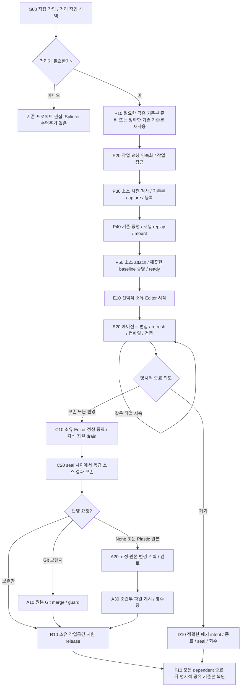
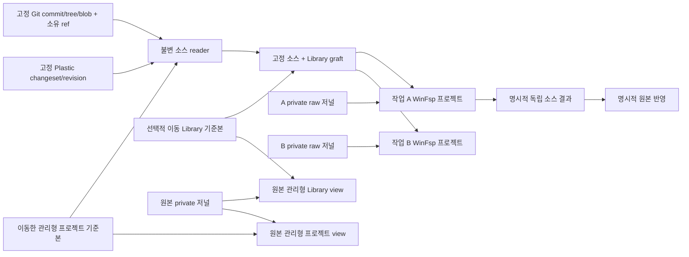
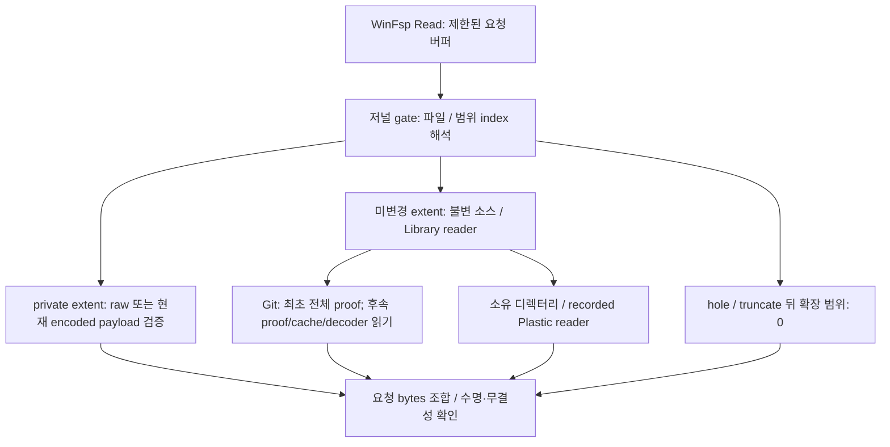
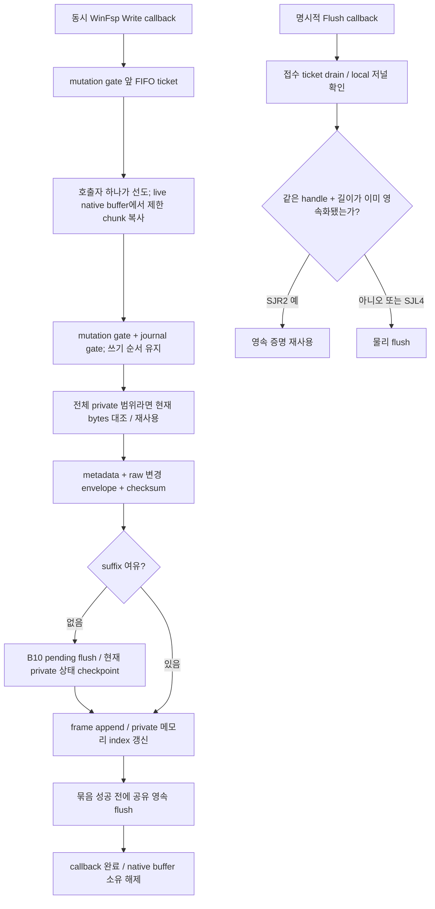
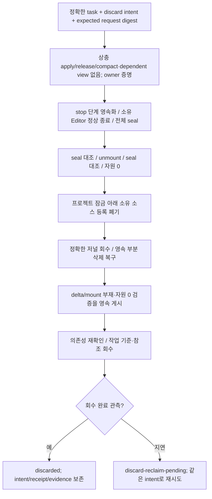

# 최적화 에이전트를 위한 Splinter 수명주기 지도

[English](../lifecycle-optimization-map.md) · [기계 판독 색인](../lifecycle-optimization-map.json) · [문서 지도](README.md)

**코드 기준:** `d00451a0c594a45c0e1bbf7d6d147e968bff6ca3`, `development`, 2026-10-26 확인. 현재 코드의 구조를 설명하는 문서이며 새 수명주기 실측이나 프로젝트 작업 실행 승인이 아니다. 작업공간 하나의 준비부터 반영/폐기·회수까지 다룬다. 다른 작업은 공유·잠금·의존성이 영향을 주는 곳에만 등장한다. 코드 색인의 symbol을 탐색 기준으로 삼고, JSON의 행 번호는 해당 커밋의 위치 힌트로 사용한다.

**AI 읽기 순서:** §§1–3에서 identity·경로를 파악하고, §4에서 단계별 동작, §§5–7에서 직렬화·비용·복구, §8에서 실제 코드를 확인한다. 계약 수정 전에는 연결된 기능 소유 문서를 읽는다. 명령 사용 절차 원본은 [Splinter 스킬](../../skills/splinter/SKILL.md)이다.

## 1. 흐름을 결정하는 규칙

- Splinter는 쓰기 가능한 격리 프로젝트, 고정 기준본, 변경 범위 저장, 소유 Editor 수명, 독립 결과, 명시적 반영·회수를 제공한다. 코드 편집·refresh·컴파일·Play/Test/build·판단은 에이전트와 선택한 설치 도구가 수행한다.
- `ready`/heartbeat는 실행 준비 관측이다. 컴파일·동작 성공 증명이 아니다. `workspace checkpoint`는 소스를 보존하며, 컴파일 실패 자체가 보존을 금지하지 않는다.
- 같은 작업은 같은 `project/key/id/home/base/requestDigest/storage/source/application/basis-id`로 재개한다. 대화 변경·Editor 종료·타임아웃은 새 작업 생성이나 삭제 승인이 아니다.
- 최초 프로젝트 전체 복제·읽기 시 디스크 hydration·파일 전체 copy-up은 금지한다. **명시적 독립 결과 보존과 원본 파일 게시**에는 별도 payload 복사 비용이 있다.
- 새 일반 Windows provider 기본값은 raw **bounded SJR2**다. 기존 저장된 SJL4/append 선택은 유지한다. `JournalDeltaStore` 생성자의 단독 기본값과 provider 기본값을 혼동하지 않는다.
- **B10 내부 저널 checkpoint**, **C20 작업공간 결과 checkpoint**, **R10 작업공간 release**, **F10 원본 Library/project restore**는 트리거·출력·비용이 다른 작업이다.
- `released`/`discarded`는 해당 작업 자원의 종료다. 보존 결과 삭제·이미 반영한 원본의 되돌림·공유 기준본의 복원까지 뜻하지 않는다.

## 2. 작업공간 하나의 제어 흐름



Editor 없는 작업은 `P50 → E20`으로 이동한다. 결과 수집 전 E20 안에서 Editor 종료·재시작도 가능하다. 반영이 필요 없는 `checkpoint --release`는 같은 작업 명령에서 C10/C20/R10을 잇는다. 반영 후 회수는 checkpoint → integrate → release다. 관리형 공유 기준본이 없으면 F10은 생략하며, peer가 사용 중이면 F10만 남겨 둔다.

## 3. 데이터와 소유 관계



원본 view의 두 연결은 Library/전체 프로젝트라는 **대안 구성**이다. 두 구성이 한 저널을 공유한다는 뜻이 아니다. 작업들은 고정 기준본을 읽으며 이후 원본 수정이 baseline에 자동 추가되지 않는다. 일반 Git/Plastic 원본 소스는 기존 경로를 유지한다. 관리형 전체 프로젝트는 승인된 writable view가 기존 원본 경로를 대신한다. 작업 Library 변경은 private이며 소스 결과에서 제외된다. 통합으로 원본 Library에 합쳐지지 않는다.

| 입력 경로 | 고정 소스 | 생성 데이터 | 반영 경로 | 최종 공통 정리 |
| --- | --- | --- | --- | --- |
| `git-snapshot`, `source=git` | 정확한 local commit/tree/blob, 최초 clean root/HEAD, 소유 기준 ref | 명시적 `library prepare` / `--library-basis` 선택; 없으면 생성 파일을 private 저장 | 원본이 요청 브랜치를 이미 checkout했고 clean일 때 Git merge | 작업 기준/ref·선택적 Library 의존성 해제; 미사용 Library 명시적 복원 |
| `plastic-snapshot`, `source=plastic` | 명시적 recorded changeset, regular/static 원본 identity, private revision reader | 같은 선택적 Library 수명주기 | `target=original`, 검토한 plan + intent/digest, 선택적 정확한 경로 | 작업 receipt/reader·Library 의존성 해제; 서버 check-in·등록 변경 없음 |
| `project-snapshot`, `source=none` | 필수 사전 준비 프로젝트 기준본; 같은 볼륨에서 복사 없이 이동 | 관리형 프로젝트 안에 포함; 별도 Library graft 없음 | `target=original`, 검토한 plan + intent/digest, 선택적 정확한 경로 | 작업은 자기 의존성만 해제; 명시적 project restore가 공통 payload 회수 |

`application=none`에는 Editor 단계가 없다. `application=unity`는 생성/bridge 경로와 Unity 정책을 제공한다. 폐기된 VSS/ReFS와 개발용 `git-checkout`은 이 제품 지도 범위가 아니다.

```text
<home>/locks/                                  명령 잠금
<home>/records/<task-id>/workspace.json         요청·phase·기준·결과·intent·관측
<home>/records/<task-id>/snapshot/              기준 receipt / read-access identity / 소스 등록 근거
<home>/records/<task-id>/overlay/               provider 요청·launch·상태·제어·진단 파일
<home>/records/<task-id>/delta/                 identity·raw 저널·checkpoint/회수 근거
<home>/records/<task-id>/files/                 None/Plastic manifest와 독립 내용 객체
<home>/records/<task-id>/{launch-*,process-*,heartbeat.json,editor.log,...}
<home>/workspaces/<task-id>/                    반환 writable mount; 최초 전체 복사본 아님
<home>/{library-bases,project-bases}/<basis-id>/ 상태·이동 base·manifest/proof·원본 delta/mount,
                                               dependents·reader lock·복원 plan/cursor/receipt
<home>/runners/                                소유 provider/process helper 바이너리
<original>/.git/                               Git 객체·작업 브랜치·기준/결과 ref·linked 등록
```

이 개요로 삭제 경로를 합성하지 말고 실제 반환 경로를 사용한다. 작업 payload 회수 뒤에도 record·evidence·결과 ref/객체·완료 영수증은 보통 남는다.

## 4. 단계별 계약

<a id="s00"></a>
### S00 — 선택과 재개

에이전트 책임이며 작업 선택 시 수행한다. 현재 capabilities/schema와 저장된 작업 identity를 읽는다. 요청되었거나 독립 실행이 필요할 때 격리하고 매 편집마다 새 작업을 만들지 않는다. `workspace list`는 저장된 목록이며 live 소유권·Editor idle 증명이 아니다. `workspace status`는 실행 상태를 관측하고, 소스 verify/audit는 명시적 추가 작업이다. [시작 안내](agent-start.md), [세션 흐름](plans/session-workflow-and-installation.md)을 따른다.

<a id="p10"></a>
### P10 — 필요한 공유 Library/project 기준본 준비

진입점: `library prepare` / `project prepare` → `ManagedDirectoryBasis.PrepareAsync` [K04]. `workspace ensure`와 별개의 명시적 원본 전환이다.

1. 기준 잠금 아래 project/key/application/compatibility/id를 고정한다. 같은 기존 NTFS 볼륨·분리된 home·지원하는 일반 경로를 요구한다. 전체 프로젝트 준비는 VCS 관리 영역도 거부한다.
2. 정확한 원본 Editor를 저장·정상 종료한다. 제품 정책은 종료/lock 조건을 검사하며 다른 작업 Editor를 자동 조작하지 않는다.
3. 준비 intent를 게시한다. 내용·메타데이터를 열거/hash하고 manifest/proof·reader/dependent 보호를 만든다. 적격 Git+Unity Library 준비는 원본 소스 bytes와 Git blob을 대조하고 일치한 timestamp도 고정한다.
4. 원본 Library/소스 디렉터리를 소유 기준 경로로 이동한다. 전체 payload 복사가 아니다. 중단된 이동은 같은 intent로 조정하며 양쪽 경로가 있으면 추측하지 않는다.
5. 이동한 내용을 증명/admit하고 원본 private 저널과 writable 원본 view를 열어 `ready`를 저장한다.

비용은 전체 입력 scan/hash·파일별 handle/metadata·증명 게시·원본 provider 시작이다. capture/admission/변경 없는 복원에 최대 8개 파일 worker를 사용한다. rename만이 준비 비용은 아니다. 다른 작업은 정확한 ready 기준을 재사용하지만 의존성/admission 비용은 남는다. [Library](git-library-reference.md), [관리형 프로젝트](plain-project-basis.md)가 계약을 소유한다.

<a id="p20"></a>
### P20 — 작업 요청 영속화

`WorkspaceCoordinator.EnsureAsync` [K01], CLI 조합 [K00]. source/application/storage/base를 정규화하고 home/경로 분리·요청 key를 검사한다. project+key에서 task ID, 고정 매개변수에서 request digest를 만든다. 작업 잠금 아래 v2 `create-intent`를 만들거나 재개의 고정 필드를 대조한다. 다르면 거부하며 released/discarded ID로 새 작업을 만들지 않는다. `--editor`는 같은 요청의 선택적 동작이다. 미완료 원본 반영/폐기는 무관한 수명주기 작업을 막는다.

비용은 local lock·경로 검사·영속 JSON 게시다. 잠금은 이 명령의 범위이며 대화 전체의 외부 파일 편집을 배타적으로 잠그지 않는다. 다른 ID는 작업 잠금을 공유하지 않지만 후속 일부 구간의 프로젝트/기준 잠금은 공유한다.

<a id="p30"></a>
### P30 — 사전 검사, 기준 capture, 소스 등록

`EnsureSnapshotAsync` [K02]는 부수 효과 전후에 `source-checked → capture-intent → captured → registration-intent → registered`를 영속화한다.

1. 프로젝트 잠금 아래 preflight로 base revision과 Git/Plastic/plain-project 전제를 확인한다.
2. provider별 receipt를 만든다. Git은 고정 commit/tree의 소유 reachability ref, Plastic은 recorded revision identity, project는 정확한 공통 기준 의존성을 고정한다. 선택적 Library attach도 dependent receipt를 만든다.
3. 프로젝트 잠금 아래 소스 등록을 준비한다. Git은 payload 전체 checkout 없이 소유 linked Git 관리 영역을 만든다. File/Plastic은 소유 receipt와 관리 root 격리를 유지한다.

Git 객체/catalog 검사·Plastic client/server revision 접근·기준 manifest admission·등록 metadata 등 비용이 다르다. 여기의 snapshot capture라는 이름은 VSS가 아니다. 코드 [K02, K05, K06, K19], 계약 [Git](git-project-basis.md)·[Plastic](plastic-project-basis.md)·[project](plain-project-basis.md).

<a id="p40"></a>
### P40 — 저장소 연결과 replay

`ConnectSnapshotAsync` → `NtfsSnapshotWorkspaceBackend.VerifyConnectionAsync/ConnectAsync` → WinFsp mount/client/server [K02, K05, K07].

1. 정확한 기준/read-access/owner·선택적 Library identity를 검사한다. 같은 read-access의 live provider만 재사용한다. 소유 앱 client가 남아 있으면 사라진 provider를 재연결하지 않는다.
2. token에 결속된 overlay 요청을 영속화하고 정확한 소유 provider를 시작/조정한다. 기준 reader 수명을 확보하고 source+Library graft, 디렉터리/저널 소유권을 확인한다.
3. 저장된 저널 모드를 열고 해당 버전의 중단된 generation을 복구한다. frame 검증/replay로 metadata·범위 index를 재구성한다. 새 일반 provider는 bounded SJR2를 선택한다.
4. **8개 dispatch thread**로 WinFsp를 mount한다. 정확한 provider PID/start/token·mount 경로·기준 가용성을 게시/관측한 뒤 연결 완료를 선언한다.

비용은 process launch·필요한 전체 admission/proof·replay·handle·cache 초기화다. 재사용은 완료가 증명된 효과만 생략한다. 새 snapshot이나 mutable 원본 복사를 통한 복구가 아니다. 소스 status/provider ready 시각은 컴파일 준비 시각과 다르다.

<a id="p50"></a>
### P50 — attach, baseline 증명, ready 반환

`SnapshotSources.AttachAsync/EstablishBaselineAsync`와 clean 검사가 마지막 단계다 [K02]. Git [K06]은 소유 관리 정보를 연결하고 새 index에 `read-tree`를 수행하며 반드시 refresh한다. **새로운 변경 없는 index**에서만 1MiB 이상 파일의 첫 바이트 선행 읽기를 refresh와 겹친다. 이 읽기는 정상 전체 blob 증명을 유발한다. 실패해도 양쪽을 drain하며 기존 index 재개에는 적용하지 않는다. File/Plastic baseline은 고정 소스 manifest를 scan하고 관리/VCS 경로를 제외한다.

clean 소스 revision이 base와 같아야 `Attached=true`, `ready`, `snapshot-ensured`를 게시한다. 연산 한정 최초 검사 증명을 editorless 응답에 재사용할 수 있지만 영구적인 무변경 증명이 아니다. `ensure --editor`는 E10 뒤 실행 관측을 반환하며 추가 전체 소스 검사를 했다고 주장하지 않는다.

주 비용은 Git index/stat/hash 순회·최초 전체 객체 decode·소스 manifest scan·metadata 연산이다. 현재 Git reader는 두 decoder 임대, 4MiB/4,096-blob proof, 256MiB/4,096-chunk RAM payload LRU, 최대 128MiB 최초 proof 선행 window를 쓴다. 각각 tree별 제한이며 process 전체 RAM 제한이 아니다. 디스크 hydration은 없다. [WC](verification/workspace-creation-throughput.md) 참조.

<a id="e10"></a>
### E10 — 소유 Editor 시작

`StartCoreAsync` → `UnityWorkspaceProvider.StartAsync` → process supervisor [K01, K08, K09]. live mount와 미수집 결과 상태를 확인하고 관측된 소유 running Editor만 재사용한다. `ProjectVersion.txt`에서 설치 Unity를 선택한다. 명시적 Library 참조의 최초 시작에서만 적격 직속 `Library/Bee/*.dag`를 무효화하고 1회 receipt·나머지 cache는 보존한다. 제품 소유 process-address만 reset한다. 소유 bridge/asmdef를 검증·재사용하거나 기록하고 launch intent/token·PID/start/process-group receipt를 만든다.

Unity가 import·assembly 작업·domain reload·scene/Editor 시작을 수행한다. bridge heartbeat 주기는 0.5초, provider freshness는 15초다. `ready`는 보고된 phase를 요구하지만 오류 없는 컴파일이나 검증 성공 증명은 아니다. 에이전트가 필요한 loaded code/compile 결과를 별도로 확인한다. launch 반환·process 생존·첫 heartbeat·컴파일 완료는 다른 계측 경계다.

<a id="e20"></a>
### E20 — 코드·Editor 작업 반복

에이전트가 **`data.workspace.path`**를 일반 파일 도구로 편집한다. 설치된 MCP/Unity CLI 등을 필요에 따라 선택하고 정확한 project/PID/start를 대조한다. 필요 시 명시적으로 refresh하고 compile/import/reload 완료와 결과를 확인한다. 포트는 바뀔 수 있고 목록 누락은 Editor 부재가 아니다. 쓰기 timeout을 근거로 자동 재실행하지 않는다.

소스·asset·Library I/O는 아래 I10/W10/B10을 통과한다. 도구 실행·Unity 컴파일/시험·게임 정답 판단은 제품 밖이다. C20 이전에는 같은 task에서 여러 edit/compile·Editor stop/start를 반복할 수 있다. 매 I/O의 내구성을 바꾸지 않으면서 준비/최종화 비용을 여러 작업에 분산한다. 소스 격리가 Unity heap/graphics memory 자동 공유를 뜻하지 않는다.

<a id="i10"></a>
### I10 — 모든 단계 안의 읽기 경로



`JournalDeltaStore.Read` [K10]는 private/base/hole 구간을 해석한다. reader 수명이 고정되고 provider가 concurrent read를 지원할 때만 불변 읽기를 저널 gate 밖에서 수행할 수 있다. 완료 시 poison/길이/기준 상태를 다시 확인하며 close는 진행 중 읽기를 drain한다. private read와 admission/replay에도 각 검증이 있다. cache hit가 필수 identity/proof 생략을 허용하지 않는다. 호출 bytes·전체 객체 decode bytes·실제 디스크 bytes를 구분한다. native/managed 요청 버퍼 제한도 별개다.

<a id="w10"></a>
### W10 — 범위 쓰기, metadata, 명시적 flush



callback [K11], queue [K12], store [K10], 순서 보장 batch [K13]. 한 batch 호출은 최대 **64개 범위 쓰기 / 16MiB**, provider 전송 chunk는 최대 **1MiB**다. 큰 callback은 여러 batch로 나뉘고 모두 끝난 뒤 완료한다. B10 경계를 넘으면 batch 안에도 추가 물리 barrier가 생기며 SJL4는 쓰기별 barrier를 유지하므로 batch당 물리 flush 한 번을 보장하지 않는다. append/constrained 길이에는 앞선 batch 쓰기를 반영한다. 중단된 waiter도 callback이 끝날 때까지 native buffer를 보존한다. background writer·수집 sleep·조기 ACK는 없다.

완전히 private인 덮어쓰기는 현재 범위를 대조한다. 동일 bytes면 새 payload 없이 metadata/timestamp 변경만 기록한다. 일부만 다르면 양끝 절약량이 합계 **4KiB** 이상일 때 단일 연속 envelope를 저장한다. base/hole/확장은 일반 요청 payload를 사용한다. 폐기한 양방향 끝 탐색 후보는 없다.

frame에는 제한된 직렬화 mutation metadata·raw payload·checksum이 있다. 단일 mutation은 flush 후 메모리 apply/반환한다. batch는 외부 접근이 막힌 gate 아래 순서대로 apply하고 flush 뒤 ACK한다. 실패하면 ACK되지 않은 prefix가 남을 수 있어 불확실한 상태를 poison하고 replay를 요구한다. batch는 rollback transaction이 아니다. create/rename/resize/metadata/delete는 여전히 별도 직렬 연산이며 이 FIFO는 모든 mutation이 아닌 범위 Write callback을 모은다.

`Flush()`가 매번 현재 상태 전체를 직렬화하는 것은 아니다. SJR2는 local 검사 뒤 **같은 열린 저널의 변경 없는 길이와 성공한 영속 flush**를 재사용할 수 있다. 신규/재연결/교체 handle은 자체 barrier가 필요하다. SJL4 capsule commit/게시·명시적 flush는 별도 경계를 유지한다. [RW/WP](raw-write-batching.md), [bounded 저널](bounded-journal.md) 참조.

<a id="b10"></a>
### B10 — 내부 bounded 저널 checkpoint

다음 frame이 **16MiB suffix / 4,096-frame** 또는 남은 전체 저널 예산을 넘으면 mutation 안에서 자동 실행한다 [K14, K15]. 작업 전체 저널 기본 예산은 **16GiB**다. suffix 제한은 현재 상태 prefix·임시 generation·전체 RAM 제한이 아니다.

1. pending batch를 flush한다. live range와 raw candidate 크기를 길이로 계산한다. 크기 계산용 payload 읽기/할당은 없다.
2. 전체 저널 예산과 candidate 크기 외에 **2GiB** 디스크 여유를 확인한다. 현재 저널 seal·논리 상태 증명을 만들고 generation intent를 영속 게시한다.
3. 현재 private 상태 전체 prefix와 checksum을 candidate에 쓰고 flush한다. candidate를 reopen/replay하여 논리 상태를 대조한다. 원본 generation을 다시 검사하고 prepared intent를 게시한다.
4. 이전 generation을 보존한 채 current를 교체한다. 게시 상태를 reopen/replay/재증명하고 index/counter를 갱신한다. 정확한 이전 generation/intent를 검증·회수한다.
5. 트리거 mutation과 정상 영속 ACK를 이어 간다.

store 연산 안의 동기 작업이므로 단일 write latency가 튈 수 있다. append suffix가 작아도 전체 private 상태 복사·증명이 지배할 수 있다. Unity 종료·소스 결과 생성·작업 삭제 승인이 아니다. 현재 형식 encoded 입력을 읽을 수 있지만 새 상태 출력은 raw다. 증분 상태 저장은 아직 구현하지 않았으며 형식/복구 설계가 필요하다.

<a id="c10"></a>
### C10 — 소유 Editor 정상 종료와 자원 drain

checkpoint/release/discard가 필요에 따라 호출하며 명시적 `unity stop`도 있다 [K08, K09, K20]. token/request에 결속된 정상 종료 요청을 게시한다. bridge는 compile/import 중 기다리고 Play·dirty scene이면 거부한다. 허용될 때만 `EditorApplication.Exit(0)`을 호출한다. 자동 저장이나 외부 도구 관리는 하지 않는다.

호출자는 최대 **2분**, **250ms** 간격으로 기다리며 정확한 process group/자식의 종료도 요구한다. timeout/거부는 상태 보존이며 강제 종료·삭제 승인이 아니다. 최종 소스 수집에는 ownership이 검증된 **active process·Working Set·Private Bytes 모두 0**이 필요하다. Editor PID 부재만으로 충분하지 않다. checkpoint는 정상 정지 후 안정된 seal 구간 전에 검증된 소유 bridge만 제거한다.

<a id="c20"></a>
### C20 — 독립 소스 checkpoint

`workspace checkpoint` [K01, K02]. 같은 작업 잠금 아래 `collecting`/checkpoint intent를 게시하고 C10과 소유 bridge 제거 뒤 전체 저널의 전후 seal 사이에서 소스를 보존한다.

- **Git:** `CheckpointAndPreserveAsync` [K06]가 소스 scan/commit과 독립 결과 ref `refs/splinter/snapshot-results/<id>`를 잇고 task/result ref·reachable 객체를 검증한다. 생성 관리 경로는 제외하고 미분류 ignored 파일은 거부한다.
- **None/Plastic:** baseline/result manifest를 만들고 양쪽에 필요한 서로 다른 hash의 **파일 전체 payload**를 보존·검증한 뒤 result manifest를 게시한다 [K19]. 명시적 최종 결과 보존에서 변경 없는 baseline/source도 상당량 복사할 수 있다. 최초 hydration이나 범위 쓰기의 전체 파일 fallback은 아니다. Library/VCS/소유 infrastructure는 정책으로 제외한다.

stable seal·정확한 revision/fingerprint·현재 collection protocol의 `IndependentOfSnapshot`을 요구하고 결과와 `collected`를 저장한다. 수집 뒤 정상 Editor start는 차단한다. 추가 작업은 새 task가 일반 경로다. 컴파일 성공을 주장하지 않는다. 보존+정리에는 `checkpoint --release`, 반영에는 C20 → A10 또는 A20/A30 → R10을 쓴다.

<a id="a10"></a>
### A10 — Git 결과를 원본 브랜치에 반영

`WorkspaceCoordinator.IntegrateAsync` → `GitWorkspaceProvider.IntegrateAsync` [K01, K18]. 정확한 clean 현재 작업 결과/독립 seal을 확인하고 소유 worker Editor를 정지한 뒤 프로젝트 잠금을 잡는다. 원본은 clean이고 **요청 브랜치를 이미 checkout**해야 한다. 결과가 이미 ancestor면 현재 revision을 반환하고, 아니면 local `merge --no-ff --no-edit` 후 clean 결과를 확인한다.

실패 시 자기 연산이 시작한 merge이고 MERGE_HEAD·변경 없는 원본 HEAD가 일치할 때만 abort한다. 사용자/peer 변경은 보존한다. Git은 None/Plastic의 reviewed file-plan API를 쓰지 않는다. 이 메서드가 원본 Editor를 종료하거나 refresh/compile/검증하지 않으므로 에이전트가 원본 Editor 사용을 조정한다. push는 포함하지 않는다. merge/checkout은 일반 원본 저장소에 변경 파일 전체를 쓸 수 있다.

<a id="a20"></a>
### A20 — None/Plastic 원본 반영 계획

`workspace integrate --target original --plan` [K16, K19]. 정확한 live task와 독립 보존된 현재 결과를 요구한다. task/project guard 아래 **baseline/result/현재 원본**을 대조하고 전체 또는 정확한 경로를 선택한다. 필요한 parent·Unity `.meta` 동반 항목을 포함하고 관리/생성 경로·충돌을 거부한다. target·고정 입력·선택을 포함한 digest를 반환한다. 실행 전에 구체적 계획을 검토하며 계획만으로 소스를 게시하지 않는다.

관리형 project는 정확한 원본 mount/basis와 원본 정지 정책 보호를 확보한다. Plastic은 client/등록/repository/loaded changeset/selector, 영향받는 원격 lock도 확인하고 관리 handle·원본 Editor lock을 유지한다. 현재 loaded changeset은 requested recorded base와 같아야 한다. 서버 lock 조회는 분산 reservation이 아니다. [일반 폴더 반영](plain-folder-original-apply.md), [Plastic 반영](plastic-original-apply.md) 참조.

<a id="a30"></a>
### A30 — 고정 파일 계획 게시

같은 `intent-key`, `expected-plan-digest`, 선택, task/home을 전달한다. 최초 intent 전에 계획을 재확인하고 intent/progress를 영속화한다. `WindowsOriginalFilePublisher.Publish` [K17]가 전체 write set과 NTFS identity/parent handle을 확인하고, 소유 sibling stage·receipt 생성 → 독립 payload 읽기/hash → stage 쓰기/flush → 기존 entry 조건부 retire·새 entry 게시 → 단계별 progress 게시 → 소유 retired/stage 검증·회수를 수행한다.

**파일별 복구 가능한 게시이며 모든 파일의 단일 원자 transaction이 아니다.** 부분 효과는 같은 영속 intent 아래 남는다. 소유 불명/교체된 stage는 보존한다. 미완료 intent는 release/discard/새 수집을 막는다. 같은 완료 요청 반복은 재게시하지 않는다. Library·VCS 이력/등록/lock·선택하지 않은 소스는 반영하지 않는다. 반영된 원본 검증은 에이전트/도구의 별도 작업이다.

<a id="r10"></a>
### R10 — 결과를 보존하고 작업공간 회수

`ReleaseSnapshotWorkspaceAsync` [K02]는 독립 결과를 유지한다. 필요 시 변경 없는 clean 소스를 수집하며 미수집 변경은 거부한다. `checkpoint --release`는 같은 호출·작업 잠금의 post-collection seal만 재사용하고 새로운 소스 검사·후속/unmount 검사는 유지한다. 저장된 결과나 재시도는 이 메모리 증명을 승계하지 않는다.

영속 순서: **release-unmount → release-registration → release-delta → release-snapshot → released**.

1. dependent candidate/source/cache view를 거부한다. 소유 앱을 정지하고 독립 결과·stable seal을 검증/재사용한다.
2. provider를 unmount한다. post-unmount seal이 결과와 같고 소유 provider/handle/memory가 0이며 mount root가 없어야 한다.
3. 프로젝트 잠금 아래 소유 소스 등록만 제거한다. 독립 Git 결과 ref/객체와 파일 결과 객체는 남긴다.
4. 영속 회수 기록의 정확한 저널 inventory를 회수한다. 부분 삭제는 이 기록으로 재개한다.
5. 기준 잠금 아래 의존성을 재확인하고 작업 기준/ref·선택적 Library 의존성을 해제한다. project는 자기 참조만 해제한다. 정확한 부재와 자원 0을 관측한 뒤 `released`다.

물리 회수가 남으면 `reclaim-pending`이지 성공 완료가 아니다. 같은 task/home/result를 유지한다. peer 연쇄 정리나 control/evidence 삭제로 우회하지 않는다.

<a id="d10"></a>
### D10 — 결과 생성 없는 폐기



`WorkspaceDiscard.DiscardAsync`, `WindowsWorkspaceDiscardProvider` [K03, K21]. **stop → unmount → source → delta → snapshot → complete**를 영속화한다. 컴파일 성공·checkpoint·독립 결과가 필요하지 않다. 정상 종료·전체 seal 대조·의존성 보호·정확한 소유권·mount/delta 부재·소유 자원 0은 여전히 필요하다. 따라서 폐기에도 종료·hash·파일 삭제 비용이 든다. 이미 반영한 원본을 rollback하거나 기존 독립 결과를 지우거나 Git GC를 수행하지 않는다.

<a id="f10"></a>
### F10 — 공유 원본 기준본을 별도로 복원

`library restore` / `project restore` [K04, K22, K23]. 모든 dependent/reader가 끝나고 정확한 원본 Editor를 저장·종료한 뒤 명시적으로 수행한다. 원본 managed provider를 종료하고 mount/provider 부재를 증명한다. exclusive reader 보호를 잡아 `restoring`과 고정 seal/plan/cursor를 사용한다.

- **변경 없는 적격 Library**: sequence 0, 정확한 manifest 일치, SJL4/bounded SJR2, 시작된 파일 plan 없음. no-replace 디렉터리 rename → 전체 NTFS identity/content/membership 재증명 → metadata 복원 → receipt 검증·정확한 저널 회수. 전체 project 복원의 fast path는 아니다.
- **그 외**: 일반 v2 파일별 plan. retained 파일 이동·private range/truncation/hole/metadata 반영·새 파일 durable creation receipt·최종 content/identity 검증을 수행한다. **128개 파일**마다 및 마지막에 completion cursor를 영속 게시한다. range data flush와 최초/최종/새 파일 receipt는 유지한다. 재개 시 마지막 durable cursor 이후 효과를 다시 검증한다.

허용된 원본 편집과 명시적 소스 반영을 포함한 **원본 view의 현재 내용**을 복원한다. 작업 Library를 원본에 합치는 것이 아니다. 최종 검증 뒤 이동 공통 payload/원본 저널/provider 자원을 회수하되 state·manifest·plan·receipt·독립 결과는 보존한다. `status`만으로 live mount를 증명하지 않는다. peer가 필요하면 관리형 상태를 유지하고 F10 미완료를 명시한다.

## 5. 직렬화·겹침·영속 경계

| 경계 | 현재 동작 | 최적화 시 의미 |
| --- | --- | --- |
| 작업 잠금 | ID별 수명주기 명령 전체; 다른 ID는 진행 가능 | 같은 ID의 명령 병렬화·전역 편집 배타 잠금으로 해석하지 않음 |
| 프로젝트 잠금 | 소스 preflight/등록·반영·소스 등록 제거/폐기 | 독립 작업도 대기 가능; lock wait 별도 기록 |
| 기준 gate/reader lease/dependent | 공유 준비/attach/복원·기준 수명 보호 | 복원은 실제 의존성 종료를 기다림; 검사 삭제는 가속 방법이 아님 |
| WinFsp | 8 dispatch thread, mutation gate 앞 범위 쓰기 FIFO | 동시 도착은 barrier 감소 가능; 완전 순차 caller의 다음 요청을 미리 묶을 수 없음 |
| 저널 mutation gate | metadata/range 순서·checksum·append·checkpoint·flush | 저널별 frame 준비/append는 현재 병렬화하지 않음 |
| 읽기 수명 | 지원하는 불변 읽기 겹침, private/상태 수집 gate, close drain | 폐기한 flush/read overlap 후보는 활성화하지 않음 |
| Git reader | 두 decoder 임대·제한 proof/payload cache | 다른 객체 decode는 겹칠 수 있으나 최초 전체 증명 유지 |
| 관리형 파일 | capture/admission/변경 없는 복원 최대 8 worker, 실패 join/drain | 이미 병렬화됨; 추가 concurrency는 device 경합·전체 RAM 계측 필요 |
| 영속 상태 | workspace/intent/receipt 원자 게시·영속 경계; 저널 checksum/flush | heartbeat/liveness는 영속 소스 결과 commit이 아님 |
| 종료 | Unity import/compile/자식 대기, retained handle이면 unmount 불가 | Editor exit·child exit·handle drain·unmount·회수를 분리 |

작업 하나의 앱 정지·독립 보존·필수 post-unmount seal은 선후 의존성이 있다. 독립 A/B 구간은 겹칠 수 있지만 공유 준비/복원은 한 번 센다. 명령 dispatch·AI 추론·외부 도구 대기를 저장소 비용에 숨기지 않는다.

## 6. 최적화 계측 계약

향후 evidence에 이 단계 ID를 사용한다. **이 목록만으로 새 Unity 실험을 실행하지 않는다.** 승인된 입력·질문·자원 제한·완료/복구 조건부터 고정한다.

| 단계 | 시작 → 종료 경계 | counter / 교란 요인 |
| --- | --- | --- |
| P10 | prepare 요청 → 원본 managed view ready 증명 | 전체 scan/hash bytes·파일·worker; 원본 정지는 별도; 공통 비용 |
| P20–P50 | ensure dispatch → mounted clean ready 반환 | 잠금 대기·preflight/capture/register/mount/attach·Git cold proof/cache·replay bytes |
| E10 | start dispatch → launch receipt → 첫 heartbeat → 외부 검증 compiled baseline | Unity 버전·소스/Library bytes/mtime·실제 loaded assembly·OS/cache |
| E20 | edit 완료 → refresh → compile/reload 완료 → 검증 완료 | 정확한 patch/workload·package/import·polling/연결 지연; AI 추론 별도 |
| W10 | callback 접수 → gate 획득 → 비교/준비 → append → flush → ACK | 연산 종류·payload/frame bytes·batch 분포·flush 횟수/시간·waiter; metadata 별도 |
| B10 | checkpoint trigger → 게시/replay 안정화 → 해당 write ACK | live prefix/suffix bytes/frame·크기 추정·seal/상태 증명·출력/replay·임시 중복 |
| C10 | stop 요청 → Editor exit → child/resource 0 | busy/Play/dirty scene 거부·종료 코드 배치·helper·retained 파일/image handle |
| C20 | 안정된 pre-seal → 결과 보존 → post-seal/record | 소스 scan·Git hash/commit·파일 전체 payload 보존·결과 검증 |
| A10/A20/A30 | plan 별도; execute 요청 → integrated 완료 | target/선택·stage bytes·merge·파일별 flush/receipt·충돌/재시도 |
| R10/D10 | release/discard 요청 → 정확한 자원 부재·완료 receipt | seal 읽기·unmount·등록 제거·inventory 삭제·task ref 제거; pending은 끝 아님 |
| F10 | 명시적 restore → 일반 원본 검증 + 공통 자원 회수 | 디렉터리 fast/general 경로·원본 변경·이동/range bytes·검증·cursor commit |

run별 원시 시작/종료 시각과 hash를 보존하고 정상 처리와 진단/복구를 분리한다. 같은 소스 bytes만으로 같은 Unity 입력이 되지 않는다. Library 내용/mtime·loaded assembly·Unity/package·Editor 시작 이력도 다를 수 있다. 양쪽 후보를 같은 입력에서 새로 측정하고 과거 구성 요소 절감률을 더해 전체 비율을 예측하지 않는다. 겹친 구간은 한 번 세며 중첩 단계 counter는 단순 합산하지 않는다.

### 기존 근거와 다음 질문

| 질문 / 단계 | 기록된 후보에서 확인한 근거 | 다음 유용한 관측; 구현 약속 아님 |
| --- | --- | --- |
| 중복 명시적 flush, W10 | [WP](verification/write-path-throughput.md): 2,048 writes+명시적 flush 8.114789 → 4.374668초; 공급된 16-write batch 0.518767 → 0.299169초 | 실제 앱 explicit flush·쓰기 도착 분포; 일반 쓰기 내구성 유지 |
| CPU 준비 / flush, W10 | WP 최종 2,048 small write: 준비 0.033705초, 물리 flush 4.317677초 | thread·binary metadata 추가 전 실제 연산 구성 확인 |
| 상태 크기 / 전체 checkpoint, B10 | WP 크기 계산 0.277765 → 0.049482초; checkpoint workload 전체 1.030469 → 0.993840초; 변경 후 checkpoint 자체 0.707720초 | 전체 상태 쓰기·증명·replay·게시를 귀속; 증분 표현 미구현 |
| 큰 private overwrite 비교 | WP 후보 읽기는 감소했지만 평균 1.838353 → 1.882652초 | 후보 제거됨; 읽기 bytes만으로 복구하지 않음 |
| 생성, P10/P50 | [WC](verification/workspace-creation-throughput.md): Library 준비 후 같은 입력 editorless Git 생성 73.953 → 51.915초 | 새 승인 입력의 최초 proof/index/manifest; 일반 대형 이점 아님 |
| Unity 수명주기 하나 | [LU](verification/unity-single-lifecycle.md): 359.5 → 300.0초; 준비/생성/복원 일관된 50.6초 절감 | 과거 결합 후보; 소스 반영 미실행; WP/RW 이득을 이 합계에 귀속 불가 |
| 정상 Editor 종료, C10 | [SD](verification/unity-shutdown-diagnosis.md): 같은 method 수의 단일/64개 class 17.34초 / 1.60초 | 정확한 종료 workload/loaded 상태; 일반 method 수 증가 법칙 아님 |
| 파일 결과 보존, C20 | 현재 None/Plastic은 baseline+result의 서로 다른 전체 파일 payload 보존 | 소스 bytes·중복 제거율·반복 hash 계측; 현재 비교 가능한 전체 Unity 시간 주장 없음 |
| metadata mutation, W10 | 범위 Write를 묶고 별도 metadata callback commit 유지 | 더 넓은 ordered commit 계약 전에 create/rename/resize/metadata/delete flush 집계 |
| release / discard | discard는 C20 보존을 생략하지만 stop/seal/reclaim 필요 | 같은 상태에서 단계별 비교; 무료 폐기나 보편 절감 가정 없음 |

폐기/무이득 후보는 유지하지 않는다: [DF](verification/durable-flush-throughput.md) RAM checkpoint·I/O 대안, [LT](verification/lifecycle-throughput.md) flush/read 겹침, native Bee, VSS, ReFS. 조기 ACK·필수 flush 생략은 다른 내구성 정책이지 동등 최적화가 아니다. 이 지도는 backend·worker pool·명령·정책 switch를 추가하지 않는다.

## 7. 완료·실패 해석

| 상태 / 관측 | 올바른 해석과 후속 |
| --- | --- |
| `ready`, Editor stopped | 결과 수집 전 재사용 가능한 작업; identity/basis 유지 |
| Editor running, `ready=false` | starting/busy/unresponsive 관측; log·정확한 ownership 확인; 컴파일 판정 아님 |
| `collected` | 독립 소스 결과 존재; 정상 start/edit 수명주기 종료; 반영/보존/release |
| `integrated` | target 반영 완료; 작업공간/기준 정리가 남을 수 있음 |
| `reclaim-pending` / `discard-reclaim-pending` | 작업 제거가 끝나도 기준 회수는 남을 수 있음; 같은 request/intent 재개 |
| `released` / `discarded` | 관측된 task 자원 부재·소유 자원 0; 독립 결과/evidence 보존; F10은 남을 수 있음 |
| 원본 apply 미완료 | 같은 intent/digest/선택만 허용; release/discard/새 수집 차단 |
| append 실패 / poison | 저널 보존·reopen/replay; 불확실한 작업 성공 ACK 없음; 새 task로 우회하지 않음 |
| 기준/소스/owner 불일치·미지원 버전 | 보존·거부; 자동 이관·mutable 원본 fallback·수동 control 삭제 없음 |
| timeout·dirty 원본/scene·공유 의존성 | 실제 조건 해결; 강제 kill/reset/discard/peer 정리 승인을 추론하지 않음 |

보고에는 task/basis ID·home, 현재 result/target, 정확한 명령 결과, 실제 Editor/provider/handle/dependency 관측, 보존 evidence, 공유 restore 미완료 여부를 쓴다. unknown counter를 0으로 대체하지 않는다.

## 8. 코드 진입점 색인

JSON은 같은 단계 ID·edge·source symbol·코드 기준 행 힌트를 기록한다. 코드가 바뀌면 `rg`로 symbol을 찾는다. 이 문서는 최적화 탐색 지도이며 기능 계약과 자격은 연결된 소유 문서가 유지한다.

| Ref | 파일 / symbol |
| --- | --- |
| K00 | [WorkspaceCommands](../../src/Splinter.Cli/WorkspaceCommands.cs): `Add`, Runtime 조합, 명령 분기; [GeneratedDirectoryCommands](../../src/Splinter.Cli/GeneratedDirectoryCommands.cs) |
| K01 | [WorkspaceCoordinator](../../src/Splinter.Runtime/WorkspaceCoordinator.cs): `EnsureAsync`, `StartCoreAsync`, `CheckpointAsync`, `IntegrateAsync`, `ReleaseAsync` |
| K02 | [SnapshotWorkspaces](../../src/Splinter.Runtime/SnapshotWorkspaces.cs): `EnsureSnapshotAsync`, `ConnectSnapshotAsync`, `CheckpointSnapshotResultAsync`, `ReleaseSnapshotWorkspaceAsync`, `ReuseSnapshotResultAsync` |
| K03 | [WorkspaceDiscard](../../src/Splinter.Runtime/WorkspaceDiscard.cs): `DiscardAsync`, seal/dependency/자원 0 guard |
| K04 | [ManagedDirectoryBasis](../../src/Splinter.Platform.Windows/ManagedDirectoryBasis.cs): `PrepareAsync`, `AttachAsync`, `DetachAsync`, `RestoreAsync`; [OwnedDirectorySnapshot](../../src/Splinter.Platform.Windows/OwnedDirectorySnapshot.cs): worker/proof |
| K05 | [NtfsSnapshotWorkspaceBackend](../../src/Splinter.Platform.Windows/NtfsSnapshotWorkspaceBackend.cs): capture/connect/seal/unmount/delta/기준 회수 |
| K06 | [GitSnapshotWorkspaces](../../src/Splinter.SourceControl.Git/GitSnapshotWorkspaces.cs), [GitOverlayRegistration](../../src/Splinter.SourceControl.Git/GitOverlayRegistration.cs), [GitObjectSnapshotTree](../../src/Splinter.SourceControl.Git/GitObjectSnapshotTree.cs): 고정 기준·attach/proof/선행 읽기·보존 |
| K07 | [WinFspOverlayMountProvider](../../src/Splinter.Platform.Windows/WinFspOverlayMountProvider.cs), [WinFspOverlayClient](../../src/Splinter.Platform.Windows/WinFspOverlayClient.cs), [WinFspOverlayServer](../../src/Splinter.Platform.Windows/WinFspOverlayServer.cs): 소유 provider/control/replay/mount |
| K08 | [UnityWorkspaceProvider](../../src/Splinter.Application.Unity/UnityWorkspaceProvider.cs): start/infrastructure/관측/정상 종료 |
| K09 | [WindowsProcessWorkspaceProvider](../../src/Splinter.Platform.Windows/WindowsProcessWorkspaceProvider.cs): 소유 launch/group/exit 증명 |
| K10 | [JournalDeltaStore](../../src/Splinter.Runtime/JournalDeltaStore.cs): `Read`, `Write`, `FindPrivateChanges`, `Commit`, `Flush`, replay/index; [JournalDeltaCandidates](../../src/Splinter.Runtime/JournalDeltaCandidates.cs): `Seal` |
| K11 | [WinFspOverlayFileSystem](../../src/Splinter.Platform.Windows/WinFspOverlayFileSystem.cs): read/write/flush/metadata/cleanup/close callback |
| K12 | [WinFspWriteBatch](../../src/Splinter.Platform.Windows/WinFspWriteBatch.cs): `SubmitWrite`, `ExecuteWriteBatch`, `DrainAcceptedWrites` |
| K13 | [JournalWriteBatch](../../src/Splinter.Runtime/JournalWriteBatch.cs): `WriteBatch`, `FlushPendingWrites`; [WorkspaceWriteBatch](../../src/Splinter.Core/WorkspaceWriteBatch.cs): 제한 |
| K14 | [JournalDeltaBounded](../../src/Splinter.Runtime/JournalDeltaBounded.cs): 용량/checkpoint/generation 복구 |
| K15 | [JournalStateFrames](../../src/Splinter.Runtime/JournalStateFrames.cs): raw 크기 계산/출력/replay |
| K16 | [WorkspaceOriginalApply](../../src/Splinter.Runtime/WorkspaceOriginalApply.cs): plan/apply 진입 guard |
| K17 | [WindowsOriginalFilePublisher](../../src/Splinter.Platform.Windows/WindowsOriginalFilePublisher.cs): NTFS 조건부 게시·receipt |
| K18 | [GitWorkspaceProvider](../../src/Splinter.SourceControl.Git/GitWorkspaceProvider.cs): 소스 checkpoint·target/dirty guard·merge |
| K19 | [FileWorkspaceProvider](../../src/Splinter.SourceControl.Files/FileWorkspaceProvider.cs), [FileOriginalApply](../../src/Splinter.SourceControl.Files/FileOriginalApply.cs), [PlasticWorkspaceProvider](../../src/Splinter.SourceControl.Files/PlasticWorkspaceProvider.cs): manifest/전체 결과 payload/원본 plan·intent |
| K20 | [WorkspaceBridge](../../unity/Splinter.Editor/Editor/WorkspaceBridge.cs): heartbeat/busy/dirty scene/Play/정상 exit |
| K21 | [WindowsWorkspaceDiscardProvider](../../src/Splinter.Workflows.Windows/WindowsWorkspaceDiscardProvider.cs): 정확한 소유 delta/기준/소스 폐기 |
| K22 | [ManagedDirectoryRestore](../../src/Splinter.Platform.Windows/ManagedDirectoryRestore.cs): v2 파일 plan/range/128-file cursor/최종 검증 |
| K23 | [ManagedUnchangedDirectoryRestore](../../src/Splinter.Platform.Windows/ManagedUnchangedDirectoryRestore.cs): 변경 없는 적격 Library rename/proof/회수 |
| K24 | [WorkspaceStore](../../src/Splinter.Runtime/WorkspaceStore.cs), [ProductState](../../src/Splinter.Workflows.Windows/ViewLifecycleState.cs): identity/경로/잠금/영속 record 게시 |

유지보수: 단계 순서·책임·내구성·모드/기본값·결과 구체화·회수 의존성이 바뀌면 영문·한국어·JSON을 함께 갱신한다. 과거 시간은 검증 ID에 결속하고 이 스냅샷을 현재 구현으로 사용하기 전에 변경된 코드를 확인한다.
