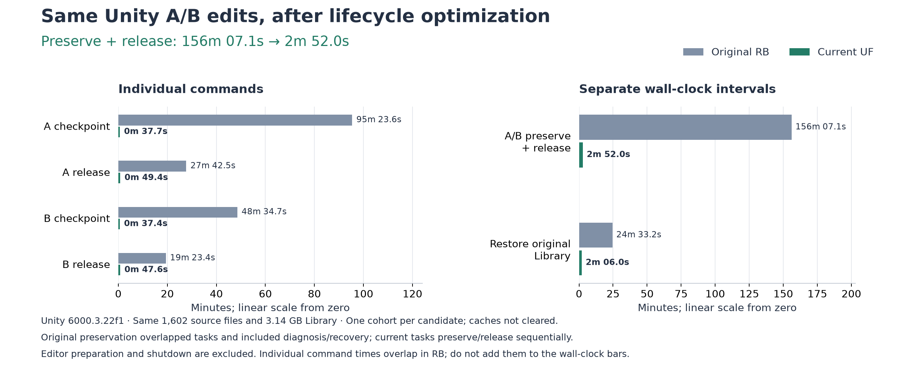

# 최적화 후 Unity 수명주기 비교

[English](../../verification/unity-final-lifecycle.md)

**UF-01**은 커밋 `116fd447086a825bf6d5b424ff9a4aad41dd8642`에서 최초 [RB A/B 작업](readme-unity-comparison.md)을 다시 실행한 기록이다. 보존·회수는 최초 **2시간 36분 7.1초 → 2분 52.0초**, 원본 Library 복원은 **2분 6.0초**였다. 새 실행의 준비부터 최종 복원까지 전체는 **18분 3.0초**다. [정확한 데이터](../../../reports/benchmarks/unity-final-lifecycle-20261008.json).

## 입력과 작업

Windows/NTFS, Unity **6000.3.22f1**, Git 소스 `b09fa58e9d40a560d4fe1af7a213f8ac23e8e3b1`, **추적 파일 1,602개 / 2,804,772,822바이트**다. 원본 소스 해시는 RB와 모두 같다. Library도 **44,860항목 / 파일 42,420개 / 3,141,660,252바이트**의 내용 해시·메타데이터가 최초 RB manifest와 모두 같다. 에셋을 줄이지 않았다.

A는 `Assets/SplinterAlphaA.cs`의 `value + 1`을 `value + 2`로, B는 `Assets/SplinterAlphaB.cs`의 `value + value`를 `value + value + value`로 수정한다. 소유 Editor 두 개를 함께 준비한 뒤 명시적 refresh로 정확한 project/PID/시작 시각, 최신 컴파일·업데이트 종료 상태, 같은 요청의 성공, 새 generation/MVID, A/B 값 `(5,6)` / `(4,9)`와 원본 값 13을 확인한다. 선택 에셋도 확인했다. [US-01](unity-startup-remeasurement.md)과 달리 최초 소스 수정을 포함한다.

새 `git-snapshot` 작업은 원본 Library 기준본을 공유하고 기본 SJL4를 사용한다. 처음부터 끝까지 고정한 일반 Release 실행 파일을 사용했으며 45개 파일 해시를 전후 확인했다. 무관한 테스트 수정을 보존한 커밋 전 작업 트리 전체 빌드는 **1,498 통과, 실패 0, 조건부 skip 20**이었으며 제품 소스 해시는 같다. 외부 profiler나 동시 벤치마크 없이 내장 계수와 10초 간격 provider 관측을 보존했다.

## 최초와 현재 비교

아래 명령은 수정·컴파일·Editor 정상 종료 뒤 시작한다. 준비와 Editor 종료는 제외하며 Library 복원은 별도 구간이다.

| 처리 | 최초 RB | 현재 UF | 관측 감소율 |
| --- | ---: | ---: | ---: |
| A checkpoint | 1시간 35분 23.6초 | 0분 37.7초 | 99.34% |
| A release | 27분 42.5초 | 0분 49.4초 | 97.03% |
| B checkpoint | 48분 34.7초 | 0분 37.4초 | 98.72% |
| B release | 19분 23.4초 | 0분 47.6초 | 95.91% |
| A/B 보존·회수 전체 경과 시간 | 2시간 36분 7.1초 | 2분 52.0초 | 98.16% |
| 원본 Library 복원 | 24분 33.2초 | 2분 6.0초 | 91.45% |
| 보존·회수 + 복원 | 3시간 0분 40.3초 | 4분 58.0초 | 97.25% |

최초 2시간 36분의 보존 구간에는 B 작업 중첩, 진단, `WorkspaceBusy` 거부와 복구가 포함된다. UF는 A 보존·회수 다음 B 보존·회수를 순차 실행하며 당시 조작 오류는 재현하지 않는다. B의 최초 성공 checkpoint는 병렬 실행의 2,914.6685초이며 거부된 5.8595초 요청이 아니다. RB에서는 B의 정확한 소스 파일을 성공 checkpoint 전에 별도 Git 명령으로 커밋했다(중첩 작업에 포함된 64.3363초). UF에서는 checkpoint 자체가 커밋하므로 B 개별 checkpoint 비교에는 이 절차 차이도 있다. 최초 개별 명령 시간은 겹치므로 합산하면 안 된다. RB의 공개 경과 시간은 기록된 UTC 경계와 0.95초 차이가 있지만 과거 공개값을 보존한다. 합계 행의 최초 값은 공개 보존·복원 시간의 합이고, 현재 값은 보존 시작부터 복원 종료까지 연속 구간이다.

후보별 한 묶음의 관측 감소율이며 OS 캐시를 비우거나 무작위 반복하지 않았다. 개별 최적화의 순수 인과적 기여율은 아니다. 기존 Codex와 저장 공간 할당 측정은 반복하지 않았다.

## 현재 전체 과정

| 단계 | 현재 시간 | 전체 비중 |
| --- | ---: | ---: |
| 원본 Library 기준본 준비 | 1분 55.9초 | 10.7% |
| A 작업공간 생성 | 2분 43.5초 | 15.1% |
| B 작업공간 생성 | 2분 49.3초 | 15.6% |
| A/B Editor 시작 → 초기 컴파일 준비 | 3분 36.1초 | 19.9% |
| A/B 한 줄 수정 → 재컴파일 | 0분 29.9초 | 2.8% |
| 선택 에셋 확인 | 0분 2.4초 | 0.2% |
| A/B Editor 정상 종료 | 1분 27.9초 | 8.1% |
| A/B checkpoint·release | 2분 52.0초 | 15.9% |
| 원본 Library 복원 | 2분 6.0초 | 11.6% |
| **준비부터 복원까지** | **18분 3.0초** | **100%** |

짧은 계측·명령 전달 간격은 전체 구간에 포함된다. Editor 준비는 스캔·임포트·컴파일 준비와 완료 관측을 포함하며 컴파일러 CPU 시간만의 측정이 아니다. 두 종료 명령 모두 2분 제한 안에 성공했다. 정확한 PID/시작 시각으로 **1분 27.9초** 만에 두 Editor의 정상 종료를 확인했으며 시간 제한·재요청·강제 종료는 없었다. 이전 UC/US 실행에서는 제한 시간을 초과했다.

## 정리와 한계

두 결과 tree는 과거 A/B 정답과 정확히 일치하며 각각 의도한 한 줄만 바뀌었다. 두 작업은 released이고 소유 Editor/provider는 PID/시작 시각으로 부재를 확인했다. mount/delta/Git 등록은 회수했으며 독립 결과는 남았다. 원본 파일 1,602개의 바이트, HEAD/branch/기존 ref와 전역 설정은 그대로다. 임시 fixture 로컬 Git 설정도 복원했다. Library는 원래 NTFS 볼륨의 일반 디렉터리로 복원했으며 저장소의 무관한 미커밋 파일 27개는 바이트가 같다.

**실제 CLI 응답 12개**가 현재 schema를 통과했으며 실패한 수명주기 명령은 없다. 원시 근거는 ignored `artifacts/unity-final-lifecycle-20261008/`와 `.local/uf8/`에 남는다. 정상 복원 영수증은 원본 Library seal과 identity/내용/구성원 검증을 유지한다. UAC·서비스·외부 패키지 변경, Play Mode, Unity 테스트, 게임 빌드, 새 Codex 실행, 전체 디스크 peak/RAM 측정, OS 장애 행렬은 실행하지 않았다. 이 입력/후보 한 묶음을 일반 Unity 지원이나 임의 프로젝트 성능으로 확대하지 않는다.
