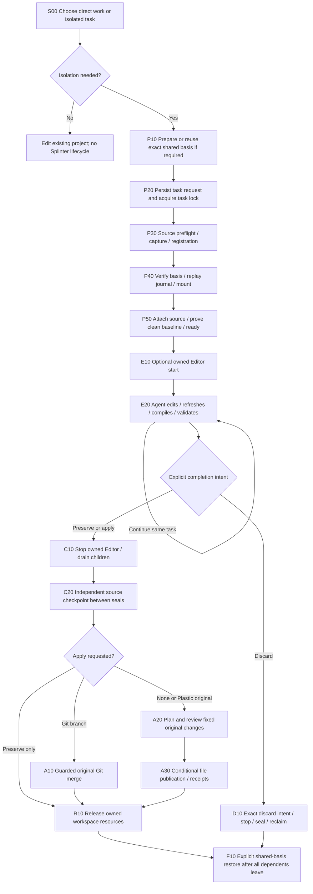
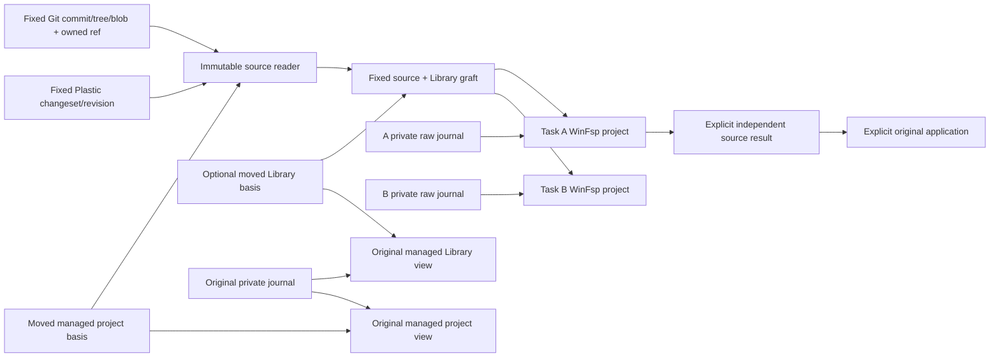
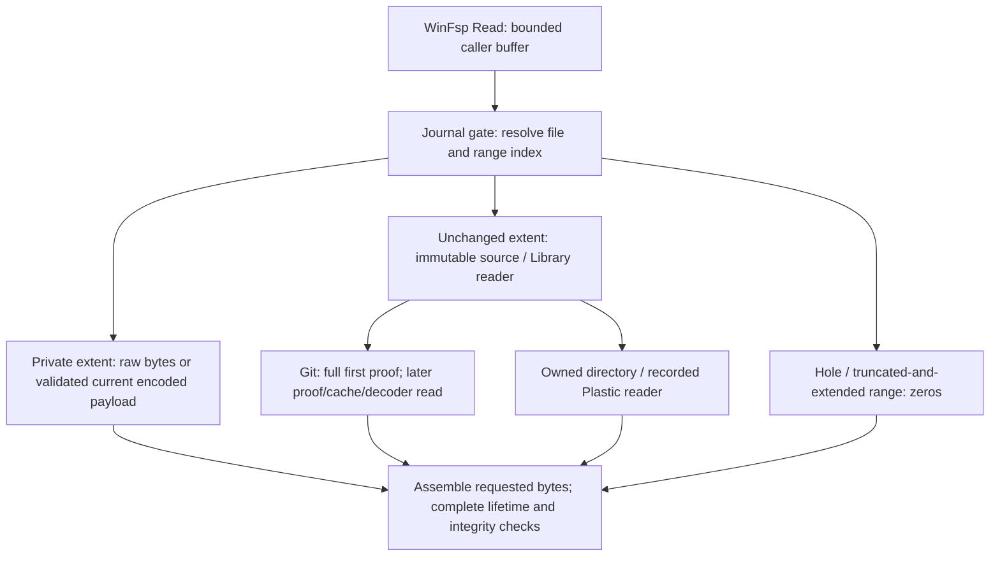
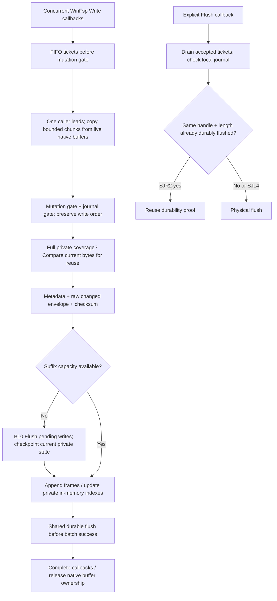
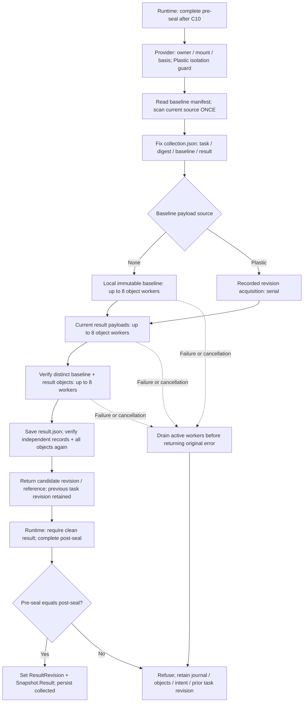
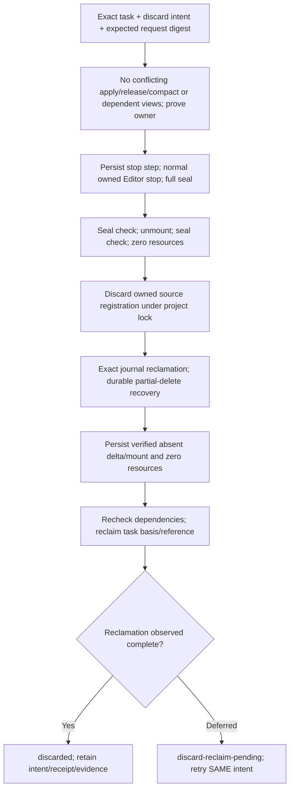

# Splinter lifecycle map for optimization agents

[한국어](ko/lifecycle-optimization-map.md) · [Machine-readable index](lifecycle-optimization-map.json) · [Documentation map](README.md)

**Code snapshot:** base `448f029a31a7c6f29d14d868c5e5f9e11aff5b19` plus the PR-01/02 preparation changes identified by source hashes in the JSON index, `development`, inspected 2026-10-26. This is a code-backed architecture inventory, not permission to run project operations. [PR verification](verification/preparation-throughput.md) owns the new bounded measurement; [RT verification](verification/result-collection-throughput.md) retains the earlier result-collection comparison. This map covers one workspace from preparation to application/discard and reclamation. Other tasks appear only where sharing, locks or dependencies matter. Symbols are authoritative navigation anchors; line numbers refer to the indexed source contents.

**AI reading order:** §§1–3 establish identities and paths; §4 explains each stage; §§5–7 expose serialization, costs and recovery; §8 maps code. Read the owning feature documents before changing a contract. The executable usage procedure remains [the Splinter skill](../skills/splinter/SKILL.md).

## 1. Rules that determine the graph

- Splinter supplies a writable isolated project, fixed basis, private changed ranges, owned Editor lifetime, independent result and explicit application/reclamation. Agents and their chosen installed tools perform code editing, refresh, compilation, Play/Test/build and judgment.
- `ready`/heartbeat means execution readiness. It does not prove correct compilation or behavior. `workspace checkpoint` preserves source; failed compilation does not prevent preservation by itself.
- A task resumes the same `project/key/id/home/base/requestDigest/storage/source/application/basis-id`. Another conversation, stopped Editor or timeout does not create a new task or authorize cleanup.
- Initial project copying, read hydration to disk and whole-file copy-up are forbidden. Explicit independent-result preservation and explicit original-file publication have separate payload-copy costs.
- Default new Windows provider: raw **bounded SJR2**. Existing stored SJL4/append selections are retained. A constructor's standalone default is not the provider's default.
- Distinguish **B10: internal journal checkpoint**, **C20: workspace result checkpoint**, **R10: workspace release**, and **F10: original Library/project restore**. They have different triggers, outputs and costs.
- `released`/`discarded` end this workspace's resources. They do not delete preserved results, revert an applied original, or imply that a shared managed basis has been restored.

## 2. One-workspace control flow



`P50 → E20` is also valid for editorless work. Stop/restart can occur inside the E20 loop before collection. `checkpoint --release` joins C10/C20/R10 under one task operation when no intervening apply is needed. Apply-before-release uses separate checkpoint → integrate → release. F10 is skipped if no managed shared basis was prepared; it can remain deferred while peers continue.

## 3. Data and ownership



The two original-view edges denote alternative Library/project configurations, not one journal shared across both configurations. Tasks read the fixed basis; subsequent original edits are not silently added to their baseline. A normal Git/Plastic original source stays at its existing path. A managed whole-project basis replaces that original path with an authorized writable view. Task Library writes remain private; they are excluded from source results and do not become original Library updates through integration.

| Input route | Fixed source | Generated data | Application route | Final common cleanup |
| --- | --- | --- | --- | --- |
| `git-snapshot`, `source=git` | Exact local commit/tree/blob; initial clean root/HEAD; owned basis ref | Optional explicit `library prepare` / `--library-basis`; otherwise generated files arise privately | Requested branch must already be checked out and original clean; Git merge | Release task basis/ref and optional Library dependency; explicit Library restore when unused |
| `plastic-snapshot`, `source=plastic` | Explicit recorded changeset; regular/static source identity; private revision reader | Same optional Library lifecycle | `target=original`, reviewed plan + intent/digest; optional exact paths | Release task receipt/readers and optional Library dependency; no server check-in/registration mutation |
| `project-snapshot`, `source=none` | Required explicitly prepared project basis; same-volume move, not copy | Included in the managed project; no separate Library graft | `target=original`, reviewed plan + intent/digest; optional exact paths | Task releases its dependency only; explicit project restore owns common payload |

`application=none` has no Editor stages. `application=unity` reserves generated/bridge paths and supplies Unity policy. Retired VSS/ReFS routes and development `git-checkout` are outside this product map.

```text
<home>/locks/                                  operation locks
<home>/records/<task-id>/workspace.json         request, phase, basis, result, intents, observations
<home>/records/<task-id>/snapshot/              basis receipt / read-access identity / source registration evidence
<home>/records/<task-id>/overlay/               provider request, launch/state/control/diagnostic files
<home>/records/<task-id>/delta/                 identity, raw journal, checkpoint/reclamation evidence
<home>/records/<task-id>/files/                 None/Plastic manifests and independent content objects
<home>/records/<task-id>/{launch-*,process-*,heartbeat.json,editor.log,...}
<home>/workspaces/<task-id>/                    returned writable project mount; not an initial full copy
<home>/{library-bases,project-bases}/<basis-id>/ state, moved base, manifest/proof, original delta/mount,
                                               dependents, reader lock, restore plans/cursors/receipts
<home>/runners/                                owned provider/process helper binaries
<original>/.git/                               Git objects, task branch, basis/result refs, linked registration
```

Use returned paths, not this schematic to construct deletion targets. Records, evidence, result refs/objects and completed receipts normally outlive reclaimed task payload.

## 4. Stage contracts

<a id="s00"></a>
### S00 — choose and resume

Agent-owned, once per task decision. Read current capabilities/schema and saved task identity. Use isolation when requested or necessary for independent execution; do not create a new workspace for every edit. `workspace list` is persisted inventory, not a live ownership/Editor-idleness proof. `workspace status` observes execution; source verification/audit are explicit extra work. See [agent start](agent-start.md), [session workflow](plans/session-workflow-and-installation.md).

<a id="p10"></a>
### P10 — prepare shared Library/project basis when needed

Entry: `library prepare` or `project prepare` → `ManagedDirectoryBasis.PrepareAsync` [K04]. This is an explicit original transition, separate from `workspace ensure`.

1. Fix project/key/application/compatibility/id under a basis lock. Require same existing NTFS volume, separated home and ordinary supported paths. Whole-project preparation also rejects VCS administration.
2. Save and normally stop the exact original Editor before transition. Product policy checks stopped/lock conditions; it does not operate another task's Editor automatically.
3. Publish preparation intent. Enumerate/hash contents and metadata, create manifest/proof and reader/dependent protection. Eligible Git+Unity Library preparation additionally proves original source bytes against Git blobs and captures matching timestamps.
4. Move original Library or whole source directory to the owned basis path. No full payload copy. Reconcile an interrupted move using the same intent; never guess when both paths exist.
5. Verify/admit moved contents, open the original private journal, mount a writable original view and save `ready`.

Cost: full input scans/hashes, per-file handles/metadata, proof publication and original-provider startup. Capture/admission/unchanged restore can use up to 8 file workers. The rename itself is not the whole preparation cost. Other tasks can reuse the exact ready basis but each retains dependency/admission costs. See [Library](git-library-reference.md), [managed project](plain-project-basis.md).

<a id="p20"></a>
### P20 — persist workspace request

`WorkspaceCoordinator.EnsureAsync` [K01], CLI composition [K00]. Normalize source/application/storage/base; validate home/path separation and request key. Derive task ID from project+key and request digest from fixed parameters. Acquire the task lock, create a v2 `create-intent` record or compare every fixed field on resume. Conflicting parameters refuse; released/discarded IDs do not create fresh work. `--editor` is an optional action on the same request. Incomplete original apply/discard prevents unrelated lifecycle work.

Cost: local locks, path checks and durable JSON publication. The lock covers this command, not arbitrary external edits throughout a conversation. Independent task IDs do not share this task lock; some following operations share project/basis locks.

<a id="p30"></a>
### P30 — preflight, capture and source registration

`EnsureSnapshotAsync` [K02] persists `source-checked → capture-intent → captured → registration-intent → registered` around effects.

1. Under the project lock, source preflight fixes the base revision and checks Git/Plastic/plain-project constraints.
2. Capture the provider-specific receipt: Git creates an owned reachability ref for the fixed commit/tree; Plastic fixes recorded revision identity; project mode attaches its exact common-basis dependency. Optional Library attachment creates a dependent receipt.
3. Under the project lock, prepare source registration. Git builds owned linked Git administration without a checkout of all payload; file/Plastic tasks use owned receipts and keep administration roots isolated.

Costs differ by provider: Git object/catalog checks, Plastic client/server revision access, basis manifest admission and registration metadata. “Snapshot capture” in these names does **not** mean VSS. Sources: [K02], [K05], [K06], [K19]; owning [Git](git-project-basis.md), [Plastic](plastic-project-basis.md), [project](plain-project-basis.md) contracts.

<a id="p40"></a>
### P40 — connect storage and replay

`ConnectSnapshotAsync` → `NtfsSnapshotWorkspaceBackend.VerifyConnectionAsync/ConnectAsync` → WinFsp mount/client/server [K02, K05, K07].

1. Validate exact basis/read-access/owner and optional Library identity. A live provider may be reused only with matching read access. A missing provider cannot be reconnected while owned application clients remain.
2. Persist token-bound overlay request; start/reconcile the exact owned provider. Acquire basis reader lifetimes, compose source+optional Library graft, and verify directory/journal ownership.
3. Open stored journal mode, recover a same-version interrupted generation if applicable, validate/replay frames and reconstruct metadata/range indexes. New normal providers select bounded SJR2, even though a direct `JournalDeltaStore` constructor has another default.
4. Mount WinFsp with **8 dispatch threads**. Publish/observe exact provider PID/start/token, mounted path and basis availability before claiming connection.

Cost: process launch, complete admission/proof when needed, replay, open handles and cache initialization. Reuse skips only effects already proven complete; it is not a new snapshot or recovery by copying the mutable original. Source-only status and provider-ready timestamps are not compile readiness.

Control observation [PR-01](verification/preparation-throughput.md): ordinary intent/receipt reads overlap but retain publication grace and drain; missing state still waits. Under Start's exclusive `client.lock`, reuse one launch-record observation and skip absence delays while excluding competing starts. A child can finish the receipt for an existing intent; a missing receipt with that intent remains uncertain and is reobserved on the same-request retry. Keep state grace when a prior launch exists. Project tasks skip absent release-receipt grace only before release/discard authorization; capture/release and dependency attach use their existing publisher-excluding locks. Every present record, sharing error, owner/generation check and unresolved launch still matters.

<a id="p50"></a>
### P50 — attach, establish baseline and return ready

`SnapshotSources.AttachAsync/EstablishBaselineAsync` and clean inspection finish [K02]. Git [K06] binds owned administration, initializes an absent index with `read-tree`, always refreshes it, and overlaps only fresh unchanged-index refresh with first-byte read-ahead for files at least 1MiB. Read-ahead triggers the normal whole-blob proof and drains with refresh even on failure. Existing-index resume does not take that hint. File/Plastic baseline establishment scans fixed source manifests and excludes managed/VCS paths.

Require clean source revision equal to base, publish `Attached=true`, `ready` and `snapshot-ensured`. An operation-limited initial inspection proof can serve the editorless response; it is not a reusable perpetual correctness assertion. `ensure --editor` then performs E10 and returns execution observation rather than another claimed full-source proof.

For None/recorded Plastic [K19], full source scans enumerate bounded membership first. None hashes with at most **8 workers**, joining all work on failure/cancellation. Mounted Plastic scans stay serial to avoid thrashing its single-revision proof/stream. The initial scan can produce a **single-use** proof for the same ensure response: both full and metadata-only revalidation scans require matching complete source-change barriers; owner/basis/mount/request/policy, membership, metadata, epoch and history must still match. Plastic rechecks registration isolation. No tracker or audit means full inspection; no proof survives a command or provider restart. See [PR-02](verification/preparation-throughput.md).

Main costs: Git index/stat/hash traversal, first whole-object decode, source manifest scan and metadata operations. Current Git reader: two decoder leases; 4MiB/4,096-blob proofs; 256MiB/4,096-chunk RAM payload LRU with up to 128MiB first-proof forward window. These are separate per-tree limits, not process RAM limits. No disk hydration. See [WC](verification/workspace-creation-throughput.md).

<a id="e10"></a>
### E10 — owned Editor start

`StartCoreAsync` → `UnityWorkspaceProvider.StartAsync` → process supervisor [K01, K08, K09]. Validate live mounted task and no collected result; reuse only an observed owned running Editor. Resolve installed Unity from `ProjectVersion.txt`. On the first explicit Library-backed launch, invalidate only eligible direct `Library/Bee/*.dag` graphs; retain the existing one-time receipt and other cache data. Apply only the product-owned process-address reset. Verify/reuse or write the workspace bridge and asmdef; publish launch intent/token and obtain the PID/start/process-group receipt.

Unity then performs import, assembly work, domain reload and scene/editor startup. The bridge reports phase/heartbeat every 0.5s; provider freshness is 15s. `ready` requires the reported phase but is not an error-free compile/result judgment. External agents must confirm the loaded code/compilation as required. Launch-return, process-alive, first heartbeat and compiled-ready are different timing boundaries.

<a id="e20"></a>
### E20 — repeated code and Editor work

Agent edits **`data.workspace.path`** with normal file tools. Choose installed MCP/Unity CLI or other tools as needed, confirm exact project/PID/start, explicitly refresh when required, wait for compile/import/reload and inspect results. Tool ports may change; list omission is not Editor absence; a timed-out write is not safe to repeat automatically.

All source/asset/Library file I/O crosses I10/W10/B10 below. Tool execution, Unity compilation, testing and user/game correctness are outside Splinter's product implementation. A task can continue through many edit/compile cycles, or stop/restart its Editor, before C20. This amortizes preparation/finalization without altering per-I/O durability. Source code is isolated; Unity heaps/graphics memory are not automatically shared.

<a id="i10"></a>
### I10 — read path inside every stage



`JournalDeltaStore.Read` [K10] resolves private/base/hole intervals; immutable reads may run outside the journal gate only while the reader lifetime is pinned and provider concurrent-read support permits it. Completion still checks poison/length/basis health; close drains reads. Private reads and admission/replay have their own validation. A cache hit does not permit bypassing required identity/proof checks. Read-call bytes, whole-object decoded bytes and physical device reads are different quantities. Native and managed request buffers are bounded separately.

<a id="w10"></a>
### W10 — range write, metadata and explicit flush



Implementation: callback [K11], queue [K12], store [K10], ordered batch [K13]. One submitted batch admits at most **64 range writes / 16MiB**; provider transfer chunks are at most **1MiB**. A larger callback spans batches and completes only after all chunks finish. Crossing B10 can add physical barriers inside a batch; SJL4 retains per-write barriers, so batch size does not guarantee one physical flush. Append/constrained lengths include prior writes in the batch. Waiting callbacks keep native buffers alive, including interrupted waiters; no background writer, collection sleep or early ACK.

For a fully private overwrite, current code compares the existing range. Identical bytes produce a metadata/timestamp mutation with no new payload. A partial difference stores one contiguous envelope only when saved edges total at least **4KiB**. Base/hole/extension writes take the ordinary request payload. The rejected bidirectional edge-search candidate is absent.

Each frame has bounded serialized mutation metadata, raw payload and checksum. A standalone mutation flushes before in-memory apply/return. A batch applies ordered state under the inaccessible gate, then flushes before ACK; failure can leave an unacknowledged prefix and poisons uncertain state, requiring replay. A batch is not a rollback transaction. Ordinary create/rename/resize/metadata/delete callbacks still serialize as their own operations; this FIFO batches range-write callbacks, not every filesystem mutation.

`Flush()` does not normally serialize all current state. For SJR2 it can now reuse successful durability only on the same unchanged open journal after local checks. New/reconnected/replaced handles establish their own barrier. SJL4 capsule commits/publication and explicit flush remain distinct. See [RW/WP](raw-write-batching.md), [bounded journal](bounded-journal.md).

<a id="b10"></a>
### B10 — internal bounded-journal checkpoint

Automatic inside a mutation when the next frame exceeds the **16MiB suffix / 4,096-frame** limit, or remaining total journal budget [K14, K15]. The default task total journal budget is **16GiB**; suffix limits do not bound the current-state prefix, temporary generations or total RAM.

1. Flush pending batch frames. Compute live ranges and raw candidate size using lengths, without payload reads/allocations for sizing.
2. Check total journal budget and candidate size plus **2GiB** free-disk headroom. Compute current journal seal and logical-state proof; durably publish generation intent.
3. Write the complete current private state prefix, checksum and flush candidate. Reopen/replay candidate and compare logical state. Recheck source generation and publish prepared intent.
4. Replace current with candidate, retaining previous generation. Reopen/replay/reprove published state; update indexes/counters; verify and reclaim exact previous generation/intent.
5. Continue the triggering mutation and its normal durable ACK.

This is synchronous journal work under the store operation. It can cause a single write latency spike. Full private-state copying/proofs may dominate even when append suffix is small. It does not stop Unity, produce a source result or authorize task deletion. Current-format encoded input is readable; new state output is raw. Different incremental state storage would require a deliberate format/recovery design.

<a id="c10"></a>
### C10 — stop owned Editor and drain resources

Called by checkpoint/release/discard as applicable; explicit `unity stop` is also available [K08, K09, K20]. Publish token/request-bound normal-stop request. The bridge waits while compiling/importing; refuses Play or dirty scenes; calls normal `EditorApplication.Exit(0)` only when allowed. It does not save user changes automatically or manage external tools.

The caller waits up to **2 minutes**, checks every **250ms**, and then requires the exact process group/children to exit. Timeout/refusal preserves state; it is not force-kill/deletion authority. Final source collection requires ownership-verified **0 active processes, Working Set and Private Bytes**. An absent Editor PID alone is insufficient. Checkpoint removes only verified owned bridge infrastructure after stop, before the stable seal interval.

<a id="c20"></a>
### C20 — independent source checkpoint

`workspace checkpoint` [K01, K02]. Under the same task lock, publish `collecting`/checkpoint intent, run C10, remove owned bridge, then preserve source between complete before/after journal seals.

- **Git:** `CheckpointAndPreserveAsync` [K06] combines checkpoint source scan/commit with the independent result ref `refs/splinter/snapshot-results/<id>`, validates task/result refs and reachable objects. Managed generated paths are excluded; unclassified ignored files refuse collection.
- **None/Plastic:** `CheckpointAndPreserveAsync` [K19] scans the result once within the seal interval, replacing separate checkpoint/inspection/preservation scans. Preserve distinct hash-addressed **full file payloads** needed by baseline/result, verify them, publish the result manifest. Local payload preservation and independent-object proofs use at most **8 workers**, draining all work on failure/cancellation; recorded Plastic revision acquisition stays serial. Every new object still flushes durably and all publication/recovery proofs remain. This can copy substantial unchanged source data during explicit final preservation; it is not initial hydration or a changed-range write fallback. Library/VCS/owned infrastructure are excluded by policy. See [RT-01–04](verification/result-collection-throughput.md).

The following expands the **None/recorded Plastic** branch of C20. The task lock covers this entire interval; each arrow between worker phases waits for that phase to drain.



Within a preservation worker, an existing object is verified; a new object is copied to its owned `.pending` file, durably flushed, hashed, then moved to its final hash path. Deduplication is by content hash, but full baseline/result payloads remain necessary. Baseline preservation, result preservation, pre-publication proof and independent-result proof are sequential phases; only work **within** eligible phases overlaps. Source manifest scanning and recorded revision acquisition do not gain eight-way parallelism. Injected verification readers keep their sequential lifetime contract.

`result.json` can exist before the post-seal succeeds. Its presence alone is not a collected task or permission to release. A mismatch leaves the previous `ResultRevision` and `Snapshot.Result` unchanged and retains evidence; resume only the same task and fixed collection identity. Later release/apply invocations reprove the independent result. The one-scan optimization removes redundant mounted-source scans, not object hashing, journal seals or durability barriers.

Require stable seals, exact revision/fingerprint and `IndependentOfSnapshot` with current collection protocol. Store the result and `collected` phase. Subsequent normal Editor start is blocked after collection; a new task is the ordinary path for more work. Compiler success is not asserted. Preserve-only plus cleanup can use `checkpoint --release`; apply requires C20 → A10 or A20/A30 → R10.

<a id="a10"></a>
### A10 — apply Git result to the original branch

`WorkspaceCoordinator.IntegrateAsync` → `GitWorkspaceProvider.IntegrateAsync` [K01, K18]. Verify exact clean current worker result/independent seal, stop owned worker Editor, hold project lock. Original must be clean and **already on the requested branch**. If result is already an ancestor, return its current revision; otherwise run local `merge --no-ff --no-edit`, then verify clean result.

On failure, abort only the merge started by this operation if its MERGE_HEAD and unchanged original HEAD still match. Preserve user/peer changes. Git does not use the None/Plastic reviewed file-plan API. This method does not itself perform original-Editor shutdown, refresh, compile or validation; coordinating any original Editor is an agent responsibility. No push is implied. Merge/checkout effects can write whole changed files to ordinary original storage.

<a id="a20"></a>
### A20 — plan None/Plastic original application

`workspace integrate --target original --plan` [K16, K19]. Require exact live task and independently preserved current result. Under task/project guards, compare **baseline/result/current original**, select full or exact paths, include necessary parent and Unity `.meta` companions, reject management/generated paths and conflicts. Return a digest covering target, fixed inputs and selection. Review the concrete plan before execution; a dry plan does not publish source files.

Managed project application acquires exact original mount/basis and stopped-original policy protection. Plastic also fixes client/registration/repository/loaded changeset/selector and checks affected remote locks, retaining administration handles and original Editor lock. Current loaded changeset must match the requested recorded base. A server lock query is not a distributed reservation. See [plain original apply](plain-folder-original-apply.md), [Plastic original apply](plastic-original-apply.md).

<a id="a30"></a>
### A30 — publish the fixed file plan

Supply the same `intent-key`, `expected-plan-digest`, selection and task/home. Revalidate plan before first intent, persist intent/progress, then `WindowsOriginalFilePublisher.Publish` [K17]: verify the whole write set and NTFS identity/parent handles; create owned sibling stages and receipts; read/hash independent payload, write/flush stage; conditionally retire old entry and publish new one; persist per-step progress; verify and reclaim owned retired/stage files.

This is recoverable per-file publication, **not an all-files atomic transaction**. Partial effects remain under the same durable intent. Unknown/replaced staging files are preserved. An incomplete intent blocks release/discard/new collection. Repeating a completed matching request does not republish. Library, VCS history/registration/locks and unselected source changes are not applied. Agent/tool validation of the resulting original is separate.

<a id="r10"></a>
### R10 — preserve and release workspace resources

`ReleaseSnapshotWorkspaceAsync` [K02] keeps an independent result. If needed, collect untouched clean source; refuse uncollected changes. `checkpoint --release` can reuse only this invocation's post-collection seal under the same task lock, still performing fresh source/following/unmount checks. Persisted results/retries do not inherit this in-memory proof.

Ordered persisted steps: **release-unmount → release-registration → release-delta → release-snapshot → released**.

1. Reject dependent candidate/source/cache views; stop owned application; verify/reuse independent result and stable seal.
2. Unmount provider. Require post-unmount seal equal to the result and ownership-verified zero provider/handles/memory; verify absent mount root.
3. Under project lock, unregister only owned source registration. Retain independent Git result refs/objects or file result objects.
4. Reclaim exact journal inventory through its durable reclamation record; partial deletion resumes from that record.
5. Under basis lock, recheck dependencies; reclaim task basis/ref and detach optional Library dependency. Project mode releases only its task reference. Observe exact absence and zero resources before `released`.

Deferred physical reclamation is `reclaim-pending`, not complete success. Keep same task/home/result. Do not cascade peer cleanup or delete control/evidence directories as a shortcut.

<a id="d10"></a>
### D10 — discard without result creation



`WorkspaceDiscard.DiscardAsync` and `WindowsWorkspaceDiscardProvider` [K03, K21]. Persist **stop → unmount → source → delta → snapshot → complete**. No successful compile, checkpoint or independent result is required. Nevertheless normal stop, full seal comparison, dependency protection, exact ownership, absent mount/delta and zero owned resources remain required. Discard can therefore still incur shutdown, hashing and filesystem deletion costs. It does not roll back already applied original changes, erase earlier independent results, or run repository GC.

<a id="f10"></a>
### F10 — restore the shared original basis separately

`library restore` / `project restore` [K04, K22, K23], explicitly after all dependents/readers leave and exact original Editor is saved/stopped. Stop original managed provider, prove mount/provider absence, take exclusive reader protection, persist `restoring` and use fixed seal/plan/cursor.

- Completely unchanged eligible **Library** with sequence zero and exact manifest equality, SJL4/bounded SJR2, no started file plan: no-replace whole-directory rename; reprove all NTFS identities/content/membership, restore metadata, verify receipt and reclaim exact journal. This fast path is not whole-project restoration.
- Otherwise: general v2 per-file plan; move retained files, apply private ranges/truncation/holes and metadata, create new files with durable creation receipts, verify final content/identity, advance completion cursor every **128 files** and at the end. Range data flushes and initial/final/new-file receipts remain. Resume revalidates effects beyond the last durable cursor.

This restores the **original view's current contents**, including permitted original edits and explicitly applied source changes. It does not merge task-generated Library data. Final verified restore reclaims moved common payload/original journal/provider resources but retains state, manifests, plans, receipts and independent results. `status` alone is not a live mount proof. If a peer still needs the basis, leave it managed and report that F10 remains outstanding.

## 5. Serialization, overlap and persistence boundaries

| Boundary | Current behavior | Optimization implication |
| --- | --- | --- |
| Task lock | Entire lifecycle command per task; separate task IDs can progress | Do not parallelize two lifecycle commands on one ID or infer global file-edit exclusion |
| Project lock | Source preflight/registration, integration, unregister/discard source | Independent tasks can still wait here; record lock wait separately |
| Managed basis gate/read leases/dependents | Shared prepare/attach/restore and basis lifetime | Restore waits for all real dependents; removing checks is not acceleration |
| WinFsp | 8 dispatch threads, range-write FIFO before mutation gate | Arrival overlap can reduce barrier count; fully sequential callers cannot be grouped across requests |
| Journal mutation gate | Ordered metadata/ranges, checksum, append, checkpoint, flush | Current implementation does not parallelize frame preparation/append per journal |
| Read lifetimes | Immutable supported reads can overlap; private/state collection is gated; close drains | The rejected flush-overlapping-read candidate is not enabled |
| Git reads | Two decoder leases, bounded proof/payload caches | Decoding different objects can overlap; first whole-object proof remains |
| Managed files | Up to 8 workers for capture/admission/unchanged restore; join/drain failures | Higher concurrency is already present; measure device contention and total RAM |
| File source / independent results | None full source hashes and local payload/proofs use up to 8 workers per phase, joined before return; mounted Plastic source scans stay serial; one C20 scan; initial editorless proof is single-use; Plastic revision acquisition serial | Full baseline/result data and fresh later-invocation proofs still cost time |
| Persistent state | Workspace/intents/receipts use atomic publication and durable boundaries; journals use checksummed flush | Heartbeat/liveness observation is not a durable source-result commit |
| Exit | Unity can wait for import/compile/children; provider cannot unmount with retained handles | Distinguish Editor exit, child exit, handle drain, unmount and reclamation |

Application stop, independent preservation and required post-unmount seal are sequential dependencies within one workspace. Independent task A/B intervals can overlap, but shared preparation/restoration is counted once. Command dispatch, AI reasoning and external-tool wait should be recorded explicitly rather than silently folded into storage cost.

## 6. Optimization measurement contract

Use these stage IDs in future evidence. **Do not run a fresh Unity experiment merely because it is listed here.** First fix the authorized input, question, resource limits and completion/recovery conditions.

| Stage | Start → end boundary to measure | Counters / confounders |
| --- | --- | --- |
| P10 | prepare request → original managed view proven ready | Full scanned/hashed bytes, files, workers, original stop separately, common cost |
| P20–P50 | ensure dispatch → returned mounted clean ready workspace | Lock waits, preflight/capture/register/mount/attach durations, Git cold proofs vs cache, replay bytes |
| E10 | start dispatch → launch receipt → first heartbeat → externally verified compiled baseline | Unity version, source and Library bytes/mtime, actual loaded assembly, OS/cache state |
| E20 | edit completed → refresh → compile/reload complete → verification complete | Exact patch/workload, package/import activity, polling/connection delay; separate AI reasoning |
| W10 | callback admission → gate acquisition → comparison/preparation → append → flush → ACK | Operation kind, payload/frame bytes, batch distribution, flush count/time, waiters; metadata callbacks separately |
| B10 | checkpoint trigger → stable published/replayed generation → triggering write ACK | Live prefix/suffix bytes/frames, estimate, seal/state proofs, candidate output/replays, temporary overlap |
| C10 | stop request → Editor exit → child/resource zero | Busy/Play/dirty-scene refusal, shutdown code shape, helper processes, retained file/image handles |
| C20 | stable pre-seal → result preservation → post-seal/record | Source scans, Git hashing/commit, file full-payload preservation, result verification |
| A10/A20/A30 | plan separately; execute request → complete integrated record | Target state/selection, staged bytes, Git merge, per-file publication flushes/receipts, conflict/retry |
| R10/D10 | release/discard request → exact absent resources and completed receipt | Seal reads, unmount, source unregister, inventory deletion, task ref removal; pending is not end |
| F10 | explicit restore → ordinary original verified + common resources reclaimed | Fast directory vs general file path, original changes, moved/range-written bytes, verification, cursor commits |

Store raw per-run start/end times and hashes; report normal operation separately from diagnostic/recovery runs. Equal source bytes alone are not equal Unity inputs: Library contents/mtime, loaded assemblies, Unity version/packages and Editor-start history can differ. Use both new candidates under matched inputs; do not combine earlier component improvements into a predicted whole-lifecycle percentage. Overlapping intervals count once; nested stage counters are not additive.

### Existing evidence and next questions

| Question / stage | Confirmed evidence at its recorded candidate | Next useful observation; not an implementation promise |
| --- | --- | --- |
| Duplicate explicit flush, W10 | [WP](verification/write-path-throughput.md): 2,048 writes+explicit flush 8.114789 → 4.374668s; supplied 16-write batches 0.518767 → 0.299169s | Actual application's explicit flush and write-arrival distribution; ordinary write durability remains |
| CPU preparation vs flush, W10 | WP final 2,048 small writes: preparation 0.033705s, physical flush 4.317677s | Measure real operation mix before adding threads or binary metadata format |
| State sizing vs full checkpoint, B10 | WP sizing 0.277765 → 0.049482s; checkpoint workload total 1.030469 → 0.993840s, checkpoint itself 0.707720s after | Attribute full-state write/proof/replay/publication; incremental representation is unimplemented |
| Large private overwrite comparison | WP candidate reads fell but mean time 1.838353 → 1.882652s | Candidate removed; do not restore it from a read-byte argument alone |
| Creation, P10/P50 | [WC](verification/workspace-creation-throughput.md): matched editorless Git creation 73.953 → 51.915s after Library preparation | First proof/index/manifest costs on a newly authorized input; not a universal large-project gain |
| One Unity lifecycle | [LU](verification/unity-single-lifecycle.md): 359.5 → 300.0s; preparation/creation/restore consistently 50.6s lower | Historical combined candidate; source apply not run; cannot assign WP/RW gain to these totals |
| Normal Editor exit, C10 | [SD](verification/unity-shutdown-diagnosis.md): same method count, one/64 classes 17.34s / 1.60s | Exact shutdown workload/loaded state, not a general method-count scaling law |
| File result preservation, C20 | [RT-03](verification/result-collection-throughput.md): actual editorless None checkpoint **98.429 → 58.944s**, saving **39.485s / 40.1%**; one scan and bounded payload work measured together | Full baseline/result materialization and repeated object proofs remain; no separate causal attribution or Unity/live Plastic timing |
| Metadata mutations, W10 | Current code batches range writes; independent metadata callbacks retain commits | Count create/rename/resize/metadata/delete flushes before proposing a broader ordered commit contract |
| Release vs discard | C20 preservation skipped by discard, but stop/seal/reclaim still required | Same-state per-stage pair; no assumed zero-cost discard or measured universal saving |

RT-03 used the same **2.125GiB / 2,112-file** source bytes and modification times, with fixed edits, in before → after → after → before order. P20–P50 ensure + E20 fixed edit + C20 checkpoint + separate R10 release summed to **203.305 → 159.906s**, an observed **43.399s / 21.3%** saving. Checkpoint command times include enclosing command overhead and are not isolated inner C20 timers. Common P10 preparation (**9.031s**) and F10 restoration (**12.018s**) each ran once outside those sums. No Editor, original apply or discard was timed. Two runs per variant, substantial absolute timing variation and OS caches not cleared limit inference; see the [exact runs and source hashes](../reports/benchmarks/result-collection-throughput-20261026.json).

PR-03 separately compared the next preparation/observation changes on a new matched **2.125 GiB / 2,112-file** source in ABBA order. Ensure **65.258 → 20.650s**, checkpoint **38.916 → 24.524s**, and separate release **35.071 → 9.578s**; the same workspace-phase sum was **139.304 → 54.790s**, saving **84.515s / 60.7%**. Common prepare **8.598s** and restore **11.965s** ran once outside the sums. All source/result identities and owned closure matched. These combined changes are not individual causal timings or a Unity/apply/discard measurement; [PR verification](verification/preparation-throughput.md) owns the limits. The remaining command costs are 20.650s / 24.524s / 9.578s; full admission, independent payload materialization and fresh later-invocation proofs remain.

The remaining measured costs on this input are **P20–P50 creation 65.599s**, **checkpoint 58.944s** and **separate R10 release 35.326s**. Future profiling should separate creation admission/baseline scans, full result materialization/proofs and release source/seal/object revalidation. These totals identify where to investigate; they do not authorize skipping proofs or establish a measured saving for an unimplemented candidate.

Retired/no-gain candidates stay retired: [DF](verification/durable-flush-throughput.md) RAM checkpoint prototype and I/O variants, [LT](verification/lifecycle-throughput.md) flush/read overlap, native Bee, VSS and ReFS. Early ACK or omitted required flush is a different durability policy, not an equivalent optimization. The map adds no backend, worker pool, command or policy switch.

## 7. Completion and failure matrix

| State / observation | Correct interpretation and continuation |
| --- | --- |
| `ready`, Editor stopped | Reusable task before result collection; keep identity/basis |
| Editor running, `ready=false` | Starting/busy/unresponsive observation; inspect logs and exact ownership; not compile failure/success |
| `collected` | Independent source result exists; ordinary start/edit lifecycle ends; apply/preserve/release next |
| `integrated` | Target application completed; workspace/basis cleanup may remain |
| `reclaim-pending` / `discard-reclaim-pending` | Owned workspace removal may be done but basis reclamation remains; resume exact request/intent |
| `released` / `discarded` | Task resources absent and owned resources zero as observed; independent results/evidence remain; F10 may remain |
| Original apply incomplete | Same intent/digest/selection only; release/discard/new collection blocked |
| File collection failed or seal changed | Drain admitted object workers; preserve journal, fixed intent and partial/published objects. `result.json` alone does not advance the task revision/result or authorize reclamation; resume the same identity |
| Failed append / poison | Preserve journal and reopen/replay; no success ACK for uncertain work; no retry-as-new-task workaround |
| Basis/source/owner mismatch, unsupported version | Preserve and refuse; no automatic migration, mutable-source fallback or manual control-file deletion |
| Timeout / dirty original / dirty scene / shared dependency | Resolve the actual condition; no inferred force-kill, reset, discard or peer cleanup authorization |

Every report should state: task and basis IDs/home; current result and target; exact command outcome; actual Editor/provider/handle/dependency observations; retained evidence; whether shared restore remains. Do not replace unknown counters with zero.

## 8. Code entry map

The JSON index records the same stable stage IDs, edges, source symbols and code-snapshot line hints. Use `rg` for the symbol after code changes. This file is an optimization reading map; the linked feature contracts remain owners of behavior and qualification.

| Ref | File / symbols |
| --- | --- |
| K00 | [WorkspaceCommands](../src/Splinter.Cli/WorkspaceCommands.cs): `Add`, Runtime composition, command routing; [GeneratedDirectoryCommands](../src/Splinter.Cli/GeneratedDirectoryCommands.cs) |
| K01 | [WorkspaceCoordinator](../src/Splinter.Runtime/WorkspaceCoordinator.cs): `EnsureAsync`, `StartCoreAsync`, `CheckpointAsync`, `IntegrateAsync`, `ReleaseAsync` |
| K02 | [SnapshotWorkspaces](../src/Splinter.Runtime/SnapshotWorkspaces.cs): `EnsureSnapshotAsync`, `ConnectSnapshotAsync`, `CheckpointSnapshotResultAsync`, `ReleaseSnapshotWorkspaceAsync`, `ReuseSnapshotResultAsync` |
| K03 | [WorkspaceDiscard](../src/Splinter.Runtime/WorkspaceDiscard.cs): `DiscardAsync`, seal/dependency/zero-resource guards |
| K04 | [ManagedDirectoryBasis](../src/Splinter.Platform.Windows/ManagedDirectoryBasis.cs): `PrepareAsync`, `AttachAsync`, `DetachAsync`, `RestoreAsync`; [OwnedDirectorySnapshot](../src/Splinter.Platform.Windows/OwnedDirectorySnapshot.cs): file workers/proofs |
| K05 | [NtfsSnapshotWorkspaceBackend](../src/Splinter.Platform.Windows/NtfsSnapshotWorkspaceBackend.cs): capture/connect/seal/unmount/delta/basis reclamation; [ProjectDirectorySnapshotProvider](../src/Splinter.Platform.Windows/ProjectDirectorySnapshotProvider.cs): shared project reference and release observation |
| K06 | [GitSnapshotWorkspaces](../src/Splinter.SourceControl.Git/GitSnapshotWorkspaces.cs), [GitOverlayRegistration](../src/Splinter.SourceControl.Git/GitOverlayRegistration.cs), [GitObjectSnapshotTree](../src/Splinter.SourceControl.Git/GitObjectSnapshotTree.cs): fixed basis, attach/proof/read-ahead, preservation |
| K07 | [WinFspOverlayMountProvider](../src/Splinter.Platform.Windows/WinFspOverlayMountProvider.cs), [WinFspOverlayClient](../src/Splinter.Platform.Windows/WinFspOverlayClient.cs), [WinFspOverlayServer](../src/Splinter.Platform.Windows/WinFspOverlayServer.cs): owned provider/control/replay/mount |
| K08 | [UnityWorkspaceProvider](../src/Splinter.Application.Unity/UnityWorkspaceProvider.cs): start, infrastructure, observation, normal stop |
| K09 | [WindowsProcessWorkspaceProvider](../src/Splinter.Platform.Windows/WindowsProcessWorkspaceProvider.cs): owned launch/group/exit proof |
| K10 | [JournalDeltaStore](../src/Splinter.Runtime/JournalDeltaStore.cs): `Read`, `Write`, `FindPrivateChanges`, `Commit`, `Flush`, replay/index; [JournalDeltaCandidates](../src/Splinter.Runtime/JournalDeltaCandidates.cs): `Seal` |
| K11 | [WinFspOverlayFileSystem](../src/Splinter.Platform.Windows/WinFspOverlayFileSystem.cs): read/write/flush/metadata/cleanup/close callbacks |
| K12 | [WinFspWriteBatch](../src/Splinter.Platform.Windows/WinFspWriteBatch.cs): `SubmitWrite`, `ExecuteWriteBatch`, `DrainAcceptedWrites` |
| K13 | [JournalWriteBatch](../src/Splinter.Runtime/JournalWriteBatch.cs): `WriteBatch`, `FlushPendingWrites`; [WorkspaceWriteBatch](../src/Splinter.Core/WorkspaceWriteBatch.cs): bounds |
| K14 | [JournalDeltaBounded](../src/Splinter.Runtime/JournalDeltaBounded.cs): capacity, checkpoint, generation recovery |
| K15 | [JournalStateFrames](../src/Splinter.Runtime/JournalStateFrames.cs): raw sizing/output/replay |
| K16 | [WorkspaceOriginalApply](../src/Splinter.Runtime/WorkspaceOriginalApply.cs): plan/apply entry guards |
| K17 | [WindowsOriginalFilePublisher](../src/Splinter.Platform.Windows/WindowsOriginalFilePublisher.cs): NTFS conditional publication and receipts |
| K18 | [GitWorkspaceProvider](../src/Splinter.SourceControl.Git/GitWorkspaceProvider.cs): checkpoint source, target/dirty guard, merge |
| K19 | [FileWorkspaceProvider](../src/Splinter.SourceControl.Files/FileWorkspaceProvider.cs), [FileRecordedBasis](../src/Splinter.SourceControl.Files/FileRecordedBasis.cs), [FileOriginalApply](../src/Splinter.SourceControl.Files/FileOriginalApply.cs), [PlasticWorkspaceProvider](../src/Splinter.SourceControl.Files/PlasticWorkspaceProvider.cs): manifests/full result payloads/original plan and intent; [FileInspectionProof](../src/Splinter.SourceControl.Files/FileInspectionProof.cs): one-use generation-bound response proof |
| K20 | [WorkspaceBridge](../unity/Splinter.Editor/Editor/WorkspaceBridge.cs): heartbeat/busy/dirty-scene/Play/normal exit |
| K21 | [WindowsWorkspaceDiscardProvider](../src/Splinter.Workflows.Windows/WindowsWorkspaceDiscardProvider.cs): exact owned delta/basis/source discard |
| K22 | [ManagedDirectoryRestore](../src/Splinter.Platform.Windows/ManagedDirectoryRestore.cs): v2 file plan/ranges/128-file cursor/final verification |
| K23 | [ManagedUnchangedDirectoryRestore](../src/Splinter.Platform.Windows/ManagedUnchangedDirectoryRestore.cs): eligible unchanged-Library rename/proof/reclamation |
| K24 | [WorkspaceStore](../src/Splinter.Runtime/WorkspaceStore.cs), [ProductState](../src/Splinter.Workflows.Windows/ViewLifecycleState.cs): identity, paths, locks and durable record publication |

Maintenance: update this map and its Korean/JSON counterparts when stage order, owner, durability, mode/default, result materialization or reclamation dependency changes. Keep historical timing rows tied to their verification IDs; inspect the new code before treating this snapshot as current.
