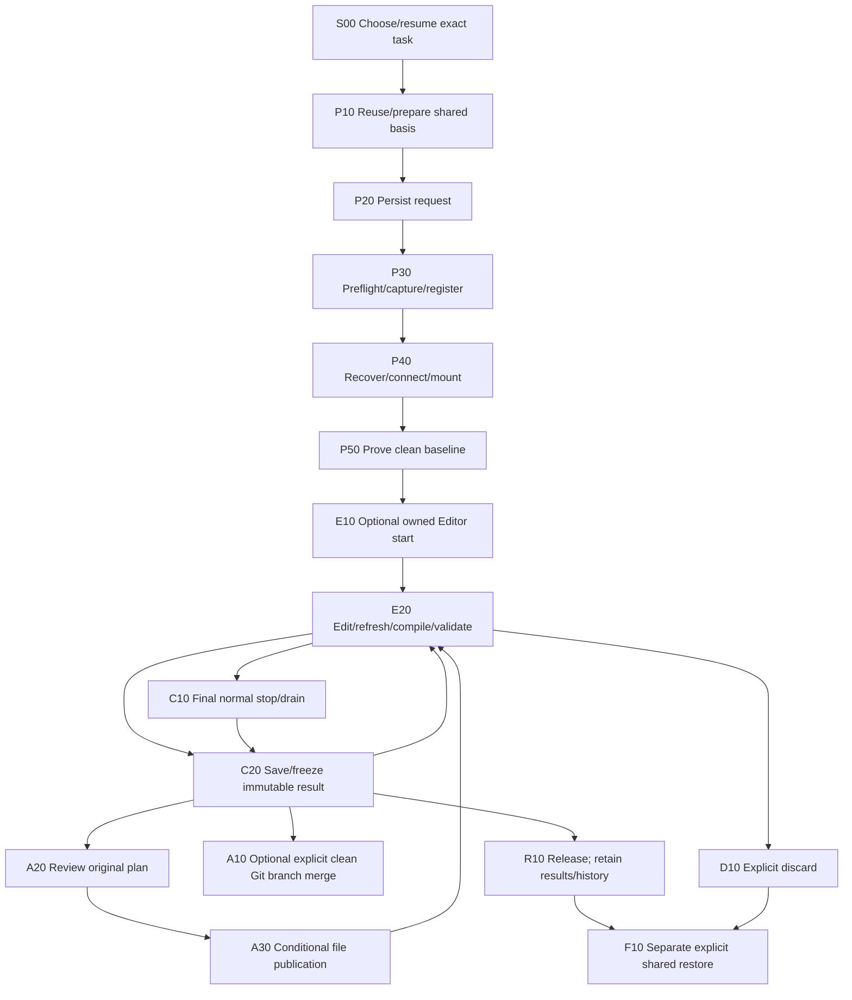
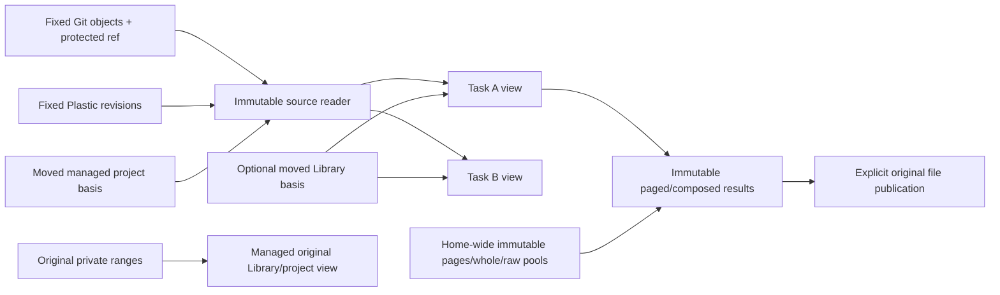
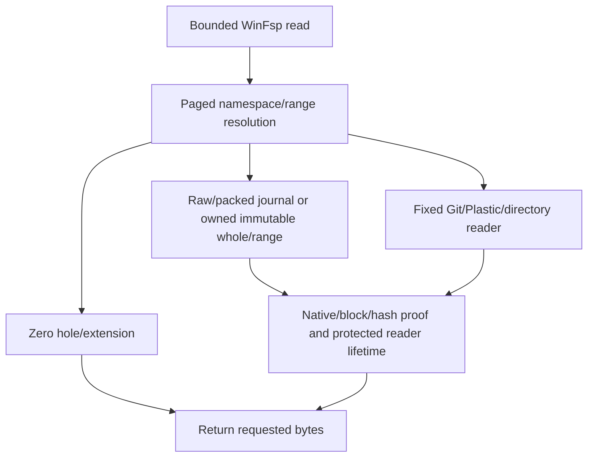
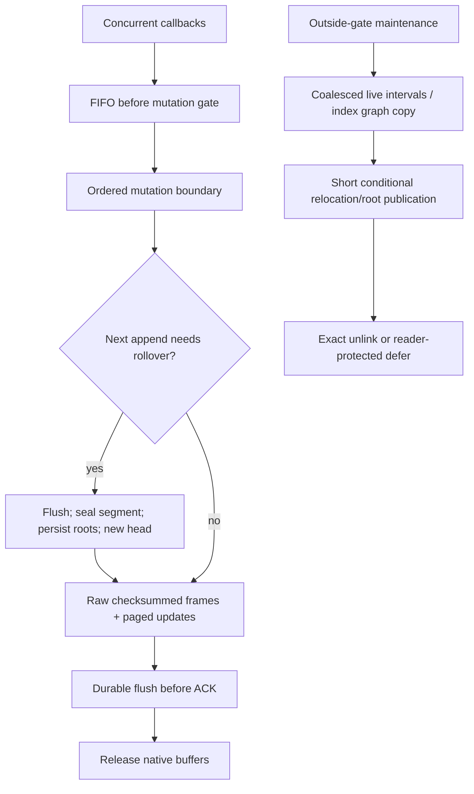
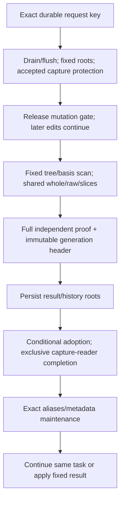
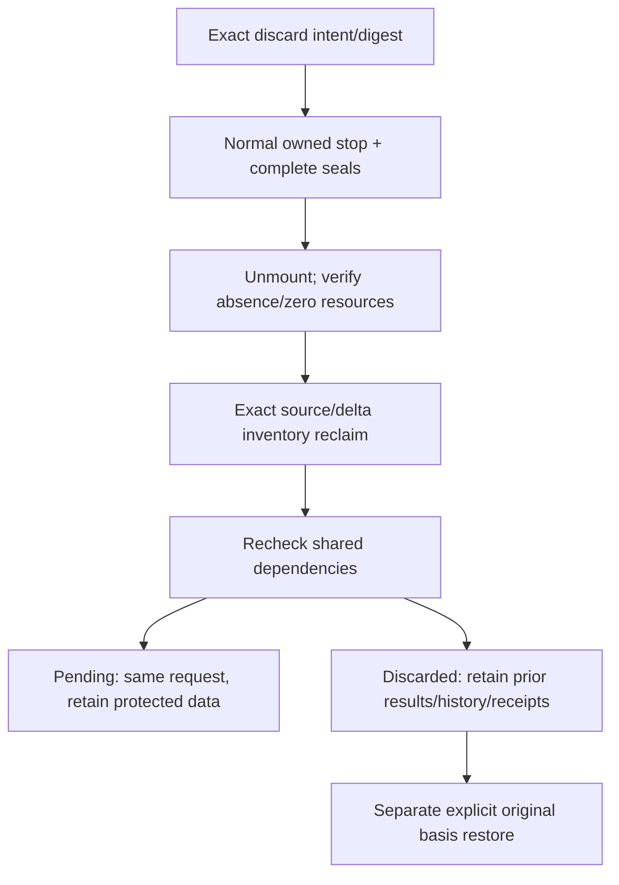

# Splinter lifecycle map for optimization agents

[한국어](ko/lifecycle-optimization-map.md) · [Machine-readable index](lifecycle-optimization-map.json) · [Documentation map](README.md)

**Code snapshot:** SCAL working-tree candidate on base `b68eaaa9e7e78930ff7b4b0b368f137bc3e528c6`, `development`, inspected 2026-11-01. The JSON pins actual file hashes and current symbol hints. The base commit does not contain these uncommitted changes. Source hashes describe implementation; retained execution manifests identify the tested binaries separately.

Current formats are **task v4 / managed basis v3 / product overlay v3**. [SCAL-01–08 qualification](verification/scalable-storage.md) remains **in progress**. Historical RI/GCO/MX and other timings below retain their recorded candidate/input scope. This map is navigation, not permission to start another experiment or a qualification claim.

The [ST-01–23 follow-up](verification/scalable-storage-throughput-followup.md) changes processing within the existing stages. W10 batches up to 64 resize/metadata callbacks and drains both queues before capture/flush; durable completion precedes callback success. B10/C20 batch relocation/adoption frames and raw object publication, retaining pending intents, full native/content proofs and reader fences. Authenticated Stop cancels accepted maintenance and drains it. Canonical readers pin under the catalog lock and hash outside it; bounded 1MiB reads check cancellation. A20 merges sorted plans and bulk-builds selections. Stage order and result/reclamation dependencies remain unchanged; the small timing comparison does not qualify large inputs.

ST-24–28 further coalesces W10's existing node search paths with `PagedMetadataBatch`, shares bounded fixed-operation C20 content proofs and Git catalog merge cursors, and skips unchanged A20 path-import rebuilds. Root publication flushes deferred pages; stage order and proof dependencies are unchanged. The separate structural report records 45 small checks and metadata cost counts, without large elapsed-time qualification.

ST-29–35 adds `StorageResources` and `BoundedParallel` within W10/C20/A20. Bounded insert/change-index batches, larger demand-driven sort/cache budgets and listing metadata reuse reduce repeated work; hashing overlaps enumeration/consumption and independent original staging can overlap under disk headroom. Fixed Plastic revision reads remain serial. Full-target locks, durable progress, cancellation/drain and stage publication order are unchanged. See the resource report for small correctness/cost checks; actual CPU/disk saturation, large-input elapsed time and process memory are unqualified.

## 1. Rules that determine the graph

- Use the returned `data.workspace.path` and retain project/key/id/home/base/request identity. Reuse the same task across editing, capture and repeated application.
- Splinter owns storage, fixed results, its Editor lifetime and exact reclamation. Agents/external MCP or Unity CLI own saving, refresh/reload, compilation and behavior judgment. `ready` or checkpoint is not a compile-success proof.
- Current Windows providers use SJS1-segmented raw SJR2 with paged metadata. Earlier overlay-v2 bounded/append/SJL4 fixtures and development views are separate. Unsupported state is preserved/refused without migration or reclamation.
- No project-wide entry/path/result/journal quota remains. Pages, cache and workers are processing units: 64KiB logical pages, a lazy process-wide 32MiB accounted metadata cache and at most eight independent file workers. Actual filesystem constraints and unique immutable history still consume storage/time.
- Native input/all-target fences and their handle bindings can grow with the pinned set. Payload buffers, native/VCS/Editor memory and total private bytes are separate from the metadata-cache gauge.
- Initial full copying, read hydration and whole-file copy-up remain forbidden. Explicit independent-result preservation and original publication have separate payload-copy costs. Mutable originals never replace immutable backing.
- B10 storage rollover/maintenance, C20 result capture, R10 task release and F10 shared-basis restore have different outputs. Conversation end, timeout, disk pressure or Editor exit authorizes none of them implicitly.

## 2. One-workspace control flow

Editorless work omits E10. Intermediate C20 preserves the original/A/B Editors; final closure uses C10 and complete seals. `checkpoint --release` shares only a fresh capture from that same operation. Separate release rechecks current source. F10 can remain deferred while peers depend on the common basis.

## 3. Data and ownership

Original Library/project views are alternative configurations, not one journal shared across both. Later original changes do not silently flow into A/B. Task Library data is excluded from source results. Git original file publication preserves HEAD/index/branch; branch merge is separate. Plastic registration/revision/administration/locks remain protected without check-in/server mutation.

`records/<id>/workspace.json` contains small lifetime/pending controls and history roots. `delta/` owns segmented/packed backing and page roots; `captures/` owns fixed control/reader/adoption protection; `files/generations/` retains result headers; `journal-packing/` owns external packing plans/protected gaps; `maintenance/` retains completed requests. Home-wide `metadata-store`, `content-store` and `range-store` hold immutable shared data/indices. These are descriptive paths, never deletion targets to construct manually.

## 4. Stage contracts

### S00 — choose and resume

Read [capabilities/schema and agent start](agent-start.md), the [skill](../skills/splinter/SKILL.md) and fixed request identity [K00, K24, K44]. Use isolation when requested/needed. Persisted list/status is not Editor idleness or compile proof. A pending operation supplies its exact recovery action.

### P10 — prepare shared Library/project basis

Explicitly save/stop the exact original Editor, take basis/dependency protection and publish preparation intent [K04, K22, K23]. Stream names/metadata into paged catalogs and hash with bounded workers while retaining complete native identity/content fences [K36, K43]. Move source/Library on the same NTFS volume without initial payload copying; publish the managed original view. Unknown moves/owners preserve/refuse. Basis v3 remains distinct from earlier evidence.

### P20 — persist workspace request

Normalize source/application/storage/base, home separation and key; derive id/digest, lock the task and publish task-v4 create intent [K00, K01]. Same key compares every fixed field. Ended tasks are not reused as new tasks. Pending capture/apply/discard/maintenance blocks unrelated mutation; normal owned stop remains available.

### P30 — preflight, capture and registration

Persist source-checked/capture/registration steps around effects [K02, K05, K06, K19]. Git fixes an owned reachability ref and administration without checkout; Plastic streams a fixed changeset listing and checks exact regular/static registration; None attaches its managed project reference. Stream subprocess catalogs and disk membership validation [K42]; never fall back to another source or mutable original.

### P40 — recover, connect and mount

Validate owner/read access/graft and reconcile the exact provider launch [K05, K07]. Open SJS1/paged roots and replay checksummed active frames. Recover pending capture controls before pins/retirement; source maintenance resumes its accepted request [K37, K38, K39]. Observe provider PID/start/token, mounted path and basis availability. WinFsp uses eight dispatch threads. A missing provider is not permission to remount while owned clients remain.

### P50 — attach, baseline proof and ready

Prove baseline/current clean equality and complete admission [K02, K06, K19, K42]. Git retains index refresh, fixed object proofs and exact read-boundary checks. Large chunk-proof metadata spills to disk; full subprocess output is not joined in memory. None hashes with up to eight workers; Plastic stays serialized and may batch at most 64 exact small revisions/4MiB with ID/segment/length/MD5 and durable SHA-256 proof. Its registration/lock observations also stream. Any initial editorless inspection proof is single-use and binds complete metadata/identity/change barriers. Cache budgets are not process-RAM limits.

### E10 — owned Editor start

Validate reusable mounted task/pending guards and reuse only the observed owned Editor [K01, K08, K09, K20]. Fixed results do not prevent editing/restart. Launch receipts bind project/executable/PID/start/token. Product bridge/eligible one-time Library graph handling remains scoped. External tools establish actual refresh/import/loaded-code success; heartbeat readiness is separate. [Startup evidence](development-cli.md#bounded-unity-startup-evidence) [K28] remains optional bounded observation.

### E20 — edit, refresh and validate

Edit only the returned path. Confirm each external response targets the exact project/PID/start, explicitly refresh when needed and verify loaded code/scene/assets. Do not infer absence from a tool list or repeat an uncertain write. Preserve unnamed dirty scenes, Play/busy/save failure and unrelated original/peer edits. Stop/restart and repeated C20/A20/A30 loops keep the same task/basis/Library.

### I10 — private, basis and hole reads

Read publication retains whole-object/chunk/native proof and close/drain [K06, K10, K40, K42]. A cache hit never substitutes a mutable original or bypasses required integrity. Caller bytes, decoded bytes, physical device reads and cache charge are different quantities.

Directory callbacks keep one handle-owned fixed cursor across native packets [K11, K37]. `ReadDirectory` serializes the complete packet, and `ReadDirectoryEntry` replays one overflow lookahead using the next marker. Restart/seek and explicit pattern changes reset membership; an omitted continuation pattern does not. EOF/Cleanup/Close/error releases the cursor and its index-reader guard. This avoids sorting/statting every directory prefix again for each packet without collecting the whole directory. Component evidence uses actual 256-byte WinFsp.Net buffers and 10,000 generated names; native 100,000-item provider qualification remains separate.

### W10 — ordered writes and flush

At most 64 range writes/16MiB form one batch; provider transfers are at most 1MiB [K11–K13]. Larger callbacks advance through batches. Standalone writes flush before success; batches retain inaccessible ordered state and flush before ACK. Failure poisons uncertain append state and requires replay. Identical private bytes can reuse payload; up to 64 resize/metadata callbacks share a separate ordered batch, retaining SJL4 barriers. Capture/flush drains both queues. Explicit flush reuse needs the same proven unchanged durable handle/length. No background writer or early ACK is added. Telemetry [K26] is bounded and separate from source proof; each metadata callback records its queue wait and shared durable batch interval.

### B10 — rollover and live storage maintenance

The 16MiB/4,096-frame append unit seals via maintained hash/native identity, persists fixed roots and publishes a new head [K37]. It does not rewrite a whole private-state prefix. There is no fixed product journal budget or 2GiB reserve; actual operation/recovery space still matters.

A fixed directory cursor now defers metadata collection before expensive copy/replay while retaining an accepted pending request and the final publication fence. The process-wide cache invalidates exact scope/container partitions; sixteen container handles use explicit LRU, including verified cache-hit recency. Partition bookkeeping is charged inside the same 32MiB budget. The candidate R16 cache/collection window passes 50 focused rows; actual100k continuation and final whole-source qualification remain separate.

Live metadata copy/tail replay runs outside the gate before an atomic root switch [K38]. Partially live closed payload uses a frozen disk plan, coalesced physical intervals and successive targets up to 16MiB. Negative data-only IDs never enter normal-frame replay. Same-sequence relocation matches file/original-block/offset and preserves concurrent writes/truncation/rename. A native/hash target fence precedes old unlink. Pending captures/readers protect old backing; busy deletion defers with physical accounting retained. Unknown creation gaps remain protected/paged outside the delta. Temporary metadata can grow during a long accepted job; bounded cache is not a constant-disk claim.

### C10 — normal owned stop and drain

Save named dirty scenes/assets through external tools; reject unnamed/Play/save failure without destructive action. Product normal stop [K08–K09, K20] binds the owned request and waits for exact process-group/child exit. Timeout is not force authority. Final closure requires ownership-verified zero active processes/working/private memory and removes only owned infrastructure before complete source seals. Original and other task Editors remain running during A finalization.

### C20 — immutable result capture while work continues

The same key returns its first fixed result, never later edits [K32–K34, K39–K41]. A checksummed capture-freeze frame/chunked pending index precedes the external header and pin walk; recovery repairs exact torn/missing controls before retirement. Payload/hash/alias work occurs outside the boundary with bounded workers and failure drain. Git retains protected basis objects and composed file/range results; commit/tree/ref creation waits for explicit branch integration.

Whole/raw pools each deduplicate exact content. Ready whole objects can serve new private chunks; before its first header, a complete matching owned raw chunk can serve a non-Git basis. Descriptor codec v3 separates raw basis from external Git basis. Full SHA/length/ownership/reference proof remains; existing immutable headers are not retargeted, arbitrary partial matches are not used and earlier cross-pool copies can remain [K40].

Final closure uses the same engine after normal stop, includes shutdown writes and compares complete pre/post/unmount seals. Logical accepted-source seals remain stable across storage-only adoption/packing/GC; native backing/hash/page/inventory proof is separate. Capture does not claim compilation success.

### A10 — explicit Git branch merge

Verify the selected immutable result, materialize owned Git objects/ref when needed and call the guarded clean-target merge [K18, K34]. Original branch/index cleanliness and owned abort protection remain. No push or automatic commit of original file publication is implied.

### A20 — fixed original plan

Compare last-applied path state/fixed result/current original [K16, K19, K34–K35, K41]. Selected paths alone advance state, including deletion/reversion and Unity metadata companions. Plan creation returns a fixed ID/digest and bounded preview; page full entries/selection/conflicts [K44]. Git administration and Plastic revision/registration/selector/locks remain protected. A live original requires exact external save/owned deferral/project/PID/start/result/plan cooperation; dirty checks and refresh/reload/compile remain external.

### A30 — conditional file publication

Fix intent/digest/result/selection/permit, inspect/pin all targets and ancestors, then run at most eight independent file workers [K17, K41]. Keep topology/companion order, serialized durable progress and failure/cancellation drain. Concurrent temporary payload reservation does not exceed the largest single-file preparation requirement. This is recoverable per-file publication, not an all-files atomic transaction. Same completed requests return receipts only. Unknown/replaced stages preserve/refuse.

### R10 — release while retaining results

Verify all retained results; normally stop A only and capture final source through C20/full seals [K02, K32]. Unmount and require exact absent provider/mount/handles; unregister owned administration; reclaim exact journal inventory. After delta removal, maintain retained results and force same-request metadata collection before shared snapshot/dependency release [K38, K40, K44]. Independent results/history/receipts survive. Deferred reclaim is pending, not success; keep original/B alive until their separately authorized transitions.

### D10 — explicit discard

No new independent result or compile success is required [K03, K21]. Prior results, original applied changes and peer/shared backing remain protected. Pending mutation/maintenance is recovered before unrelated discard. Normal stop/seal/ownership guards remain mandatory.

### F10 — separate shared original restore

After all dependents/readers leave, explicitly save/stop the exact original Editor [K04, K22–K23]. Resume source packing/retirement, freeze the stopped seal and use native fences. Large restore inventories use paged directory/GUID/range records and a small durable cursor [K43]; unchanged payload is moved and private ranges replayed. Small unchanged/sparse/root-delta/topology/general paths remain only under their route guards, with existing-plan-first recovery and complete identity/content/membership/new-file proof. Route thresholds choose processing implementations, not input rejection. Preserve unknown/foreign entries and exact creation gaps. Restore the original view's current contents; do not merge task Library data. State/manifests/receipts/results remain afterward.

## 5. Maintenance and serialization

`workspace maintain --id --request-key --scope workspace|shared|content|ranges|all` [K44] owns seven fixed metadata scopes. Freeze all authoritative roots, active pool anchors, retained results/reviews/progress and readers before exclusive collection. Physical relocation preserves logical hash; checksummed controls and target native/hash proofs precede old-container deletion. Capture/apply may schedule after 4MiB appended metadata; this is not a quota. Release forces collection. Pending work supplies exact recovery identity and blocks new mutation while stop remains available. Completed retries are receipt-only; status never collects.

Use root-bound `workspace read` pages for history/files/plans/selection/conflicts. `deferred-reclamation` scopes are `content`, `ranges`, `content-references`, `journal-packing`; original publication scratch uses `preserved-scratch`/`workspace-original`. `maintenance-residuals` binds request key and one of the seven store scopes. Count/preview/retained allocation is not deletion permission.

Task/project/basis/pool locks, mutation order, reader drain and full-target publication fences remain distinct. Only independent file work overlaps. Metadata-cache charge, payload/native/Editor/private memory, actual allocated-file union, control evidence, protected history and unresolved residue are separately measured.

## 6. Measurement and historical evidence

Use the stage IDs above, actual binary/source identities and raw start/end/resource evidence. Separate diagnostic/recovery overhead and direct editing from CLI work; do not add overlapping counters. SCAL-08 uses its declared small-input ABBA protocol and coarse stage/total regression gates. Sampled group maxima are lower bounds; missing old cache gauges stay null. Native allocation counts hard-linked identities once and excludes directory/MFT/system cache. Preserved history/protected backing is not automatically a leak. No new Unity experiment is authorized by this map.

### Recorded historical candidate measurements

The wording and numbers below retain their recorded versions; current/unimplemented inside these rows refers to that historical candidate, not this SCAL snapshot.

| Question / stage | Confirmed evidence at its recorded candidate | Next useful observation; not an implementation promise |
| --- | --- | --- |
| Duplicate explicit flush, W10 | [WP](verification/write-path-throughput.md): 2,048 writes+explicit flush 8.114789 → 4.374668s; supplied 16-write batches 0.518767 → 0.299169s | Actual application's explicit flush and write-arrival distribution; ordinary write durability remains |
| CPU preparation vs flush, W10 | WP final 2,048 small writes: preparation 0.033705s, physical flush 4.317677s | Measure real operation mix before adding threads or binary metadata format |
| State sizing vs full checkpoint, B10 | WP sizing 0.277765 → 0.049482s; checkpoint workload total 1.030469 → 0.993840s, checkpoint itself 0.707720s after | Attribute full-state write/proof/replay/publication; incremental representation is unimplemented |
| Large private overwrite comparison | WP candidate reads fell but mean time 1.838353 → 1.882652s | Candidate removed; do not restore it from a read-byte argument alone |
| Creation, P10/P50 | [WC](verification/workspace-creation-throughput.md): matched editorless Git creation 73.953 → 51.915s after Library preparation | First proof/index/manifest costs on a newly authorized input; not a universal large-project gain |
| One Unity lifecycle | [LU](verification/unity-single-lifecycle.md): 359.5 → 300.0s; preparation/creation/restore consistently 50.6s lower | Historical combined candidate; source apply not run; cannot assign WP/RW gain to these totals |
| Normal Editor exit, C10 | [SD](verification/unity-shutdown-diagnosis.md): same method count, one/64 classes 17.34s / 1.60s | Exact shutdown workload/loaded state, not a general method-count scaling law |
| File result preservation, C20 | [RT-03](verification/result-collection-throughput.md): actual editorless None checkpoint **98.429 → 58.944s**, saving **39.485s / 40.1%**; one scan and bounded payload work measured together | Full baseline/result materialization and repeated object proofs remain; no separate causal attribution or Unity/live Plastic timing |
| Metadata mutations, W10 | ST-10 batches up to 64 resize/metadata callbacks with durable completion and queue drain | Native large/concurrent arrival distributions remain unqualified; create/rename/delete retain their existing commits |
| Release vs discard | C20 preservation skipped by discard, but stop/seal/reclaim still required | Same-state per-stage pair; no assumed zero-cost discard or measured universal saving |

RT-03 used the same **2.125GiB / 2,112-file** source bytes and modification times, with fixed edits, in before → after → after → before order. P20–P50 ensure + E20 fixed edit + C20 checkpoint + separate R10 release summed to **203.305 → 159.906s**, an observed **43.399s / 21.3%** saving. Checkpoint command times include enclosing command overhead and are not isolated inner C20 timers. Common P10 preparation (**9.031s**) and F10 restoration (**12.018s**) each ran once outside those sums. No Editor, original apply or discard was timed. Two runs per variant, substantial absolute timing variation and OS caches not cleared limit inference; see the [exact runs and source hashes](../reports/benchmarks/result-collection-throughput-20261026.json).

PR-03 separately compared the next preparation/observation changes on a new matched **2.125 GiB / 2,112-file** source in ABBA order. Ensure **65.258 → 20.650s**, checkpoint **38.916 → 24.524s**, and separate release **35.071 → 9.578s**; the same workspace-phase sum was **139.304 → 54.790s**, saving **84.515s / 60.7%**. Common prepare **8.598s** and restore **11.965s** ran once outside the sums. All source/result identities and owned closure matched. These combined changes are not individual causal timings or a Unity/apply/discard measurement; [PR verification](verification/preparation-throughput.md) owns the limits. The remaining command costs are 20.650s / 24.524s / 9.578s; full admission, independent payload materialization and fresh later-invocation proofs remain.

The remaining measured costs on this input are **P20–P50 creation 65.599s**, **checkpoint 58.944s** and **separate R10 release 35.326s**. Future profiling should separate creation admission/baseline scans, full result materialization/proofs and release source/seal/object revalidation. These totals identify where to investigate; they do not authorize skipping proofs or establish a measured saving for an unimplemented candidate.

Retired/no-gain candidates stay retired: [DF](verification/durable-flush-throughput.md) RAM checkpoint prototype and I/O variants, [LT](verification/lifecycle-throughput.md) flush/read overlap, native Bee, VSS and ReFS. Early ACK or omitted required flush is a different durability policy, not an equivalent optimization. The map adds no backend, worker pool, command or policy switch.

BO-01–05 links F10's sparse restore implementation to W10/P50 diagnostic attribution and E10 evidence capture. Diagnostic OFF/ON overhead, ordinary-NTFS restore comparison and historical RR-01 Unity observations are separate evidence sets. No BO whole-Unity saving or new apply/discard timing is inferred from the earlier tables; follow [the BO plan](plans/lifecycle-bottlenecks.md) and [verification](verification/lifecycle-bottlenecks.md) for the current qualification.

MX10 final observations are apply **338.51645460→326.31757210s** and discard **281.90245510→286.53377360s**. Each uses one whole stopwatch with **1** pair per endpoint; no large whole benefit or causal estimate follows. All selected original-Library sequence **0**, `unchanged-root`, not MX05 A/B2 changed restoration. Large intervals remain preparation about **40s**, ensure **49–52s**, initial ready **98–101s**, final apply **90.57529460s** / discard **44.63291410s**, and restore **22–24s**. [MX10](verification/remaining-lifecycle-optimization.md#mx-10-final-closeout) owns the final gate **1,966 passed / 0 failed / 34 conditional skips**, MX08A adoption evidence and limits; this does not authorize a new trial.

## 7. Completion and recovery interpretation

| Observation | Required interpretation |
| --- | --- |
| Ready / fixed result exists | Task remains reusable; capture version and workspace lifetime are separate |
| Pending capture/apply/maintenance | Resume exact key/result/intent/scope/root; do not bypass with a new task/request |
| Reader-deferred or preserved backing | Keep owned/unknown data and expose indexed residue; no force deletion or zero-allocation claim |
| Released/discarded | Exact task resources absent; historical results/receipts remain and common restore may still be pending |
| Dirty/Play/unnamed scene or unknown external response | Preserve and observe exact Editor/operation before another write/reload/stop |
| Unsupported/corrupt/foreign state | Preserve/refuse; no automatic migration, mutable-original fallback or manual control deletion |

## 8. Current code entry map

Hashes and symbol hints in the JSON are observations of this source snapshot. The stable K00–K35 references remain for navigation; K14/K15 describe historical overlay-v2/development checkpoint code, while current B10 uses K37/K38. New modules below connect scalable preparation through final reclaim. Feature contracts and verification owners remain authoritative.

| Ref | File / symbols |
| --- | --- |
| K00 | [WorkspaceCommands](../src/Splinter.Cli/WorkspaceCommands.cs): `Add`, Runtime composition, command routing; [GeneratedDirectoryCommands](../src/Splinter.Cli/GeneratedDirectoryCommands.cs) |
| K01 | [WorkspaceCoordinator](../src/Splinter.Runtime/WorkspaceCoordinator.cs): `EnsureAsync`, `StartCoreAsync`, `CheckpointAsync`, `IntegrateAsync`, `ReleaseAsync` |
| K02 | [SnapshotWorkspaces](../src/Splinter.Runtime/SnapshotWorkspaces.cs): `EnsureSnapshotAsync`, `ConnectSnapshotAsync`, `CheckpointSnapshotResultAsync`, `ReleaseSnapshotWorkspaceAsync`, `ReuseSnapshotResultAsync` |
| K03 | [WorkspaceDiscard](../src/Splinter.Runtime/WorkspaceDiscard.cs): `DiscardAsync`, seal/dependency/zero-resource guards |
| K04 | [ManagedDirectoryBasis](../src/Splinter.Platform.Windows/ManagedDirectoryBasis.cs): `PrepareAsync`, `AttachAsync`, `DetachAsync`, `RestoreAsync`; [OwnedDirectorySnapshot](../src/Splinter.Platform.Windows/OwnedDirectorySnapshot.cs): file workers/proofs |
| K05 | [NtfsSnapshotWorkspaceBackend](../src/Splinter.Platform.Windows/NtfsSnapshotWorkspaceBackend.cs): capture/connect/seal/unmount/delta/basis reclamation; [ProjectDirectorySnapshotProvider](../src/Splinter.Platform.Windows/ProjectDirectorySnapshotProvider.cs): shared project reference and release observation |
| K06 | [GitSnapshotWorkspaces](../src/Splinter.SourceControl.Git/GitSnapshotWorkspaces.cs), [GitOverlayRegistration](../src/Splinter.SourceControl.Git/GitOverlayRegistration.cs), [GitObjectSnapshotTree](../src/Splinter.SourceControl.Git/GitObjectSnapshotTree.cs): fixed basis, attach/proof/read-ahead, preservation |
| K07 | [WinFspOverlayMountProvider](../src/Splinter.Platform.Windows/WinFspOverlayMountProvider.cs), [WinFspOverlayClient](../src/Splinter.Platform.Windows/WinFspOverlayClient.cs), [WinFspOverlayServer](../src/Splinter.Platform.Windows/WinFspOverlayServer.cs): owned provider/control/replay/mount |
| K08 | [UnityWorkspaceProvider](../src/Splinter.Application.Unity/UnityWorkspaceProvider.cs): start, infrastructure, observation, normal stop |
| K09 | [WindowsProcessWorkspaceProvider](../src/Splinter.Platform.Windows/WindowsProcessWorkspaceProvider.cs): owned launch/group/exit proof |
| K10 | [JournalDeltaStore](../src/Splinter.Runtime/JournalDeltaStore.cs): `Read`, `Write`, `FindPrivateChanges`, `Commit`, `Flush`, replay/index; [JournalDeltaCandidates](../src/Splinter.Runtime/JournalDeltaCandidates.cs): `Seal` |
| K11 | [WinFspOverlayFileSystem](../src/Splinter.Platform.Windows/WinFspOverlayFileSystem.cs): read/write/flush/metadata/cleanup/close callbacks, whole-packet `ReadDirectory`, handle-owned fixed cursor and overflow replay |
| K12 | [WinFspWriteBatch](../src/Splinter.Platform.Windows/WinFspWriteBatch.cs): `SubmitWrite`, `ExecuteWriteBatch`, `DrainAcceptedWrites` |
| K13 | [JournalWriteBatch](../src/Splinter.Runtime/JournalWriteBatch.cs): `WriteBatch`, `FlushPendingWrites`; [WorkspaceWriteBatch](../src/Splinter.Core/WorkspaceWriteBatch.cs): bounds |
| K14 | [JournalDeltaBounded](../src/Splinter.Runtime/JournalDeltaBounded.cs): capacity, checkpoint, generation recovery |
| K15 | [JournalStateFrames](../src/Splinter.Runtime/JournalStateFrames.cs): raw sizing/output/replay |
| K16 | [WorkspaceOriginalApply](../src/Splinter.Runtime/WorkspaceOriginalApply.cs): plan/apply entry guards |
| K17 | [WindowsOriginalFilePublisher](../src/Splinter.Platform.Windows/WindowsOriginalFilePublisher.cs): NTFS conditional publication and receipts; `MoveOwnedEntry`, `CreateOwnedFile`, `CreateOwnedDirectory` |
| K18 | [GitWorkspaceProvider](../src/Splinter.SourceControl.Git/GitWorkspaceProvider.cs): checkpoint source, target/dirty guard, merge |
| K19 | [FileWorkspaceProvider](../src/Splinter.SourceControl.Files/FileWorkspaceProvider.cs), [FileRecordedBasis](../src/Splinter.SourceControl.Files/FileRecordedBasis.cs), [FileOriginalApply](../src/Splinter.SourceControl.Files/FileOriginalApply.cs), [PlasticWorkspaceProvider](../src/Splinter.SourceControl.Files/PlasticWorkspaceProvider.cs): manifests/full result payloads/original plan and intent; [FileInspectionProof](../src/Splinter.SourceControl.Files/FileInspectionProof.cs): one-use generation-bound response proof |
| K20 | [WorkspaceBridge](../unity/Splinter.Editor/Editor/WorkspaceBridge.cs): heartbeat/busy/dirty-scene/Play/normal exit |
| K21 | [WindowsWorkspaceDiscardProvider](../src/Splinter.Workflows.Windows/WindowsWorkspaceDiscardProvider.cs): exact owned delta/basis/source discard |
| K22 | [ManagedDirectoryRestore](../src/Splinter.Platform.Windows/ManagedDirectoryRestore.cs): `ExecuteAsync`, shared `CursorBatchSize=128`, fresh routing/existing-intent resume and general v2 file/range/cursor/final proof |
| K23 | [ManagedUnchangedDirectoryRestore](../src/Splinter.Platform.Windows/ManagedUnchangedDirectoryRestore.cs): eligible unchanged-Library rename/proof/reclamation |
| K24 | [WorkspaceStore](../src/Splinter.Runtime/WorkspaceStore.cs), [ProductState](../src/Splinter.Workflows.Windows/ViewLifecycleState.cs): identity, paths, locks and durable record publication |
| K25 | [ManagedSparseDirectoryRestore](../src/Splinter.Platform.Windows/ManagedSparseDirectoryRestore.cs): `Eligible`, `CreateAsync`, `ResumeAsync`, `OpenJournalEffects`, staged leaf reclamation; [ManagedRestoreJournalProof](../src/Splinter.Platform.Windows/ManagedRestoreJournalProof.cs): fixed-manifest metadata replay; [ManagedRestoreFileAccess](../src/Splinter.Platform.Windows/ManagedRestoreFileAccess.cs): exact handle move/delete, `MoveRelative`, `CreateFile`, `CreateDirectory`, `PinDirectoryAgainstDataWrites` |
| K26 | [WinFspWriteTelemetry](../src/Splinter.Platform.Windows/WinFspWriteTelemetry.cs): `WriteTelemetry`, `ObserveWriteAdmission`, bounded attribution; [JournalWriteAccounting](../src/Splinter.Runtime/JournalWriteAccounting.cs), [SourceViewDeltaStore](../src/Splinter.Runtime/SourceViewDeltaStore.cs): cheap Runtime interval counters |
| K27 | [GitReadObservation](../src/Splinter.SourceControl.Git/GitReadObservation.cs): `ObserveReads`; [GitPreparationObservation](../src/Splinter.SourceControl.Git/GitPreparationObservation.cs): `Run`, `Measure`, `Observe`; [WorkspaceSnapshotBasis](../src/Splinter.Platform.Windows/WorkspaceSnapshotBasis.cs): `ObserveGitReads` |
| K28 | [capture-unity-startup.ps1](../scripts/capture-unity-startup.ps1), [UnityStartupCapture](../scripts/internal/UnityStartupCapture.cs): bounded development evidence, ownership checks, before/live correlation and ordered log analysis |
| K29 | [ManagedRootDeltaDirectoryRestore](../src/Splinter.Platform.Windows/ManagedRootDeltaDirectoryRestore.cs): `Eligible`, `CreateAsync`, `ResumeAsync` — fixed-topology root-delta v1 |
| K30 | [ManagedTopologyDirectoryRestore](../src/Splinter.Platform.Windows/ManagedTopologyDirectoryRestore.cs): `Eligible`, `PreferFresh`, `CreateAsync`, `ResumeAsync`; [ManagedRestoreTopology](../src/Splinter.Platform.Windows/ManagedRestoreTopology.cs): `Build`, `Inventory`, `ForestPins` |
| K31 | [ManagedRestoreControlFiles](../src/Splinter.Platform.Windows/ManagedRestoreControlFiles.cs): `IsPublicationTemporary`; [WindowsDirectoryTreeProof](../src/Splinter.Platform.Windows/WindowsDirectoryTreeProof.cs): `PinDirectory`; [WindowsOwnedDirectoryLease](../src/Splinter.Platform.Windows/WindowsOwnedDirectoryLease.cs): `TransferToRestore` |
| K32 | [WorkspaceGenerations](../src/Splinter.Core/WorkspaceGenerations.cs): `WorkspaceResultGeneration`; [WorkspaceGenerations](../src/Splinter.Runtime/WorkspaceGenerations.cs): `CaptureGenerationCoreAsync`; [JournalSourceCapture](../src/Splinter.Runtime/JournalSourceCapture.cs): `CaptureSource` |
| K33 | [NtfsSourceGenerations](../src/Splinter.Platform.Windows/NtfsSourceGenerations.cs): `CaptureSourceAsync`; [WinFspSourceCapture](../src/Splinter.Platform.Windows/WinFspSourceCapture.cs): `CaptureSource`; [WindowsJournalFilePins](../src/Splinter.Platform.Windows/WindowsJournalFilePins.cs): `RecoverCopies`, `CreateDirectory`; [GitSnapshotReadScope](../src/Splinter.SourceControl.Git/GitSnapshotReadScope.cs): `OpenReadScope`, `VerifyReadBoundary`; [WorkspaceSnapshotBasis](../src/Splinter.Platform.Windows/WorkspaceSnapshotBasis.cs): `OpenCaptureTree`; [CapturedResultReaders](../src/Splinter.Platform.Windows/CapturedResultReaders.cs): `Open` |
| K34 | [FileSourceGenerations](../src/Splinter.SourceControl.Files/FileSourceGenerations.cs): `PreserveGenerationAsync`; [GitGenerationIntegration](../src/Splinter.SourceControl.Git/GitGenerationIntegration.cs): `IntegrateGenerationAsync`; [GitOriginalPublicationGuard](../src/Splinter.SourceControl.Git/GitOriginalPublicationGuard.cs): `GitOriginalPublicationGuard`; [ResultGenerationDiagnostics](../src/Splinter.Runtime/ResultGenerationDiagnostics.cs): `Open`, `Measure` |
| K35 | [UnityProjectPolicy](../src/Splinter.Application.Unity/UnityProjectPolicy.cs): `AcquireOriginal`; [WindowsOriginalEditorIdentityVerifier](../src/Splinter.Platform.Windows/WindowsOriginalEditorIdentityVerifier.cs): `Acquire` |

| K36 | [PagedMetadataStore](../src/Splinter.Runtime/PagedMetadataStore.cs): `PagedMetadataStore`, `Build`, `ReadPage`; [DirectoryMetadataTree](../src/Splinter.Runtime/DirectoryMetadataTree.cs): `DirectoryMetadataTree`; [PagedSnapshotCatalog](../src/Splinter.Runtime/PagedSnapshotCatalog.cs): `Walk`, `Find`, `EnumerateChildren`; [PagedPathInterner](../src/Splinter.Runtime/PagedPathInterner.cs): `Intern`, `Import`, `Resolve`; [MetadataExternalSort](../src/Splinter.Runtime/MetadataExternalSort.cs): `Order`; [MetadataSpool](../src/Splinter.Runtime/MetadataSpool.cs): `WithPathMarkers`; [PagedMetadataDerivedStore](../src/Splinter.Runtime/PagedMetadataDerivedStore.cs): `Derive`; [PagedMetadataStoppedAudit](../src/Splinter.Runtime/PagedMetadataStoppedAudit.cs): `VerifyStoppedGraph`, `VerifyUnownedStoppedContainer` |
| K37 | [JournalSegmentStorage](../src/Splinter.Runtime/JournalSegmentStorage.cs): `Rotate`, `OpenSealed`, `FileName`; [JournalDeltaSegments](../src/Splinter.Runtime/JournalDeltaSegments.cs): `OpenSegmented`, `RollSegment`, `SegmentedSeal`; [JournalPagedIndex](../src/Splinter.Runtime/JournalPagedIndex.cs): `InitializePagedIndex`, `EncodeExtent`, `DecodeExtent`; [JournalControlIntegrity](../src/Splinter.Runtime/JournalControlIntegrity.cs): `Read`, `Digest`; [PagedExtentMap](../src/Splinter.Runtime/PagedExtentMap.cs): `PagedExtentMap` |
| K38 | [JournalLiveIndexCollection](../src/Splinter.Runtime/JournalLiveIndexCollection.cs): `CollectLiveMetadata`, `ReplayShadow`, `CleanupRetiredIndices`, `ReconcileRetiredEmptySegments`, `RepackContentMatches`; [JournalPartialSegmentPacking](../src/Splinter.Runtime/JournalPartialSegmentPacking.cs): `PackPartialSegments`, `SelectPackingUnit`, `OpenPackedProof`, `EnumeratePreservedPacking`; [JournalSegmentCollection](../src/Splinter.Runtime/JournalSegmentCollection.cs): `MaintainLiveStorage`, `CollectDeadSegments`; [JournalDeltaRestore](../src/Splinter.Runtime/JournalDeltaRestore.cs): `EnumerateRestore`, `ReadRestoreRange`; [SegmentedJournalReclamation](../src/Splinter.Runtime/SegmentedJournalReclamation.cs): `ReclaimDirectory`; [JournalPagedIndexReclamation](../src/Splinter.Runtime/JournalPagedIndexReclamation.cs): `ReclaimPagedIndices`; [JournalIndexResiduals](../src/Splinter.Runtime/JournalIndexResiduals.cs): `EnumeratePreservedJournalIndices`, `PreserveOpaqueIndex`; [JournalReadOnlyReplayScope](../src/Splinter.Runtime/JournalReadOnlyReplayScope.cs): `EnumeratePreservedReadOnlyReplays`; [JournalStoppedIndexPreservation](../src/Splinter.Runtime/JournalStoppedIndexPreservation.cs): `PreserveWholeStoppedIndex`, `AuditStoppedFrames`; [JournalStoppedJsonRoots](../src/Splinter.Runtime/JournalStoppedJsonRoots.cs): `StreamStoppedJsonRoots` |
| K39 | [JournalFrozenCaptureControls](../src/Splinter.Runtime/JournalFrozenCaptureControls.cs): `StoreFrozenCapture`, `RecoverSourceCaptures`; [JournalPagedCapture](../src/Splinter.Runtime/JournalPagedCapture.cs): `ValidatePagedCapture`, `GetFileRanges`; [JournalChangeReader](../src/Splinter.Runtime/JournalChangeReader.cs): `BindChangeView`; [WindowsSourceChanges](../src/Splinter.Platform.Windows/WindowsSourceChanges.cs): `ObserveChangesAsync`; [SourceChanges](../src/Splinter.Core/SourceChanges.cs): `SourceChangeView`, `ContentIdentity`; [SourceCaptureRanges](../src/Splinter.Core/SourceCaptureRanges.cs): `ISourceCaptureRanges` |
| K40 | [OwnedContentStore](../src/Splinter.Runtime/OwnedContentStore.cs): `Preserve`, `TryReferenceExisting`, `Open`; [OwnedRangeContentStore](../src/Splinter.Runtime/OwnedRangeContentStore.cs): `Preserve`, `TryReferenceExisting`, `ReadDeferredReclamationPage`; [ResultFileContentStore](../src/Splinter.Runtime/ResultFileContentStore.cs): `Preserve`, `ReferencesForFiles`; [JournalRangeAdoption](../src/Splinter.Runtime/JournalRangeAdoption.cs): `AdoptCapturedRanges`, `EnumerateRequiredCapturedContent`; [CapturedRangeAdoptionStore](../src/Splinter.Runtime/CapturedRangeAdoptionStore.cs): `Publish`; [OwnedCapturedContentReader](../src/Splinter.Runtime/OwnedCapturedContentReader.cs): `OwnedCapturedContentReader` |
| K41 | [OriginalApplyPages](../src/Splinter.Runtime/OriginalApplyPages.cs): `ReadPlan`, `ReadSelectionPage`, `SavePlan`; [FilePagedQueries](../src/Splinter.SourceControl.Files/FilePagedQueries.cs): `ReadResultPage`, `ReadAppliedPathsPage`; [FileOriginalApply](../src/Splinter.SourceControl.Files/FileOriginalApply.cs): `PlanOriginalAsync`, `ApplyOriginalAsync`; [WindowsOriginalFilePublisher](../src/Splinter.Platform.Windows/WindowsOriginalFilePublisher.cs): `Publish` |
| K42 | [GitSourceMetadata](../src/Splinter.SourceControl.Git/GitSourceMetadata.cs): `GitSourceMetadataManifest`; [GitPagedSourceFingerprint](../src/Splinter.SourceControl.Git/GitPagedSourceFingerprint.cs): `InspectPagedSourceAsync`, `GitRecords`; [GitChunkProof](../src/Splinter.SourceControl.Git/GitChunkProof.cs): `GitChunkProof`; [GitSourceResult](../src/Splinter.SourceControl.Git/GitSourceResult.cs): `PreserveAsync`; [PlasticRevisionManifest](../src/Splinter.SourceControl.Files/PlasticRevisionManifest.cs): `BuildCatalog`; [PlasticRevisionSnapshotTree](../src/Splinter.SourceControl.Files/PlasticRevisionSnapshotTree.cs): `Read`; [PlasticRevisionClient](../src/Splinter.SourceControl.Files/PlasticRevisionClient.cs): `ListAsync`, `VerifyProjectAsync`; [PlasticRevisionBridge](../src/Splinter.SourceControl.Files/PlasticRevisionBridge.cs): `ValidateBatch`; [PlasticWorkspaceClient](../src/Splinter.SourceControl.Files/PlasticWorkspaceClient.cs): `EnumerateAsync`, `OriginalStateAsync`; [PlasticLockIndex](../src/Splinter.SourceControl.Files/PlasticLockIndex.cs): `Affects`; [GitCommandLifetime](../src/Splinter.SourceControl.Git/GitCommandLifetime.cs): `GitCommandLifetime`, `WaitAsync`; [PlasticManifestObservationScope](../src/Splinter.SourceControl.Files/PlasticManifestObservationScope.cs): `Check`, `Observe` |
| K43 | [OwnedDirectoryManifest](../src/Splinter.Platform.Windows/OwnedDirectoryManifest.cs): `OpenIndex`; [OwnedDirectorySnapshot](../src/Splinter.Platform.Windows/OwnedDirectorySnapshot.cs): `CaptureCancellable`, `VerifyContents`; [ManagedPagedDirectoryRestore](../src/Splinter.Platform.Windows/ManagedPagedDirectoryRestore.cs): `ExecuteAsync`; [ManagedDirectoryRestore](../src/Splinter.Platform.Windows/ManagedDirectoryRestore.cs): `RestoreIndexExceeds`, `ResumeStoppedSourceMaintenance`; [SnapshotInputChecks](../src/Splinter.Platform.Windows/SnapshotInputChecks.cs): `VerifyTree` |
| K44 | [WorkspaceMetadataMaintenance](../src/Splinter.Core/WorkspaceMetadataMaintenance.cs): `IWorkspaceMetadataMaintenance`; [WorkspaceMetadataMaintenance](../src/Splinter.Runtime/WorkspaceMetadataMaintenance.cs): `MaintainMetadataAsync`, `RequireMetadataMaintenanceComplete`; [MetadataMaintenance](../src/Splinter.Runtime/MetadataMaintenance.cs): `Collect`; [PagedMetadataCollection](../src/Splinter.Runtime/PagedMetadataCollection.cs): `Collect`, `PendingCollection`, `CollectionReceipt`; [PagedMetadataGraphCopy](../src/Splinter.Runtime/PagedMetadataGraphCopy.cs): `CopyRootsTo`; [PagedMetadataOwnership](../src/Splinter.Runtime/PagedMetadataOwnership.cs): `ValidateReclaimInventory`; [OwnedMetadataMaintenance](../src/Splinter.Runtime/OwnedMetadataMaintenance.cs): `CollectMetadata`; [SharedMetadataPoolMaintenance](../src/Splinter.Runtime/SharedMetadataPoolMaintenance.cs): `Collect`; [FileMetadataMaintenance](../src/Splinter.SourceControl.Files/FileMetadataMaintenance.cs): `MaintainMetadataAsync`, `ReadMaintenanceResiduals`; [WorkspaceMaintenanceCommands](../src/Splinter.Cli/WorkspaceMaintenanceCommands.cs): `Add`; [WorkspaceReadCommands](../src/Splinter.Cli/WorkspaceReadCommands.cs): `Add`, `ReadDeferred` |
| K45 | [WorkspaceHistory](../src/Splinter.Core/WorkspaceHistory.cs): `WorkspaceHistory`, `WorkspaceHistoryReference`; [WorkspaceHistoryStorage](../src/Splinter.Runtime/WorkspaceHistoryStorage.cs): `Read`, `Append`, `Enumerate`; [FoundationGateway](../src/Splinter.Host/FoundationGateway.cs): `Capabilities`; [ContractCatalog](../src/Splinter.Protocol/ContractCatalog.cs): `Validate` |

### Additional historical programme records

The following numbers apply only to their recorded verification IDs/versions.

[BD-01](verification/unity-lifecycle-bottleneck-diagnosis.md) adds one actual GUI diagnostic on its recorded committed code: 391.3s through normal stop, discard and exact Library restoration, including 29.7s of explicit capture/server observation. It is not a before/after comparison. Total decoder wait was 0.000837s, so the cache-bypass candidate was removed. W10 serial durable writes, E10 initialization and P50 payload retention/re-decoding remain distinct candidates; their overlapping totals are not additive savings. Original apply and a new optimized GUI comparison remain unqualified.

[GR-01–03](verification/git-payload-retention.md) tested a 1.5GiB/32,768-entry Git payload cache. Same-input native creation averaged **50.661 → 48.550s (2.111s / 4.2%)**. The small time saving did not meet the large-gain criterion, so the candidate was removed and **256MiB/4,096 entries remain**. This is editorless creation evidence, not a whole Unity lifecycle improvement. See the [fixed scope](plans/git-payload-retention.md).

MX05 adopted A and publication-count-guarded B2. F10 ordinary-NTFS restoration measured fixed 46.05306965→14.73430160s (31.31876805s / 68.00582087%) and bulk 45.36571795→14.74108300s (30.62463495s / 67.50611769%); leaf stays on general restoration and is effectively unchanged at 5.02044795→5.00588275s. The full gate passed 1,941, failed 0 and skipped 33. Whole-test-process observed mean OS peak working-set increases of 26,806,272 / 40,529,920 bytes were judged acceptable for these inputs, with setup/assert and sampling limits. Historical A/B1 candidates, guard arithmetic and component savings are not promoted to current whole-Unity improvement. Read the [MX program](plans/remaining-lifecycle-optimization.md), [candidate verification](verification/remaining-lifecycle-optimization.md) and [tracked report](../reports/benchmarks/remaining-lifecycle-optimization-20261028.json) together.

RI-01–08 scoped qualification now includes the current Windows cm 11.0.16.10484 private reader, raw/BOM and segmented binary reads, and all three fixed Unity original/A/B sequences. That historical source identity remains in snapshot history, separate from the current SCAL hashes and qualification.

Update both languages/index after lifecycle, ownership, durability, defaults, result materialization or reclamation changes. Refresh hashes/symbol hints from the final reviewed source; keep historical evidence tied to its recorded versions and never infer a new native/Unity/performance pass.
