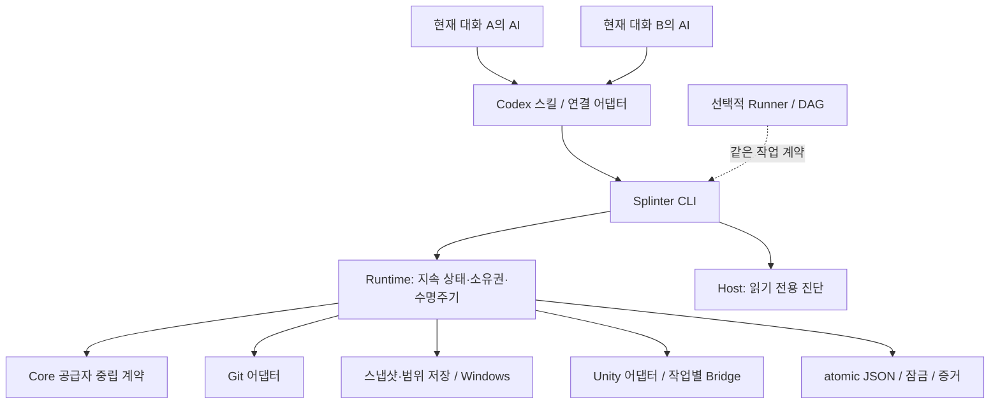

# Splinter 목표 구조와 구현 계획

제품 요구사항은 [plan.html](../../plan.html), 현재 구현은 [foundation](../foundation.md)에서 확인한다. 이 문서는 목표 구조와 남은 작업이며 아래 제안 API·Host·DB·단계를 모두 구현된 기능으로 해석하지 않는다.

현재 우선순위는 [저장공간·준비·재개 비용](storage-priority-and-editor-modes.md), [NR 지원 관문](ntfs-recovery-and-support.md), [설치·대화 연결·폐기](session-workflow-and-installation.md), [권한 서비스](storage-privilege-service.md)다. 내부 알파 성공은 전체 필수 48개 공개 시나리오의 완료가 아니다.

[Library 수명주기와 WF-09~12 일반 권한 Unity 실행](../verification/product-validation-unelevated.md)은 작은 fixture에서 scoped-complete-with-limitations다. 기존 Library snapshot 재사용·수명 의존성·private 정리·재증가·독립 결과와 회수의 이번 범위를 마감했다. 남은 판단은 대형 입력의 용량 목표·일반 NR 지원·반복 비용과 모드 채택이며, SF-02/03 전체는 Partial이다. 미실행 대형 비교·제품 설치/binding/discard는 각 관문의 NotRun을 유지한다.

확정한 [NR-01/02 준비 단계 중단 복구](ntfs-recovery-and-support.md#확정-범위-nr-0102-준비-단계-중단-복구)는 [현재 후보의 26개 실제 경계·보존/회수](../verification/preparation-recovery.md)로 scoped-complete-with-limitations 판정했다. 게시 실패 1건의 원인 미확정과 정상 재개 증거를 함께 유지한다. 다음 독립 단위는 NR-03의 나머지 쓰기/flush 중단 관문이며 Library 재자격·대형 비교·설치/binding/discard·NR 전체 장애는 별도 범위다.

## 2. AI 사용성을 먼저 고정한다

| 원칙 | 구현 결정 | 검증 방법 |
| --- | --- | --- |
| 첫 호출에서 다음 행동을 알 수 있다 | `capabilities`, `doctor`, 명령별 `schema`; 현재 사용 가능 여부와 준비 후 가능 여부를 분리 | 지침을 처음 읽은 에이전트가 필요한 기능·차단 이유를 발견 |
| 필요할 때만 사용한다 | 명시 요청 또는 독립 실행 필요를 관측하면 Splinter 사용, 그 외 직접 작업 | direct 사례의 새 workspace/snapshot/Editor 0, 병렬 사례의 Codex 별도 worktree 0 |
| 정상 경로의 관리 호출이 적다 | 각 대화가 작업 연결을 재사용하고 workspace·Unity·완료 명령을 실행 | 사용자 수동 키 입력·복사·포트/Editor 관리 0회 |
| 읽을 출력이 작다 | 요약 우선, 변경분 cursor, 페이지 제한, 별도 artifact 조회 | 대형 로그도 기본 응답을 넘치게 하지 않음 |
| 재시도 판단을 추측하지 않는다 | 안정된 오류 코드, `nextActions`, 재시도 분류, `operationId` | 같은 요청 재전송·응답 유실에도 중복 실행 없음 |
| 문맥이 끊겨도 재개한다 | Runtime의 영속 작업 상태와 연결 manifest 대조; Codex 세션 locator는 어댑터 소유 | 같은 작업·변경분·경로·증거 복원, 타 대화 오접속·중복 생성 없음 |
| 대화와 작업의 수명을 구분한다 | 응답/대화 종료에는 유지, 사용자 완료/폐기 의도에만 해당 수명주기 실행 | A만 완료해도 B 지속; 보존/반영/폐기 결과를 구분 |
| 성공 여부를 프로그램이 판단한다 | 요구된 증거와 소스 revision이 일치해야 검증 성공 | 작업자의 성공 메시지·종료 코드만으로 성공 처리하지 않음 |
| 사람에게 같은 질문을 반복하지 않는다 | 최초 설정 정책의 범위 안에서 자동 수행; 추가 행동이 꼭 필요할 때만 구조화해 반환 | 정상 반복 실행의 사용자 운영 개입 0회 목표 |

CLI 기본 JSON·비대화형과 `--json`·`--non-interactive`를 구현했다. 현재 `--human`은 JSON 들여쓰기다. 향후 사람용 표·설명과 `setup --interactive`의 최초 설정 대화를 추가한다. 토큰 낭비를 줄이되 필요한 진단은 artifact ID로 즉시 찾을 수 있게 한다.

자연어 분할·의미 판단을 Core 안에 넣지 않는다. 자연어 스킬 선택의 성공은 모델에 의존하므로 반복된 실제 Codex 세션에서 따로 평가한다. 실패 시 명시 호출 경로도 제공한다.

## 3. 기술 선택과 운영 비용

| 영역 | 제안 선택 | 선택 이유와 비용 |
| --- | --- | --- |
| 외부 프로그램 | C# / .NET 10 LTS | Windows API와 비동기 프로세스·IPC 구현에 적합하고 Unity와 언어를 공유한다. 배포 크기와 런타임 패치 관리는 감수한다. |
| 배포 | self-contained `win-x64` 폴더 패키지부터 시작 | 사용자가 .NET SDK를 설치하거나 빌드하지 않게 한다. 초기에는 single-file·Native AOT 최적화를 완료 조건에 넣지 않는다. |
| CLI 파싱 | `System.CommandLine` | 직접 옵션 파서를 만들지 않는다. 파싱 오류도 공통 JSON 오류로 변환하는 경계를 둔다. |
| 상태 저장 | 현재 atomic JSON + 작업/저장소 잠금 유지 | 대화 간 지속성과 멱등성을 먼저 완성한다. SQLite/단일 writer는 동시성·조회·운영 비용의 필요를 확인한 뒤 선택하며 전환 시 migration·복구·배포를 검증한다. |
| JSON | Host는 `System.Text.Json`, 검증은 `JsonSchema.Net` 후보 | JSON Schema를 공개 계약의 기준으로 삼는다. 패키지 지원·라이선스·schema 적합성 확인 후 버전을 고정한다. |
| 공통 조정 | 작업별 명시적 상태 전이 + 잠금·자원 admission | 독립 대화의 명령과 저장소 통합 순서를 제어한다. DAG 실행기는 선택적 확장으로 분리한다. |
| Git | 설치된 Git CLI 및 Git LFS | 기존 filters·attributes·hooks 동작을 Git에 맡긴다. 명령 인자 배열과 기계용 출력을 사용한다. |
| 저장소 | 스냅샷 + 범위별 변경 저장 + OS 파일시스템 어댑터 | Windows VSS/WinFsp는 우선 후보. 최초 전체 복제·읽기 hydration·파일 copy-up은 금지하며 실제 호환성과 설치 비용을 검증한다. ReFS는 선택적 최적화다. |
| 로컬 통신 | Windows named pipe, 버전 있는 JSON 메시지 | 외부 포트 없이 사용자 범위를 제한한다. 전송 계층은 교체할 수 있게 둔다. |
| Unity | Editor 전용 UPM 브리지 + 선택적 테스트/런타임 모듈 | Unity가 지원하는 C#·API 대상으로 별도 빌드한다. Host 어셈블리·SQLite·.NET 10을 Unity에 로드하지 않는다. |
| 테스트 | .NET 단위·프로세스 시험 + Unity Test Framework | Core/fake는 Unity 없이 실행한다. 실제 NTFS 스냅샷·마운트·GUI Unity·Codex 시험은 전용 환경에서 실행한다. ReFS는 별도 회귀다. |

.NET 10은 확인일 기준 지원 중인 LTS이며 지원 종료일은 2028-11-14다. 이를 외부 런타임 기준으로 제안한다. [공식 지원 정책](https://dotnet.microsoft.com/en-us/platform/support/policy). self-contained 배포는 런타임을 함께 제공하는 공식 배포 방식이다. [배포 문서](https://learn.microsoft.com/en-us/dotnet/core/deploying/).

CLI·DB·schema 처리는 기존 라이브러리를 우선한다. 직접 만드는 부분은 Splinter의 작업 상태·소유권·검증·복구 정책과 스냅샷·변경 저장 연결이다. 라이브러리의 역할은 [System.CommandLine](https://learn.microsoft.com/en-us/dotnet/standard/commandline/), [Microsoft.Data.Sqlite](https://learn.microsoft.com/en-us/dotnet/standard/data/sqlite/), [JsonSchema.Net](https://docs.json-everything.net/schema/basics/)에서 확인했다. 현재 CLI·schema 패키지를 중앙 버전과 lock 파일에 기록했고, DB 패키지는 실제 영속 구현 시 추가한다.

Rust/Go는 작은 배포와 시스템 구현에 장점이 있으나 첫 구현에서는 Unity C# 외에 별도 언어 체계를 운영해야 한다. TypeScript는 에이전트 연결에 편리하지만 ReFS·Job Object용 네이티브 경계가 추가된다. 현재 범위에서는 C#이 전체 유지 비용을 줄인다는 설계 판단이다. 에이전트가 사용하는 언어와 제품의 구현 언어는 독립적이다.

## 4. 구조와 책임 경계



그림은 기본 실행 관계다. Core에는 Codex 세션 API나 Unity/Win32/Git 전용 API를 넣지 않는다. CLI가 현재 Runtime·읽기 전용 Host·어댑터를 조합한다. 스킬/연결 어댑터는 사용 판단과 대화 바인딩, Runtime은 공통 상태·검증·통합·회수 정책을 맡는다. 별도 AI 조정자는 필요하지 않다. 상주 Host와 저장소 변경은 이 책임 경계를 유지한 채 별도 근거로 결정한다.

### 프로젝트 배치

```text
Splinter.slnx
global.json                         검증한 SDK 고정
Directory.Build.props               공통 빌드·분석 규칙
Directory.Packages.props            의존성 버전 관리
contracts/v1/                       JSON Schema·명령 descriptor·예제
src/
  Splinter.Core/                    모델·정책·상태 전이·ports
  Splinter.Protocol/                외부 DTO·검증·직렬화
  Splinter.Host/                    현재 읽기 전용 조합·진단
  Splinter.Runtime/                 지속 상태·작업/저장소 잠금·수명주기
  Splinter.Cli/                     명령 파싱·어댑터 조합·출력
  Splinter.Persistence.Sqlite/      선택적 후속 전환: migration·저널·조회
  Splinter.SourceControl.Git/       snapshot·worktree·결과·통합
  Splinter.Storage/                 범위별 변경 저장·읽기 합성·저널
  Splinter.Storage.ReFS/            선택적 네이티브 복제 최적화
  Splinter.Platform.Windows/       snapshot·파일시스템 제공·프로세스·pipe
  Splinter.SessionRunner/           자식 실행·로그 보관용 내부 실행 파일
  Splinter.Application.Unity/      탐지·캐시·브리지·복구
  Splinter.Agent.Codex/             계획: 대화 바인딩·경로/권한·지침 발견
  Splinter.AgentRunner.Codex/       선택적 후속: 작업자 시작·이벤트
packages/unity-bridge/
  Editor/                          핵심 연결·메인 스레드 명령 큐
  TestFramework/                   선택적 UTF 연결
  RuntimeProbe/                    명시적으로 사용하는 Play 관찰
tests/                             .NET 단위·통합·CLI 시험
conformance/                       fake와 공급자 공통 계약 시험
../splinter-unity/                 사용자가 제공한 독립 Git/Unity fixture
experiments/                       P0의 작은 재현 프로그램
install/                           프로젝트용/전역용 설치·연결·제거
integrations/codex/                 최소 스킬·선택적 플러그인 배포 원본
docs/                              계획·현재 계약·운영 문서
```

처음부터 위 폴더를 빈 프로젝트로 모두 생성하지 않는다. P0는 실험에 필요한 것만, P1은 기존 Core/Protocol/Runtime/Host/CLI/fake를 우선 사용한다. Persistence/Runner는 필요가 확정된 후속 범위다. 실제 구현 단계에서 나머지를 추가한다.

`IStorageBackend`, `ISourceControlAdapter`, `IProcessBackend`, `IApplicationAdapter`, `IAgentRunner`는 지원 검사, 실행 계획, 부작용 실행, 사후조건 조회를 분리한다. 결과에는 capability, 진단, 증거 ID를 반환한다. 공급자 전용 옵션은 공급자별 schema로 검증한다. Core에 `UnityProject`, `GitBranch`, 드라이브 문자 같은 필수 필드를 넣지 않는다.

v0의 어댑터는 빌드 시 명시적으로 등록한다. 임의 DLL 로더·플러그인 마켓·범용 원격 분산 실행은 만들지 않는다. 다른 앱과 VCS를 흉내 내는 fake로 경계를 검증한다.

## 5. 상태·소유권·증거 모델

### 영속 엔터티

| 엔터티 | 식별자와 핵심 데이터 |
| --- | --- |
| Project | `projectId`, 공급자별 locator, 프로젝트 상대 경로, 적용 정책 revision |
| SourceSnapshot | `sourceSnapshotId`, opaque source revision, 내용 manifest, 상속된 사용자 변경 |
| Baseline | `baselineId`, snapshot·체크아웃 조건·앱 버전·패키지·타깃·overlay hash, 봉인 상태 |
| Task / ConversationBinding | 일반 작업 ID·안정된 key, 프로젝트·workspace·상태 위치·owner 세대·완료 의도; Codex locator는 연결 모듈 소유 |
| Plan (선택적) | 여러 작업의 목표·선행 결과·의존성·capability·검증과 예산 |
| Workspace | `workspaceId`, 공급자의 `sourceWorkspaceId`, 루트, baseline, 작성자 세대, 수명 상태 |
| Operation / Step / Attempt | 요청키·입력 hash·상태·단계·취소·deadline·실행 시도·복구 분류 |
| Session / Lease | 역할, 프로세스 시작 정보, 작업공간, 세대, 권한, 만료, 자원 예약 |
| Artifact / Evidence | 형식·내용 hash·크기·보존 위치, 소스/설정/실행 세대, 검증 결과 |
| Integration | 입력 결과 목록, 대상 기준, 후보 revision, 검증 묶음, 적용 전제조건 |
| DiscardIntent (계획) | 명시적 폐기 의도, 정확한 workspace/owner 세대/변경 상태, 공유 의존성, 단계별 회수·폐기 영수증 |

Git commit만으로 검증 대상을 표현하지 않는다. 아직 커밋하지 않은 소스와 에셋까지 manifest로 계산한 `sourceRevision`을 별도로 둔다. Git 쪽 필터 처리 후 객체 ID와 실제 체크아웃 바이트 hash도 구분한다.

`baseRevision`, `sourceSnapshotId`, `overlayRevision`, `sourceRevision`, `compiledRevision`, `validatedRevision`, `integrationRevision`의 의미를 혼합하지 않는다. 증거에는 Unity/UTF/패키지·타깃·검증 프로필도 연결한다. 무시한 파일이 실행에 영향을 주면 명시 의존성으로 hash를 포함하거나 증거의 제한으로 표시한다.

### 상태 전이

```text
Workspace:
Requested → Provisioning → Materializing → Ready → Active
          → Quiescing → Collected → Integrating → Releasing → Released
보존 회수: Collected → Releasing → Released (독립 결과 유지)
명시 폐기: Active / RecoveryRequired → DiscardRequested → Discarding → Discarded
중단 경로: Suspended / RecoveryRequired

Operation:
Accepted → Queued → Running → WaitingForReload → Reconciling
         → Succeeded / Failed / Cancelled / Interrupted / OutcomeUnknown

Application:
수명 상태 + 작업 상태 + 알려진 소스 상태
예: Connected + Compiling + sourceRevision=R4, compiledRevision=R3
```

`CancelRequested`는 요청 상태다. 실제 중지가 확인되기 전 `Cancelled`로 끝내지 않는다. 재시도는 새 attempt를 추가하고 이전 실패를 유지한다. 테스트 자체 성공과 최신 소스에 대한 유효성은 분리하여 성공한 과거 결과도 `Stale`이 될 수 있게 한다.

### 현재 영속 상태와 선택적 Host/DB 전환

대화별 기본 운영은 현재 atomic JSON·작업/저장소 잠금과 supervisor를 재사용한다. 아래 단일 Host/SQLite는 필요가 입증된 경우의 전환 설계이며 설치·세션 연결·폐기나 첫 공개 완료의 선행 요구사항이 아니다.

- 한 사용자 설치에 Host 하나가 상태를 쓴다. 다중 CLI가 동시에 시작해도 OS 소유권 잠금으로 Host 시작을 합친다. DB는 네트워크 드라이브가 아닌 로컬 제어 경로에 둔다.
- SQLite는 `journal_mode=WAL`, `foreign_keys=ON`, 핵심 상태 기록에 `synchronous=FULL`을 초기값으로 제안하고 migration 버전을 관리한다. 상태 변경과 이벤트 추가는 같은 짧은 DB 트랜잭션에서 처리한다. Git·파일 복제·Unity 대기를 DB 트랜잭션 안에 넣지 않는다.
- 각 외부 부작용 전에 `StepIntent`, 실행 후 `StepObserved`를 남긴다. 재시작 시 실제 Git 등록·디렉터리·프로세스·결과를 조회하여 다음 단계로 이어가거나 보존 상태로 전환한다.
- 파일 증거는 임시 파일 작성 → flush/닫기 → 같은 볼륨에서 발행 → DB에 hash/위치 기록 순서로 처리한다. 중간 실패의 고아 증거는 reconcile 대상으로 남긴다.
- DB만 복사해 백업하지 않는다. 일관된 SQLite 백업과 schema migration 복원 시험을 둔다. 손상 시 소유권을 추측해 삭제하지 않는다.

SQLite WAL은 읽기와 쓰기를 함께 처리할 수 있지만 동시에 쓰는 writer는 하나이며, 네트워크 파일시스템에 그대로 적용할 수 없다. 이 제약에 맞춘 단일 Host 구조다. [SQLite WAL 문서](https://www.sqlite.org/wal.html).

### 오래된 작성자 차단

lease에는 증가하는 `ownerGeneration`을 넣어 브리지 명령과 Host 변경 API에서 검사한다. TTL 만료는 삭제나 즉시 새 작성자 배정의 근거가 아니다. 이전 작업자가 살아 있으면 먼저 정지·종료 여부를 확인하고 재조정한다. 살아 있는 오래된 프로세스의 직접 파일 쓰기까지 토큰 검사로 막을 수는 없기 때문이다.

작성자 lease는 작업 세션을 식별하고, 짧은 편집·Editor 변경 예약은 동시에 양립하지 않게 한다. 검증 시작과 종료에 소스 manifest를 대조하고, 계약 밖 수정이 보이면 진행 중 증거를 `Stale`로 처리한다. 파일 감시 이벤트는 빠른 감지용 힌트다.

## 6. CLI와 프로토콜을 제품 API로 만든다

실행 파일 이름은 프로젝트명에 맞춘 `splinter`를 제안한다. 기획서의 `pw`는 가칭이므로 기존 호환 명령을 만들 필요는 없다.

### 상위 흐름과 세부 제어

각 대화의 AI가 직접 자기 workspace를 확보·재개한다. 정상 흐름은 `필요성 판단 → workspace ensure/status → 편집·Unity 검증 반복 → 사용자의 종료 의도 → checkpoint/integrate/release`다. 불필요한 경우 workspace를 만들지 않는다. 반영 없는 폐기는 별도 제안 계약이며 현재 명령이 아니다.

```text
# 현재 내부 알파 CLI의 호출 예시. 각 대화는 자기 key/id를 사용한다.
splinter workspace ensure --project <project> --key <stable-task-key> --storage ntfs-snapshot --base development --home <shared-home>
splinter unity start --id <workspace-id> --home <shared-home>
splinter unity refresh --id <workspace-id> --home <shared-home>
splinter workspace status --id <workspace-id> --home <shared-home>
# 명시적 완료 요청 뒤 현재 소스 검증을 확인하고 실행
splinter workspace checkpoint --id <workspace-id> --message <result> --home <shared-home>
splinter workspace integrate --id <workspace-id> --target development --home <shared-home>
splinter workspace release --id <workspace-id> --home <shared-home>
```

위 호출은 현재 사용 가능한 하위 수명주기다. 설치/사용 판단·자동 대화 바인딩·통합 후보 전체 검증·discard는 [대화별 계획](session-workflow-and-installation.md)의 미구현 범위다. 개발 빌드의 `splinter` 접두사는 `pwsh ./scripts/splinter.ps1`이다.

설치·사용 판단·binding·완료 의도는 필요한 합성 명령으로 설계하되 현재 `checkpoint`의 결과 보존 의미를 변경하지 않는다. `project ensure`, session attach/resolve, workspace finish/discard, integration prepare/validate/apply는 제안 범주이며 정확한 이름·schema는 구현 단위에서 고정한다. `plan submit/wait`와 `agent start/resume`는 선택적 자동 위임용이다. 구현된 명령만 capabilities에 공개한다.

폐기/정리 실행은 명시적 대상과 상태 digest, 소유권·공유 의존성·사용자 의도를 연결한다. 같은 요청의 재시도에 새 결과가 잘못 삭제되지 않아야 한다.

### 요청·응답 계약

공개 schema는 `contracts/v1/`의 JSON Schema를 기준으로 관리한다. command descriptor가 입력·출력 schema, 부작용, 권한, 요구 capability, 완료 조건, 재시도 분류를 참조한다. `help`, `schema`, 문서의 명령 목록은 같은 descriptor에서 생성한다. Host와 Unity DTO는 동일 예제·실제 출력 적합성 시험을 통과해야 한다.

선택적 DAG 확장의 작업 계획 예시다. 기본 대화별 작업은 이 제출을 요구하지 않는다. ID·경로·테스트 이름은 예시이며, 이미 승인된 정책을 참조하는 구조로 제안한다.

```json
{
  "schemaVersion": "1.0",
  "projectId": "project_game",
  "sourceSnapshotId": "source_approved",
  "policyRef": "local_development",
  "tasks": [
    {
      "taskId": "door_logic",
      "goal": "문 상태 변경 버그를 수정하고 EditMode 회귀 테스트를 추가한다.",
      "dependsOn": [],
      "expectedPaths": ["Assets/Game/Doors/**", "Assets/Tests/EditMode/Doors/**"],
      "requiredCapabilities": ["source.edit", "unity.source.sync", "unity.tests.editmode"],
      "verification": { "requiredTests": [{ "mode": "EditMode", "filter": "Game.Tests.Doors" }] }
    },
    {
      "taskId": "hud_logic",
      "goal": "HUD 표시 조건을 수정하고 EditMode 회귀 테스트를 추가한다.",
      "dependsOn": [],
      "expectedPaths": ["Assets/Game/Hud/**", "Assets/Tests/EditMode/Hud/**"],
      "requiredCapabilities": ["source.edit", "unity.source.sync", "unity.tests.editmode"],
      "verification": { "requiredTests": [{ "mode": "EditMode", "filter": "Game.Tests.Hud" }] }
    }
  ],
  "limits": { "maxWorkers": 2, "maxEditors": 2, "maxAttemptsPerTask": 2 },
  "completion": {
    "collectResults": true,
    "integration": "prepare-and-validate",
    "applyToOriginal": false,
    "releaseSuccessfulWorkspaces": true
  }
}
```

요청한 limits와 completion은 저장된 정책의 허용 범위 안에서만 적용한다. `true`를 보냈다는 이유로 권한이 생기지 않는다. 검증된 결과 보존이 선행돼야 release가 가능하며, 실패한 작업은 보존한다. task별 테스트뿐 아니라 통합 정책의 필수 시험도 통과해야 통합 후보를 완료로 표시한다.

장시간 명령의 접수 응답 예시:

```json
{
  "schemaVersion": "1.0",
  "requestId": "req_18",
  "operationId": "op_7",
  "workspaceId": "ws_a",
  "status": "Accepted",
  "terminal": false,
  "phase": "Queued",
  "retryDisposition": "observe-existing",
  "nextActions": [
    {
      "command": "operation.wait",
      "arguments": { "operationId": "op_7", "timeoutMs": 30000 },
      "requiresUserAction": false
    }
  ],
  "artifacts": []
}
```

- `requestId`는 호출마다 다르고, `(projectId, requestKey)`는 동일 부작용 요청을 식별한다. 명령·의미 있는 인자를 정규화한 hash가 같으면 기존 operation, 다르면 `RequestKeyConflict`다. 보존기간 안에는 작업공간을 회수해도 키의 tombstone을 남긴다.
- `nextActions`는 사람이 읽을 shell 문자열이 아니라 명령 ID와 타입 있는 인자다. 상태 버전·권한 전제조건을 포함하여 오래된 행동의 실행을 거부한다.
- `--json`은 응답 하나, `--jsonl`은 이벤트마다 한 줄이다. 로그·색상·진행 표시는 stdout에 섞지 않는다. 응답 크기 제한과 `truncated`, `nextCursor`, artifact ID를 둔다.
- 호출 대기 제한과 operation deadline을 분리한다. watch 종료·Ctrl+C는 관찰만 중지하고 작업 취소는 명시 `cancel`이다.
- 기존 종료 코드 제안 0~9를 유지하되, `wait`가 최종 상태 전에 끝난 경우 `10=WaitTimeout`을 추가하는 안을 P1에서 고정한다. 응답은 `terminal:false`와 같은 operation ID를 유지한다. 접수의 exit 0은 완료를 뜻하지 않는다.
- 파괴적 명령의 누락 ID를 현재 디렉터리로 추정하지 않는다. 명시 `workspaceId` 또는 검증된 작업 세션 manifest가 필요하다.
- 프로토콜 major 불일치는 차단하고 minor 차이는 capability 협상으로 처리한다. 미지원 enum/필수 의미를 조용히 성공으로 처리하지 않는다.

### IPC와 권한

초기 pipe 전송은 길이 접두사가 있는 UTF-8 JSON으로 하고, 제어 메시지 상한은 1 MiB로 제안한다. 로그·이미지는 artifact로 전달한다. 동일 사용자 ACL에 더해 작업 역할·허용 capability가 담긴 세션 인증을 검사한다. 프로젝트 경로·PID·시작 시각·workspace·프로토콜·실행 세대를 handshake에서 대조한다.

각 대화의 작업 권한과 Unity 브리지 권한을 구분한다. 대화의 에이전트는 자기 작업공간을 편집하고, 브리지는 해당 Editor의 응답·증거를 제공한다. 원본 통합·폐기는 명시적 사용자 의도와 정책을 대조한 Runtime/Git 계약으로 수행한다. 토큰은 argv·로그·Git 결과에 넣지 않는다. 사용자 권한으로 실행되는 임의 프로젝트 코드를 완전히 차단하는 보안 경계로 표현하지 않는다.

## 7. Git과 스냅샷·변경분 작업공간

필수 저장 계약과 다음 구현의 상세 기준은 [NTFS 스냅샷·변경분 검증 계획](../snapshot-overlay.md)이다. 원본은 기존 NTFS 위치에서 계속 수정할 수 있고 각 작업은 시작 시점의 불변 스냅샷을 참조한다. 전체 기준본 준비와 작업 기간의 원본 쓰기 차단은 정상 경로가 아니다.

1. Git root/common directory, 소스 provenance, 앱/패키지/설정 및 스냅샷·파일시스템 공급자 지원을 검사한다.
2. 일관된 캡처 순간과 snapshot ID를 확보한다. 소스·Library 전체를 별도 전개하거나 필수 cold import하지 않는다.
3. 작업별 경로·브랜치·변경 저장소·저널을 예약하고 실제 no-checkout worktree와 가상 경로를 연결한다. `.git`과 index는 Git이 관리한다.
4. 기준 읽기와 범위별 쓰기를 합성하고 파일 전체를 다시 쓰지 않는 index 검증을 수행한다. 마운트·Git·기준 연결 모두 준비됐을 때만 WorkspaceReady를 발행한다.
5. 각 Editor가 전용 변경 저장소에서 임포트·컴파일한다. 소스/캐시·mmap·자식 I/O 모두 같은 격리 경계를 통과한다.
6. 결과를 보존하고 프로세스·핸들·마운트·Git·변경 저장소를 회수한다. 마지막 의존성이 사라진 기준만 해제한다.

원본 HEAD/staged, 저장된 시작 상태 S, 도구 변경 O, 작업 결과 R을 구분한다. 새 기여는 도구 변경을 제거한 R-S다. 원본 stash/reset/자동 commit은 하지 않는다. 기준 캡처는 원본의 계속된 수정과 양립해야 하며 현재 원본 읽기로 이전 스냅샷을 대체하지 않는다.

Windows 우선 후보는 VSS 시스템 CoW + WinFsp + 범위별 변경 저장소다. 후보를 확정 지원으로 표시하지 않는다. Core는 Win32 API를 알지 않으며 snapshot 수명·mount/reconnect/flush/unmount·사용량 계약을 가진다. 전체 복사, ProjFS hydration, 큰 파일 copy-up fallback은 없다. ReFS 경로는 별도 선택적 백엔드로 남긴다.
## 8. 프로세스와 Unity 제어

### Host 수명과 자식 실행 수명을 분리한다

`Splinter.SessionRunner`를 내부 실행 보조 프로세스로 둔다. 역할은 구조화된 인자로 자식을 시작하고 stdout/stderr·PID/시작 시각·종료 결과를 로컬 파일에 보존하는 데 한정한다. 작업 분할이나 재시도 정책은 갖지 않는다. Host가 죽어도 Codex의 stdout pipe가 닫혀 결과가 사라지는 문제를 이 경계에서 시험한다.

실행 intent에서 미리 정한 `sessionId`로 supervisor의 접속 지점과 시작 잠금을 식별한다. 자식 시작 직후 Host에 응답하기 전에 중단된 경우에도 같은 ID를 조회하여 기존 실행을 채택한다. 연결 실패만으로 새 supervisor나 작업자를 시작하지 않는다.

Windows backend는 named Job Object와 소유 marker를 사용한다. 재연결 모드에서 Host 종료만으로 자식을 죽이지 않도록 하고, supervisor가 프로세스·로그 수명을 유지한다. Host는 재시작 후 검증된 세션에만 연결한다. PID 단독 일치나 프로세스 이름을 소유권으로 인정하지 않는다. Job의 자식 포함·breakaway·종료 동작은 실제 시험으로 확인한다. [Windows Job Objects](https://learn.microsoft.com/en-us/windows/win32/procthread/job-objects).

### Unity 브리지의 첫 구현

1. 정확한 Editor 버전을 탐지하고 전용 프로젝트 경로·로그로 시작한다. 설치/업그레이드/라이선스 조치를 자동 가정하지 않는다.
2. pipe 수신은 메인 스레드 밖에서, Unity API 실행은 `EditorApplication.update`의 작업 큐에서 처리한다. Editor 하나에는 변경 operation 하나만 실행한다.
3. 컴파일·리로드·임포트 이벤트를 Host에 연결한다. 리로드 이후 bootstrap이 재접속하며 `domainEpoch`와 콜백을 갱신한다.
4. `unity sync`는 특정 source revision의 컴파일 진단, 새 도메인, 후속 임포트와 실제 타입 사용 가능 여부를 함께 확인한다.
5. 최초 컴파일 오류·Safe Mode·브리지 부재는 외부 로그/프로세스 경로로 진단한다. 정상 브리지가 반드시 살아 있다고 가정하지 않는다.

Unity Safe Mode는 프로젝트와 패키지의 managed code 실행을 막으므로 브리지 자체를 복구의 유일한 진입점으로 만들 수 없다. [Unity Safe Mode](https://docs.unity3d.com/6000.0/Documentation/Manual/SafeMode.html).

### 저작·Play·테스트

- 기본 저작 API는 import/query, 씬 open/save, GUID를 보존하는 에셋 조작이다. 확장은 작업자가 작성한 **파일 기반 명명된 Editor task**로 제공한다. 코드 hash·entrypoint·전제조건·사후조건을 기록한다.
- 신규 타입 컴파일 → ScriptableObject/프리팹/씬 생성 → 명시 저장 → 재개방 확인을 하나의 fixture 시나리오로 연결한다. 생성은 기본 fail-if-exists다.
- 실제 Play는 시작 씬, 진입 이벤트, 프레임 진행, 프로젝트 ready hook을 확인한다. tests의 PlayMode와 별도 capability·증거로 기록한다.
- 처음에는 reload on 설정을 구현하고, 공개 전 reload off도 필수 확인한다. GUI capture·가상 입력은 해당 세션·입력 방식·그래픽 모드를 증거에 기록한다.
- 테스트 연결은 핵심 브리지와 별도 assembly다. 실제 목록 발견 → 선택 manifest → 실행 → callback/XML/JSON 수집 → Edit 복귀를 처리한다. 0개·skip·취소·컴파일 실패를 성공과 구별한다.
- batch는 Editor가 닫혀 있을 때 별도 경로로 실행한다. GUI 화면·입력 검증을 `-nographics`로 대체하지 않는다. 테스트 callback와 결과 저장은 고정한 UTF 버전에서 검증한다. [TestRunnerApi](https://docs.unity3d.com/Packages/com.unity.test-framework@1.4/api/UnityEditor.TestTools.TestRunner.Api.TestRunnerApi.html).

## 9. 대화 연결과 선택적 작업 그래프·Runner

기본 Codex 연결은 [대화별 작업과 설치 계획](session-workflow-and-installation.md)의 스킬/플러그인 발견, 사용 여부 판단, 현재 대화의 작업 경로·권한·재개와 완료 의도 처리다. 아래 DAG/Runner 설계는 별도 자동 위임을 요청하는 후속 확장이고 P0~P7 필수 경로에서 제외한다. 자원 제한·통합 잠금은 독립 대화 운영에도 필요하므로 Runtime에 남긴다.

### DAG의 입력까지 관리한다

`dependsOn`은 단순 실행 순서가 아니다. B가 A의 변경을 필요로 하면 A의 보존된 결과를 반영한 새 입력 snapshot을 만든 후 B를 시작한다. 처음 생성한 오래된 worktree에서 B를 그대로 실행하지 않는다. 독립 A/B는 같은 입력에서 병렬 실행하고 통합 단계에서 결과를 합친다.

계획은 task별 목표·입력·예상 경로·필수 capability·검증·예산을 받는다. 순환, 없는 선행 노드, 미지원 기능, 정책 위반을 접수 전에 거부한다. 같은 에셋을 의도적으로 연속 수정하는 작업은 의존성과 입력 갱신을 요구한다. 예상 경로는 충돌 계획 정보이며 복제할 파일의 제한 목록이 아니다.

자원은 `worker`, `editor`, `compile/import`, `gpu`, `desktop-input`, 외부 저장소/포트 namespace로 나눈다. 동시에 필요한 자원 집합을 원자적으로 예약해 일부만 잡고 기다리는 교착을 피한다. 공정한 대기와 오래 기다린 작업을 위한 우선순위 조정을 둔다. 각 상태 응답에 기다리는 자원과 점유자를 표시한다.

Unity가 자동으로 시작하는 컴파일·임포트까지 항상 선점 제어할 수 있다고 가정하지 않는다. 편집 확정/명령 진입의 admission과 실제 프로세스 부하 관찰을 결합한다. AI 응답을 기다리는 동안 import/reload를 잠그지 않는다.

PlayerPrefs·persistentDataPath·EditorPrefs·프로젝트 외부 플러그인 상태는 별도 분류한다. 격리 훅이 있으면 작업별 namespace를 쓰고, 없으면 충돌하는 실행 단계만 직렬화한다. 관리 밖 원본 Play와 충돌할 수 있으면 해당 실행을 차단하고 이유를 반환한다. `isolationLevel=project-operational` 및 미격리 자원을 노출한다.

### 선택적 Codex 작업자 실행

Runner는 설치된 지원 버전의 `codex exec`를 지정 CWD·JSONL·결과 schema·정책에 맞는 sandbox로 시작한다. 사용자 인증과 모델 설정을 재사용하며 인증 파일을 프로젝트에 복사하지 않는다. 공식 문서는 JSONL, 구조화된 최종 응답, 기존 CLI 인증 재사용, 세션 ID 재개를 설명한다. [Codex 비대화형 실행](https://developers.openai.com/codex/noninteractive/).

작업 입력은 stdin으로 전달하고 session manifest에는 ID·루트·기준 revision·허용 capability·검증 계획·Host 접속 정보를 둔다. 작업자는 소스 편집을, Host는 Git 관리 쓰기를 담당한다. 외부 Git common directory는 읽기/Host proxy 경로를 검사하며 원본 `.git` 전체 쓰기 권한을 작업자에게 부여하지 않는다.

`--cd`만으로 파일 접근 경계가 보장되지는 않는다. 마운트된 worktree 쓰기, 다른 workspace/원본 쓰기 차단, named pipe 접속, 좁은 artifact 경로 접근을 **Runner 확장 착수 전에 함께 시험**한다. 권한 실패를 sandbox 해제로 해결하지 않는다. 전송·권한의 대체안이 필요하면 이 시점에 계약을 조정한다.

재개는 기록된 정확한 세션 ID를 사용한다. 전역 `--last`는 병렬 작업에 사용하지 않는다. 설치 버전에서 안전한 재개가 불가능하면 `ResumeUnsupported`와 기존 결과를 반환한다. 새 세션으로 이어갈 때에도 기존 프로세스가 종료됐고 작업공간 소유권이 재발급됐는지 확인한다.

`maxWorkers`, 실행 시간, 재시도 수, 깊이를 Host가 제한한다. 지원되는 usage 이벤트는 기록하지만 비용이 제공되지 않으면 비용을 추정값/unknown으로 구분한다. 자연어 프롬프트만으로 강제 예산이나 권한 제한을 보장하지 않는다. 내장 하위 에이전트 기능을 사용하는 연결과 외부 Runner는 실행 소유자 하나를 선택한다.

## 10. 회수·통합·복구

결과 수집 전 작업자를 정지/대기시키고 Play·테스트·미저장 변경을 처리하여 소스를 고정한다. 소스 manifest와 실제 Git 차이를 대조하고 overlay를 분리한다. 보존형 완료에서는 result commit/ref, LFS 객체·바이너리와 검증 증거가 독립적으로 보존된 뒤 회수한다. 명시적 폐기는 아래 별도 경로를 따른다.

별도 통합 worktree에서 최신 대상 기준과 각 작업의 delta를 3-way로 합친다. saved-working-copy snapshot을 사용자 브랜치에 merge하는 방식은 쓰지 않는다. 상속된 사용자 변경이 대상에 없거나 달라서 task delta를 적용할 수 없으면 이를 명시적인 충돌로 반환한다. 소스나 에셋이 충돌하면 해당 대화의 AI가 승인된 작업 범위에서 해결하고 후보 전체를 다시 검증한다. A를 먼저 반영해도 B의 시작 기준과 작업 내용을 자동 변경하지 않는다.

`integration prepare → validate → apply`는 후보 hash와 대상의 기대 상태를 연결한다. apply 직전에 대상 HEAD·dirty/staged 상태·열린 Editor·타 worktree의 branch 사용을 재검사한다. 변경됐으면 `IntegrationTargetChanged`로 중단한다. 다른 작업에서 체크아웃 중인 branch를 강제로 ref 업데이트하지 않는다. 사용자가 원본 반영·종료를 요청한 경우의 완료 기준은 원본 반영 확인과 소유 자원 회수다. 결과만 보존하라는 요청은 별도 완료 방식이며, 원격 push는 별도 정책이다.

| 중단 위치 | 기본 복구 |
| --- | --- |
| Git 등록 후 clone 미완료 | 같은 worktree를 조회하여 이어가거나 결과 없는 소유 대상만 보상 회수 |
| 명령 전송 후 응답 유실 | 기존 operation 조회와 사후조건 검사; 재실행 가능성이 입증된 종류만 재시도 |
| 에셋 생성 후 응답 유실 | 경로·GUID·내용으로 판정; 모르면 `OutcomeUnknown` |
| Host 종료 | 세션·Git·저널 재조정 후 채택; 같은 작업자를 추가 시작하지 않음 |
| lease 만료 | 이전 작성자의 실행 상태를 확인하고 보존; 즉시 삭제/재배정 금지 |
| 디스크 부족 | 신규 준비 중지, 현재 결과 보존, 정리 가능한 대상만 제안 |
| 볼륨 분리 | offline으로 유지; 외부 삭제로 오인하지 않음 |
| 검사 도중 소스 변경 | 기존 증거를 stale로 표시하고 새 revision 검증 |

회수는 새 요청 차단 → 작업자 정지 → 앱 저장/실행 종료 → 결과 보존 확인 → 소유 프로세스 종료 → 정확한 `git worktree remove` → 전용 상태 정리 → 영속 완료 기록 순서다. baseline, 결과 branch, 증거는 별도 수명을 갖는다.

Git이 생성한 연결을 먼저 전체 디렉터리 삭제로 훼손하지 않는다. 경로 문자열 prefix만으로 삭제 대상을 판정하지 않고, 정규화된 경로·볼륨 ID·소유 marker·reparse 여부를 재검사한다. 임의 경로 지정 삭제 API는 제공하지 않는다. 외부 attach 작업공간의 제거 권한은 별도이며 기본은 보존이다.

도구 주입 파일 때문에 worktree 제거가 거부될 수 있다. 이때 실제 남은 내용을 overlay/임시 파일 manifest와 대조하고 도구 소유분만 처리한다. 설명되지 않은 dirty/untracked 파일이 있으면 `RecoveryRequired`로 보존한다. 전체 `clean`이나 강제 제거로 조용히 통과시키지 않는다.

### 명시적 반영 없는 폐기

사용자가 정확한 작업을 버리라고 요청하면 컴파일 성공·checkpoint·원본 통합 없이도 그 작업의 변경분을 제거할 수 있어야 한다. 이는 현재 미구현이며 release의 보존 조건에 force 옵션을 더해 대체하지 않는다. [폐기 계약](session-workflow-and-installation.md#완료보존폐기)에 따라 intent·owner/상태 검증 → 새 쓰기/소유 프로세스 중지 → 정확한 전용 자원·작업 전용 결과 참조 회수 → 영속 폐기 완료로 진행한다. 공유 snapshot/기준본과 원본/다른 작업을 보호하고, 중단 뒤 같은 intent로 재개한다. 이미 원본에 반영된 변경을 자동 revert하지 않는다. 대화 종료·timeout·공간 압박은 폐기 승인이 아니다.

## 11. 구현 단계와 통과 조건

P0~P7의 명칭은 기획서와 맞춘다. 다만 첫 알파에서 실제 테스트 발견·실행까지 연결하기 위해 P3에 최소 테스트 경로를 앞당긴다. P5는 테스트 기능의 전체 신뢰성과 대체 경로를 완성한다.

| 단계 | 구체 산출물 | 다음 단계로 가는 조건 |
| --- | --- | --- |
| P0 핵심 위험 실험 | 아래 S0~S4 재현 프로그램·fixture·원시 결과·결정 기록 | 실제 목표 환경에서 핵심 경로 성공. 실패는 이유·대체안·범위 영향 확정 |
| P1 Core/CLI 기반 | schema·상태 전이·영속 기록·Runtime·CLI·fake·중복 요청·재조정 | Unity 없이 생성→실행→중단→재개→보존→회수와 JSON 계약 통과 |
| P2 Git/CoW 수명주기 | 탐지·clean/dirty snapshot·baseline·실제 worktree·LFS·overlay·attach·안전 회수 | 원본 HEAD/staged 보존, A/B 쓰기 격리, 생성/회수 중단 복구 |
| P3 설치·대화 연결 | 프로젝트용/전역용 배포·스킬/플러그인 연결·사용 판단·현재 대화 경로/권한·Unity sync | SW-01~06, 독립 대화 A/B의 여러 차례 작업·재개, 불필요한 경우 미사용 |
| P4 에셋/Play | 새 타입·에셋·프리팹·씬·실제 Play·프레임·입력·캡처·프로젝트 훅 | AS/PL 전체, 저장 후 재개방, reload on/off, 실제 화면·입력 검증 |
| P5 테스트/증거 | 목록·필터·취소·reload 재연결·XML/JSON·batch·stale 판정 | TS 전체, 실패/0개/skip/중단/이전 XML을 오판하지 않음 |
| P6 대화별 완료·폐기 | 공유 자원 제어·외부 상태 정책·최신 통합 후보·조건부 적용·독립 회수·명시적 discard | SW-07~10 및 UX-04/05, IS/RC/MG/PK, GT-08. A 완료 후 B 지속, 반영/보존/폐기 구분 |
| P7 공개 준비 | 최초 설치·스냅샷/파일시스템 공급자 준비·업데이트/제거·지원표·성능·기여 문서 | 개정 5판의 48개·SW·적용 가능한 FD, 실제 대상 조합의 재현 가능한 증거 |

### P0: 결론을 바꿀 수 있는 실험

| ID | 최소 실험 | 통과 증거 / 실패 시 결정 |
| --- | --- | --- |
| S0 | 짧은 계약 골격과 CLI JSON 입출력, 버전·의존성 고정 | 정상/오류 응답 파싱, 재현 명령; 이후 실험은 이 envelope를 사용 |
| S1 | SO-01~04: NTFS 스냅샷 + 범위별 변경 저장 + no-checkout worktree/index | 격리 hash, Git 상태·원본 index 보존, 최초 payload·snapshot·delta 할당; 결합 실패 시 P2 착수 전 절차 재설계 |
| S2 | 고정 Unity fixture의 코드 값 변경→compile/reload→신규 타입→Play→Edit/PlayMode 테스트, 최초 오류 복구 | 새 값·세대·결과 XML·Play 프레임; 브리지 없는 실패 복구 불가 시 외부 경로 수정 |
| S3 | 현재 Codex 대화의 스킬 발견·사용 판단·실제 파일 도구/명령 경로·권한·재개 | 독립 대화 A/B 연결, direct 미사용, 중복 작업 없음. 별도 작업자 생성 없이 지원 여부 판정 |
| S4 | SO-05~06: 기존 Library 스냅샷과 전용 변경 저장소에서 원본/A/B 동시 실행·복구·회수 | 재임포트·준비 시간·RAM·disk 변화·license/프로세스 제약; 성능 이득 부재 시 캐시 정책 재설계 |

P0를 장기 기술 조사로 만들지 않는다. 각각 한 질문에 답하는 작은 실행 프로그램과 결과를 남기며 성공 경로를 P1 이후 어댑터 시험으로 옮긴다. 필수 스냅샷·마운트/Unity 실행 환경이 없으면 fake 작업은 진행할 수 있지만 그 실험을 통과 처리하거나 해당 지원 조합을 확정하지 않는다.

### 첫 구현 작업 묶음

| 순서 | 구현 파일/경계 | 완료 기준 |
| --- | --- | --- |
| F01 | solution·SDK/패키지 고정·빌드 규칙·테스트 진입점 | 복원/빌드/단위 시험 한 명령, 제품 코드와 Unity 빌드 분리 |
| F02 | operation/error/event/capability/plan/workspace schema와 command descriptor | 정상·오류·중복 요청·비호환 버전 예제 검증 |
| F03 | Core 상태 전이·정책·revision·lease·fake clock | 잘못된 전이/오래된 작성자/오염된 증거 거부 |
| F04 | 현재 atomic JSON 기반 operation steps·request keys·binding/intent·artifact 기록 | 같은 요청 동시 접수 시 1개 실행, 중단 위치별 복구 |
| F05 | 작업/저장소 잠금·CLI 출력·IPC·관측/취소·재조정 | CLI 재실행·관측 종료·프로세스 재연결의 보존 계약 통과 |
| F06 | fake VCS/storage/app/대화 연결로 시작·재개·반영·보존·폐기 | 특정 앱/OS/AI 용어 없이 동일 Core 실행, Runner 없이 적합성 검증 |
| F07 | Windows 세션 실행기·Git/CoW S1 실험을 실제 ports에 연결 | 실제 작업공간 생성/쓰기/결과 고정/회수 |
| F08 | 설치·Codex 대화 연결/지침·Unity S2/S3를 같은 operation·증거에 연결 | SW와 실제 여러 대화의 경로·권한·재개 검증 |

현재 F01과 17개 명령의 F02 계약, F03의 DAG 검사 및 좁은 workspace 상태를 구현했다. 내부 알파는 atomic JSON 저장, fake 적합성, Git·Unity·ReFS·프로세스 그룹 어댑터를 연결한다. F07의 일부 성공 경로와 실제 검증 범위는 SR 항목으로 구분한다. F04의 전체 operation/binding/discard 기록, F05 전체 복구, F06 대화별 완료/폐기, F07 중단 지점별 복구·광범위한 파일 지원, F08 설치·Codex 대화 연결은 미완료다. daemon/SQLite와 DAG/Runner는 선택적 후속이다. Git-only smoke·기존 ReFS·일반 checkout Editor 실행은 새 S1/SO 관문의 통과가 아니다.

F01/F02의 최소 골격은 P0에 만들고 F03~F06은 P1에서 완성한다. F07은 P2, F08은 P3에 속한다. 생성/회수와 검증에 필요한 계약만 먼저 고정하고, 아직 쓰지 않는 앱 capability를 미리 대량 설계하지 않는다.

### 내부 알파의 진행 작업: NTFS 스냅샷·변경분 제품 통합

SO-01~06은 [실제 fixture 증거](../verification/snapshot-overlay.md)를 확보했다. [1차 통합](../ntfs-workspaces.md)의 coordinator·독립 결과·제한된 복구·공간 보호를 코드와 자동 시험에 연결했다. [NI 기록](../verification/ntfs-workspace-integration.md)에서 일반 CLI의 실제 NTFS/Git/Unity·장애 보호와 VSS까지의 회수를 확인했다. 실제 dirty 원본 통합 차단과 원본/결과 보존까지 확인해 이번 NI-01~08 범위를 완료했다. 재부팅과 일반 파일/Unity 지원의 나머지 조건은 [SO 계획](../snapshot-overlay.md)에 유지한다. 자동 시험·독립 실험 완료를 공개 시나리오 전체 완료로 확대하지 않는다.

현재 ReFS clone/seal 복구 확장을 먼저 진행하지 않는다. 기존 Job Object·Git no-checkout/index·CLI/Unity 검증 계약을 재사용하고 변경 저장소의 수명에 맞춰 복구를 검증한다. 전체 준비 사본을 만든 뒤 절감률을 측정하는 시험은 SO 통과가 아니다. 선택적 backend의 검증 범위는 [검증 안내](../verification/README.md)를 따른다.
### 향후 병렬 개발의 경계

계약이 고정되면 `Git/Storage`, `Runtime/CLI/대화 연결`, `Unity`를 독립 작업 단위로 나눌 수 있다. 각 작업은 자기 구현·fixture·문서만 소유하고, 공통 schema·Core 상태 변경은 먼저 합의된 변경으로 처리한다. 실제 Unity/스냅샷·마운트 시험 자원은 예약한다.

작업 납품 형식은 문제·변경 계약·담당 파일·재현 명령·정상/실패 시험·증거 경로·남은 제약이다. 최신 통합 후보에서의 필수 시험까지 끝나야 완료로 표시한다. 달력 일정은 P0의 실제 import·CI·복구 비용을 얻은 뒤 정하고, 그전에는 완료 조건으로 진도를 관리한다.

## 12. 검증·성능·공개 준비

개정 5판의 필수 48개를 대화별 사용 모델에 맞춰 유지하고 [검증 추적표](validation-matrix.md)에서 담당 단계와 증거를 연결한다. `Passed / Failed / NotRun / Unsupported`를 구분한다. 공개 48개·필수 FD·SW 항목의 전체 조건은 아직 `NotRun`이며, 실제 내부 알파에서 통과한 좁은 범위는 별도의 AA·SR 항목으로 기록한다.

시험 계층은 네 가지다.

1. 일반 CI: Core 상태·schema·fake·영속 기록 복구·CLI 출력. SQLite 시험은 전환 시 추가한다. Unity/Win32가 없어도 실행.
2. Windows 통합: 실제 프로세스·pipe·경로·Git·LFS. 임시 저장소에서 원본/staged 보존 확인.
3. Windows/NTFS + 스냅샷·가상 파일시스템 + Unity 머신: SO-01~06, 캐시·원본/A/B·리로드·Play·테스트·종료. ReFS는 선택적 회귀다.
4. 실제 에이전트 평가: 프로젝트용/전역용 설치, 명시/암묵 호출과 미사용, 독립 대화의 여러 차례 수정·재개·한쪽 선행 완료·폐기. 목표 전달과 종료 요청은 정상 사용이며 수동 운영 개입과 구분한다.

실행 증거는 도구 commit, 전체 환경 버전, fixture/source hash, 시작/종료 manifest, 명령 이벤트, 단계 시간, 결과 파일·hash를 포함한다. 테스트 자격증명·유료 에셋·개인 프로젝트는 공개 fixture에 넣지 않는다. 실제 프로젝트 검증은 별도 비공개 결과로 보관한다.

성능은 같은 소스·Unity 버전·타깃에서 최초 등록부터 회수까지 측정한다. 원본 크기·읽기량·쓰기 범위를 독립적으로 바꿔 SO 조건을 검증하며 전체 복사는 명시적 비교군으로만 사용한다. OS 기본 복사가 CoW를 쓰는 환경이면 비교군을 오표기하지 않도록 실제 복사 경로와 복제량을 확인한다. cold/warm 조건, 최초 snapshot 확보, Git/LFS/index, 전체 manifest 계산, Ready, EditorReady, 변경 후 증가량, 회수 비용을 나눈다.

측정은 반복 수와 median/p95·실패율을 같이 기록한다. 짧은 반복 루프 20회는 초기 안정성 목표이며 신뢰도 보장은 아니다. 제품 성능 배수나 준비시간 SLA는 측정 전에 약속하지 않는다. A 오류 중 B 진전, 두 Editor 실행 구간의 겹침, 순차 실행 대비 실제 완료 시간도 함께 측정한다.

AI 사용성은 정상 흐름의 호출 수·기본 응답 바이트·불필요한 로그 조회·잘못된 명령·중복 작업·복구 성공률·사람 개입 횟수로 평가한다. 기본 상태 응답 8 KiB 이하, 로그 상세 조회 기본 100줄을 초기 목표로 두고 실제 작업에서 조정한다. 중요한 오류·필수 조치를 크기 제한 때문에 누락시키지 않는다.

설치는 [프로젝트용/전역용 계약](session-workflow-and-installation.md#프로젝트용전역용-설치)에 따라 CLI/bridge와 스킬 또는 플러그인을 연결하고 등록 변경을 manifest로 기록한다. 필수 ReFS/Dev Drive/VHDX 이관은 없다. 필요한 스냅샷/파일시스템 공급자의 최소 설치와 권한을 검증해 구체적인 영향과 함께 처리한다. 기존 볼륨 포맷이나 보안 설정 해제는 기본 경로에 넣지 않는다. 업데이트는 활성 세션의 protocol/bridge를 유지하고 종료 후 적용한다. 제거는 도구가 추가한 설정만 복원하고 미회수 결과를 보존한다.

공개 전에 `QUICKSTART`, `AGENT_GUIDE`, 현재 아키텍처·수명·프로토콜, CLI/schema, 어댑터 적합성 안내, 지원 조합·실제 성능표, 보안/권한 경계, 기여 방법을 실제 구현에 맞춰 작성한다. 오픈소스 라이선스·배포 서명·지원 Unity 정확한 패치·Codex 버전은 공개 전 결정 항목이며 지금 임의로 지원을 선언하지 않는다.

## 13. 지금 고정할 것과 실험 후 고정할 것

| 지금 제안대로 시작할 결정 | P0 이후 증거로 확정할 결정 |
| --- | --- |
| AI 중심 CLI, JSON 기본값, 비대화형 기본값 | 지원 Codex 버전과 sandbox에서 가능한 IPC/재개 방식 |
| .NET 10 Host와 Unity 브리지 분리 | 정확한 Unity 패치·UTF·Input System 지원 조합 |
| 현재 Runtime·atomic JSON/잠금, 영속 작업·idempotency·증거 | 범위 저장·메타데이터·snapshot 보존 비용과 실제 성능 |
| 실제 worktree와 CoW 작업 루트 1:1 | no-checkout/index/필터 결합의 검증된 절차 |
| 원본·상속 변경·overlay·작업 결과의 분리 | Library 캐시 재사용 키와 새 경로에서의 유효성 |
| 분리된 작업공간과 필요한 자원만 예약 | 동시 Editor·메모리·디스크 예산 및 단계별 timeout |
| 명시적 반영/보존/폐기 분기, 최신 통합 후보 검증과 안전 회수 | 설치 서명·최소 환경·공개 라이선스 |

현재 내부 알파의 좁은 범위는 [알파 작업공간](../alpha-workspaces.md)에 고정한다. 제품 NTFS의 현재 완료 경계는 [NI 기록](../verification/ntfs-workspace-integration.md)을 따른다. 이후 공개 목표를 위해 설치·대화 연결·반영/폐기, 재부팅/특수 파일·일반 Unity 검증과 저작·Play·테스트를 단계별로 확장한다. DAG/Runner와 상주 Host/DB는 별도 필요에 따른 선택적 확장이다. 완료 판정은 명령 존재가 아니라 해당 범위의 실행 증거로 내린다.

PV-02의 추가 비교군은 Codex worktree 코드 병렬 작업과 Unity Agent Coordination 단일 Editor 순차 검증이다. 큐 대기·후보 전달·공용 Library와 두 소스 checkout의 비용을 별도로 측정하며 Splinter 실행에는 Coordination을 사용하지 않는다. 상세 조건과 실제 실행 여부는 [PV 범위](parallel-workflow-qualification.md)와 실행 기록을 따른다.

반복 작업의 UAC 제거는 [저장소 권한 서비스 계획](storage-privilege-service.md)의 UA-01~04로 별도 추적한다. 제한 서비스 설치 후 일반 CLI의 반복 요청을 처리하는 [작은 실제 A/B 범위](../verification/storage-privilege-service.md)를 확인했다. 제품 전체 설치·자동 binding이나 daemon/DB Host의 완료를 뜻하지 않는다.
