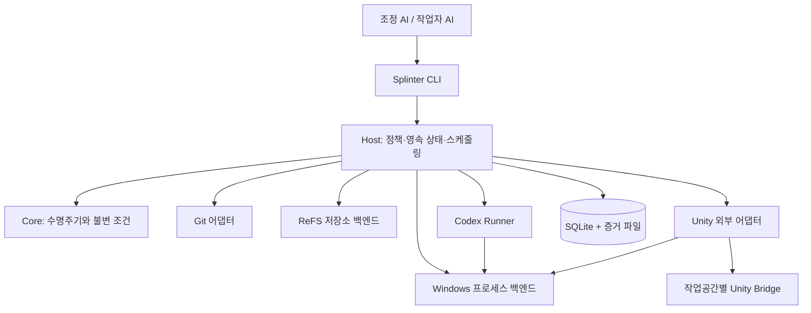

# Splinter 기반 구현 계획

현재 내부 알파 runtime은 [알파 작업공간](../alpha-workspaces.md)과 [저장소·자원 관리](../storage-and-resources.md)의 기준본/CoW/Unity 흐름을 구현한다. 일반 checkout의 두 작업자 증거는 [알파 검증](../verification/internal-alpha.md), ReFS와 프로세스 회수의 실제 범위는 [자원 검증](../verification/storage-and-resources.md)에 기록한다. daemon/SQLite Host와 공개 단계 전체 완료로 해석하지 않는다.

작성일: 2026-09-20. 상태: **기반 및 Git checkout/Unity 스크립트 내부 알파 구현, 공개 목표 구조는 미완료**. 기준: [기획서 개정 2판](../../plan.html). 실제 실행 가능한 범위는 [현재 기반](../foundation.md)에서 확인한다. 아래 전체 구조·상태·명령 목록을 이미 구현된 제품 API로 해석하지 않는다.

## 1. 설계 결론과 첫 완료 지점

Splinter를 **AI 에이전트가 독립 작업공간과 제한된 실행 자원을 사용하는 로컬 실행 기반**으로 만든다. 에이전트는 작업 내용과 검증 조건을 정하고, 프로그램은 그 계획에 맞춰 환경 준비·실행·관찰·복구·회수를 책임진다.

기획서의 Windows + ReFS + Git + Unity 첫 지원 조합, 실제 linked worktree와 CoW 루트의 일치, CLI 중심 운영을 유지한다. 범용성은 서로 다른 공급자를 연결하는 작은 계약과 적합성 시험으로 확보한다. 다른 OS·엔진 구현은 첫 릴리스에 포함하지 않는다.

첫 개발 목표는 전체 기능을 수평으로 구현하는 것이 아니라 다음 흐름을 작은 fixture에서 끝까지 연결하는 것이다.

> 한 조정 에이전트의 계획 → 실제 worktree A/B 생성 → 각 작업자의 소스 수정 → A 컴파일 오류 중 B 실행 지속 → 수정 후 Unity 검증 → 로컬 결과 보존 → 새 CLI/대화와 Editor 재시작 후 재접속 → development 통합과 worktree 회수.

이 내부 알파 이후 에셋 저작·실제 Play·테스트·미커밋 원본·통합 후보의 자동 검증·설치까지 확장한다. **공개 v0의 완료 범위는 기획서의 전체 필수 루프와 48개 시나리오**다. 내부 알파를 공개 v0로 간주하지 않는다.

### 현재 확인한 것

- 제품과 형제 `../splinter-unity`를 별도 Git 저장소로 관리한다. Unity fixture는 submodule이 아니며 Assets·Packages·ProjectSettings를 추적하고 캐시는 제외한다.
- SDK `10.0.112` 및 패키지 버전·lock 파일을 고정했다. 8개 제품 프로젝트와 시험 프로젝트를 `Splinter.slnx`에서 빌드한다.
- `capabilities`, `schema`, 읽기 전용 `doctor`, `plan validate`와 9개 workspace/Unity 명령을 구현했다. 읽기 전용 Host와 별도의 Runtime을 CLI에서 조합한다. Runtime은 atomic JSON과 작업/저장소 잠금을 사용하고 Unity에는 작업별 파일 IPC로 요청한다. 지속 daemon/SQLite는 미구현이다.
- 실제 fixture는 Unity `6000.3.22f1`, URP `17.3.0`, UTF `1.6.0`이다. 두 독립 GUI Editor의 동시 실행·컴파일 격리·재시작을 검증했다. Play와 Unity Test Framework 시험은 실행하지 않았다.
- 설치된 Codex의 `exec --help`에서 `--cd`, `--json`, `--output-schema`, `--sandbox`와 세션 재개 명령을 확인했다. 실제 알파에서는 외부 조정자의 Luna low 하위 작업자가 CLI를 사용했다. 제품의 Codex runner 실행·인증·세션 재접속은 미구현이다.
- ReFS 어댑터·예열 기준본·작업별 Windows 프로세스 감시를 추가했다. `storage probe`, `baseline prepare/seal/release`까지 17개 명령이 있다. 실제 지원은 자원 검증의 SR 항목에 한정하며, 공개 설치·자동 발견성과 대형 프로젝트 지원은 미완료다.
- 새 소스 커밋의 기준본은 동일 `Packages`·`ProjectSettings` snapshot과 앱 호환 키의 캐시에서 CoW로 시작하고, Git의 변경 소스만 갱신한다. 호환 캐시가 없을 때만 cold 준비를 사용한다. 원본의 실행 중인 Library는 복사하지 않는다.
- 기존 Unity 협업 기록의 작성자 소유권·리로드·검증 경계 경험은 실패 시나리오 설계에만 참고한다. 그 프로젝트의 단일 Editor 운영 규칙을 이 제품의 여러 독립 Editor 구조에 적용하지 않는다.

## 2. AI 사용성을 먼저 고정한다

| 원칙 | 구현 결정 | 검증 방법 |
| --- | --- | --- |
| 첫 호출에서 다음 행동을 알 수 있다 | `capabilities`, `doctor`, 명령별 `schema`; 현재 사용 가능 여부와 준비 후 가능 여부를 분리 | 지침을 처음 읽은 에이전트가 필요한 기능·차단 이유를 발견 |
| 정상 경로의 관리 호출이 적다 | `project ensure`와 `plan submit`이 worktree·작업자·자원·회수를 조합 | 작업자마다 Git/복사/포트/Editor를 수동 관리하는 명령이 0회 |
| 읽을 출력이 작다 | 요약 우선, 변경분 cursor, 페이지 제한, 별도 artifact 조회 | 대형 로그도 기본 응답을 넘치게 하지 않음 |
| 재시도 판단을 추측하지 않는다 | 안정된 오류 코드, `nextActions`, 재시도 분류, `operationId` | 같은 요청 재전송·응답 유실에도 중복 실행 없음 |
| 문맥이 끊겨도 재개한다 | 실제 상태는 Host에 저장하고 session manifest로 재접속 | 새 에이전트 세션에서 목표·현재 상태·증거·다음 행동 복원 |
| 성공 여부를 프로그램이 판단한다 | 요구된 증거와 소스 revision이 일치해야 검증 성공 | 작업자의 성공 메시지·종료 코드만으로 성공 처리하지 않음 |
| 사람에게 같은 질문을 반복하지 않는다 | 최초 설정 정책의 범위 안에서 자동 수행; 추가 행동이 꼭 필요할 때만 구조화해 반환 | 정상 반복 실행의 사용자 운영 개입 0회 목표 |

CLI 기본 JSON·비대화형과 `--json`·`--non-interactive`를 구현했다. 현재 `--human`은 JSON 들여쓰기다. 향후 사람용 표·설명과 `setup --interactive`의 최초 설정 대화를 추가한다. 토큰 낭비를 줄이되 필요한 진단은 artifact ID로 즉시 찾을 수 있게 한다.

자연어 분할·의미 판단을 Core 안에 넣지 않는다. 자연어 스킬 선택의 성공은 모델에 의존하므로 반복된 실제 Codex 세션에서 따로 평가한다. 실패 시 명시 호출 경로도 제공한다.

## 3. 기술 선택과 운영 비용

| 영역 | 제안 선택 | 선택 이유와 비용 |
| --- | --- | --- |
| 외부 프로그램 | C# / .NET 10 LTS | Windows API와 비동기 프로세스·IPC 구현에 적합하고 Unity와 언어를 공유한다. 배포 크기와 런타임 패치 관리는 감수한다. |
| 배포 | self-contained `win-x64` 폴더 패키지부터 시작 | 사용자가 .NET SDK를 설치하거나 빌드하지 않게 한다. 초기에는 single-file·Native AOT 최적화를 완료 조건에 넣지 않는다. |
| CLI 파싱 | `System.CommandLine` | 직접 옵션 파서를 만들지 않는다. 파싱 오류도 공통 JSON 오류로 변환하는 경계를 둔다. |
| 상태 저장 | `Microsoft.Data.Sqlite` + SQLite | 설치할 DB 서버가 필요 없다. Host만 쓰고 짧은 트랜잭션으로 처리한다. SQLite 네이티브 파일의 배포도 검사한다. |
| JSON | Host는 `System.Text.Json`, 검증은 `JsonSchema.Net` 후보 | JSON Schema를 공개 계약의 기준으로 삼는다. 패키지 지원·라이선스·schema 적합성 확인 후 버전을 고정한다. |
| 스케줄러 | 작은 명시적 상태 전이 + .NET 채널/동기화 도구 | Core는 실행 가능 노드를 결정한다. 범용 분산 workflow 엔진·Redis·메시지 브로커를 요구하지 않는다. |
| Git | 설치된 Git CLI 및 Git LFS | 기존 filters·attributes·hooks 동작을 Git에 맡긴다. 명령 인자 배열과 기계용 출력을 사용한다. |
| ReFS | 별도 Windows 모듈의 최소 Win32 interop | 검증한 네이티브 API만 감싼다. 드라이버나 파일 감시 기반 쓰기 우회는 만들지 않는다. |
| 로컬 통신 | Windows named pipe, 버전 있는 JSON 메시지 | 외부 포트 없이 사용자 범위를 제한한다. 전송 계층은 교체할 수 있게 둔다. |
| Unity | Editor 전용 UPM 브리지 + 선택적 테스트/런타임 모듈 | Unity가 지원하는 C#·API 대상으로 별도 빌드한다. Host 어셈블리·SQLite·.NET 10을 Unity에 로드하지 않는다. |
| 테스트 | .NET 단위·프로세스 시험 + Unity Test Framework | Core/fake는 Unity 없이 실행한다. 실제 ReFS·GUI Unity·Codex 시험은 전용 환경에서 실행한다. |

.NET 10은 확인일 기준 지원 중인 LTS이며 지원 종료일은 2028-11-14다. 이를 외부 런타임 기준으로 제안한다. [공식 지원 정책](https://dotnet.microsoft.com/en-us/platform/support/policy). self-contained 배포는 런타임을 함께 제공하는 공식 배포 방식이다. [배포 문서](https://learn.microsoft.com/en-us/dotnet/core/deploying/).

CLI·DB·schema 처리는 기존 라이브러리를 우선한다. 직접 만드는 부분은 Splinter의 작업 상태·소유권·검증·복구 정책과 ReFS 연결이다. 라이브러리의 역할은 [System.CommandLine](https://learn.microsoft.com/en-us/dotnet/standard/commandline/), [Microsoft.Data.Sqlite](https://learn.microsoft.com/en-us/dotnet/standard/data/sqlite/), [JsonSchema.Net](https://docs.json-everything.net/schema/basics/)에서 확인했다. 현재 CLI·schema 패키지를 중앙 버전과 lock 파일에 기록했고, DB 패키지는 실제 영속 구현 시 추가한다.

Rust/Go는 작은 배포와 시스템 구현에 장점이 있으나 첫 구현에서는 Unity C# 외에 별도 언어 체계를 운영해야 한다. TypeScript는 에이전트 연결에 편리하지만 ReFS·Job Object용 네이티브 경계가 추가된다. 현재 범위에서는 C#이 전체 유지 비용을 줄인다는 설계 판단이다. 에이전트가 사용하는 언어와 제품의 구현 언어는 독립적이다.

## 4. 구조와 책임 경계



그림은 목표 실행 관계다. 최종 코드 의존성은 `Host → Core + adapters`, `adapters → Core의 ports`, `CLI → Protocol + transport client`로 제한한다. 현재는 읽기 전용 Host와 변경 작업 Runtime을 CLI에서 호출하고 어댑터도 조합한다. Core는 구체 어댑터를 참조하지 않고 Git 명령은 Git 어댑터에만 있다. 지속 Host 도입 시 조합 지점을 옮긴다.

### 프로젝트 배치

```text
Splinter.slnx
global.json                         검증한 SDK 고정
Directory.Build.props               공통 빌드·분석 규칙
Directory.Packages.props            의존성 버전 관리
contracts/v1/                       JSON Schema·명령 descriptor·예제
src/
  Splinter.Core/                    모델·정책·상태 전이·ports
  Splinter.Protocol/                외부 DTO·검증·직렬화
  Splinter.Host/                    조합·DB writer·스케줄러·재조정
  Splinter.Cli/                     명령 파싱·RPC·출력
  Splinter.Persistence.Sqlite/      migration·저널·조회
  Splinter.SourceControl.Git/       snapshot·worktree·결과·통합
  Splinter.Storage.ReFS/            복제·볼륨 검사·파일 통계
  Splinter.Platform.Windows/       프로세스 소유권·pipe·안전한 경로
  Splinter.SessionRunner/           자식 실행·로그 보관용 내부 실행 파일
  Splinter.Application.Unity/      탐지·캐시·브리지·복구
  Splinter.Agent.Codex/             CLI 연결·작업자 수명·이벤트
packages/unity-bridge/
  Editor/                          핵심 연결·메인 스레드 명령 큐
  TestFramework/                   선택적 UTF 연결
  RuntimeProbe/                    명시적으로 사용하는 Play 관찰
tests/                             .NET 단위·통합·CLI 시험
conformance/                       fake와 공급자 공통 계약 시험
../splinter-unity/                 사용자가 제공한 독립 Git/Unity fixture
experiments/                       P0의 작은 재현 프로그램
install/                           설치·설정 등록·제거
docs/                              계획·현재 계약·운영 문서
```

처음부터 위 폴더를 빈 프로젝트로 모두 생성하지 않는다. P0는 실험에 필요한 것만, P1은 Core/Protocol/Host/CLI/Persistence/fake만 만든다. 실제 구현 단계에서 나머지를 추가한다.

`IStorageBackend`, `ISourceControlAdapter`, `IProcessBackend`, `IApplicationAdapter`, `IAgentRunner`는 지원 검사, 실행 계획, 부작용 실행, 사후조건 조회를 분리한다. 결과에는 capability, 진단, 증거 ID를 반환한다. 공급자 전용 옵션은 공급자별 schema로 검증한다. Core에 `UnityProject`, `GitBranch`, 드라이브 문자 같은 필수 필드를 넣지 않는다.

v0의 어댑터는 빌드 시 명시적으로 등록한다. 임의 DLL 로더·플러그인 마켓·범용 원격 분산 실행은 만들지 않는다. 다른 앱과 VCS를 흉내 내는 fake로 경계를 검증한다.

## 5. 상태·소유권·증거 모델

### 영속 엔터티

| 엔터티 | 식별자와 핵심 데이터 |
| --- | --- |
| Project | `projectId`, 공급자별 locator, 프로젝트 상대 경로, 적용 정책 revision |
| SourceSnapshot | `sourceSnapshotId`, opaque source revision, 내용 manifest, 상속된 사용자 변경 |
| Baseline | `baselineId`, snapshot·체크아웃 조건·앱 버전·패키지·타깃·overlay hash, 봉인 상태 |
| Plan / Task | 목표, 입력 snapshot/선행 결과, 의존성, capability, 허용 범위, 검증과 예산 |
| Workspace | `workspaceId`, 공급자의 `sourceWorkspaceId`, 루트, baseline, 작성자 세대, 수명 상태 |
| Operation / Step / Attempt | 요청키·입력 hash·상태·단계·취소·deadline·실행 시도·복구 분류 |
| Session / Lease | 역할, 프로세스 시작 정보, 작업공간, 세대, 권한, 만료, 자원 예약 |
| Artifact / Evidence | 형식·내용 hash·크기·보존 위치, 소스/설정/실행 세대, 검증 결과 |
| Integration | 입력 결과 목록, 대상 기준, 후보 revision, 검증 묶음, 적용 전제조건 |

Git commit만으로 검증 대상을 표현하지 않는다. 아직 커밋하지 않은 소스와 에셋까지 manifest로 계산한 `sourceRevision`을 별도로 둔다. Git 쪽 필터 처리 후 객체 ID와 실제 체크아웃 바이트 hash도 구분한다.

`baseRevision`, `sourceSnapshotId`, `overlayRevision`, `sourceRevision`, `compiledRevision`, `validatedRevision`, `integrationRevision`의 의미를 혼합하지 않는다. 증거에는 Unity/UTF/패키지·타깃·검증 프로필도 연결한다. 무시한 파일이 실행에 영향을 주면 명시 의존성으로 hash를 포함하거나 증거의 제한으로 표시한다.

### 상태 전이

```text
Workspace:
Requested → Provisioning → Materializing → Ready → Active
          → Quiescing → Collected → Releasing → Released
중단 경로: Suspended / RecoveryRequired

Operation:
Accepted → Queued → Running → WaitingForReload → Reconciling
         → Succeeded / Failed / Cancelled / Interrupted / OutcomeUnknown

Application:
수명 상태 + 작업 상태 + 알려진 소스 상태
예: Connected + Compiling + sourceRevision=R4, compiledRevision=R3
```

`CancelRequested`는 요청 상태다. 실제 중지가 확인되기 전 `Cancelled`로 끝내지 않는다. 재시도는 새 attempt를 추가하고 이전 실패를 유지한다. 테스트 자체 성공과 최신 소스에 대한 유효성은 분리하여 성공한 과거 결과도 `Stale`이 될 수 있게 한다.

### 단일 Host와 저널

- 한 사용자 설치에 Host 하나가 상태를 쓴다. 다중 CLI가 동시에 시작해도 OS 소유권 잠금으로 Host 시작을 합친다. DB는 네트워크 드라이브가 아닌 로컬 제어 경로에 둔다.
- SQLite는 `journal_mode=WAL`, `foreign_keys=ON`, 핵심 상태 기록에 `synchronous=FULL`을 초기값으로 제안하고 migration 버전을 관리한다. 상태 변경과 이벤트 추가는 같은 짧은 DB 트랜잭션에서 처리한다. Git·파일 복제·Unity 대기를 DB 트랜잭션 안에 넣지 않는다.
- 각 외부 부작용 전에 `StepIntent`, 실행 후 `StepObserved`를 남긴다. 재시작 시 실제 Git 등록·디렉터리·프로세스·결과를 조회하여 다음 단계로 이어가거나 보존 상태로 전환한다.
- 파일 증거는 임시 파일 작성 → flush/닫기 → 같은 볼륨에서 발행 → DB에 hash/위치 기록 순서로 처리한다. 중간 실패의 고아 증거는 reconcile 대상으로 남긴다.
- DB만 복사해 백업하지 않는다. 일관된 SQLite 백업과 schema migration 복원 시험을 둔다. 손상 시 소유권을 추측해 삭제하지 않는다.

SQLite WAL은 읽기와 쓰기를 함께 처리할 수 있지만 동시에 쓰는 writer는 하나이며, 네트워크 파일시스템에 그대로 적용할 수 없다. 이 제약에 맞춘 단일 Host 구조다. [SQLite WAL 문서](https://www.sqlite.org/wal.html).

### 오래된 작성자 차단

lease에는 증가하는 `ownerGeneration`을 넣어 브리지 명령과 Host 변경 API에서 검사한다. TTL 만료는 삭제나 즉시 새 작성자 배정의 근거가 아니다. 이전 작업자가 살아 있으면 먼저 정지·종료 여부를 확인하고 재조정한다. 살아 있는 오래된 프로세스의 직접 파일 쓰기까지 토큰 검사로 막을 수는 없기 때문이다.

작성자 lease는 작업 세션을 식별하고, 짧은 편집·Editor 변경 예약은 동시에 양립하지 않게 한다. 검증 시작과 종료에 소스 manifest를 대조하고, 계약 밖 수정이 보이면 진행 중 증거를 `Stale`로 처리한다. 파일 감시 이벤트는 빠른 감지용 힌트다.

## 6. CLI와 프로토콜을 제품 API로 만든다

실행 파일 이름은 프로젝트명에 맞춘 `splinter`를 제안한다. 기획서의 `pw`는 가칭이므로 기존 호환 명령을 만들 필요는 없다.

### 상위 흐름과 세부 제어

조정 AI의 정상 흐름은 `project ensure → plan submit → plan wait → result inspect`다. 계획에 포함된 승인 정책에 따라 결과 수집·통합 검증·작업공간 회수까지 Host가 수행한다. 오류나 의미적 충돌이 생긴 경우에만 세부 명령을 사용한다.

```text
splinter capabilities
splinter schema plan.submit
splinter project ensure --path <project-path> --request-key <key>
splinter plan submit --input <plan.json> --request-key <key>
splinter plan wait --plan <plan-id> --timeout 30s
splinter result inspect --plan <plan-id>

splinter workspace checkpoint --workspace <id> --sync --wait
splinter unity tests run --workspace <id> --mode EditMode --filter <name> --wait
splinter operation get --operation <id>
splinter events --plan <id> --after <cursor> --limit 100
```

`workspace checkpoint --sync`는 `edit commit + unity sync + 상태 확인`의 합성 명령으로 제안한다. 여기서 edit commit은 편집 구간 확정이며 Git commit이 아니다. 작업자는 Unity 준비가 필요할 때 이 명령을 사용하고, Host가 이후 편집/실행 예약을 전환한다. 디버깅용 `edit begin/commit`도 남긴다.

세부 명령은 기획서 11.1의 project/plan/workspace/agent/edit/unity/operation/events/logs/changes/result/integration/reconcile/cleanup 범주를 유지한다. 각 단계에서 실제 제공하는 명령만 capabilities에 공개한다. `cleanup plan/apply`는 대상과 상태 digest를 연결하고 상태가 달라지면 다시 계획한다.

### 요청·응답 계약

공개 schema는 `contracts/v1/`의 JSON Schema를 기준으로 관리한다. command descriptor가 입력·출력 schema, 부작용, 권한, 요구 capability, 완료 조건, 재시도 분류를 참조한다. `help`, `schema`, 문서의 명령 목록은 같은 descriptor에서 생성한다. Host와 Unity DTO는 동일 예제·실제 출력 적합성 시험을 통과해야 한다.

작업 계획의 최소 예시다. ID·경로·테스트 이름은 예시이며, 이미 승인된 정책을 참조하는 구조로 제안한다.

```json
{
  "schemaVersion": "1.0",
  "projectId": "project_game",
  "sourceSnapshotId": "source_approved",
  "policyRef": "local_development",
  "tasks": [
    {
      "taskId": "door_logic",
      "goal": "문 상태 변경 버그를 수정하고 EditMode 회귀 테스트를 추가한다.",
      "dependsOn": [],
      "expectedPaths": ["Assets/Game/Doors/**", "Assets/Tests/EditMode/Doors/**"],
      "requiredCapabilities": ["source.edit", "unity.source.sync", "unity.tests.editmode"],
      "verification": { "requiredTests": [{ "mode": "EditMode", "filter": "Game.Tests.Doors" }] }
    },
    {
      "taskId": "hud_logic",
      "goal": "HUD 표시 조건을 수정하고 EditMode 회귀 테스트를 추가한다.",
      "dependsOn": [],
      "expectedPaths": ["Assets/Game/Hud/**", "Assets/Tests/EditMode/Hud/**"],
      "requiredCapabilities": ["source.edit", "unity.source.sync", "unity.tests.editmode"],
      "verification": { "requiredTests": [{ "mode": "EditMode", "filter": "Game.Tests.Hud" }] }
    }
  ],
  "limits": { "maxWorkers": 2, "maxEditors": 2, "maxAttemptsPerTask": 2 },
  "completion": {
    "collectResults": true,
    "integration": "prepare-and-validate",
    "applyToOriginal": false,
    "releaseSuccessfulWorkspaces": true
  }
}
```

요청한 limits와 completion은 저장된 정책의 허용 범위 안에서만 적용한다. `true`를 보냈다는 이유로 권한이 생기지 않는다. 검증된 결과 보존이 선행돼야 release가 가능하며, 실패한 작업은 보존한다. task별 테스트뿐 아니라 통합 정책의 필수 시험도 통과해야 통합 후보를 완료로 표시한다.

장시간 명령의 접수 응답 예시:

```json
{
  "schemaVersion": "1.0",
  "requestId": "req_18",
  "operationId": "op_7",
  "workspaceId": "ws_a",
  "status": "Accepted",
  "terminal": false,
  "phase": "Queued",
  "retryDisposition": "observe-existing",
  "nextActions": [
    {
      "command": "operation.wait",
      "arguments": { "operationId": "op_7", "timeoutMs": 30000 },
      "requiresUserAction": false
    }
  ],
  "artifacts": []
}
```

- `requestId`는 호출마다 다르고, `(projectId, requestKey)`는 동일 부작용 요청을 식별한다. 명령·의미 있는 인자를 정규화한 hash가 같으면 기존 operation, 다르면 `RequestKeyConflict`다. 보존기간 안에는 작업공간을 회수해도 키의 tombstone을 남긴다.
- `nextActions`는 사람이 읽을 shell 문자열이 아니라 명령 ID와 타입 있는 인자다. 상태 버전·권한 전제조건을 포함하여 오래된 행동의 실행을 거부한다.
- `--json`은 응답 하나, `--jsonl`은 이벤트마다 한 줄이다. 로그·색상·진행 표시는 stdout에 섞지 않는다. 응답 크기 제한과 `truncated`, `nextCursor`, artifact ID를 둔다.
- 호출 대기 제한과 operation deadline을 분리한다. watch 종료·Ctrl+C는 관찰만 중지하고 작업 취소는 명시 `cancel`이다.
- 기존 종료 코드 제안 0~9를 유지하되, `wait`가 최종 상태 전에 끝난 경우 `10=WaitTimeout`을 추가하는 안을 P1에서 고정한다. 응답은 `terminal:false`와 같은 operation ID를 유지한다. 접수의 exit 0은 완료를 뜻하지 않는다.
- 파괴적 명령의 누락 ID를 현재 디렉터리로 추정하지 않는다. 명시 `workspaceId` 또는 검증된 작업 세션 manifest가 필요하다.
- 프로토콜 major 불일치는 차단하고 minor 차이는 capability 협상으로 처리한다. 미지원 enum/필수 의미를 조용히 성공으로 처리하지 않는다.

### IPC와 권한

초기 pipe 전송은 길이 접두사가 있는 UTF-8 JSON으로 하고, 제어 메시지 상한은 1 MiB로 제안한다. 로그·이미지는 artifact로 전달한다. 동일 사용자 ACL에 더해 작업 역할·허용 capability가 담긴 세션 인증을 검사한다. 프로젝트 경로·PID·시작 시각·workspace·프로토콜·실행 세대를 handshake에서 대조한다.

조정 에이전트, 작업자, Unity 브리지의 권한을 구분한다. 작업자는 자기 작업공간만, 브리지는 해당 Editor의 응답·증거만, 통합은 승인된 조정 정책만 사용한다. 토큰은 argv·로그·Git 결과에 넣지 않는다. 사용자 권한으로 실행되는 임의 프로젝트 코드를 완전히 차단하는 보안 경계로 표현하지 않는다.

## 7. Git과 CoW 작업공간 생성

### 관리 배치

```text
사용자 원본                  기존 위치와 Git common directory 유지
<ReFS-root>/b/<baseline>/    .git 없는 봉인된 source와 cache
<ReFS-root>/w/<workspace>/   Git에 등록된 최종 worktree = CoW 작업 루트
<local-state>/              DB·저널·권한 정보·로그·증거·session manifest
```

관리 루트는 짧은 경로를 우선하고 저장소 안에 Unity가 하위 폴더로 있으면 상대 경로를 보관한다. 제어 데이터는 Unity가 임포트하는 경로 밖에 둔다. 원본이 NTFS여도 기준본과 작업 루트가 같은 ReFS 볼륨에 있도록 배치한다.

### 생성 절차

1. Git root/common directory, 기준 commit 또는 승인된 saved-working-copy snapshot, LFS/attributes/filters/외부 의존성, 목적지 볼륨을 검사한다.
2. 프로젝트별 기준본 키로 중복 준비를 합친다. 준비 worktree에서 실제 Git 체크아웃·LFS 실파일 전개·Unity 예열을 한 번 수행하고 정상 종료한 뒤 봉인한다.
3. 작업공간의 최종 경로·고유 브랜치·저널을 예약한다. Git 공유 관리 정보를 바꾸는 짧은 구간만 저장소 단위로 직렬화한다.
4. `git worktree add --no-checkout -b <owned-branch> <final-path> <base>`로 Git이 연결을 만든다. 목적지 `.git`은 storage에서 생성·복제·덮어쓰지 않는다.
5. 기준본의 소스를 CoW로 채운다. 독립 Library·필요한 UserSettings·고정된 bridge overlay를 준비한다.
6. 작업 파일을 다시 쓰지 않는 index 초기화와 stat 검증을 수행한다. Git 관점의 변경과 checkout manifest가 예상과 일치해야 한다.
7. 연결·권한·캐시·소스 검사가 통과한 경우에만 `WorkspaceReady`를 발행한다. Editor 준비 상태는 별도다.

`--no-checkout`과 `read-tree`는 공식 Git 기능이다. 둘과 CoW·LFS·CRLF를 결합한 절차의 정확성 및 비용은 **P0에서 검증할 대상**이다. [git-worktree](https://git-scm.com/docs/git-worktree), [git-read-tree](https://git-scm.com/docs/git-read-tree).

### 저장된 미커밋 변경과 overlay

원본 HEAD·원본 index의 staged 상태·저장된 working copy를 각각 기록한다. 실행 입력은 승인된 저장 파일 상태로 만들며, 원본의 staging 구분은 별도 provenance로 보존한다. 준비 사본과 임시 index에서 내부 snapshot ref를 만들고 원본 stash/reset/commit은 하지 않는다.

여러 파일의 일관된 시점을 단순 복사나 두 번의 hash만으로 보장한다고 주장하지 않는다. 저장/편집 안정화 계약을 확보하고 복사 전후 manifest도 비교한다. 계속 바뀌거나 미저장 씬을 확인할 수 없으면 `SourceNotStable` 또는 `UnsavedStateUnknown`으로 반환한다. 사용자의 선택 없이 HEAD만 사용하거나 원본 Editor를 종료하지 않는다.

원본 기준 `H`, 저장 상태 snapshot `S`, 도구 overlay `O`, 사용자 작업 결과 `R`을 구분한다. 새 작업의 기여는 **overlay를 정확히 분리한 R과 S의 차이**다. 전체 `R-H`를 새 작업 변경으로 회수하지 않는다. overlay가 패키지 JSON에 들어가면 도구가 추가한 항목만 3-way 비교로 제거하고 lock 파일의 일관성을 재확인한다. 사용자 패키지 변경은 보존한다.

### CoW 백엔드

동일 볼륨 확인 → 작은 실제 복제 probe → 대상 파일 생성/길이 설정 → 클러스터 정렬 영역을 제한 크기로 복제 → 남은 부분 처리 → 속성·내용 검증 순서로 구현한다. 클러스터 경계·요청 크기·sparse/integrity 조건은 공식 제약이다. [ReFS block cloning](https://learn.microsoft.com/en-us/windows-server/storage/refs/block-cloning).

정렬되지 않은 꼬리와 작은 파일은 실험 후 정책을 확정하고 실제 일반 복사 바이트를 보고한다. ADS·reparse point·외부 링크는 보존 방법이 검증된 것만 지원한다. writable hard link/junction 공유는 금지한다. `cloneBytes`, `copiedBytes`, 파일 수, 단계별 시간, 볼륨 여유 공간 변화를 기록한다. cloneBytes를 물리 절약 공간과 동일시하지 않는다.

최초 기준본 준비 비용, cache 재생성 비용, source hash 계산 비용도 성능 보고에 포함한다. ReFS 미지원이나 복제 실패를 전체 복사 성공으로 숨기지 않는다. 다른 storage mode는 향후 별도 명시 기능으로 추가할 수 있다.

## 8. 프로세스와 Unity 제어

### Host 수명과 자식 실행 수명을 분리한다

`Splinter.SessionRunner`를 내부 실행 보조 프로세스로 둔다. 역할은 구조화된 인자로 자식을 시작하고 stdout/stderr·PID/시작 시각·종료 결과를 로컬 파일에 보존하는 데 한정한다. 작업 분할이나 재시도 정책은 갖지 않는다. Host가 죽어도 Codex의 stdout pipe가 닫혀 결과가 사라지는 문제를 이 경계에서 시험한다.

실행 intent에서 미리 정한 `sessionId`로 supervisor의 접속 지점과 시작 잠금을 식별한다. 자식 시작 직후 Host에 응답하기 전에 중단된 경우에도 같은 ID를 조회하여 기존 실행을 채택한다. 연결 실패만으로 새 supervisor나 작업자를 시작하지 않는다.

Windows backend는 named Job Object와 소유 marker를 사용한다. 재연결 모드에서 Host 종료만으로 자식을 죽이지 않도록 하고, supervisor가 프로세스·로그 수명을 유지한다. Host는 재시작 후 검증된 세션에만 연결한다. PID 단독 일치나 프로세스 이름을 소유권으로 인정하지 않는다. Job의 자식 포함·breakaway·종료 동작은 실제 시험으로 확인한다. [Windows Job Objects](https://learn.microsoft.com/en-us/windows/win32/procthread/job-objects).

### Unity 브리지의 첫 구현

1. 정확한 Editor 버전을 탐지하고 전용 프로젝트 경로·로그로 시작한다. 설치/업그레이드/라이선스 조치를 자동 가정하지 않는다.
2. pipe 수신은 메인 스레드 밖에서, Unity API 실행은 `EditorApplication.update`의 작업 큐에서 처리한다. Editor 하나에는 변경 operation 하나만 실행한다.
3. 컴파일·리로드·임포트 이벤트를 Host에 연결한다. 리로드 이후 bootstrap이 재접속하며 `domainEpoch`와 콜백을 갱신한다.
4. `unity sync`는 특정 source revision의 컴파일 진단, 새 도메인, 후속 임포트와 실제 타입 사용 가능 여부를 함께 확인한다.
5. 최초 컴파일 오류·Safe Mode·브리지 부재는 외부 로그/프로세스 경로로 진단한다. 정상 브리지가 반드시 살아 있다고 가정하지 않는다.

Unity Safe Mode는 프로젝트와 패키지의 managed code 실행을 막으므로 브리지 자체를 복구의 유일한 진입점으로 만들 수 없다. [Unity Safe Mode](https://docs.unity3d.com/6000.0/Documentation/Manual/SafeMode.html).

### 저작·Play·테스트

- 기본 저작 API는 import/query, 씬 open/save, GUID를 보존하는 에셋 조작이다. 확장은 작업자가 작성한 **파일 기반 명명된 Editor task**로 제공한다. 코드 hash·entrypoint·전제조건·사후조건을 기록한다.
- 신규 타입 컴파일 → ScriptableObject/프리팹/씬 생성 → 명시 저장 → 재개방 확인을 하나의 fixture 시나리오로 연결한다. 생성은 기본 fail-if-exists다.
- 실제 Play는 시작 씬, 진입 이벤트, 프레임 진행, 프로젝트 ready hook을 확인한다. tests의 PlayMode와 별도 capability·증거로 기록한다.
- 처음에는 reload on 설정을 구현하고, 공개 전 reload off도 필수 확인한다. GUI capture·가상 입력은 해당 세션·입력 방식·그래픽 모드를 증거에 기록한다.
- 테스트 연결은 핵심 브리지와 별도 assembly다. 실제 목록 발견 → 선택 manifest → 실행 → callback/XML/JSON 수집 → Edit 복귀를 처리한다. 0개·skip·취소·컴파일 실패를 성공과 구별한다.
- batch는 Editor가 닫혀 있을 때 별도 경로로 실행한다. GUI 화면·입력 검증을 `-nographics`로 대체하지 않는다. 테스트 callback와 결과 저장은 고정한 UTF 버전에서 검증한다. [TestRunnerApi](https://docs.unity3d.com/Packages/com.unity.test-framework@1.4/api/UnityEditor.TestTools.TestRunner.Api.TestRunnerApi.html).

## 9. 작업 그래프와 Codex Runner

### DAG의 입력까지 관리한다

`dependsOn`은 단순 실행 순서가 아니다. B가 A의 변경을 필요로 하면 A의 보존된 결과를 반영한 새 입력 snapshot을 만든 후 B를 시작한다. 처음 생성한 오래된 worktree에서 B를 그대로 실행하지 않는다. 독립 A/B는 같은 입력에서 병렬 실행하고 통합 단계에서 결과를 합친다.

계획은 task별 목표·입력·예상 경로·필수 capability·검증·예산을 받는다. 순환, 없는 선행 노드, 미지원 기능, 정책 위반을 접수 전에 거부한다. 같은 에셋을 의도적으로 연속 수정하는 작업은 의존성과 입력 갱신을 요구한다. 예상 경로는 충돌 계획 정보이며 복제할 파일의 제한 목록이 아니다.

자원은 `worker`, `editor`, `compile/import`, `gpu`, `desktop-input`, 외부 저장소/포트 namespace로 나눈다. 동시에 필요한 자원 집합을 원자적으로 예약해 일부만 잡고 기다리는 교착을 피한다. 공정한 대기와 오래 기다린 작업을 위한 우선순위 조정을 둔다. 각 상태 응답에 기다리는 자원과 점유자를 표시한다.

Unity가 자동으로 시작하는 컴파일·임포트까지 항상 선점 제어할 수 있다고 가정하지 않는다. 편집 확정/명령 진입의 admission과 실제 프로세스 부하 관찰을 결합한다. AI 응답을 기다리는 동안 import/reload를 잠그지 않는다.

PlayerPrefs·persistentDataPath·EditorPrefs·프로젝트 외부 플러그인 상태는 별도 분류한다. 격리 훅이 있으면 작업별 namespace를 쓰고, 없으면 충돌하는 실행 단계만 직렬화한다. 관리 밖 원본 Play와 충돌할 수 있으면 해당 실행을 차단하고 이유를 반환한다. `isolationLevel=project-operational` 및 미격리 자원을 노출한다.

### 실제 Codex 실행

Runner는 설치된 지원 버전의 `codex exec`를 지정 CWD·JSONL·결과 schema·정책에 맞는 sandbox로 시작한다. 사용자 인증과 모델 설정을 재사용하며 인증 파일을 프로젝트에 복사하지 않는다. 공식 문서는 JSONL, 구조화된 최종 응답, 기존 CLI 인증 재사용, 세션 ID 재개를 설명한다. [Codex 비대화형 실행](https://developers.openai.com/codex/noninteractive/).

작업 입력은 stdin으로 전달하고 session manifest에는 ID·루트·기준 revision·허용 capability·검증 계획·Host 접속 정보를 둔다. 작업자는 소스 편집을, Host는 Git 관리 쓰기를 담당한다. 외부 Git common directory는 읽기/Host proxy 경로를 검사하며 원본 `.git` 전체 쓰기 권한을 작업자에게 부여하지 않는다.

`--cd`만으로 파일 접근 경계가 보장되지는 않는다. ReFS worktree 쓰기, 다른 workspace/원본 쓰기 차단, named pipe 접속, 좁은 artifact 경로 접근을 **P0에서 함께 시험**한다. 권한 실패를 sandbox 해제로 해결하지 않는다. 전송·권한의 대체안이 필요하면 이 시점에 계약을 조정한다.

재개는 기록된 정확한 세션 ID를 사용한다. 전역 `--last`는 병렬 작업에 사용하지 않는다. 설치 버전에서 안전한 재개가 불가능하면 `ResumeUnsupported`와 기존 결과를 반환한다. 새 세션으로 이어갈 때에도 기존 프로세스가 종료됐고 작업공간 소유권이 재발급됐는지 확인한다.

`maxWorkers`, 실행 시간, 재시도 수, 깊이를 Host가 제한한다. 지원되는 usage 이벤트는 기록하지만 비용이 제공되지 않으면 비용을 추정값/unknown으로 구분한다. 자연어 프롬프트만으로 강제 예산이나 권한 제한을 보장하지 않는다. 내장 하위 에이전트 기능을 사용하는 연결과 외부 Runner는 실행 소유자 하나를 선택한다.

## 10. 회수·통합·복구

결과 수집 전 작업자를 정지/대기시키고 Play·테스트·미저장 변경을 처리하여 소스를 고정한다. 소스 manifest와 실제 Git 차이를 대조하고 overlay를 분리한다. 결과 commit/ref, LFS 객체·바이너리, 검증 증거가 살아 있는 참조로 보존된 뒤에만 작업공간을 정리할 수 있다.

별도 통합 worktree에서 최신 대상 기준과 각 작업의 delta를 3-way로 합친다. saved-working-copy snapshot을 사용자 브랜치에 merge하는 방식은 쓰지 않는다. 상속된 사용자 변경이 대상에 없거나 달라서 task delta를 적용할 수 없으면 이를 명시적인 충돌로 반환한다. 소스나 에셋이 충돌하면 조정 AI가 해결하고 후보 전체를 다시 검증한다.

`integration prepare → validate → apply`는 후보 hash와 대상의 기대 상태를 연결한다. apply 직전에 대상 HEAD·dirty/staged 상태·열린 Editor·타 worktree의 branch 사용을 재검사한다. 변경됐으면 `IntegrationTargetChanged`로 중단한다. 다른 작업에서 체크아웃 중인 branch를 강제로 ref 업데이트하지 않는다. 기본 산출물은 검증한 로컬 결과 브랜치이며, 원격 push는 별도 정책이다.

| 중단 위치 | 기본 복구 |
| --- | --- |
| Git 등록 후 clone 미완료 | 같은 worktree를 조회하여 이어가거나 결과 없는 소유 대상만 보상 회수 |
| 명령 전송 후 응답 유실 | 기존 operation 조회와 사후조건 검사; 재실행 가능성이 입증된 종류만 재시도 |
| 에셋 생성 후 응답 유실 | 경로·GUID·내용으로 판정; 모르면 `OutcomeUnknown` |
| Host 종료 | 세션·Git·저널 재조정 후 채택; 같은 작업자를 추가 시작하지 않음 |
| lease 만료 | 이전 작성자의 실행 상태를 확인하고 보존; 즉시 삭제/재배정 금지 |
| 디스크 부족 | 신규 준비 중지, 현재 결과 보존, 정리 가능한 대상만 제안 |
| 볼륨 분리 | offline으로 유지; 외부 삭제로 오인하지 않음 |
| 검사 도중 소스 변경 | 기존 증거를 stale로 표시하고 새 revision 검증 |

회수는 새 요청 차단 → 작업자 정지 → 앱 저장/실행 종료 → 결과 보존 확인 → 소유 프로세스 종료 → 정확한 `git worktree remove` → 전용 상태 정리 → 영속 완료 기록 순서다. baseline, 결과 branch, 증거는 별도 수명을 갖는다.

Git이 생성한 연결을 먼저 전체 디렉터리 삭제로 훼손하지 않는다. 경로 문자열 prefix만으로 삭제 대상을 판정하지 않고, 정규화된 경로·볼륨 ID·소유 marker·reparse 여부를 재검사한다. 임의 경로 지정 삭제 API는 제공하지 않는다. 외부 attach 작업공간의 제거 권한은 별도이며 기본은 보존이다.

도구 주입 파일 때문에 worktree 제거가 거부될 수 있다. 이때 실제 남은 내용을 overlay/임시 파일 manifest와 대조하고 도구 소유분만 처리한다. 설명되지 않은 dirty/untracked 파일이 있으면 `RecoveryRequired`로 보존한다. 전체 `clean`이나 강제 제거로 조용히 통과시키지 않는다.

## 11. 구현 단계와 통과 조건

P0~P7의 명칭은 기획서와 맞춘다. 다만 첫 알파에서 실제 테스트 발견·실행까지 연결하기 위해 P3에 최소 테스트 경로를 앞당긴다. P5는 테스트 기능의 전체 신뢰성과 대체 경로를 완성한다.

| 단계 | 구체 산출물 | 다음 단계로 가는 조건 |
| --- | --- | --- |
| P0 핵심 위험 실험 | 아래 S0~S4 재현 프로그램·fixture·원시 결과·결정 기록 | 실제 목표 환경에서 핵심 경로 성공. 실패는 이유·대체안·범위 영향 확정 |
| P1 Core/CLI 기반 | schema·상태 전이·SQLite 저널·Host·CLI·fake·중복 요청·재조정 | Unity 없이 생성→실행→중단→재개→보존→회수와 JSON 계약 통과 |
| P2 Git/CoW 수명주기 | 탐지·clean/dirty snapshot·baseline·실제 worktree·LFS·overlay·attach·안전 회수 | 원본 HEAD/staged 보존, A/B 쓰기 격리, 생성/회수 중단 복구 |
| P3 첫 실제 알파 | self-contained 개발 패키지·설정 연결·Codex Runner·Unity sync·최소 테스트·로컬 결과 수집 | 자연어 요청으로 두 작업자, A 컴파일 오류 중 B 성공, Host 재시작·회수까지 시연 |
| P4 에셋/Play | 새 타입·에셋·프리팹·씬·실제 Play·프레임·입력·캡처·프로젝트 훅 | AS/PL 전체, 저장 후 재개방, reload on/off, 실제 화면·입력 검증 |
| P5 테스트/증거 | 목록·필터·취소·reload 재연결·XML/JSON·batch·stale 판정 | TS 전체, 실패/0개/skip/중단/이전 XML을 오판하지 않음 |
| P6 자동 병렬 통합 | DAG 입력 갱신·자원 예약·외부 상태 정책·통합 후보·조건부 적용·동반 회수 | UX-04/05, IS/RC/MG/PK, GT-08 전체 자동 완료 |
| P7 공개 준비 | 최초 설치·필요 시 Dev Drive 준비·업데이트/제거·지원표·성능·기여 문서 | 48개 필수 시나리오 + 기반 추가 시험, 실제 대상 조합의 재현 가능한 증거 |

### P0: 결론을 바꿀 수 있는 실험

| ID | 최소 실험 | 통과 증거 / 실패 시 결정 |
| --- | --- | --- |
| S0 | 짧은 계약 골격과 CLI JSON 입출력, 버전·의존성 고정 | 정상/오류 응답 파싱, 재현 명령; 이후 실험은 이 envelope를 사용 |
| S1 | 실제 ReFS clone + no-checkout worktree A/B + index + NTFS common dir | 격리 hash, Git 상태·원본 index 보존, clone/copy 바이트; 결합 실패 시 P2 착수 전 절차 재설계 |
| S2 | 고정 Unity fixture의 코드 값 변경→compile/reload→신규 타입→Play→Edit/PlayMode 테스트, 최초 오류 복구 | 새 값·세대·결과 XML·Play 프레임; 브리지 없는 실패 복구 불가 시 외부 경로 수정 |
| S3 | Codex 지정 CWD/sandbox에서 실제 수정·pipe 호출·JSONL·세션 재개 | A/B 바인딩과 권한, 중복 실행 없음; Host/sandbox 통신 불가 시 transport·실행 배치 수정 |
| S4 | 예열 Library를 다른 경로 A/B에 CoW 적용하고 GUI Editor 두 개 실행 | 재임포트·준비 시간·RAM·disk 변화·license/프로세스 제약; 성능 이득 부재 시 캐시 정책 재설계 |

P0를 장기 기술 조사로 만들지 않는다. 각각 한 질문에 답하는 작은 실행 프로그램과 결과를 남기며 성공 경로를 P1 이후 어댑터 시험으로 옮긴다. ReFS/Unity 실행 환경이 없으면 fake 작업은 진행할 수 있지만 그 실험을 통과 처리하거나 해당 지원 조합을 확정하지 않는다.

### 첫 구현 작업 묶음

| 순서 | 구현 파일/경계 | 완료 기준 |
| --- | --- | --- |
| F01 | solution·SDK/패키지 고정·빌드 규칙·테스트 진입점 | 복원/빌드/단위 시험 한 명령, 제품 코드와 Unity 빌드 분리 |
| F02 | operation/error/event/capability/plan/workspace schema와 command descriptor | 정상·오류·중복 요청·비호환 버전 예제 검증 |
| F03 | Core 상태 전이·정책·revision·lease·fake clock | 잘못된 전이/오래된 작성자/오염된 증거 거부 |
| F04 | SQLite migration·operation steps·events·request keys·artifact 기록 | 같은 요청 동시 접수 시 1개 실행, 중단 위치별 복구 |
| F05 | Host 시작 잠금·pipe·CLI 출력·wait/cancel/cursor | CLI 재실행·watch 종료·Host 재시작 계약 통과 |
| F06 | fake VCS/storage/app/runner로 plan 전체 루프 | 특정 앱/OS/Git 용어 없이 동일 Core 실행 |
| F07 | Windows 세션 실행기·Git/CoW S1 실험을 실제 ports에 연결 | 실제 작업공간 생성/쓰기/결과 고정/회수 |
| F08 | Unity/Codex S2/S3 실험을 같은 operation과 증거에 연결 | 첫 실제 알파에 필요한 연결 완성 |

현재 F01과 17개 명령의 F02 계약, F03의 DAG 검사 및 좁은 workspace 상태를 구현했다. 내부 알파는 atomic JSON 저장, fake 적합성, Git·Unity·ReFS·프로세스 그룹 어댑터를 연결한다. F07의 일부 성공 경로와 실제 검증 범위는 SR 항목으로 구분한다. F04의 daemon/SQLite, F05 전체 복구, F06 전체 plan 루프, F07 중단 지점별 복구·광범위한 파일 지원, F08 Codex runner 연결은 미완료다. Git-only smoke와 일반 checkout Editor 실행은 S1의 ReFS 결합 통과가 아니다.

F01/F02의 최소 골격은 P0에 만들고 F03~F06은 P1에서 완성한다. F07은 P2, F08은 P3에 속한다. 생성/회수와 검증에 필요한 계약만 먼저 고정하고, 아직 쓰지 않는 앱 capability를 미리 대량 설계하지 않는다.

### 내부 알파의 다음 작업: 중단된 자원 작업 복구

정상 흐름의 저장소 절감·전체 프로세스 회수는 SR 증거로 유지하고, 다음 변경은 아래 장애 경계에 한정한다. daemon이나 DAG를 동시에 도입하지 않는다.

| 순서 | 변경 대상 | 완료 조건 |
| --- | --- | --- |
| 1 | Runtime의 생성·clone·seal·회수 단계 기록과 복구 응답 schema | 같은 key 재호출에 새 branch/Editor가 생기지 않고, 안전한 재개와 사용자 변경 보존을 기계가 구분 |
| 2 | Git 등록 직후·파일 복제 도중·완성 영수증 직전 중단 | 정확한 경로·볼륨·baseline hash·소유권을 재검사. 확인된 파생 파일만 재개하며 모르는 파일/변경 소스는 그대로 보존 |
| 3 | 캐시 봉인 도중·봉인 후 Git 회수 도중 중단 | 불완전 캐시를 작업에 제공하지 않고, 완성 캐시는 다시 예열하지 않음. 재시도 후 worktree/소유 프로세스 0 |
| 4 | 감시 프로세스 비정상 종료·종료 증거 누락 | 살아 있는 원본/다른 작업자 무변경, 소유권을 확인하지 못하면 회수 성공을 반환하지 않음 |
| 5 | 실제 ReFS + Unity에서 장애 주입 재현 | 각 중단 위치의 재접속·결과 보존·0 프로세스 증거, 현 SR 정상 경로 회귀 통과 |

구현 순서는 Core/응답 계약과 fake 장애 주입 → Runtime 저널 → Git/Windows 재조정 → 실제 fixture다. 그다음 작업으로는 대형 프로젝트의 manifest/작은 파일 비용과 캐시 보유 정책을 측정한다. LFS·filter·외부 링크·다른 Unity 패치는 지원표와 독립 검증 없이 지원으로 추가하지 않는다.

### 향후 병렬 개발의 경계

계약이 고정되면 `Git/Storage`, `Host/CLI/Runner`, `Unity`를 독립 작업 단위로 나눌 수 있다. 각 작업은 자기 구현·fixture·문서만 소유하고, 공통 schema·Core 상태 변경은 먼저 합의된 변경으로 처리한다. 실제 Unity/ReFS 머신 사용은 예약한다.

작업 납품 형식은 문제·변경 계약·담당 파일·재현 명령·정상/실패 시험·증거 경로·남은 제약이다. 최신 통합 후보에서의 필수 시험까지 끝나야 완료로 표시한다. 달력 일정은 P0의 실제 import·CI·복구 비용을 얻은 뒤 정하고, 그전에는 완료 조건으로 진도를 관리한다.

## 12. 검증·성능·공개 준비

원본의 필수 시나리오를 하나도 축소하지 않고 [검증 추적표](validation-matrix.md)에서 담당 단계와 증거를 연결한다. `Passed / Failed / NotRun / Unsupported`를 구분한다. 원본 48개와 FD 항목의 전체 조건은 아직 `NotRun`이며, 실제 내부 알파에서 통과한 좁은 범위는 별도의 AA·SR 항목으로 기록한다.

시험 계층은 네 가지다.

1. 일반 CI: Core 상태·schema·fake·SQLite 복구·CLI 출력. Unity/Win32가 없어도 실행.
2. Windows 통합: 실제 프로세스·pipe·경로·Git·LFS. 임시 저장소에서 원본/staged 보존 확인.
3. 전용 ReFS + Unity 머신: 실제 블록 복제·캐시·두 GUI Editor·리로드·Play·테스트·종료.
4. 실제 에이전트 평가: 도구 이름 없는 새 세션 요청, 명령 오류·재시도·실패 복구·전체 회수.

실행 증거는 도구 commit, 전체 환경 버전, fixture/source hash, 시작/종료 manifest, 명령 이벤트, 단계 시간, 결과 파일·hash를 포함한다. 테스트 자격증명·유료 에셋·개인 프로젝트는 공개 fixture에 넣지 않는다. 실제 프로젝트 검증은 별도 비공개 결과로 보관한다.

성능은 같은 소스·Unity 버전·타깃·작업을 사용해 일반 전체 복사, 소스만 준비/새 Library, 예열된 CoW를 비교한다. OS 기본 복사가 CoW를 쓰는 환경이면 비교군을 오표기하지 않도록 실제 복사 경로와 복제량을 확인한다. cold/warm 조건, 최초 baseline 준비, Git/LFS/index, 전체 manifest 계산, Ready, EditorReady, 변경 후 증가량, 회수 비용을 나눈다.

측정은 반복 수와 median/p95·실패율을 같이 기록한다. 짧은 반복 루프 20회는 초기 안정성 목표이며 신뢰도 보장은 아니다. 제품 성능 배수나 준비시간 SLA는 측정 전에 약속하지 않는다. A 오류 중 B 진전, 두 Editor 실행 구간의 겹침, 순차 실행 대비 실제 완료 시간도 함께 측정한다.

AI 사용성은 정상 흐름의 호출 수·기본 응답 바이트·불필요한 로그 조회·잘못된 명령·중복 작업·복구 성공률·사람 개입 횟수로 평가한다. 기본 상태 응답 8 KiB 이하, 로그 상세 조회 기본 100줄을 초기 목표로 두고 실제 작업에서 조정한다. 중요한 오류·필수 조치를 크기 제한 때문에 누락시키지 않는다.

설치는 사용자 범위 CLI/Host/bridge를 먼저 설치하고 등록 변경을 manifest로 기록한다. ReFS가 없을 때의 Dev Drive/VHDX 준비는 영향·위치·용량을 보여주는 일회 승인 경계다. 기존 볼륨 포맷이나 보안 설정 해제는 기본 경로에 넣지 않는다. 업데이트는 활성 세션의 protocol/bridge를 유지하고 종료 후 적용한다. 제거는 도구가 추가한 설정만 복원하고 미회수 결과를 보존한다.

공개 전에 `QUICKSTART`, `AGENT_GUIDE`, 현재 아키텍처·수명·프로토콜, CLI/schema, 어댑터 적합성 안내, 지원 조합·실제 성능표, 보안/권한 경계, 기여 방법을 실제 구현에 맞춰 작성한다. 오픈소스 라이선스·배포 서명·지원 Unity 정확한 패치·Codex 버전은 공개 전 결정 항목이며 지금 임의로 지원을 선언하지 않는다.

## 13. 지금 고정할 것과 실험 후 고정할 것

| 지금 제안대로 시작할 결정 | P0 이후 증거로 확정할 결정 |
| --- | --- |
| AI 중심 CLI, JSON 기본값, 비대화형 기본값 | 지원 Codex 버전과 sandbox에서 가능한 IPC/재개 방식 |
| .NET 10 Host와 Unity 브리지 분리 | 정확한 Unity 패치·UTF·Input System 지원 조합 |
| 단일 Host/SQLite, 영속 operation·idempotency·증거 | clone 꼬리/작은 파일·특수 속성의 처리와 실제 성능 |
| 실제 worktree와 CoW 작업 루트 1:1 | no-checkout/index/필터 결합의 검증된 절차 |
| 원본·상속 변경·overlay·작업 결과의 분리 | Library 캐시 재사용 키와 새 경로에서의 유효성 |
| 분리된 작업공간과 필요한 자원만 예약 | 동시 Editor·메모리·디스크 예산 및 단계별 timeout |
| 결과 보존 후 회수, 최신 통합 후보에서 검증 | 설치 서명·최소 환경·공개 라이선스 |

현재 내부 알파의 좁은 범위는 [알파 작업공간](../alpha-workspaces.md)에 고정한다. 이후 공개 목표를 위해 ReFS 저장소, 지속 Host와 복구, DAG/runner, Unity 저작·Play·테스트를 단계별로 확장한다. 완료 판정은 명령 존재가 아니라 해당 범위의 실행 증거로 내린다.
