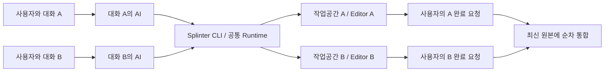

# 대화별 작업공간 사용과 설치 계획

이 문서는 AI가 기존 CLI·파일/Git 도구와 외부 Unity 도구로 수행할 사용 절차를 소유한다. 전용 프로젝트/전역 installer·Codex 자동 binding은 미구현이며 프로그램 구현 범위에서 제외한다. [최소 사용 스킬](../../skills/splinter/SKILL.md)은 지침 원본이다. SW-01/02/04/05/07/08/10의 NotRun, SW-03/06/09 전체 Partial은 기존 실행 증거의 상태로 보존하며 새 프로그램 개발 목록으로 읽지 않는다. 현재 명령과 gate는 [foundation](../foundation.md), [알파 작업공간](../alpha-workspaces.md), [폐기](../workspace-discard.md)를 따른다.

첫 한정 실사용 [M0](implementation-plan.md)는 [납품 판정](../verification/m0-delivery.md)으로 마감했다. [시작 안내](../agent-start.md)의 기존 CLI·서비스 전제와 [대표 A/B](../verification/representative-agent-workflow.md)의 실행 자격을 유지한다. 프로그램과 에이전트의 책임·축소한 후속 작업은 [구현 계획](implementation-plan.md#프로그램과-에이전트의-책임)을 따른다. 설치·인계·작업 순서·게임 검증에는 AI 사용 절차를 제공하며 자동화 framework를 추가하지 않는다.

[저장공간 우선 계획](storage-priority-and-editor-modes.md)에 따라 독립 파일 작업공간과 Editor 실행 정책을 구분한다. 아래 지속 작업·반영·보존·폐기 원칙은 두 실행 방식에 공통이며, 제안 필드·상태·명령은 현재 capability가 아니다.

## 제품의 기본 사용 모델

사용자는 평소의 각 Codex 대화에서 작업을 지시한다. 별도 조정 AI, 새 하위 작업자 실행, 전체 작업 그래프 제출을 요구하지 않는다. 해당 대화의 AI가 필요할 때 Splinter CLI로 자기 작업공간과 Editor를 확보하고, 여러 차례 대화하며 작업을 이어 간다. 사용자의 명시적 완료 요청에 원본 반영과 정리를 수행하며, 명시적 폐기 요청에는 원본에 반영하지 않고 해당 작업을 제거한다.

프로그램은 작업 식별·지속 상태·소유권·공유 자원·통합 순서를 조정한다. 작업의 의미 판단과 편집은 각 대화의 AI가 수행한다. Codex Runner·DAG·daemon/SQLite는 이 제품 계획에 포함하지 않는다.

## Splinter를 사용할 때와 사용하지 않을 때

| 상황 | 에이전트의 행동 | 부작용 경계 |
| --- | --- | --- |
| 사용자가 “Splinter로 병렬 작업해줘”라고 명시 | 현재 대화의 작업을 생성하거나 재개 | 지원 조건을 확인하고 Splinter가 반환한 경로에서 작업 |
| 다른 작업이 같은 프로젝트/Editor를 점유하고 독립 실행이 필요 | 설치된 지침과 승인된 프로젝트 정책에 따라 자율적으로 Splinter 사용 | 기존 작업·Editor를 탈취하거나 종료하지 않음 |
| 독립 실행이 필요 없고 현재 프로젝트에서 안전하게 작업 가능 | 기존 경로에서 직접 작업 | 새 snapshot·worktree·Editor·작업 기록을 생성하지 않음 |
| 이미 이 대화에 Splinter 작업이 연결됨 | 원본 Editor가 비어도 같은 작업을 계속 사용 | 원본으로 자동 복귀하거나 새 작업을 중복 생성하지 않음 |
| 점유/소유권을 관측할 수 없음 | unknown으로 표시하고 안전한 독립 실행 가능 여부를 검사 | unknown을 idle로 취급하지 않음. 지원/권한 부족 시 보존하고 필요한 행동 반환 |
| 병렬 작업은 필요하지만 Splinter가 설치되지 않음 | 설치 필요와 범위를 제시하고 설치 요청/기존 정책 범위에서 준비 | 설치 승인이나 OS 권한을 임의로 확대하지 않음 |

Editor가 열려 있다는 사실만으로 다른 작업이 점유했다고 판정하지 않는다. 현재 대화가 사용하는 Editor인지, 다른 작성자가 편집·실행 중인지와 필요한 기능을 함께 확인한다. 스킬은 가벼운 관측으로 사용 여부를 결정하며 모든 요청을 workspace 생성 명령으로 시작하지 않는다.

이 조건에 해당하는 병렬 작업에는 **Codex의 별도 worktree 생성 기능 대신 Splinter의 작업공간 수명주기**를 사용한다. Splinter 내부 Git 어댑터가 만드는 linked worktree는 유지한다. 이미 외부 worktree에서 시작한 대화는 원본·대상 브랜치·관리 소유권을 식별하고 지원 여부를 확인한다. 기존 Codex worktree를 임의로 이동·삭제하거나 두 도구가 같은 자원을 함께 소유하게 만들지 않는다.

## AI 절차: 프로젝트용·사용자 범위 연결

설치 요청이 있을 때 AI가 요청 범위의 배포물·의존성·지침을 연결한다. 제품 전용 installer·자동 Codex 설정 관리·설치 manifest framework는 구현하지 않는다. 현재 개발 CLI·제한 서비스 전제와 설치 전체 미자격을 유지한다.

사용자는 “이 프로젝트에서 쓰도록 가져와줘” 또는 “사용자 범위에서 쓸 수 있게 연결해줘”라고 요청한다. AI가 배포물 확보 또는 기존 빌드 사용, 의존성 확인, 지침 연결과 실제 발견 검증을 담당한다. 사용자에게 수동 빌드·경로 복사를 맡기는 대신 에이전트가 가능한 기존 명령으로 수행한다.

| 설치 범위 | 실행 파일·설정·지침 | 완료 판정 |
| --- | --- | --- |
| 프로젝트용 | 기존 AGENTS/스킬 체계에 CLI 절대 경로·프로젝트 정책을 명시. 장비별 값은 로컬 설정/인계에 보존 | 해당 프로젝트에서 CLI/schema·지침을 확인하며 다른 프로젝트·전역 PATH 불변 |
| 사용자 범위 | 사용자가 요청한 실행 경로/스킬 연결을 기존 도구로 구성. 프로젝트 정책을 우선 | 각 프로젝트의 원본·설정·미완료 작업과 기존 연결을 보존 |

같은 대상 저장소의 모든 대화는 기존에 등록된 공통 home을 사용한다. 연결 범위와 작업 상태 위치를 구분하고 새 home으로 중복 관리하지 않는다. 관리자 권한은 서비스/driver의 실제 구성 경계에서만 사용한다.

설치 순서는 다음과 같다.

1. 기존 CLI·버전·프로젝트 정책·등록 home·스킬 연결을 확인하고 재사용한다.
2. 기존 빌드/배포물·의존성을 준비하고 CLI 절대 경로와 정책을 기록한다. 기존 AGENTS·설정·다른 스킬을 덮어쓰지 않는다.
3. `capabilities/schema`·진단과 실제 지침 발견을 각각 확인한다. 진단 성공을 VSS/grant/Editor 실행 자격으로 읽지 않는다.
4. 서비스/driver 구성이 필요하면 기존 명시적 설치 도구의 계획과 권한 경계를 따른다. 일반 CLI/Git/Unity를 승격하거나 임의 관리자 helper를 만들지 않는다.

스킬 경로·재로딩·플러그인 지원은 해당 AI 도구의 현재 지침으로 확인한다. 특정 Codex 버전의 설치/즉시 발견을 Splinter가 보장하지 않는다. 발견되지 않으면 명시적으로 스킬 원본을 읽는 기존 경로를 안내한다.

AI가 업데이트/제거할 때도 활성 작업의 실행물·계약·인계와 다른 프로젝트의 설정/배포물·원본·미완료 작업을 보존한다. 도구 제거는 workspace 폐기가 아니다.

## 대화와 작업공간 연결

project/task key·workspace ID·절대 루트·동일 home·기준/digest를 AI의 대화/인계에 보존하고 CLI 상태와 대조한다. 특정 Codex locator API·fork/host 자동 인계·manifest 자동 발견·binding framework는 구현 제외다. 새 CLI의 같은 작업 재개 근거는 M0-02를 따른다.

Core의 식별자는 공급자 중립적인 project/task/workspace ID를 유지한다. AI가 저장한 안정된 작업 키로 재개하며 사용자에게 반복 키 입력을 맡기지 않는다. 프로그램은 대화 제목이나 현재 창으로 작업을 추측하지 않는다.

인계 정보는 대상 프로젝트·CLI, key/id·반환 루트, home·base/revision·snapshot/digest, 명시한 옵션과 pending 입력/다음 행동을 포함한다. 현재 응답이 제공하는 owner/generation은 그대로 보존하며 새 manifest 계약을 만들지 않는다.

- 대화 A/B는 서로 다른 key와 경로를 사용한다. 새 CLI·문맥 압축 뒤 인계와 실제 상태를 대조한다. fork/인계의 작성자 조정은 AI가 수행하고 살아 있는 작성자의 소유권을 복제하지 않는다.
- 현재 대화를 유지한 채 반환된 workspace 절대 경로를 파일 도구와 명령의 작업 경로로 사용한다. shell의 `cd`나 workspace ID 전달만으로 모든 도구의 CWD·쓰기 권한이 바뀌었다고 간주하지 않는다.
- 에이전트 연결이 실제 쓰기 경로·권한을 확인하지 못하면 차단 이유와 필요한 경로 권한을 반환한다. 권한 우회, 원본으로 몰래 편집, 별도 Codex worktree 생성, 강제 하위 세션 생성으로 대체하지 않는다.
- 기본은 한 경로의 작성자 하나다. 프로그램은 현재 계약의 명령 잠금·identity·중복/owner 검사를 유지한다. 임의 파일 쓰기의 대화별 배타 잠금과 자동 작성자 인수는 제공하지 않는다.
- 대화·응답·시간 경과·Editor 종료는 완료/반영/삭제가 아니다. AI는 명시적 종료가 완료될 때까지 같은 작업의 인계를 보존한다.

## 외부 도구 인계의 한정 범위

AI는 반환 workspace에서 파일/Git 작업을 하고 필요한 시점에 소유 Editor를 확보한 뒤 MCP·Unity CLI로 Unity 작업을 수행한다. 에셋 저작·Play·테스트·빌드·캡처·오류 분석·검증 판단은 외부 도구와 AI가 맡는다. 모드/작업 순서 선택도 AI가 하며 자동 큐·일반 임대 인수·Unity 명령 중계는 구현하지 않는다.

현재 worker는 Coplay `10.2.0` 서버를 따로 시작하지 않는 전용 브리지 경로이며 원본 서버 종료 방어가 있다. Unity CLI의 작은 T: Plastic A/B exact-path 작업·정상 종료 공존·독립 결과/회수는 [별도 UH 검증](../verification/unity-cli-handoff.md)으로 한정 마감했다. CLI 목록 누락·첫 eval 타임아웃과 MCP/다른 입력의 미자격을 유지한다. 새 인계 작업은 사용할 외부 도구 하나·버전·기존 프로젝트 설정을 먼저 고정하고, 정확한 A/B 프로젝트 선택·작업·한쪽 정상 종료 뒤 peer/원본/공유 서버 보존만 확인한다. 기존 도구가 선택/연결을 제공하면 그 절차를 스킬에 적고, 필요한 식별 정보 누락이나 공존 결함만 프로그램에서 수정한다. 패키지·서비스·원본 설정 변경은 해당 실행 범위에 별도로 명시하며 이 계획만으로 설치하지 않는다.

현재 `checkpoint/integrate`는 내부 컴파일 증거를 요구하지 않는다. AI가 외부 도구로 검증할 내용을 판단하고, Splinter는 같은 checkpoint 경로로 Editor 유무·컴파일 결과와 무관하게 안정된 소스를 독립 보존한다. seal·독립 결과·target/dirty guard는 유지한다. `preserve-worker`와 자체 refresh/컴파일/포커스 처리는 제거했으며 범용 검증 증거 플랫폼은 추가하지 않는다. 선택적 단일 view/Library cache는 [개발 CLI](../development-cli.md)의 저장소 수명 관리로 제한한다. 현재 기본 사용법은 [시작 안내](../agent-start.md)를 따른다.

### 후속 범위: Unity CLI의 A/B 인계

아래에 고정한 2026-10-03의 T: 실행은 [UH-01~04](../verification/unity-cli-handoff.md)로 scoped-complete-with-limitations 마감했다. 정확한 반환 경로의 기존 CLI 연결로 해결돼 프로그램 변경은 없으며 [사용 절차](../alpha-workspaces.md#unity-cli의-정확한-대상-선택)·스킬·시작 안내를 보완했다. 목록 발견 제한·초기 읽기 eval 타임아웃·미실행 MCP/Play/Test/build와 선행 C: 회수 보류는 유지한다. 이하 Git 표는 이전에 읽기 전용으로 조사한 후보이며 이번 실행 입력이 아니다.

2026-10-03의 실행 단위는 아래 과거 Git 후보 대신 **기존 `T:\plastic-fixture-20261002`·등록 home `T:\pt1002`·`source=plastic`·`application=unity`·`base=snapshot`**을 사용한다. 후보는 `development @ 57d4439`이며 프로그램 수정 시 최종 소스/바이너리 hash를 다시 고정한다. Unity `6000.3.22f1`·CLI `1.0.0-beta.5`·Pipeline `0.8.0-exp.1`을 그대로 사용한다. 질문은 선행 PC의 worker 발견 실패가 CLI 목록에만 한정되는지, 정확한 반환 경로의 실제 명령/loaded 결과와 A 정상 종료 후 B의 후속 작업이 가능한지다.

새 key `cli-t-a-20261003`·`cli-t-b-20261003` 하나씩만 만들며 같은 home/16 GiB journal budget을 고정한다. 별도 source 등록·fixture 복제·서비스 업데이트·패키지/원본 설정 변경·Coplay 서버 시작은 포함하지 않는다. 원본 C: Editor/Pipeline, T: source/Plastic 관리 정보와 기존 등록 5개, 보존 결과·C: 회수 보류를 유지한다. A/B 각각 작은 C# loaded 값을 확인하고 A stop 후 B 후속 컴파일/조회, 두 독립 결과 보존과 release·마지막 소유 snapshot/자원 회수로 마감한다. 연결 자체가 불가능하면 실패와 보존 상태·필요한 최소 후속 범위를 남긴다. CLI의 substring 선택 결과를 정확한 절대 경로/PID와 대조하며 discovery 실패를 readiness 또는 연결 성공으로 숨기지 않는다.

VCS 독립성 요구를 반영해 **VCS 없는 기본 수명주기와 기존 Git 사용 환경의 보호 경계를 먼저 구현하고 한정 A/B를 마감**했다. 일반 폴더 단위의 exact path eval/recompile·목록 누락·원본 공존은 [VCS 검증](../verification/vcs-independent-workspaces.md), 작은 Editor 없는 원본 반영은 [별도 AP](plain-folder-original-apply.md)의 자격이다. 이후 이 절의 T: Plastic A/B 인계를 별도 실행해 마감했으며 이들 판정을 서로 승계하지 않는다. 아래 Git 후보의 별도 실행/fixture 변경은 시작하지 않았다. 실행 상태는 [추적표](validation-matrix.md#축소한-후속의-책임-분류)를 따른다.

이 단위는 자체 refresh/컴파일 기능을 제거한 제품 경로에서 실제 외부 도구 인계를 확인하려고 선택했다. 기존 Unity CLI/Pipeline의 exact-path 연결로 해결돼 프로그램 변경 없이 사용 절차와 자격을 보완했다. 새 도구/입력에서도 필요한 식별 정보나 공존 결함만 수정한다. 저장·메모리 개선의 우선순위는 그대로 유지한다. 이미 마감한 [부분 쓰기·버퍼 개선](../verification/resource-efficiency-followup.md)을 반복하거나 관측하지 않은 Library 병목을 구현 대상으로 미리 정하지 않는다.

| 항목 | 고정한 범위와 실행 전 재확인 |
| --- | --- |
| 제품 후보 | `development @ 7891389`. 구현이 바뀌면 최종 Git SHA·소스/바이너리 hash를 실행 근거에 고정 |
| 외부 도구 | 설치된 `C:/Users/olive/AppData/Local/Unity/bin/unity.exe`, `1.0.0-beta.5`. 로컬 `--version`과 `command --help`에서 `--project-path`를 확인. 최신 스킬의 명령·옵션을 설치 버전에 그대로 가정하지 않음 |
| Unity/연결 패키지 | Unity `6000.3.22f1`·`com.unity.pipeline` `0.7.0-exp.1`. 기존 등록 fixture의 manifest·lock·ProjectVersion을 읽어 확인했으며 실제 연결은 미실행 |
| 입력/상태 위치 | 기존 `T:/ua-source`, base `codex/library-20260929`, HEAD `f71e4e244ba9b085aa0fc439336e4c60ee3d5d5d`, home `C:/Users/olive/Desktop/Development/splinter/.local/wl29`. 원본 Git은 이번 읽기에서 clean. 기존 등록·warm Library·여유 공간·실제 HEAD/clean을 실행 전에 다시 확인하며 달라지면 새 기준을 명시 |
| 작업/소유권 | 새 A/B key 각각 하나, 같은 등록 home, 반환된 서로 다른 workspace 경로·ID/digest/snapshot. 기존 작업·결과 refs·원본/peer Editor와 서버 identity를 먼저 보존 |

#### 실행 순서와 완료 기준

1. 제품 schema와 기존 서비스/등록·입력을 읽기 전용으로 확인한다. A/B workspace와 소유 Editor를 만들고, Pipeline 발견 결과의 프로젝트 절대 경로·PID를 Splinter의 반환 경로·소유 PID/시작 시각과 대조한다. 연결 실패나 sandbox의 미관측을 Editor 부재로 단정하지 않는다.
2. A/B 각각에 `--project-path <반환 workspace 경로>`를 명시해 명령 카탈로그와 실제 입력 schema를 읽는다. 기존 도구가 제공하는 refresh/컴파일·조회 경로로 작업별 작은 C# 변경과 서로 다른 loaded 결과를 확인한다. A 조작 전후 B·원본의 선택 소스 hash와 Editor identity가 유지되어야 한다. 원본 경로로 fallback하거나 Splinter 자체 컴파일 기능을 복원하지 않는다.
3. A를 Splinter의 정상 stop으로 종료하고 B에서 도구 조회·한 번의 후속 편집/컴파일이 가능한지 확인한다. 기존 원본 Editor·공유 Coplay 서버가 있으면 정확한 projectRoot·PID/시작 시각과 연결을 전후 대조한다. 없는 서버는 새로 시작하지 않고 그 공존 관문은 NotRun으로 남긴다. 자기 작업의 Pipeline 연결과 기존 Coplay 서버를 구분한다.
4. 새로 만든 A/B는 각각 안정된 소스를 `checkpoint`로 독립 보존한 뒤 명시적 `release`로 회수한다. 독립 결과의 내용과 실제 mount/Git 등록/delta·마지막 소유 snapshot 부재 및 소유 자원 0을 확인한다. shared/reclaim-pending·unknown이면 완료로 표시하지 않고 같은 작업의 다음 행동을 남긴다. 원본 integrate·discard는 이 단위의 관문이 아니다.
5. 최종 후보의 필수 `pwsh ./scripts/build.ps1`과 변경한 계약의 schema/fake·적합성을 확인한다. CLI/패키지·입력 SHA·A/B 식별자·명령/응답·전후 hash/소유 자원·결과 refs·시간과 관측 파일 할당을 실행 근거에 남기고, 성공한 사용 절차만 스킬/시작 안내에 반영한다. 외부 컴파일 성공과 Splinter의 데이터 보존 성공은 각각 판정한다.

완료는 위 관문의 **실제 실행 근거와 한정 지원 판정**이다. 도구 발견/버전 확인만으로 인계를 완료하지 않는다. 원본·공유 서버 관문이 미실행이면 제한을 적고 전체 공존 성공을 주장하지 않는다. 반복 벤치마크나 공간/메모리 절감률을 이 단위의 합격 조건에 넣지 않는다.

#### 수정 한도와 종료 규칙

절차로 해결되면 스킬·예시·지원 기록만 보완한다. 프로그램 수정은 반환 대상 식별 정보와 소유 Editor/외부 도구 공존의 재현 결함에 한정한다. 공개 계약 변경에는 schema·fake·적합성과 해당 현재 문서를 함께 갱신하고 기존 승인 쓰기·seal·독립 결과·target/dirty·peer 보호를 유지한다.

등록/driver/서비스·패키지/버전 변경이 필요하거나 Pipeline 연결 자체가 성립하지 않으면 실패와 보존 상태를 남기고 필요한 최소 변경을 별도 범위로 제시한다. 도구 설치·업데이트, 원본 설정 변경·Coplay 서버 시작, 관리자 Apply, 전역 Codex 설정, 다른 MCP로의 자동 전환은 포함하지 않는다. 지원 경로의 승인 쓰기 손실·원본/peer 훼손이 재현되면 해당 경로를 차단하고 그 결함을 우선한다.

대표 A/B 한 묶음과 발견한 동일 원인의 한정 재현/수정·회귀로 마감한다. 새 harness·장애 행렬·강제 프로세스 종료·OS/ARM/VIVOBOOK·대형/cold/C/S/Q 비교·개발용 view 확장·자동 모드/큐·전용 installer/binding·push/배포는 이 범위에 넣지 않는다.

## 완료·보존·폐기

| 사용자 의도 | 목표 처리 | 결과/자원 |
| --- | --- | --- |
| “병렬 작업을 끝내고 원본에 반영·정리해줘” 또는 문맥상 같은 뜻의 종료 요청 | 대상 작업 확정 → 새 쓰기 정지 → 현재 소스 검증·독립 결과 보존 → 최신 원본 통합 후보 검증 → 원본 반영 확인 → 소유 자원 회수 | 원본 반영과 회수 증거를 보고. A만 끝내면 B는 계속 유지 |
| “나중에 이어갈게”, 대화 종료, Editor만 종료 | 작업과 변경분을 보존 | 원본 반영·자동 삭제 없음 |
| “결과만 보관하고 작업공간을 정리해줘” | 검증 가능한 독립 결과를 보존한 후 회수 | 원본은 그대로, 결과 참조·재사용 정보 유지 |
| “이 작업은 필요 없으니 반영하지 말고 버려줘” | 명시적 discard intent를 기록하고 해당 작업의 쓰기를 정지한 뒤 소유 변경분·전용 자원을 제거 | 원본/다른 작업 불변. 현재 요청은 작업 branch만 제거하고 이미 보존한 독립 결과 ref는 유지 |

“정리”가 코드 정리를 뜻하는지 작업공간 종료를 뜻하는지 문맥상 구별되지 않거나 대상 작업이 여러 개면 대상을 확인한다. 이미 대상과 반영/폐기 의도가 명확한 요청에 같은 승인을 다시 요구하지 않는다. 정상 완료 후에도 사용자가 계속 수정하는 대화 전체를 자동 종료하지 않는다.

프로그램은 현재 통합의 저장소 잠금·target HEAD/dirty/staged guard와 독립 결과를 유지한다. AI는 원본 Editor의 미저장 상태·충돌 해결·통합 전략·최신 원본의 게임 검증을 기존 도구로 확인한다. A 반영 후 B의 기준을 몰래 바꾸지 않는다. Unity 생성 소스의 반환 병합도 AI/Git 절차다. 현재 명령의 gate/실패를 우회하지 않으며 원격 push는 별도 요청 범위다.

폐기는 보존형 release와 별도 계약이다. 현재 release의 결과 보존 검사를 약화하거나 임의 경로 강제 삭제 옵션으로 대체하지 않는다. 폐기 시에는 다음을 확인한다.

- 정확한 workspace·owner 세대·변경 상태와 사용자 의도에 연결한 intent를 먼저 저장한다. 컴파일 실패 작업도 명시적으로 폐기할 수 있으며 성공한 검증·checkpoint를 폐기 전제조건으로 요구하지 않는다.
- 해당 작업의 작성·Editor·자식·provider를 정지하고 소유권/핸들을 관측한다. 이후 scope가 달라졌거나 다른 쓰기가 계속되면 삭제를 멈춘다. 재시도는 같은 intent의 남은 단계만 수행한다.
- 전용 mount·Git 등록·delta·작업 branch만 정리한다. 공유 view/cache와 이미 보존한 독립 결과 ref는 이번 요청으로 삭제하지 않는다. 공유 snapshot·기준본·Git 객체에 다른 의존성이 있으면 유지한다. 저장소 전체 GC나 다른 branch 삭제로 “완전 삭제”를 강제하지 않는다.
- 반영 전 폐기는 원본을 바꾸지 않는다. 이미 반영된 작업의 폐기는 원본 revert가 아니며, 원본 변경 취소는 별도 명시 요청과 검증이 필요하다.
- 최소 폐기 영수증과 완료 상태는 남기되, 폐기 대상으로 확정된 작업 payload를 별도 숨은 백업으로 계속 복제하지 않는다. 미승인 결과·타 작업·원본은 보존한다. unknown을 자원 0으로 판정하지 않는다.

## 마감한 구현과 남길 사용 절차

| 순서 | 산출물 | 담당 경계 / 완료 조건 |
| --- | --- | --- |
| 1 | 명시적 discard의 계약·fake·실제 worker 처리 | Core/Protocol/Runtime/Git/Windows. 성공 검증/checkpoint 없이 실패·미커밋 작업 폐기, intent/owner·동일 요청 중단 재개. 공유 candidate/source/cache는 명시적 차단과 정리 행동, 자동 연쇄 삭제 없음 |
| 2 | 최소 AI 사용 지침·작업 연결: Editor 없는 단위 마감 | 스킬 원본·실제 explicit/direct·반환 루트 편집·새 CLI 동일 작업 재개·명시적 폐기. Editor는 3에서 확인하며 특정 Codex API·전역 설치를 필수로 하지 않음 |
| 3 | 실제 A/B 사용과 종료: 한정 M0 마감 | [대표 사용](../verification/representative-agent-workflow.md)의 오류/재개·보존/반영/폐기·peer 지속·비용. 전체 SW로 승계하지 않음 |
| 후속 | AI 절차와 최소 외부 도구 인계 | 설치·발견·인계·모드/도구 선택은 지침. 프로그램 수정은 위 외부 도구 인계와 안전한 결과 수집/회수에 필요한 경계만 |

PV의 한정 마감과 S4 FailedInputQualification·소수 표본·raw 동등성 unknown은 [실행 기록](../verification/parallel-workflow.md)에 보존한다. 전체 PV/SW를 Passed로 올리지 않는다. 프로그램 구현 제외와 실행 미자격을 구분하고 새 사용 환경에 필요한 NR 조건만 선택한다.

## 사용 흐름 검증: SW-01~10

SW-01/02/04/05/07/08/10은 **NotRun**, SW-03/06/09 전체는 **Partial**을 유지한다. [최소 AI 실행](../verification/agent-workflow.md)·[로컬 폐기](../verification/workspace-discard.md)·[대표 A/B](../verification/representative-agent-workflow.md)의 하위 자격을 전체 SW로 승계하지 않는다. 아래는 보존할 증거와 책임 분류이며 모든 행을 다음 구현/시험으로 실행하라는 목록이 아니다. 구현 제외 항목의 NotRun을 Passed/Unsupported로 바꾸지 않는다.

| ID | 시나리오 | 반드시 남길 증거 |
| --- | --- | --- |
| SW-01 | AI 절차: 프로젝트용 연결·반복 요청 | 기존 CLI/지침 발견과 무관 프로젝트/전역 설정 불변. 전용 installer 구현은 제외 |
| SW-02 | AI 절차: 사용자 범위 연결·업데이트/제거 | 같은 저장소의 공통 home, 다른 프로젝트/미완료 작업 보존. 설치 관리 framework는 제외 |
| SW-03 | 명시 요청·점유에 따른 자동 사용·필요 없는 직접 작업 | 각각 Splinter 사용/사용/미사용. direct 사례의 새 snapshot/workspace/Editor 0, Codex 별도 worktree 생성 0 |
| SW-04 | 점유 unknown·권한 부족·경로 바인딩 실패 | 기존 Editor·원본 보존, 거짓 idle/Ready 없음, 정확한 복구 행동, sandbox 우회 없음 |
| SW-05 | 별도 조정 AI 없는 대화 A/B의 여러 차례 수정 | 서로 다른 workspace/Editor, A 오류 중 B 진전, 원본과 상대 작업의 내용 불변 |
| SW-06 | AI 인계와 현재 CLI의 같은 작업 재개 | 같은 key/id/home·기준·변경분과 현재 명령 owner/중복 검사. 자동 binding/임의 파일 stale 작성자 배제는 구현 제외 |
| SW-07 | A 먼저 반영·정리, B는 계속 수정 후 반영 | A 자원 회수, B의 PID/기준/변경분 유지, B 최신 통합 후보 검증, 명령/개입 수 |
| SW-08 | 통합 충돌·원본 dirty·동시 통합·관측 불확실 | 순서 제어, 원본/결과 보존, 실패를 완료로 기록하지 않음 |
| SW-09 | 미커밋·컴파일 실패 작업의 명시적 폐기와 중간 중단 | 원본 반영 0, 해당 payload/소유 자원 회수, 타 작업·공유 snapshot 유지, 같은 intent로 재개 |
| SW-10 | 단순 대화 종료·Editor 종료·보존 요청·이미 반영한 작업의 폐기 요청 | 자동 통합/삭제 없음, 독립 결과 보존 경로, 원본 자동 revert 없음, 명확한 완료 보고 |

선택한 실제 사용 시험은 도구/지침 버전·AI 인계·원본/작업 hash·명령·소유 자원 관측을 연결한다. 사용자 목표/승인과 도구 연결·재시도 개입을 구분한다. SW-03~10의 작업공간 보호는 프로그램에 유지하고 필요성 판단·충돌 해결·게임 검증은 AI 절차로 판정한다.

## 반복 작업의 관리자 승인 UX

최초 설치/권한 구성 이후 정상적인 workspace 생성·재연결·회수마다 UAC를 요구하지 않는 것을 완료 목표로 둔다. 서비스 구현은 [현재 권한 계약](../storage-privilege-service.md), UA-01~04의 실제 설치·반복 사용 판정은 [UA 검증](../verification/storage-privilege-service.md)을 따른다. 현재 개별 VSS helper와 개발용 제한 관리자 세션은 제품의 서비스 설치·SW 완료 증거가 아니다.
