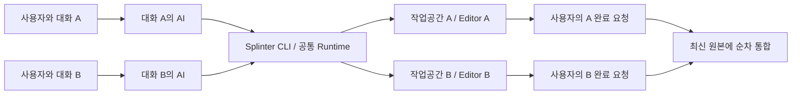

# 대화별 작업과 설치·연결 계획

후속 설계에서는 [저장공간 우선 검토](storage-priority-and-editor-modes.md)에 따라 독립 파일 작업공간과 Editor 실행 정책을 분리한다. 용량 부담 해소가 1순위이며, 단일 Editor 순차 검증은 기본 방식의 후보로 평가한다. 아래 작업별 Editor 흐름은 현재 독립 실행 경로다. 설치·같은 대화의 지속·명시적 반영/보존/폐기 원칙은 두 실행 방식에 공통으로 유지하며, 새 검증 후보 계약은 미구현이다.

공통 저장소 1차의 구현·소스 검증은 진행됐지만 [기존 VSS 보존 실패](../verification/storage-foundation.md)로 전체 마감하지 못했다. 보존 관문을 우선하며 아래 설치·자동 binding·discard는 별도 후속이다. SW-01~10은 NotRun을 유지한다.

계획일: 2026-09-23. 상태: **계획 확정, 설치·자동 세션 연결·명시적 폐기는 미구현**. [기획서 개정 5판](../../plan.html#section-2)의 기본 사용 모델을 구체화한다. 현재 실행 가능한 명령은 [현재 기반](../foundation.md), 기존 작업공간의 사용법은 [알파 작업공간](../alpha-workspaces.md)을 따른다. 이 문서의 제안 필드·상태·명령은 현재 capabilities나 schema에 추가된 기능이 아니다.

## 제품의 기본 사용 모델

사용자는 평소의 각 Codex 대화에서 작업을 지시한다. 별도 조정 AI, 새 하위 작업자 실행, 전체 작업 그래프 제출을 요구하지 않는다. 해당 대화의 AI가 필요할 때 Splinter CLI로 자기 작업공간과 Editor를 확보하고, 여러 차례 대화하며 작업을 이어 간다. 사용자의 명시적 완료 요청에 원본 반영과 정리를 수행하며, 명시적 폐기 요청에는 원본에 반영하지 않고 해당 작업을 제거한다.

프로그램은 작업 식별·지속 상태·소유권·공유 자원·통합 순서를 조정한다. 작업의 의미 판단과 편집은 각 대화의 AI가 수행한다. Codex Runner와 DAG는 이후 자동 하위 작업 위임을 위한 선택적 확장이다. daemon/SQLite 전환도 기본 사용법의 선행 조건이 아니다.

## Splinter를 사용할 때와 사용하지 않을 때

| 상황 | 에이전트의 행동 | 부작용 경계 |
| --- | --- | --- |
| 사용자가 “Splinter로 병렬 작업해줘”라고 명시 | 현재 대화의 작업을 생성하거나 재개 | 지원 조건을 확인하고 Splinter가 반환한 경로에서 작업 |
| 다른 작업이 같은 프로젝트/Editor를 점유하고 독립 실행이 필요 | 설치된 지침과 승인된 프로젝트 정책에 따라 자율적으로 Splinter 사용 | 기존 작업·Editor를 탈취하거나 종료하지 않음 |
| 독립 실행이 필요 없고 현재 프로젝트에서 안전하게 작업 가능 | 기존 경로에서 직접 작업 | 새 snapshot·worktree·Editor·작업 기록을 생성하지 않음 |
| 이미 이 대화에 Splinter 작업이 연결됨 | 원본 Editor가 비어도 같은 작업을 계속 사용 | 원본으로 자동 복귀하거나 새 작업을 중복 생성하지 않음 |
| 점유/소유권을 관측할 수 없음 | unknown으로 표시하고 안전한 독립 실행 가능 여부를 검사 | unknown을 idle로 취급하지 않음. 지원/권한 부족 시 보존하고 필요한 행동 반환 |
| 병렬 작업은 필요하지만 Splinter가 설치되지 않음 | 설치 필요와 범위를 제시하고 설치 요청/기존 정책 범위에서 준비 | 설치 승인이나 OS 권한을 임의로 확대하지 않음 |

Editor가 열려 있다는 사실만으로 다른 작업이 점유했다고 판정하지 않는다. 현재 대화가 사용하는 Editor인지, 다른 작성자가 편집·실행 중인지와 필요한 기능을 함께 확인한다. 스킬은 가벼운 관측으로 사용 여부를 결정하며 모든 요청을 workspace 생성 명령으로 시작하지 않는다.

이 조건에 해당하는 병렬 작업에는 **Codex의 별도 worktree 생성 기능 대신 Splinter의 작업공간 수명주기**를 사용한다. Splinter 내부 Git 어댑터가 만드는 linked worktree는 유지한다. 이미 외부 worktree에서 시작한 대화는 원본·대상 브랜치·관리 소유권을 식별하고 지원 여부를 확인한다. 기존 Codex worktree를 임의로 이동·삭제하거나 두 도구가 같은 자원을 함께 소유하게 만들지 않는다.

## 프로젝트용·전역용 설치

사용자는 “이 프로젝트에서 Splinter를 쓰도록 가져와줘” 또는 “전역에서 쓸 수 있게 설치해줘”라고 요청한다. AI가 요청 범위의 배포물 확보, 의존성 확인, 지침 연결과 실제 발견 검증을 담당한다. 사용자가 제품 소스를 빌드하거나 직접 경로를 복사하는 절차를 정상 경로로 삼지 않는다.

| 설치 범위 | 실행 파일·설정·지침 | 완료 판정 |
| --- | --- | --- |
| 프로젝트용 | 해당 프로젝트의 사용 정책과 버전 참조, 저장소 범위 스킬 연결. 바이너리는 검증한 공용 캐시를 재사용할 수 있으나 다른 프로젝트의 기본 정책·전역 PATH를 바꾸지 않음 | 해당 프로젝트 대화에서 발견·CLI 진단 성공, 별도 미등록 프로젝트에는 영향 없음 |
| 전역용 | 현재 OS 사용자 범위의 실행 파일/실행 경로와 공용 지침. 프로젝트 정책은 전역 기본값보다 구체적으로 적용 | 서로 다른 프로젝트에서 발견, 프로젝트별 설정·작업 기록은 독립 유지 |

“전역”은 기본적으로 현재 사용자 범위다. 머신 전체 설치나 관리자 권한은 공급자/드라이버 설치처럼 실제 필요한 경계에서만 사용한다. 설치 범위와 작업 상태의 저장 위치는 분리한다. 같은 대상 저장소를 사용하는 모든 대화는 동일한 상태 저장소와 저장소 잠금을 사용해야 한다. 프로젝트용·전역용 설치가 공존해도 서로 다른 home으로 동일 자원을 중복 관리하지 않도록 기존 등록을 발견하고 충돌을 진단한다.

설치 순서는 다음과 같다.

1. 기존 Splinter·Codex 연결과 프로젝트/사용자 설정을 조사하고 요청한 범위를 확정한다. 기존 호환 버전은 재사용한다.
2. 출처·버전·무결성을 확인한 self-contained 배포물과 필요한 Windows 의존성을 준비한다. 원본 복사·필수 ReFS 이관은 하지 않는다.
3. 프로젝트 정책, 실행 위치, 상태 저장소 연결을 기록한다. 장비별 절대 경로·토큰·작업 상태를 프로젝트의 공유 설정에 섞지 않는다.
4. 최소 스킬을 연결하거나 스킬을 포함한 Codex 플러그인을 설치한다. CLI 호출만으로 충분하면 MCP 서버·상주 AI를 추가하지 않는다. 기존 AGENTS.md·설정·다른 스킬을 덮어쓰지 않고 도구 소유 항목을 기록한다.
5. CLI 실행·capabilities/schema·의존성 진단과 실제 Codex의 스킬 발견을 각각 확인한다. 해당 설치 버전에서 지침 재로딩이나 새 대화가 필요하면 알리고, 진행 중 작업의 연결 정보를 보존한다.
6. 명시 호출, 점유 상황의 암묵 호출, 불필요한 상황의 미사용을 새 대화에서 검증한다. 설치 재요청으로 중복 연결·새 작업이 생기지 않아야 한다.

공식 문서에서 저장소의 `.agents/skills`, 사용자 범위의 `$HOME/.agents/skills`, 명시/암묵적 스킬 선택을 확인했다. 배포용 플러그인은 스킬만 포함할 수도 있다. 이는 구현 경로의 근거이며 특정 Codex 버전의 프로젝트 범위 플러그인 설치나 현재 대화의 즉시 재로딩을 보장하지 않는다. 설치 어댑터가 실제 지원 범위를 검사하고, 프로젝트 범위 플러그인 연결이 없으면 저장소 범위 스킬 경로를 사용한다. [OpenAI 스킬 문서](https://developers.openai.com/codex/skills), [플러그인 구조](https://developers.openai.com/plugins/concepts/plugins).

업데이트는 활성 작업이 사용하는 프로토콜·실행 파일을 강제 교체하지 않는다. 제거는 해당 설치가 만든 연결과 사용하지 않는 배포물만 처리하고, 다른 프로젝트의 공용 설치·원본·미완료 작업은 보존한다. 도구 제거 요청을 작업 폐기 요청으로 해석하지 않는다.

## 대화와 작업공간 연결

Core의 식별자는 공급자 중립적인 project/task/workspace ID를 유지한다. Codex 대화 ID는 연결 어댑터가 보유하는 선택적 locator다. 지원된 세션 ID가 없으면 안정된 작업 키와 저장된 연결 manifest로 재개하며 사용자가 키를 반복 입력하게 하지 않는다.

연결 정보는 대상 프로젝트, 작업 키, workspace ID·실제 루트, 상태 저장소 위치, 기준 snapshot/revision, 작업 소유 세대, 검증·완료 상태를 포함한다. 대화 제목·현재 활성 창·전역 “마지막 작업”으로 대상을 추측하지 않는다. 설치 manifest와 작업 manifest는 수명과 범위가 다르다.

- 대화 A/B는 서로 다른 작업 키를 사용한다. 새 CLI·문맥 압축·앱 재시작 뒤에는 저장된 연결과 실제 상태를 대조해 같은 작업을 이어 간다. 대화 fork나 다른 대화로의 인계는 새 작업인지 기존 작업 인수인지 구분하며 살아 있는 작성자의 소유권을 복제하지 않는다.
- 현재 대화를 유지한 채 반환된 workspace 절대 경로를 파일 도구와 명령의 작업 경로로 사용한다. shell의 `cd`나 workspace ID 전달만으로 모든 도구의 CWD·쓰기 권한이 바뀌었다고 간주하지 않는다.
- 에이전트 연결이 실제 쓰기 경로·권한을 확인하지 못하면 차단 이유와 필요한 경로 권한을 반환한다. 권한 우회, 원본으로 몰래 편집, 별도 Codex worktree 생성, 강제 하위 세션 생성으로 대체하지 않는다.
- 기본은 한 작업공간의 작성자 하나다. 연결 인수·stale 세대·동시 재개와 명령 중복은 프로그램이 검사한다. 짧은 CLI 잠금만으로 에이전트의 모든 직접 파일 쓰기가 차단된다고 주장하지 않는다.
- 대화 종료, 응답 완료, 시간 경과, Editor 종료는 작업 완료·원본 반영·삭제의 근거가 아니다. 저장된 binding은 명시적 반영/보존/폐기 완료 뒤 종료한다.

## 완료·보존·폐기

| 사용자 의도 | 목표 처리 | 결과/자원 |
| --- | --- | --- |
| “병렬 작업을 끝내고 원본에 반영·정리해줘” 또는 문맥상 같은 뜻의 종료 요청 | 대상 작업 확정 → 새 쓰기 정지 → 현재 소스 검증·독립 결과 보존 → 최신 원본 통합 후보 검증 → 원본 반영 확인 → 소유 자원 회수 | 원본 반영과 회수 증거를 보고. A만 끝내면 B는 계속 유지 |
| “나중에 이어갈게”, 대화 종료, Editor만 종료 | 작업과 변경분을 보존 | 원본 반영·자동 삭제 없음 |
| “결과만 보관하고 작업공간을 정리해줘” | 검증 가능한 독립 결과를 보존한 후 회수 | 원본은 그대로, 결과 참조·재사용 정보 유지 |
| “이 작업은 필요 없으니 반영하지 말고 버려줘” | 명시적 discard intent를 기록하고 해당 작업의 쓰기를 정지한 뒤 소유 변경분·전용 자원을 제거 | 원본/다른 작업 불변. 해당 작업 전용 결과 참조도 요청 범위에서 제거 |

“정리”가 코드 정리를 뜻하는지 작업공간 종료를 뜻하는지 문맥상 구별되지 않거나 대상 작업이 여러 개면 대상을 확인한다. 이미 대상과 반영/폐기 의도가 명확한 요청에 같은 승인을 다시 요구하지 않는다. 정상 완료 후에도 사용자가 계속 수정하는 대화 전체를 자동 종료하지 않는다.

통합은 저장소별로 직렬화하고 최신 대상 HEAD·dirty/staged·미저장 Editor 상태를 검사한다. A 반영 후 B의 시작 기준을 몰래 바꾸지 않는다. B 통합 시 최신 원본과 비교해 충돌을 처리하고 후보를 다시 검증한다. 충돌·원본 변경·검증 실패에는 해당 결과를 보존하고 성공이나 정리 완료로 기록하지 않는다. 원격 push는 별도 요청 범위다.

폐기는 보존형 release와 별도 계약이다. 현재 release의 결과 보존 검사를 약화하거나 임의 경로 강제 삭제 옵션으로 대체하지 않는다. 폐기 시에는 다음을 확인한다.

- 정확한 workspace·owner 세대·변경 상태와 사용자 의도에 연결한 intent를 먼저 저장한다. 컴파일 실패 작업도 명시적으로 폐기할 수 있으며 성공한 검증·checkpoint를 폐기 전제조건으로 요구하지 않는다.
- 해당 작업의 작성·Editor·자식·provider를 정지하고 소유권/핸들을 관측한다. 이후 scope가 달라졌거나 다른 쓰기가 계속되면 삭제를 멈춘다. 재시도는 같은 intent의 남은 단계만 수행한다.
- 전용 mount·Git 등록·delta·캐시·작업 전용 결과 참조만 정리한다. 공유 snapshot·기준본·Git 객체에 다른 의존성이 있으면 유지한다. 저장소 전체 GC나 다른 branch 삭제로 “완전 삭제”를 강제하지 않는다.
- 반영 전 폐기는 원본을 바꾸지 않는다. 이미 반영된 작업의 폐기는 원본 revert가 아니며, 원본 변경 취소는 별도 명시 요청과 검증이 필요하다.
- 최소 폐기 영수증과 완료 상태는 남기되, 폐기 대상으로 확정된 작업 payload를 별도 숨은 백업으로 계속 복제하지 않는다. 미승인 결과·타 작업·원본은 보존한다. unknown을 자원 0으로 판정하지 않는다.

## 구현 순서와 책임

| 순서 | 산출물 | 담당 경계 / 완료 조건 |
| --- | --- | --- |
| 1 | 사용 판단·연결·종료 의도의 계약과 fake | Core/Protocol/Runtime. explicit/busy/direct/unknown, 동일 작업 재개, 반영·보존·폐기를 구분. 구현 시 schema·fake·현재 문서를 함께 변경 |
| 2 | 프로젝트용·전역용 설치와 최소 스킬 연결 | 설치/Codex 어댑터. 의존성·범위·기존 설정·실제 발견 확인, 미사용 경로 포함 |
| 3 | 현재 대화의 binding·경로·재개 | Codex 연결 + Runtime. 실제 파일 도구/CLI/Editor가 같은 작업을 가리키며 Core는 Codex API에 의존하지 않음 |
| 4 | 통합 완료 처리와 명시적 discard | Runtime/Git/Windows/Unity. 최신 원본 검증·단계별 중단 복구·정확한 소유 자원 회수 |
| 5 | 독립 대화의 실제 여러 차례 작업과 비용 | 기존 PV-01/02와 아래 SW 사례. 코드 편집/오류 수정, A 먼저 완료, B 지속·재개, 별도 폐기, 재설치·미사용 경로 |

기존 CLI로 가능한 PV 작업·비용 측정의 사용자 선택 범위는 설치/폐기 구현 전체를 기다리지 않고 `scoped-complete-with-limitations`로 마감했다. 복구·운영 개입을 포함한 PV-01 완료와 S4 FailedInputQualification·소수 표본·과거 전체 팩 raw 동등성 unknown은 [실행 기록](../verification/parallel-workflow.md)을 따른다. PV-02 전체 Passed로 올리지 않는다. 아직 없는 기능은 SW에서 NotRun으로 둔다. NR의 장애·파일 지원 조건은 지원 확대 전에 완료하고, 별도 Runner·DAG·DB 도입으로 이 사용자 흐름의 검증을 늦추지 않는다.

## 사용 흐름 검증: SW-01~10

모두 **NotRun**이다. 기존 NI/LV/AA/SR 시험의 성공을 이 표로 승계하지 않는다. 공개 48개 시나리오의 UX/CLI/GT/RC 조건을 구체화하는 하위 사례이며 새 통과율을 만들기 위한 별도 집계가 아니다.

| ID | 시나리오 | 반드시 남길 증거 |
| --- | --- | --- |
| SW-01 | 프로젝트용 최초/반복 설치 | 등록 프로젝트에서만 발견, 무관 프로젝트/전역 설정 불변, 중복 설치·연결 없음 |
| SW-02 | 전역 설치와 프로젝트 정책 공존·업데이트/제거 | 두 프로젝트에서 발견, 같은 저장소는 같은 상태 저장소, 다른 프로젝트/미완료 작업 보존 |
| SW-03 | 명시 요청·점유에 따른 자동 사용·필요 없는 직접 작업 | 각각 Splinter 사용/사용/미사용. direct 사례의 새 snapshot/workspace/Editor 0, Codex 별도 worktree 생성 0 |
| SW-04 | 점유 unknown·권한 부족·경로 바인딩 실패 | 기존 Editor·원본 보존, 거짓 idle/Ready 없음, 정확한 복구 행동, sandbox 우회 없음 |
| SW-05 | 별도 조정 AI 없는 대화 A/B의 여러 차례 수정 | 서로 다른 workspace/Editor, A 오류 중 B 진전, 원본과 상대 작업의 내용 불변 |
| SW-06 | 문맥 압축·새 CLI·대화 재개·동시 접속 | 같은 작업/기준/변경분 유지, stale 작성자·중복 생성 거부, 전역 마지막 작업 오접속 없음 |
| SW-07 | A 먼저 반영·정리, B는 계속 수정 후 반영 | A 자원 회수, B의 PID/기준/변경분 유지, B 최신 통합 후보 검증, 명령/개입 수 |
| SW-08 | 통합 충돌·원본 dirty·동시 통합·관측 불확실 | 순서 제어, 원본/결과 보존, 실패를 완료로 기록하지 않음 |
| SW-09 | 미커밋·컴파일 실패 작업의 명시적 폐기와 중간 중단 | 원본 반영 0, 해당 payload/소유 자원 회수, 타 작업·공유 snapshot 유지, 같은 intent로 재개 |
| SW-10 | 단순 대화 종료·Editor 종료·보존 요청·이미 반영한 작업의 폐기 요청 | 자동 통합/삭제 없음, 독립 결과 보존 경로, 원본 자동 revert 없음, 명확한 완료 보고 |

모든 실제 시험은 설치 범위·제품/지침 버전·대화별 작업 연결·원본/작업 hash·명령과 소유 자원 관측을 연결한다. 사용자 목표 전달과 승인된 종료 지시는 정상 사용이며, 키 입력·수동 복사·Editor 재연결 같은 운영 개입과 별도로 센다.
