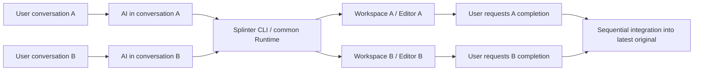

# Per-conversation workspace usage and installation plan

[한국어](../ko/plans/session-workflow-and-installation.md)

This document owns AI usage procedures through existing CLI/file-Git tools/external Unity tools. Dedicated project/global installers and automatic Codex binding are unimplemented and excluded from program scope. [Minimal skill](../../skills/splinter/SKILL.md) is the instruction source. Preserve SW-01/02/04/05/07/08/10 NotRun and overall SW-03/06/09 Partial as existing execution-evidence states, not new program tasks. Current commands/gates follow [foundation](../foundation.md), [alpha workspaces](../alpha-workspaces.md), and [discard](../workspace-discard.md).

First scoped practical-use [M0](implementation-plan.md) closed through [delivery decision](../verification/m0-delivery.md). Retain existing CLI/service prerequisites from [start guide](../agent-start.md) and [representative A/B](../verification/representative-agent-workflow.md) execution qualification. Program-agent responsibilities/reduced follow-ups follow [implementation plan](implementation-plan.md#program-and-agent-responsibilities). Provide AI procedures for installation/handoff/task order/game verification without adding automation frameworks.

Under the [storage-first plan](storage-priority-and-editor-modes.md), distinguish independent file workspaces/Editor execution policy. Continuing-task/application/preservation/discard principles below apply to both execution methods; proposed fields/states/commands are not current capabilities.

## Product's basic usage model

Users instruct work in ordinary Codex conversations. Require no separate coordinating AI/new child-worker execution/full task-graph submission. Each conversation's AI obtains its workspace/Editor through Splinter CLI when needed, continuing through multiple exchanges. Explicit completion requests trigger original application/cleanup; explicit discard removes that task without applying to original.

Program coordinates task identity/persistent state/ownership/shared resources/integration order. Each conversation's AI judges meaning/edits. No Codex Runner/DAG/daemon-SQLite in this plan.

## When to use Splinter

| Situation | Agent action | Side-effect boundary |
| --- | --- | --- |
| User explicitly requests parallel work with Splinter | Create/resume this conversation's task | Check support conditions/work at returned Splinter path |
| Another task occupies same project/Editor and independent execution is needed | Autonomously use Splinter under installed guidance/approved project policy | Do not seize/terminate existing tasks-Editors |
| Independent execution unnecessary/current project safe | Work directly at existing path | Create no snapshots/worktrees/Editors/task records |
| Splinter task already attached to conversation | Continue same task even if original Editor is free | No automatic return to original/duplicate new tasks |
| Occupancy/ownership unobservable | Mark unknown/check safe independent execution | Unknown is not idle. Preserve/return needed actions if support-permissions insufficient |
| Parallel work needed/Splinter not installed | Explain installation need/scope; prepare under installation request-existing policy | No arbitrary expansion of installation approval/OS privileges |

Open Editor alone does not establish another task's occupancy. Check whether current conversation uses it, whether another writer edits/runs, and required features. Skill decides use through lightweight observation; not every request starts workspace creation.

For qualifying parallel work, use **Splinter workspace lifecycle instead of separate Codex worktree creation**. Retain linked worktrees created by internal Git adapter. For conversations starting in external worktrees, identify original/target branch/management ownership and support. Do not arbitrarily move/delete existing Codex worktrees or give both tools joint ownership of one resource.

## AI procedure: project/user-scope connection

On installation requests, AI connects requested distribution/dependencies/guidance. Do not implement dedicated installer/automatic Codex settings/installation-manifest framework. Retain current development CLI/restricted-service prerequisites and unqualified whole installation.

Users ask to bring it into this project or connect it for user-scope use. AI obtains distributions/reuses builds/checks dependencies/connects guidance/verifies actual discovery. Use available existing commands rather than requiring user manual builds/path copying.

| Installation scope | Executables/settings/guidance | Completion decision |
| --- | --- | --- |
| Project | Specify CLI absolute path/project policy in existing AGENTS-skill structure. Preserve device values in local settings/handoffs | Verify project CLI-schema/guidance; other projects/global PATH unchanged |
| User | Configure requested executable paths/skill connections through existing tools; prioritize project policies | Preserve each project's originals/settings/incomplete tasks/existing connections |

All conversations on one repository use existing registered common home. Distinguish connection scope/task-state location; no duplicate management through new homes. Administrator privileges only at actual service/driver configuration boundaries.

Installation sequence:

1. Check/reuse existing CLI/version/project policies/registered homes/skill connections.
2. Prepare existing builds/distributions/dependencies; record CLI absolute paths/policies. Do not overwrite AGENTS/settings/other skills.
3. Verify `capabilities/schema`, diagnostics, and actual instruction discovery separately. Diagnostic success does not qualify VSS/grant/Editor execution.
4. Needed service/driver configuration follows existing explicit installation-tool plans/privilege boundaries. No normal CLI-Git-Unity elevation/arbitrary administrator helpers.

Check skill paths/reloading/plugin support through current AI-tool guidance. Splinter does not guarantee installation/immediate discovery for particular Codex versions. If undiscovered, guide explicit reading of skill source.

During update/removal, AI also preserves active-task executables/contracts/handoffs and other-project settings/distributions/originals/incomplete tasks. Tool removal is not workspace discard.

## Connecting conversations and workspaces

Preserve project/task keys/workspace IDs/absolute roots/identical homes/bases-digests in AI conversations/handoffs; compare CLI state. Specific Codex locator APIs/automatic fork-host handoff/manifest discovery/binding frameworks excluded. New-CLI same-task resumption evidence follows M0-02.

Core retains provider-neutral project/task/workspace IDs. AI resumes stable saved task keys instead of repeated user key entry. Program does not infer tasks from conversation titles/current windows.

Handoffs include target project/CLI/key-id/returned root/home/base-revision/snapshot-digest/explicit options/pending inputs-next actions. Preserve owner/generation from current responses unchanged; no new manifest contracts.

- Conversations A/B use distinct keys/paths. Compare handoffs/actual state after new CLI/context compaction. AI coordinates writers during forks/handoffs; do not duplicate live writer ownership.
- Keep current conversation; use returned absolute workspace path for file tools/command working directories. Shell `cd` or workspace IDs alone do not change every tool's CWD/write permissions.
- If agent connection cannot verify actual write paths/permissions, return blockers/needed path permissions. No permission bypass/secret original editing/separate Codex worktree/forced child sessions.
- Default one writer per path. Program retains current command locks/identity/duplicate-owner checks; no per-conversation exclusive arbitrary-file-write locks/automatic writer takeover.
- Conversation/response/time passing/Editor ending do not mean completion/application/deletion. AI preserves same-task handoff until explicit completion finishes.

## Scoped external-tool handoff

AI uses files/Git at returned workspace and obtains owned Editor when needed. Unity work uses Editor UI or selected installed external tools as needed. External tools/AI own assets/Play/tests/builds/capture/error analysis/verification decisions. AI also selects modes/task order; no automatic queues/general lease takeover/Unity command relaying.

MCP/Unity CLI are optional external tools chosen as needed from user-installed tools. Storage isolation/bases/Library-unchanged-file references/range changes/independent results/safe original application/owned-resource lifetimes work without them. Specific names/versions/internal APIs are not prerequisites/gates. Agents choose/connect/refresh/compile/Play-Test-build/capture/judge. External-tool installation/downgrade/modification/separate modified-tool creation-operation are excluded. Splinter supplies exact returned paths/owned Editor identity; agents/tools own external connections/shared-server coexistence/recovery. Do not solve external defects through product callback manipulation/patch creation/version-detection frameworks. Historical small T: handoff is [UH evidence](../verification/unity-cli-handoff.md), not inherited current requirements.

Current `checkpoint/integrate` require no internal compile evidence. AI determines external verification; same Splinter checkpoint independently preserves stable sources regardless of Editors/compile results. Retain seals/independent results/target-dirty guards. Removed `preserve-worker` and built-in refresh/compilation/focus handling; add no general verification-evidence platform. Optional single-view/Library caches remain [development CLI](../development-cli.md) storage lifecycles. Current default usage follows [start guide](../agent-start.md).

### Follow-up scope: Unity CLI A/B handoff

This section records execution closed on 2026-10-03 and the unexecuted Git candidate. Do not inherit commands/versions/new A-B/settings-package changes below as current execution instructions or required product requirements. No automatic new handoff/support verification. Current responsibilities follow optional external-tool boundaries above.

Fixed T: execution on 2026-10-03 closed scoped-complete-with-limitations under [UH-01–04](../verification/unity-cli-handoff.md). Existing CLI connection to exact returned paths solved it without program changes; supplemented [usage procedure](../alpha-workspaces.md#exact-target-selection-with-unity-cli)/skill/start guide. Retain list-discovery limits/initial read-eval timeout/unexecuted MCP-Play-Test-build/preceding C: pending reclamation. Git table below is an earlier read-only candidate, not this execution input.

2026-10-03 uses **existing `T:\plastic-fixture-20261002`, registered home `T:\pt1002`, `source=plastic`, `application=unity`, `base=snapshot`** instead of earlier Git candidate. Candidate `development @ 57d4439`; refix final source/binary hashes if code changes. Retain Unity `6000.3.22f1`/CLI `1.0.0-beta.5`/Pipeline `0.8.0-exp.1`. Question: does preceding PC worker-discovery failure affect only CLI lists; can actual commands/loaded results target exact returned paths and B continue after normal A shutdown?

Create only one each of keys `cli-t-a-20261003`/`cli-t-b-20261003`; fix same home/16 GiB journal budgets. No separate source registration/fixture copies/service updates/package-original-settings changes/Coplay server starts. Preserve original C: Editor-Pipeline/T: source-Plastic management/five existing registrations/results/C: pending. Confirm small C# loaded values in A/B, B follow-up compile-query after A stop, two independent results/releases/final owned snapshot-resource reclamation. If no connection, preserve failure/state/minimum needed follow-up. Compare CLI substring selection with exact absolute paths/PIDs; discovery failure is not readiness/connection success.

VCS-independence requirements led to **first implementing VCS-free basic lifecycle/existing-Git protection and closing scoped A/B**. Plain-folder exact-path eval-recompile/list omission/original coexistence qualification is in [VCS verification](../verification/vcs-independent-workspaces.md); small editorless original application in [separate AP](plain-folder-original-apply.md). This T: Plastic handoff then executed/closed separately; none inherit each other. Separate execution/fixture changes for Git candidate below never started. [Matrix](validation-matrix.md#reduced-follow-up-responsibility-classification) owns status.

Historically this unit verified external-tool handoff after built-in refresh/compilation removal. Preserve recorded CLI-Pipeline inputs/results only; new coexistence verification/package changes are not mandatory product follow-ups. Current follow-ups address actual storage-isolation/owned-resource-result preservation defects, distinct from agent connections/tool judgment.

| Item | Fixed scope/pre-execution rechecks |
| --- | --- |
| Product candidate | `development @ 7891389`. Refix final Git SHA/source-binary hashes if implementation changes |
| External tool | Installed `C:/Users/olive/AppData/Local/Unity/bin/unity.exe`, `1.0.0-beta.5`. Confirmed `--project-path` in local `--version`/`command --help`. Do not assume latest-skill commands/options match installed version |
| Unity/connection package | Unity `6000.3.22f1`/`com.unity.pipeline` `0.7.0-exp.1`. Confirmed manifest-lock-ProjectVersion in registered fixture; actual connection unexecuted |
| Input/state location | Existing `T:/ua-source`, base `codex/library-20260929`, HEAD `f71e4e244ba9b085aa0fc439336e4c60ee3d5d5d`, home `C:/Users/olive/Desktop/Development/splinter/.local/wl29`. Original Git clean during this read. Recheck registration/warm Library/free space/actual HEAD-clean before execution; explicitly define new basis if changed |
| Tasks/ownership | One new key each A-B/same registered home/distinct returned paths-IDs-digests-snapshots. First preserve existing tasks/result refs/original-peer Editor-server identities |

#### Execution sequence and completion criteria

1. Read-only check schemas/existing service-registrations/inputs. Create A-B workspaces/owned Editors; compare Pipeline discovery absolute paths/PIDs to returned paths/owned PID-start. Failed connection/sandbox unobservability does not mean Editor absent.
2. Read catalogs/actual input schemas with explicit `--project-path <returned workspace path>` for each A-B. Use tool refresh-compile-query paths to confirm small C# changes/distinct loaded values. Selected B-original source hashes/Editor identities unchanged before-after A operations. No original fallback/restored Splinter compilation.
3. Normal Splinter stop ends A; verify B queries/one follow-up edit-compile. If original Editor/shared Coplay server exists, compare exact projectRoot/PID-start/connections before-after. Do not start absent servers; coexistence gate remains NotRun. Distinguish own Pipeline connection/shared Coplay server.
4. Independently preserve stable A-B source via `checkpoint`, explicitly `release`. Verify result contents/no actual mounts-Git registrations-deltas/final owned snapshots/zero owned resources. shared-reclaim-pending/unknown is incomplete; retain same-task next actions. Original integrate/discard are not gates here.
5. Verify final required `pwsh ./scripts/build.ps1` and changed schema-fake-conformance. Record CLI-packages/input SHA/A-B identities/commands-responses/before-after hashes-owned resources/result refs/time-observed allocation; add only successful procedures to skill/start guide. Judge external compilation and Splinter preservation separately.

Completion requires **actual execution evidence/scoped support decision**. Discovery/version checks alone do not finish handoff. If original/shared-server gate is unexecuted, state limits/no whole coexistence claim. No repeated benchmarks/storage-memory savings pass conditions.

#### Fix limits and completion rules

These were historical-run fix limits. Current program changes address only returned targets/owned Editors/storage isolation/result preservation defects. External implementation/installation-patching/shared-server lifetimes excluded. Public-contract changes update schemas/fakes/conformance/current docs, retaining acknowledged writes/seals/independent results/target-dirty/original-peer protection.

If registration-driver-service/package-version changes are needed or Pipeline connection cannot work, preserve failures/state and separately propose minimum change scope. Exclude tool install-update/original settings/Coplay start/administrator Apply/global Codex settings/automatic other-MCP switches. Reproduced supported-path acknowledged-write loss/original-peer damage blocks route/fix first.

Close with one representative A-B and bounded same-cause reproduction-fix-regression. Exclude new harness/failure matrix/forced process termination/OS-ARM-VIVOBOOK/large-cold-C-S-Q comparisons/development view expansion/automatic modes-queues/dedicated installer-binding/push-distribution.

## Completion, preservation, and discard

| User intent | Target handling | Results/resources |
| --- | --- | --- |
| Finish parallel work, apply to original, and clean up, or contextually equivalent | Fix target → stop new writes → verify current source/preserve independent result → verify latest-original integration candidate → confirm application → reclaim owned resources | Report application/reclamation evidence. Ending only A retains B |
| Continue later, conversation ending, Editor-only stop | Preserve task/changes | No original application/automatic deletion |
| Keep result only and clean workspace | Preserve verifiable independent result then reclaim | Original unchanged; keep result refs/reuse details |
| Discard unneeded task without application | Record explicit discard intent/stop task writes/remove owned changes-dedicated resources | Original/other tasks unchanged. Current request removes only task branch; existing independent-result refs retained |

Clarify targets when cleanup could mean code cleanup/workspace completion or multiple tasks are ambiguous. Do not request identical approval again when target/application-discard intent is clear. Do not automatically end an entire conversation where the user continues edits after normal completion.

Program retains integration repository locks/target HEAD-dirty-staged guards/independent results. AI checks original Editor unsaved state/conflict resolution/integration strategy/latest-original game verification through existing tools. Do not silently change B basis after A application. Unity generated-source return merging is AI/Git procedure. Do not bypass current gates/failures; remote push requires separate scope.

Discard is separate from preserving release. Do not weaken release result checks or replace with arbitrary-path forced deletion. Verify:

- Save exact workspace/owner generation/change state/user-intent-linked intent first. Explicitly discard compilation failures without successful verification/checkpoint prerequisites.
- Stop task writer/Editor/children/provider/observe ownership-handles. Stop deletion if scope changed or other writes continue; retries perform same-intent remaining stages only.
- Clean only dedicated mounts/Git registrations/deltas/task branches. Do not delete shared views-caches/existing independent-result refs. Retain shared snapshots/bases/Git objects with dependencies. No repository-wide GC/other-branch deletion to force complete erasure.
- Pre-application discard leaves original unchanged. Discard after application is not original revert; undo requires separate explicit request/verification.
- Keep minimum discard receipts/completion state without hidden duplicate backups of explicitly discarded payload. Preserve unapproved results/other tasks/original. Unknown is not resource zero.

## Closed implementation and retained procedures

| Order | Deliverable | Ownership/completion criteria |
| --- | --- | --- |
| 1 | Explicit discard contracts/fakes/actual worker handling | Core/Protocol/Runtime/Git/Windows. Discard failing-uncommitted work without successful verification/checkpoints; intent-owner/same-request interruption recovery. Shared candidate-source-cache explicitly block/return cleanup actions; no automatic cascades |
| 2 | Minimal AI guidance/task connection: editorless unit closed | Skill source/actual explicit-direct/returned-root editing/new-CLI same-task resumption/explicit discard. Editor checked at 3; no required specific Codex API/global install |
| 3 | Actual A-B use/completion: scoped M0 closed | [Representative use](../verification/representative-agent-workflow.md): errors-resumption/preservation-application-discard/peer continuation/costs. No overall SW inheritance |
| Follow-up | AI procedures/minimum external handoff | Installation-discovery-handoff/mode-tool selection are guidance. Code changes only at necessary external-handoff/safe collection-reclamation boundaries |

Preserve scoped PV closure/S4 FailedInputQualification/few samples/unknown raw equivalence in [execution record](../verification/parallel-workflow.md). Do not promote whole PV/SW to Passed. Distinguish excluded implementation/unqualified execution; select only NR needed for new environments.

## Workflow verification: SW-01–10

SW-01/02/04/05/07/08/10 remain **NotRun**, overall SW-03/06/09 **Partial**. [Minimal AI execution](../verification/agent-workflow.md)/[local discard](../verification/workspace-discard.md)/[representative A-B](../verification/representative-agent-workflow.md) subqualification does not pass whole SW. Below preserves evidence/responsibility classification, not instructions to implement/test every row next. Excluded-implementation NotRun cannot become Passed/Unsupported.

| ID | Scenario | Required preserved evidence |
| --- | --- | --- |
| SW-01 | AI procedure: project connection/repeated requests | Existing CLI-guidance discovery/unrelated projects-global settings unchanged. Dedicated installer excluded |
| SW-02 | AI procedure: user-scope connection/update-removal | Common home per repository/other projects-incomplete tasks retained. Installation framework excluded |
| SW-03 | Explicit requests/occupancy-based autonomous use/unneeded direct work | Use/use/no use respectively. Direct case zero new snapshots-workspaces-Editors/separate Codex worktrees |
| SW-04 | Occupancy unknown/insufficient privileges/path binding failures | Preserve Editors-original/no false idle-Ready/exact recovery/no sandbox bypass |
| SW-05 | Repeated conversation A-B changes without coordinating AI | Distinct workspaces-Editors/B progresses during A errors/original-peer contents unchanged |
| SW-06 | AI handoff/current CLI same-task resumption | Same key-id-home/basis-changes/current owner-duplicate checks. Automatic binding/arbitrary-file stale-writer exclusion unimplemented |
| SW-07 | Apply-clean A first, B continues then applies | A resources reclaimed/B PID-basis-changes retained/latest B candidate verified/command-intervention counts |
| SW-08 | Integration conflict/dirty original/concurrent integration/uncertain observations | Order control/original-result preservation/no failed completion |
| SW-09 | Explicit discard of uncommitted-compile-failed tasks/interruption | Zero original application/task payload-owned reclamation/other tasks-shared snapshots retained/same-intent resumption |
| SW-10 | Conversation-Editor ending/preservation requests/discard already applied tasks | No automatic integration-deletion/independent-result preservation/no automatic original revert/clear completion |

Selected actual-use tests connect tool-guidance versions/AI handoffs/original-task hashes/commands/owned observations. Distinguish user goals-approval/tool connection-retry interventions. Program retains SW-03–10 workspace protection; AI procedures judge necessity/conflicts/game verification.

## Administrator approval UX for repeated work

Completion goal is no UAC for normal creation/reconnection/reclamation after initial installation/privilege configuration. Service implementation follows [current privilege contract](../storage-privilege-service.md); actual UA-01–04 installation/repeated-use decisions follow [UA verification](../verification/storage-privilege-service.md). Current individual VSS helpers/development restricted administrator sessions are not service-installation/SW completion evidence.
