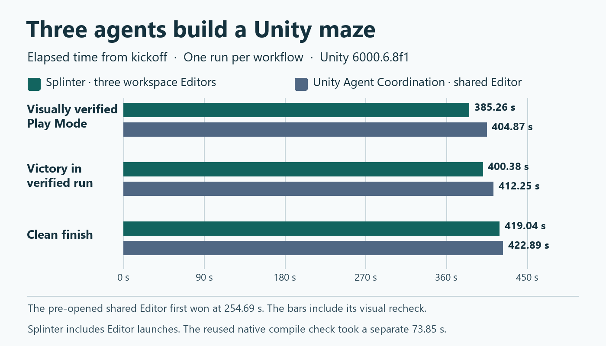

# Unity maze benchmark

Three agents built a playable 100 × 100 Unity maze. World generated the maze and A* route, Actors implemented movement and combat, and Presentation built the camera and display. Integration assembled the scene. Both workflows demonstrated movement in Play Mode, a visible game view, five encounters, health recovery and victory.

| From kickoff | Unity Agent Coordination | Splinter |
| --- | ---: | ---: |
| Visually verified Play Mode | 404.87 s | 385.26 s |
| Verified victory | 412.25 s | 400.38 s |
| Clean finish | 422.89 s | 419.04 s |

## What the clock includes

**Unity Agent Coordination** started with one validated Editor already open. Agents could draft in parallel. Publishing a module, compiling and running Editor checks required a turn in the FIFO queue. The coordinator took a turn to assemble and test the game. The shared Editor first showed movement at 245.81 s and won at 254.69 s. The reported endpoints include a second integration and visual check. Clean finish includes leaving Play Mode, returning the ticket, verifying the empty queue, closing the Editor and checking the project.

**Splinter** started from a stopped project. The clock includes preparing the shared Library (3.18 s), admitting three workspaces and starting their Editors, verifying each module, checkpointing and applying reviewed paths to the original, releasing all workspaces, restoring the native Library (0.97 s), and launching the original Editor (82.07 s) for the integrated Play test. Each Editor exited normally. All three workspace jobs drained, with zero remaining handles, mounts or providers and zero reported overlay I/O failures.

## Inputs and interpretation

Both runs used Unity 6000.6.8f1, the same project seed and a warm Library of 24,246 files (1.22 GB). Each arm implemented the same requirements independently. The shared run produced a 116-step route and the Splinter run a 121-step route. Splinter replayed its three authored modules at their recorded draft times. Actors and Presentation already had their modules loaded at initial readiness. World needed one refresh. Each Splinter task reported zero initial payload bytes copied.

These are single-machine, single-run workflow measurements. Splinter finished 3.85 s sooner (0.91%). The runs include differences in authored code, scheduling and visual rework. The small finish-time difference cannot establish a general performance ranking. Splinter's practical benefit here was that each agent could compile, enter Play Mode and keep its own result independently.

The Splinter run reused a successful native compile check for the exact input and Editor. Charging that one-time 73.85 s to a fresh input gives **459.10 s to playable and 492.89 s to clean finish**. The 54.39 s used to copy and verify the benchmark fixture is outside these timings. The shared Editor's startup and preflight were also outside its clock.

The [measurement data](unity-maze.json) includes the timing boundaries, input identity and acceptance results used for the chart. For another run, freeze the seed, Editor, packages and initial Editor states, verify native compilation before creating workspaces and record monotonic kickoff, visually verified play, victory and clean finish events. Count each arm through its final Editor close and resource checks. Report retries, extra validation and one-time setup separately. [Unity measurement tools](../development-cli.md#unity-readiness-and-shutdown-timing)
