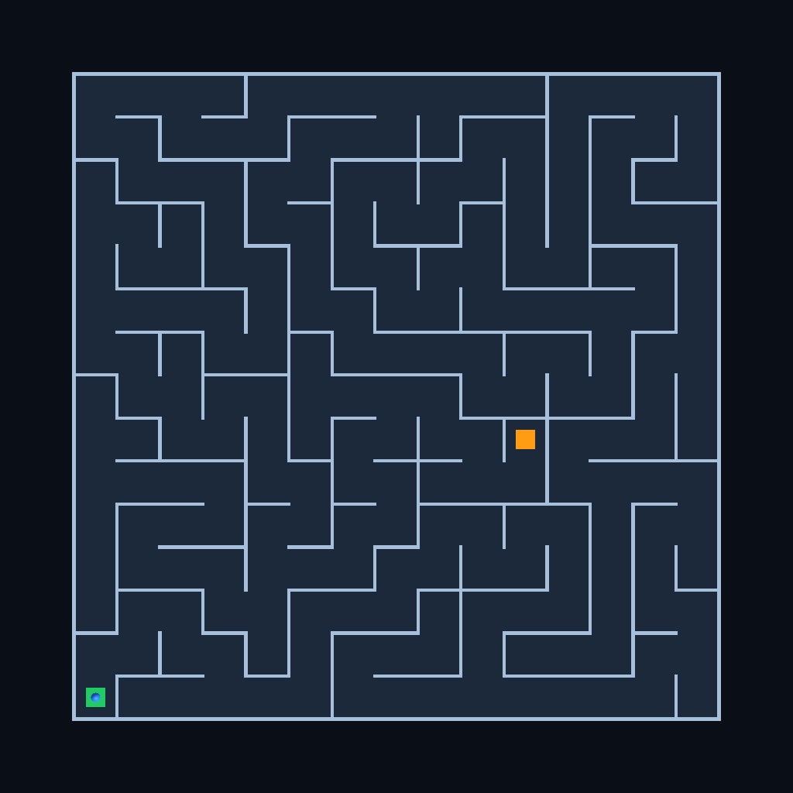

# Multi-stage Unity maze workflow

[한국어](../ko/verification/unity-maze-workflow.md)

MW-01 · 2026-10-14 · product `07bc2de`. [Dataset](../../reports/benchmarks/unity-maze-workflow-20261014.json).

Follow-up: [TP-06](unity-throughput-optimization.md#tp-06-time-comparison) records the corrected shared-Editor replay and the subsequent optimization candidate's reclamation failure. Keep the historical recovery totals below separate from that comparison.

**Both methods completed the maze feature, real Play validation, result preservation and original-source restoration, with recovery. This is not a clean automated throughput benchmark.** Observed complete time was **25m 01.9s for Splinter** and **13m 07.5s for one shared Editor**, excluding evidence copies but retaining recovery/diagnosis time. The shared run contains a material-save modal incident whose exact start was not recorded. Its normal uninterrupted total is **unknown**; these totals do not establish a normal overall speed ratio or a long-task crossover.

## Observed time and recovery

| Complete-workflow accounting | Splinter | Shared Editor |
| --- | ---: | ---: |
| Raw elapsed | 1,502.0641s | 787.5238s |
| Evidence copy, excluded | 0.2081s | 0.0642s |
| **Primary observed total, including recovery** | **1,501.8560s — 25m 01.9s** | **787.4596s — 13m 07.5s** |
| Separately timestamped measurement pause | 60.6813s | Not isolated |
| Secondary total without that known pause | 1,441.1747s — 24m 01.2s | **Unknown** |

The Splinter secondary value still includes the first timeout and same-workspace retry; it is not a successful-first-call throughput figure. There is no defensible corresponding adjusted shared-Editor total. Do not subtract its entire 476.4674s affected interval, an estimated dialog duration, or a neighboring compile time to construct one.

**Splinter completion:** A/B ran `workspace checkpoint --release` concurrently. The first calls returned `EditorStopTimeout` after 121.7227s/121.8201s; both Editors subsequently exited normally after approximately 130s. The measurement reader observed process absence before the asynchronous normal-exit receipts were published and stopped too early. After confirming exit-code-0 receipts, it resumed with the same workspace IDs and parallel combined commands; retries succeeded in approximately 128.1s/133.4s. No replacement workspace or forced exit was used. The completion interval is 324.6650s raw, or 263.9837s after removing the separately recorded 60.6813s measurement pause. The primary total retains that pause. See local `s-measurement-recovery.json`, completion/continuation costs and the first/retry command responses.

**Shared-Editor incident:** the A2→B2 transition removed A's task subtree after copying its saved assets back to A's code workspace. Unity then attempted to save cached Floor/Wall materials at the removed paths. Four dialogs were cancelled, two for Floor and two for Wall, after their owned windows were identified; one earlier Escape did not dismiss a dialog. The 476.4674s `q-b2` compile/handoff interval contains the modal wait, investigation and recovery, rather than pure compilation. Its exact dialog-open timestamp is unknown. The external `idle-scene` fixture was then amended to save assets before and after unloading unused objects (`EditorUtility.UnloadUnusedAssetsImmediate`). A/B feature snapshots were unchanged. All incident time remains in the primary total. See local `q-modal-recovery.json`.

## Input and fixed work

Both methods used Unity 6000.3.22f1, the same source revision `b09fa58e9d40a560d4fe1af7a213f8ac23e8e3b1`, **1,602 tracked files / 2,804,772,822 bytes**, and the same initial **42,416-file / 3,141,770,387-byte Library**. The Library inventory SHA-256 is `8bb1eb3171651cf6c67efbf556c787126feaa687db36c8d18d4dd71d490df30e`. Frozen product source/runtime hashes match `07bc2de`; the reused runtime was built before that commit and is identified by its recorded hashes, not a claimed new build.

Two agents authored A and B concurrently once. The exact same cumulative feature snapshots were replayed in both methods, with actual compilation and Editor execution after each edit. AI reasoning, one-time feature/harness development and prior diagnostics are excluded from method timing. This controls feature differences; it does not measure two independent AI development sessions.

| Stage | A: maze generator and scenes | B: character and game logic |
| --- | --- | --- |
| 1 | Compile seeded DFS generation and layout data; verify connected, acyclic graphs, reciprocal passages, shortest solution and deterministic output. | Compile CharacterController movement, Input System WASD/arrows input, Waiting/Playing/Cleared state and entry/goal triggers; verify component/state contracts. |
| 2 | Create three 15×15 layouts, four materials and three saved maze scenes; reopen and verify geometry, colliders, endpoints and references. | Save/reopen a player prefab and sandbox; use Play Mode to verify keyboard movement, wall collision, entry, clear, idempotent clear and post-clear movement lockout. |
| 3 | Move the goal to the farthest reachable cell, raise walls from 1.6m to 2.2m and regenerate/revalidate all scenes. | Add R-key restart and a second sandbox; recompile, save and validate both scenes, replaying the first after restart. |
| Integration | Combine both features, compile, save/reopen three playable mazes, traverse their solution routes, verify clear/restart and render a preview. | The same combined feature and acceptance sequence applies to both methods. |

The seeds are 1729, 2718 and 31415, with 2m cell spacing. Each final maze has 225 cells, 224 passages and 256 walls. Final routes contain 161/131/142 waypoints. Both methods traversed all three integrated scenes; the first was completed twice with one keyboard-triggered restart.

## Execution and stage costs

Splinter prepares the Library basis, creates A/B workspaces concurrently and launches two independent Editors. A1→A2→A3 runs concurrently with B1→B2→B3; integration then runs in the prepared A Editor. Final A/B combined checkpoint/release calls run concurrently, including normal Editor shutdown, before original Library restoration.

The shared method creates two ordinary code workspaces and uses one original Editor in order **A1→B1→A2→B2→A3→B3**. Generated assets and metadata return to their task workspace before a switch. B is preserved independently, then A/B are combined and validated in the shared Editor. Both methods preserve **two results: B independently and the integrated feature**. These code workspaces are script-created Git worktrees, not newly created Codex chats.

| Interval | Splinter | Shared Editor |
| --- | ---: | ---: |
| Library preparation | 64.1s | Not required |
| A/B workspace creation | 169.9s | 14.5s |
| Initial Editor readiness | 267.8s | 37.9s |
| **Preparation through initial readiness** | **501.8s** | **52.4s** |
| Three-stage A/B work | 382.9s, parallel | 602.5s, includes modal incident |
| Independent B preservation before integration | Included in completion | 0.9s |
| Integration, Play validation and preview | 239.8s | 110.1s, includes combined-result preservation |
| Completion including normal shutdown and retries, excluding separate measurement pause | 264.0s | Not applicable |
| Separately measured recovery pause, retained in primary total | 60.7s | Not isolated |
| Original game restoration/recompilation | Not required | 15.3s |
| Shared Editor exit and source/workspace cleanup | Not applicable | 6.3s |
| Original Library restoration | 52.6s | Not required |

Rows are rounded and small dispatch/observation gaps remain in totals. Evidence copies are separately subtracted. Input hashes, final audit scans, prior diagnostic attempts and their recovery are outside this run's totals. The formal run's recovery described above remains included. No artificial task-duration delays were inserted.

Within Splinter, A's three stages sum to 284.6s and B's to 382.7s, overlapping by approximately 284.4s within the 382.9s development interval. That demonstrates concurrent Editor work in this run; it is not an equivalent saving against the shared method. Shared queue waits also contain the modal incident and must not be interpreted as normal Editor-contention measurements.

The unaffected preparation and integration intervals still show substantial extra Splinter cost. Selected completed stages provide further observations:

| Stage component | Splinter | Shared Editor |
| --- | ---: | ---: |
| A2 compile / authoring | 43.451s / 35.794s | 14.654s / 4.820s |
| A3 compile / authoring | 42.393s / 36.086s | 15.082s / 4.418s |
| B3 compile / authoring / Play request | 43.980s / 7.032s / 29.490s | 14.465s / 2.410s / 17.051s |

These are bounded stage observations, not isolated causal attribution to a cache or filesystem feature. Initial built-in script-compilation logs record 139.171s/139.293s for Splinter A/B and 6.107s for the shared Editor. Later very small log entries do not replace end-to-end refresh/handoff intervals. No normal overall speed ratio is qualified by this run.

## Functional results and closure

All six feature stages and both integrated Play workflows passed their explicit acceptance checks. Play uses public virtual-keyboard events and the same `CharacterController.Move` motor as normal keyboard movement, with real physics collisions and entry/goal triggers. Automated route following targets saved cell centers; only explicit restart resets position. Sandbox validation proves wall blocking; the integrated run follows open paths and does not separately claim a deliberate wall-block test in every maze.

Both methods report `playModeExited=true` and `inputSettingsRestored=true`. The fixture restores the original Input System settings and background-processing choice, disposes its temporary settings clone and removes its owned virtual keyboard. Formal logs contain **zero** occurrences of the prior Input System shutdown assertion. This qualifies controlled Play input, not manual OS-focus/physical-keyboard behavior or broad external-tool support.

Generated asset GUIDs and scene-local IDs can differ across methods. Maze content hashes, scene references and matching gameplay outcomes establish semantic equivalence; generated scene bytes are not claimed identical. The two inspected PNG previews do match exactly: SHA-256 `e7b499179ee71dadaffca444408c0d20ac5d6e58673e96719ecea5e10a6d7a5f`. This equality applies to that single rendered output.

| Durable result | Revision | Verification |
| --- | --- | --- |
| Splinter integrated A | `b7475e1fedaf9993a2fdbe7c52ea9aa36b5dbe14` | 23 feature payload files; all 74 exported files verified |
| Splinter independent B | `845f22801b0ad559aa9c55c739aa48e15934dedf` | 15 payload files; all 37 exported files verified |
| Shared integrated | `e590536d9d61aeb510a8762155d75c0a9b26d587` | 23 feature payload files; 74 exported files verified, with Git LF normalization only for the external observation script |
| Shared independent B | `435e71c5df8b62b61a299b557958132e378853aa` | 15 feature payload files verified |

All three owned Editors exited normally with exit code 0. Both Splinter workspaces reached `released`; owned providers/mounts/delta and active process/memory observations were reclaimed. Original source stayed/restored clean with all 1,602 tracked file bytes verified; branch, configuration, pre-existing refs and worktree registrations were preserved. Fifteen actual CLI responses passed one current-schema Release validation test.

The shared workflow restored original game source and recompiled it before exit. Only the external observation script remained for acknowledgement/shutdown and was removed afterward; this does not rule out a later observer-only Editor assembly recompile. Splinter's original Library was restored byte-for-byte before Q started. Q's normally regenerated Library cache was retained afterward; no identical post-Q cache claim is made.

**No clean-Console claim:** logs contain one Unity Search indexing `ArgumentOutOfRangeException` in A and two in B, and one FontEngine/TMP callback-unregistration message in each of A, B and Q. Their causes are not established. Successful specified gameplay checks, zero occurrences of the separate Input System assertion, normal exits and these remaining messages are distinct findings.

## Evidence and limits

The dataset records formal evidence under `artifacts/unity-maze-workflow-final-20261014/`: `scope.json`, frozen driver/payload proof, per-stage responses/costs, `s-measurement-recovery.json`, `q-modal-recovery.json`, Play results, `preservation-verification.json`, built-in logs, native exit evidence and closure records. `collect.py` checks durable Git payloads and exports; `summarize.py` compares semantic outcomes and records timing qualifications. The local 226,087-byte `maze-demo-assets.zip` contains authored feature assets, excluding the external control fixture, original third-party assets, Library and packages.

Earlier diagnostics remain in `artifacts/unity-maze-workflow-20261014/`, separately excluded. They exposed generated-GUID assumptions and temporary InputSettings lifetime handling, and also required normal-exit/same-ID completion recovery. Their successful function checks are not substituted for this formal run's results.

This is one completed cohort per method in fixed **Splinter→shared** order, without clearing OS caches, randomizing order or repeated statistical sampling. The shared control fixture was amended during recovery, while feature inputs remained identical. CPU/GPU/storage contention and frame scheduling can affect the observations. **Uninterrupted shared total, normal overall throughput ratio, build performance, new RAM/storage measurements and a long-workload crossover remain unqualified/NotRun.** The earlier [FU-01 one-line workload](unity-finalization-rerun.md), 768.3s/94.0s, is context rather than a like-for-like baseline for this substantially different task.
